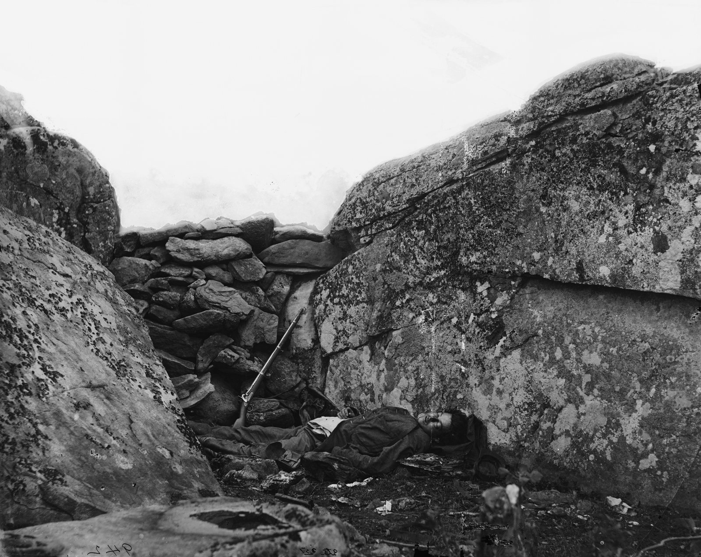

<h2 class="wp-block-heading">Alexander Gardner's Photography and its Lasting Impact in Today's Digital World</h2>

Alexander Gardner was a Scottish photographer who is best known for his work during the American Civil War. He worked as a photographer for the Union Army and is credited with capturing some of the most important images of the war. Gardner's work has had a lasting impact in the world of photography and continues to influence photographers and enthusiasts alike in today's digital age.

<figure class="wp-block-image size-large"></figure>

One of Gardner's most famous photographs is "The Home of a Rebel Sharpshooter." This photograph depicts the body of a dead Confederate soldier lying in a makeshift sniper's nest with the surrounding landscape in the background. The image is haunting and powerful, and it provides a visceral reminder of the brutality of war. It is often cited as one of the most important photographs in American history.

Gardner's work was not only important for its historical significance but also for its technical innovation. He was one of the earlier photographers to experiment with large-format cameras and the wet-plate collodion process, which allowed for greater detail and clarity in his images. His use of these techniques set the standard for photojournalism and documentary photography and paved the way for future innovations in the field.

In today's digital world, Gardner's legacy lives on. Many contemporary photographers still look to his work for inspiration and guidance, and his photographs continue to be studied and analyzed by historians and scholars. The impact of his work can be seen in the way that we approach photography today, with an emphasis on capturing the truth and the raw emotion of a moment.

Overall, Alexander Gardner's photography has had a profound and lasting impact on the world of photography. His work continues to inspire and influence photographers and enthusiasts alike, and his contributions to the field will always be remembered and appreciated.

<h3 class="wp-block-heading">Controversy Surrounding Alexander Gardner's Photography Staging and Fabrication</h3>

Gardner was not a stranger to manipulating his photographs. He would often move objects or bodies around to create a more dramatic image. In one famous photograph, he even went as far as to move a dead soldier's rifle to make it look like he was killed in action. Some argue that this was a harmless practice that helped to create a more compelling narrative of the war. Others, however, believe that this was an unethical practice that misrepresented the truth.

Another controversial aspect of Gardner's work was his use of reenactors. Gardner would often take photographs of staged scenes using actors to stand in for soldiers. These images were then presented as real depictions of the war, which some argue is misleading. It is important to note that Gardner was not the only photographer to use reenactors during the Civil War, but his images were some of the most widely distributed.

Despite the controversy surrounding Gardner's methods, there is no denying that his photographs had a significant impact on the way that people viewed the war. His images helped to shape the public's perception of the conflict and played a role in the eventual outcome of the war.

In conclusion, while Alexander Gardner's methods of staging and fabricating photographs may be controversial, it is important to consider the context in which they were created. The Civil War was a time of great upheaval and uncertainty, and Gardner's images helped to provide a sense of clarity and understanding to a nation in crisis. While we may not agree with his methods today, it is important to acknowledge the impact that his photographs had on shaping our understanding of this pivotal moment in American history.

