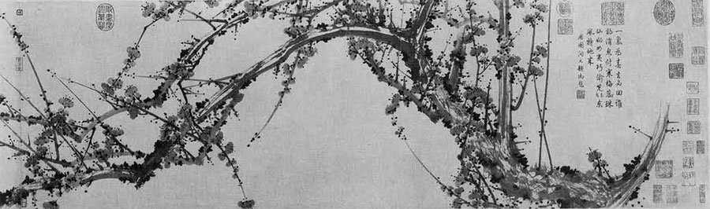
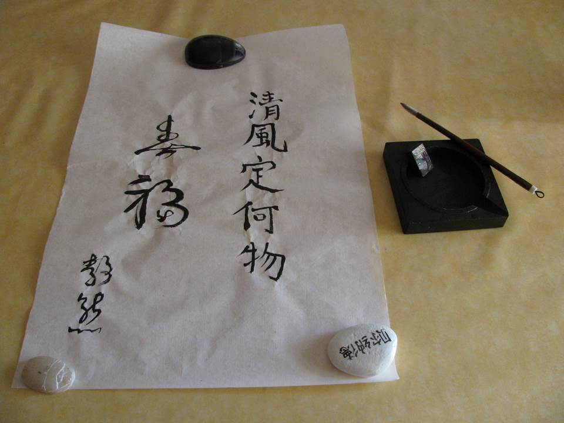
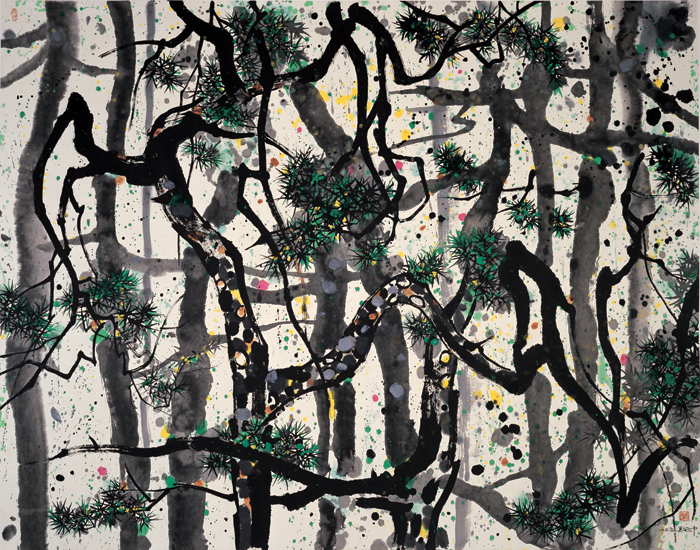
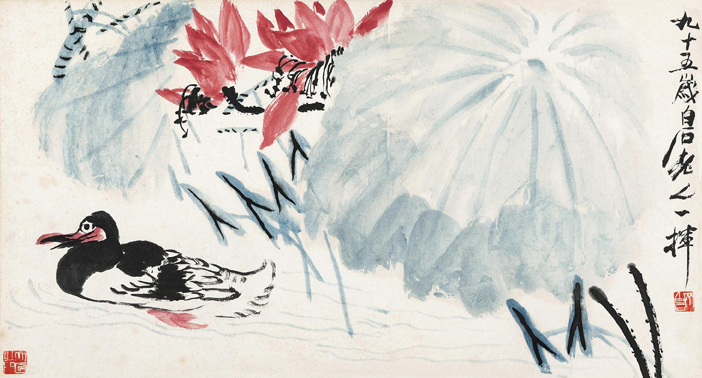
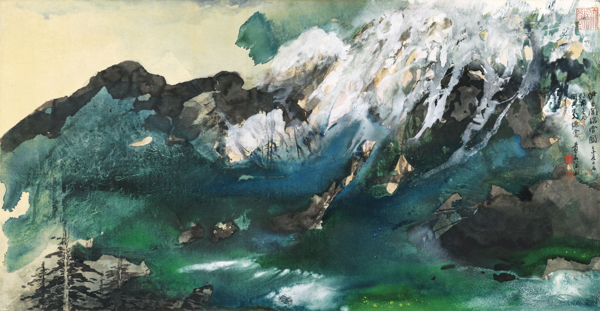
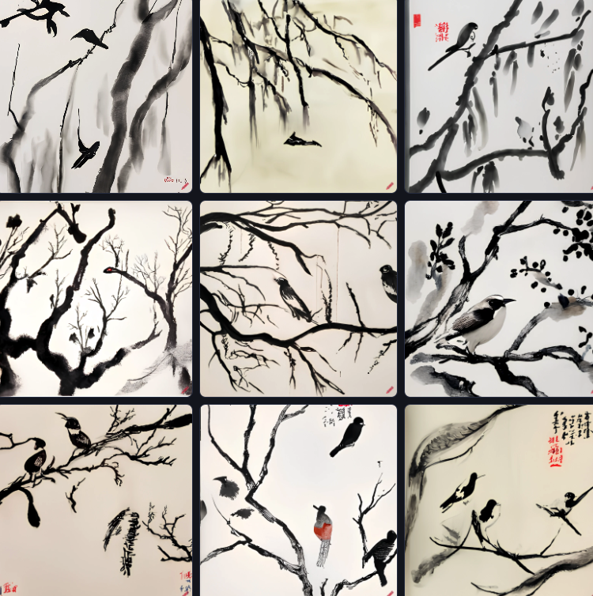

<h2 class="wp-block-heading">Chinese Ink Drawing: A Rich Tradition in Global Art</h2>

Chinese ink drawing, also known as brush painting, is a highly esteemed form of art that has been passed down for centuries. The history of ink drawing can be traced back to the Tang Dynasty (618-907 AD) and has since then been refined and perfected over generations.

<figure class="wp-block-image size-large"><figcaption class="wp-element-caption">Painting by Tsou Fu-Lei 1360</figcaption></figure>

The <strong>Four Treasures of the Study</strong> are a set of tools that are integral to the practice of Chinese ink drawing. They consist of a brush, ink stick, inkstone, and paper, and were created during the Ming Dynasty. These tools are still regarded as the epitome of the art form, and continue to be used by artists around the world who practice Chinese ink drawing.

<strong>Four Treasures of the Study</strong>

Traditional ink drawings were often created by a single artist, who would carefully execute each stroke with great precision and attention to detail. However, there have been instances where a team of artists would collaborate on a single piece, each contributing their unique skills to the final product.

Despite the passage of time, ink drawing remains a popular form of art both in China and around the world. In fact, the practice has undergone a modern revival, with contemporary artists exploring new techniques and styles while still honoring the traditions of their ancestors. From its humble beginnings to its modern-day revival, the practice continues to inspire and captivate artists and art enthusiasts alike.

Some of the most notable masters of ink drawing include <strong>Wu Guanzhong</strong>, <strong>Qi Baishi</strong>, and <strong>Zhang Daqian</strong>. Each of these artists brought their unique perspectives to the art form, creating highly individualized pieces that are still celebrated today.

<h3 class="wp-block-heading">Wu Guanzhong </h3>

<figure class="wp-block-image size-large"><figcaption class="wp-element-caption">Wu Guanzhong</figcaption></figure>

Wu Guanzhong was a renowned Chinese ink painting artist who is considered one of the most important figures in modern Chinese art history. He is known for his innovative style that blended traditional Chinese ink painting techniques with Western modernism.

Guanzhong was unique in his emphasis on expression and the emotions conveyed through his brushstrokes. He believed that ink painting should not simply be a representation of the external world, but should instead capture the inner essence of the artist's emotions and thoughts. 

In his works, Guanzhong employed a wide range of tools including traditional brushes, ink, and paper, as well as more modern tools like knives and sponges. He experimented with various textures and techniques, creating works that were highly individualized and expressive.

Guanzhong's art continues to be celebrated today, not only for its technical mastery but also for its emotional depth and innovative approach to the art form.

<h3 class="wp-block-heading">Qi Baishi</h3>

<figure class="wp-block-image size-large"></figure>

Qi Baishi is known for his unique style that blended traditional Chinese painting techniques with a more free-form approach.

Baishi's art was characterized by its whimsical and playful nature, often featuring images of animals, plants, and insects. He employed a wide range of techniques, including the use of dots, splashes, and smears to create texture and depth. What sets Baishi apart from other artists is his ability to capture the essence of his subjects through his brushstrokes.

In contrast to Wu Guanzhong, Baishi's focus was not on expressing his own emotions and thoughts, but rather on capturing the essence of the world around him. However, both artists were known for their innovative approaches to the art form and their willingness to experiment with new techniques and styles.

<h3 class="wp-block-heading">Zhang Daqian</h3>

<figure class="wp-block-image size-large"><figcaption class="wp-element-caption">Zhang Daqian - Manchurian Mountains  1969 - Splashed ink and color on paper. </figcaption></figure>

Zhang Daqian was known for his bold use of color and texture in his works. He incorporated elements of Western art, such as Impressionism and Fauvism, into his paintings, creating works that were both innovative and deeply rooted in Chinese tradition. 

Zhang was also known for creating works that were both technically impressive and emotionally resonant.

While Baishi, Guanzhong, and Daqian had different perspectives on art, they each contributed greatly to the development and appreciation of Chinese ink painting. One similarity the artists shared was their deep appreciation for the traditional techniques of ink painting. All three artists were well-versed in the classic styles of Chinese ink painting and used these techniques as a foundation for their own work. They also shared a commitment to experimentation, each developing their own unique approach to the art form. 

<h3 class="wp-block-heading">Modern Day Conversation</h3>

<strong>If Guanzhong, Baishi, and Daqian met on a Saturday morning in a modern day coffee shop. </strong>

Upon finding a seat with the seasonal coffee of the day, <strong>Zhang Daqian</strong> may want to discuss his innovative approach to incorporating Western art styles into Chinese ink painting. He may also want to discuss the importance of color and texture in his works and how they contribute to the emotional impact of his paintings.

While sipping on a double Latte <strong>Qi Baishi </strong>may want to discuss his whimsical and playful style, and how he believed that paintings should convey the spirit and essence of the subject. He may also want to discuss his use of dots, splashes, and smears to create texture and depth in his works.

Wu Guanzhong, with his Oak Milk Cappuccino may want to discuss his emphasis on emotions and thoughts in ink painting, and how his works were highly individualized and expressive. He may also want to discuss his use of modern tools like knives and sponges, and how they contribute to the unique texture and style of his paintings.

In their conversation, the artists may discuss the importance of tradition in Chinese ink painting, and how they each built upon these traditions in their own unique ways. They may also discuss the role of experimentation in their work, and how they each used new techniques and styles to create highly individualized and innovative works of art. 

The conversation would likely revolve around the artists' shared love of Chinese ink painting, and how they each contributed to the development and appreciation of the art form. They may discuss the challenges they faced as artists, as well as the joy and satisfaction they found in creating works that were both skillfully executed and deeply moving. They would have a rich and engaging conversation that would highlight the beauty and complexity of Chinese ink painting.

<figure class="wp-block-image aligncenter size-full"><figcaption class="wp-element-caption">Ink Drawings - Digitally Created by Gary Crossey</figcaption></figure>

