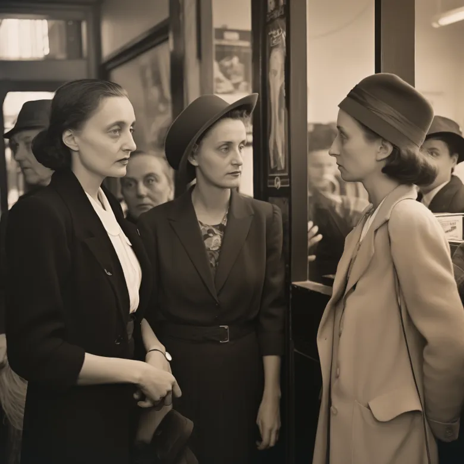
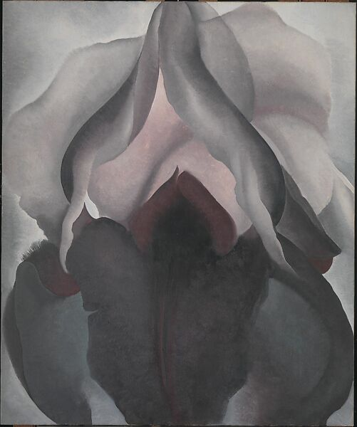
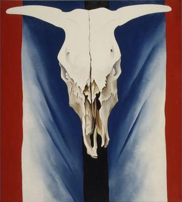
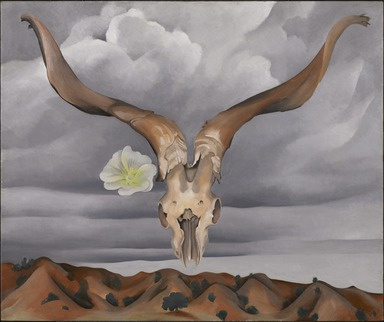
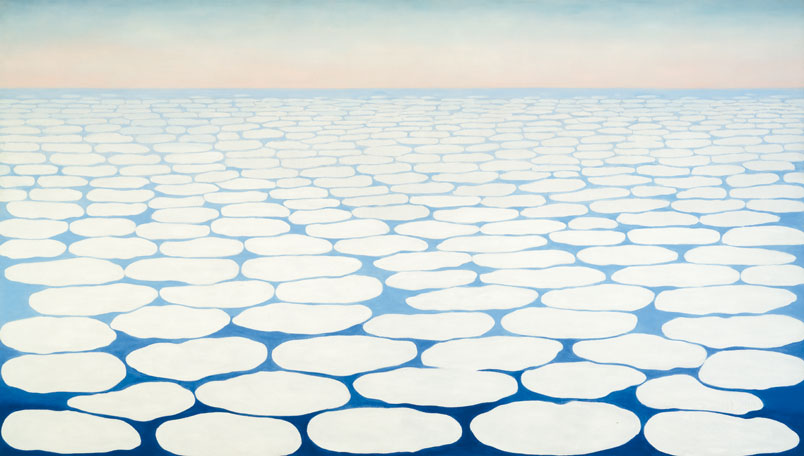
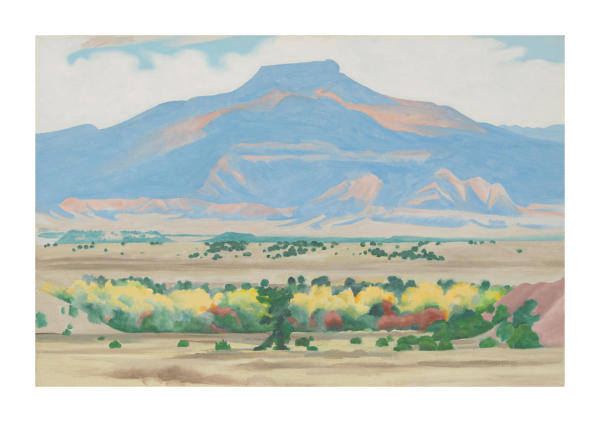

Georgia O'Keeffe was an influential American artist known for her unique style and contribution to American modernism. Born in 1887, she was a trailblazer in the art world, particularly as a female artist in a male-dominated industry. O'Keeffe's work primarily focused on capturing the essence of natural forms, such as flowers, landscapes, and bones. Her paintings often featured bold and vibrant colors, emphasizing the beauty and intricacies of the subject matter.

O'Keeffe's significance as an artist lies in her ability to challenge traditional artistic conventions and explore new ways of representation. Her artwork showcased a distinct visual language and a keen sense of abstraction. Through her innovative use of color, composition, and form, O'Keeffe was able to evoke emotions and convey her unique perspective on the world.

Her contributions to the feminist art movement are noteworthy as well. O'Keeffe's success and recognition as a female artist during a time when women faced significant barriers in the art world served as an inspiration to many. She paved the way for future generations of female artists, challenging societal norms and advocating for equal opportunities.

Today, O'Keeffe's work continues to resonate with audiences worldwide. Her legacy extends beyond her artistic achievements, as she is celebrated for her contributions to the perception and representation of nature and the Southwest. O'Keeffe's ability to capture the essence of her subjects in a bold and abstract manner has left an indelible mark on the art world and solidified her status as a cultural icon.

Georgia O'Keeffe's life and work exemplify her significance as an artist. Through her unique artistic style, pioneering spirit, and unwavering dedication to her craft, she continues to inspire and influence artists of all backgrounds, leaving an enduring impact on the artworld.

<em><strong>Latte Line</strong> - fictional story</em>

Georgia O'Keeffe stood in line at the bustling coffee shop, patiently waiting for her turn to order her favorite latte. As she glanced around, she couldn't help but notice the vibrant conversations taking place among the customers. One conversation in particular caught her attention.

A woman in front of her was animatedly discussing a recent art show she had attended. Her voice carried a mix of excitement and intrigue as she recounted the openly sexual nature of the artworks on display. Georgia's curiosity was piqued, and she leaned in closer to listen.

The woman's words painted a vivid picture of provocative and sensual art pieces that explored themes of desire, intimacy, and the human form. She spoke of how the artists fearlessly embraced their sexuality, challenging societal norms and pushing boundaries in their work.

As Georgia absorbed the woman's words, she couldn't help but be reminded of her own journey as an artist. Throughout her career, she had faced criticism and controversy for her bold and sensual depictions of flowers and landscapes. Her art had been labeled as provocative and scandalous in a society that often shied away from discussions about sexuality.

But Georgia had always believed that art should be a reflection of life, and that included exploring the complexities of human sexuality. Her paintings were not meant to be explicit, but rather an invitation to appreciate the beauty and sensuality that existed in the world.

Feeling a surge of inspiration, Georgia stepped forward as the woman finished her animated monologue. With a warm smile, she engaged her in conversation.

"I couldn't help but overhear your discussion about the art show," Georgia began. "It's truly fascinating how artists are embracing their sexuality in their work. It's a powerful way to challenge societal norms and spark conversations about our own perceptions of intimacy and desire."

The woman turned to Georgia, her eyes filled with curiosity. "Are you an artist too?" she asked.

Georgia nodded, a glimmer of excitement in her eyes. "Yes, I am. And I've learned throughout my career that art has the ability to evoke emotions, challenge preconceived notions, and celebrate the beauty of human connection. It's a form of expression that allows us to explore and appreciate our own sexuality in a safe and introspective way."

The woman listened intently, intrigued by Georgia's perspective. She had never considered art in such a profound manner before.

"Artistic expression should not be confined by societal taboos or judgments," Georgia continued. "By embracing our sexuality and exploring it through art, we create an opportunity for open dialogue and understanding. It's a celebration of our shared humanity and the diverse ways in which we experience pleasure and desire."

As the woman absorbed Georgia's words, she felt a newfound appreciation for the transformative power of art. She realized that art had the ability to challenge her own perceptions, broaden her understanding, and foster a deeper connection with her own sexuality.

The line inched forward, and it was soon Georgia's turn to order her latte. As she bid farewell to the woman, she left her with a gentle reminder.

"Art appreciation is not just about admiring the technical skill or aesthetics of a piece," Georgia said. "It's about allowing ourselves to be vulnerable, to question, and to engage with the emotions and ideas that art presents. It's a journey of self-discovery and growth, and I hope that the art show you attended continues to inspire you to explore the complexities of human sexuality."

With a final smile, Georgia collected her latte and made her way out of the coffee shop, leaving behind a newfound appreciation for the power of art and the importance of embracing our own sexuality.

The story about Georgia O'Keeffe in the coffee shop and her conversation with another woman about art and sexuality is purely fictional. It was created to provide a context for discussing the importance of exploring sexuality through art. The purpose of this story is to highlight the transformative power of art and how it can challenge societal norms and spark conversations about our perceptions of intimacy and desire. The story is not based on any real events or interactions involving Georgia O'Keeffe. It was fabricated for the purpose of understanding the subject matter in a relatable and engaging way.

<figure class="wp-block-image size-large"></figure>

<em>Black Iris</em> (1926): 

This iconic painting showcases O'Keeffe's mastery in capturing the beauty and essence of flowers. The close-up composition and bold colors emphasize the intricate details of the iris, symbolizing her unique perspective on nature.

<figure class="wp-block-image size-large"></figure>

<em>Cow's Skull: Red, White, and Blue</em> (1931): 

This piece exemplifies O'Keeffe's fascination with the American Southwest. Through the juxtaposition of a cow's skull against a vibrant background, she explores themes of life and death, while incorporating patriotic colors, reflecting her connection to American identity.

<figure class="wp-block-embed is-type-video is-provider-youtube wp-block-embed-youtube wp-embed-aspect-4-3 wp-has-aspect-ratio">

<iframe loading="lazy" title="O&#039;Keeffe, The Lawrence Tree" width="1080" height="810" src="https://www.youtube.com/embed/wQq2xOs2BYU?feature=oembed" frameborder="0" allow="accelerometer; autoplay; clipboard-write; encrypted-media; gyroscope; picture-in-picture; web-share" allowfullscreen></iframe>

</figure>

<em>The Lawrence Tree</em> (1929): 

This landscape painting demonstrates O'Keeffe's ability to infuse natural forms with a sense of spirituality. The twisted branches of the tree against the vivid sky create a captivating composition, inviting viewers to contemplate the beauty and power of nature.

<figure class="wp-block-image size-large"></figure>

<em>Ram's Head with Hollyhock</em> (1935): 

In this artwork, O'Keeffe combines the delicate beauty of a hollyhock flower with the strength and resilience symbolized by the ram's head. The contrasting elements reflect her exploration of duality and the balance between fragility and strength.

<figure class="wp-block-image size-large"></figure>

<em>Lake George Reflection</em> (1921): 

This painting captures the serene beauty of Lake George in New York. Through the use of subtle colors and reflections, O'Keeffe creates a sense of tranquility and invites viewers to contemplate the harmony between nature and its surroundings.

<figure class="wp-block-image size-large"></figure>

<em>Jimson Weed/White Flower No. 1</em> (1932): 

This large-scale painting of a white jimson weed flower showcases O'Keeffe's ability to elevate everyday objects to a monumental scale. By isolating the flower against a simple background, she draws attention to its delicate details and invites viewers to appreciate its beauty.

<figure class="wp-block-image size-large"></figure>

<em>Sky Above Clouds IV</em> (1965): 

This monumental painting depicts the expansive sky and clouds, symbolizing O'Keeffe's fascination with the infinite and the sublime. The use of vibrant colors and sweeping brushstrokes creates a sense of movement and invites viewers to contemplate the vastness of the universe.

<figure class="wp-block-image size-large"></figure>

<em>Red Canna</em> (1924): 

In this artwork, O'Keeffe captures the vibrant energy and sensual qualities of a red canna flower. Through her close-up composition and attention to detail, she elevates the ordinary to the extraordinary, inviting viewers to appreciate the beauty in everyday life.

<figure class="wp-block-image size-large"></figure>

<em>Horse's Skull with Pink Rose</em> (1931): 

This piece combines the starkness of a horse's skull with the softness and delicacy of a pink rose. O'Keeffe's exploration of contrasting elements creates a sense of tension and invites viewers to contemplate the cycle of life and the beauty found in both strength and vulnerability.

<figure class="wp-block-image size-large"></figure>

<em>Pedernal</em> (1941): 

This painting depicts the iconic Pedernal mountain in New Mexico, which held great significance for O'Keeffe. Through her use of bold colors and simplified forms, she captures the essence of the landscape and conveys a profound connection to the natural world.

<h2 class="wp-block-heading">Less Known Works</h2>

These less known works highlight the range of styles and techniques that Georgia O'Keeffe explored throughout her career, showcasing her versatility and innovation as an artist.

<figure class="wp-block-image size-large"></figure>

<em>Abstraction White Rose</em> (1927): 

This lesser-known work showcases O'Keeffe's experimentation with abstraction. Through simplified shapes and subtle use of color, she distills the essence of a white rose, highlighting her versatility as an artist.

<figure class="wp-block-image size-large"></figure>

<em>Blue I</em> (1916): 

This early work demonstrates O'Keeffe's exploration of color and form. The geometric abstraction and vibrant blue hues reveal her early experimentation with modernist principles.

<figure class="wp-block-image size-large"></figure>

<em>From the Faraway, Nearby</em> (1937): 

This painting combines O'Keeffe's interest in landscapes and abstraction. Through the interplay of colors and shapes, she creates a sense of depth and invites viewers to contemplate the vastness of the natural world.

<figure class="wp-block-image size-large"></figure>

<em>Summer Days</em> (1936): 

In this artwork, O'Keeffe captures the essence of a summer landscape through bold colors and organic forms. The vibrant composition showcases her ability to convey a sense of energy and vitality in her paintings.

<h3 class="wp-block-heading has-text-align-center has-tertiary-background-color has-background">Unique artistic style and techniques.</h3>

Georgia O'Keeffe's unique artistic style and techniques set her apart from other artists of her time. She developed a distinct visual language that was characterized by several key elements.

O'Keeffe's use of composition was revolutionary. She often depicted her subjects in close-up or cropped views, focusing on specific details and eliminating unnecessary elements. This allowed her to create bold and impactful compositions that emphasized the essence of her subjects. By isolating a flower, landscape, or object, O'Keeffe was able to draw attention to its form, lines, and textures, inviting viewers to see these familiar subjects in a new and powerful way.

Another aspect that distinguished O'Keeffe's artistic style was her keen sense of abstraction. She had a remarkable ability to simplify and distill her subjects to their core essence, often bordering on abstraction. O'Keeffe sought to capture the underlying spirit and energy of her subjects rather than merely replicating their physical appearance. This abstract quality in her work allowed viewers to engage with the subject matter on multiple levels, encouraging personal interpretation and emotional connection.

O'Keeffe's technique and brushwork were notable. She employed both precise and gestural brushstrokes, adapting her approach to suit the subject matter and desired effect. Whether it was the delicate petals of a flower or the rugged texture of a landscape, O'Keeffe's brushwork captured the tactile qualities of her subjects, adding depth and dimension to her paintings.

<h3 class="wp-block-heading has-tertiary-background-color has-background has-large-font-size">Georgia O'Keeffe's impact on the art world and subsequent generations of artists is profound. Her unique artistic style and pioneering spirit have made her an influential figure in American modernism.</h3>

Her unique compositions, O'Keeffe's use of color was striking and unconventional. She employed vibrant and bold hues, often contrasting them to create visual impact. O'Keeffe had a keen sensitivity to color relationships and used them to evoke emotions and enhance the expressive qualities of her subjects. Her color choices were not always representational but were instead used to convey a subjective experience or a deeper understanding of the natural world. This approach to color was groundbreaking and set her apart from her contemporaries.

Georgia O'Keeffe's unique artistic style and techniques, characterized by her innovative compositions, bold use of color, keen sense of abstraction, and masterful brushwork, set her apart from other artists of her time. Her ability to capture the essence of her subjects and present them in a fresh and powerful way made her a trailblazer in the art world. O'Keeffe's artistic legacy continues to inspire and influence artists today, cementing her status as one of the most important figures in American modernism.

O'Keeffe's contributions to American modernism are significant. She challenged traditional artistic conventions and pushed the boundaries of representation. Her ability to distill the essence of her subjects and present them in a fresh and powerful way paved the way for new artistic expressions.

The art world recognizes O'Keeffe's importance, and her works have become highly sought after by collectors. The cost of her artwork varies depending on factors such as the size, medium, and significance of the piece. O'Keeffe's paintings have fetched high prices at auctions, reflecting her enduring popularity and the value placed on her artistic contributions.

O'Keeffe's art has been showcased in numerous prestigious exhibitions and galleries around the world. Major museums, including the Museum of Modern Art in New York and the Tate Modern in London, have featured her works in solo exhibitions and included them in their permanent collections. These exhibitions provide an opportunity for audiences to experience O'Keeffe's art firsthand and appreciate her unique vision.

The appeal of O'Keeffe's art extends beyond the art world. Her works resonate with people from various backgrounds and fulfill different needs. Some are drawn to the beauty and vibrancy of her paintings, while others appreciate the deeper meanings and emotions they evoke. O'Keeffe's ability to capture the essence of nature and the Southwest has also made her art popular among those who seek a connection to the natural world.

Collectors play a significant role in the recognition and preservation of O'Keeffe's art. Private collectors, art institutions, and museums have acquired her works, ensuring their long-term preservation and accessibility to the public. The passion and support of collectors contribute to the continued appreciation and study of O'Keeffe's artistic legacy.

<h3 class="wp-block-heading has-tertiary-background-color has-background has-large-font-size">Georgia O'Keeffe's legacy is profound and continues to have a lasting impact on the art world. Her enduring relevance in contemporary art is a testament to her unique artistic vision and contributions.</h3>

O'Keeffe's legacy can be seen in her enduring influence on the perception and representation of nature and the Southwest. Through her bold and abstract depictions she challenged conventional notions of how nature should be portrayed.

O'Keeffe's contributions to the feminist art movement are significant. As a female artist in a male-dominated industry, she faced numerous challenges and barriers. However, her success and recognition as a trailblazing artist paved the way for future generations of female artists. O'Keeffe's ability to challenge societal norms and advocate for equal opportunities has had a lasting impact on the art world, inspiring women to pursue their artistic ambitions and assert their voices.

O'Keeffe's legacy can be observed in the continued relevance of her artwork in contemporary art. Her unique artistic style, characterized by innovative compositions, bold use of color, and keen sense of abstraction, continues to inspire and influence artists today. O'Keeffe's ability to distill the essence of her subjects and present them in a fresh and powerful way remains a source of inspiration for artists seeking to push the boundaries of representation.

