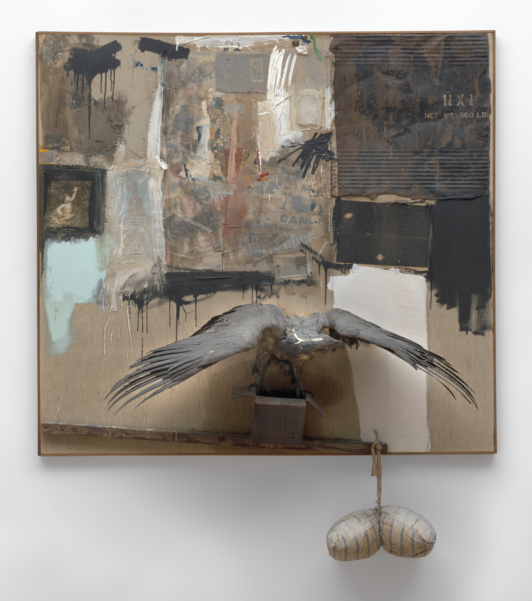
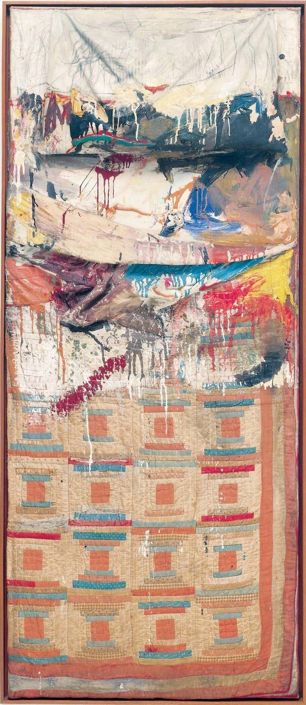
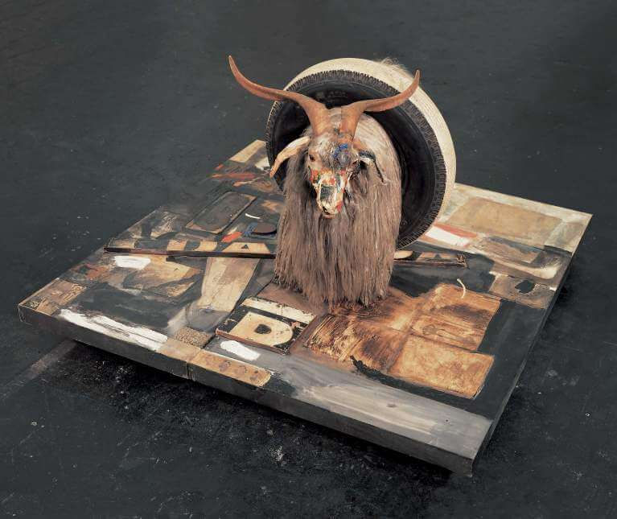
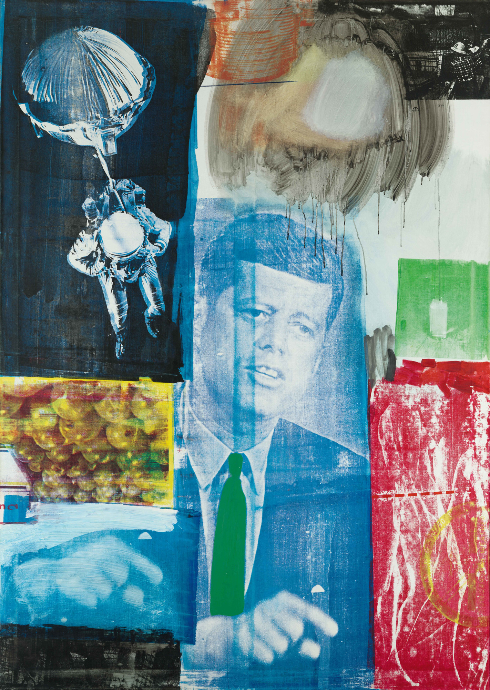

Robert Rauschenberg is a renowned American artist of the 20th century who is known for his pioneering works in contemporary art, pop art, mixed media art, and neo-dadaism. Rauschenberg is celebrated for his unique and innovative approach to creating art that combines everyday objects with traditional painting techniques. His work has influenced generations of artists around the world and continues to be an inspiration for many today.

Rauschenberg's innovative works combined painting with photography, sculpture, and other media to create powerful pieces that challenged traditional artistic conventions. Throughout his career, Rauschenberg continued to push boundaries with his signature style of combining elements from different genres into one piece.

Rauschenberg began his artistic adventure in Paris when he joined the Academie Julian to study painting and sculpture. After finishing his studies, he shifted to New York City to explore the art world more. He furthered his studies at Black Mountain College, where he was exposed to the works of modernist artists such as Willem de Kooning, Jasper Johns, and Robert Motherwell. 

While at Black Mountain College, Rauschenberg explored abstract expressionism, Neo Dadaism, and Pop Art. While he developed a unique style of combining different media such as paint, photography, fabric, and found objects into his work. Creating powerful pieces of art that challenged traditional artistic conventions. This style would become his signature throughout his career and influence generations of artists to come.

<figure class="wp-block-embed is-type-video is-provider-youtube wp-block-embed-youtube wp-embed-aspect-16-9 wp-has-aspect-ratio">

<iframe loading="lazy" title="Robert Rauschenberg - Pop Art Pioneer Full BBC Documentary 2016" width="1080" height="608" src="https://www.youtube.com/embed/yELmPbQNx9M?feature=oembed" frameborder="0" allow="accelerometer; autoplay; clipboard-write; encrypted-media; gyroscope; picture-in-picture; web-share" referrerpolicy="strict-origin-when-cross-origin" allowfullscreen></iframe>

<figcaption class="wp-element-caption">This documentary takes us through his creative journey, beginning with his education, which helped shape his artistic vision.</figcaption></figure>

<h3 class="wp-block-heading has-text-align-center"><em>Erased de Kooning Drawing</em></h3>

<strong>"Erased de Kooning Drawing"</strong>, a 1953 artwork in which he erased a drawing by Willem de Kooning. This artwork was seen as an act of rebellion against traditional painting and has been credited with helping to usher in the Pop Art movement. It also demonstrated Rauschenberg's interest in combining found objects and modern technology to create something new and unique. The Erased de Kooning Drawing remains one of Rauschenberg's iconic works, and it continues to be celebrated as an important example of contemporary art today.

<figure class="wp-block-image aligncenter size-large"><figcaption class="wp-element-caption"><em>Erased de Kooning Drawing</em> (1953)</figcaption></figure>

<h3 class="wp-block-heading has-text-align-center"><em>Canyon</em></h3>

<figure class="wp-block-image aligncenter size-large"><figcaption class="wp-element-caption"><em>Canyon</em></figcaption></figure>

<strong>"Canyon" </strong>is a combination of painting and sculpture that utilizes everyday objects in a beautiful, creative way. Not only does it represent the power of art to transform the mundane into something special, but it also serves as a reminder of Rauschenberg's genius and his legacy in contemporary art.

<h2 class="wp-block-heading has-text-align-center">Bed</h2>

<figure class="wp-block-image aligncenter size-large"><figcaption class="wp-element-caption"><em>Bed</em> (1955)</figcaption></figure>

<strong>"Bed"</strong>, is a mixed media piece combining painting, photography, and fabric that explores the boundaries between abstraction and representation. The work has become an iconic example of Rauschenberg's ability to use everyday objects to create something entirely new.

<h3 class="wp-block-heading has-text-align-center"><em>Monogram</em></h3>

<figure class="wp-block-image aligncenter size-large"><figcaption class="wp-element-caption"><em>Monogram</em></figcaption></figure>

Robert Rauschenberg work is characterized by his use of everyday items and materials to create pieces that challenge traditional art-making conventions. One of his most famous pieces, "<strong>Monogram</strong>", is an exemplary example of Rauschenberg's subversive approach to art-making. The work combines a taxidermied goat with a tire, expressing an ironic commentary on consumer culture and established artistic conventions. The artist combines the two elements in unexpected ways, creating an unexpected yet beautiful piece of art.

<h3 class="wp-block-heading has-text-align-center"><em><em>Retroactive I</em></em></h3>

<figure class="wp-block-image aligncenter size-large"><figcaption class="wp-element-caption"><em><em>Retroactive I</em></em></figcaption></figure>

"<em><em>Retroactive I</em></em>" consists of a variety of found objects and images, including newspaper clippings, photographs, and other mixed media. Through the use of these objects, Rauschenberg explores the idea of memory and identity. As a result, Retroactive I has become an iconic piece in the art world that continues to inspire viewers today.

<figure class="wp-block-embed is-type-video is-provider-youtube wp-block-embed-youtube wp-embed-aspect-4-3 wp-has-aspect-ratio">

<iframe loading="lazy" title="Robert Rauschenberg interview (1998)" width="1080" height="810" src="https://www.youtube.com/embed/tDUbPqBRPvY?feature=oembed" frameborder="0" allow="accelerometer; autoplay; clipboard-write; encrypted-media; gyroscope; picture-in-picture; web-share" referrerpolicy="strict-origin-when-cross-origin" allowfullscreen></iframe>

<figcaption class="wp-element-caption">Robert Rauschenberg interview (1998)</figcaption></figure>
