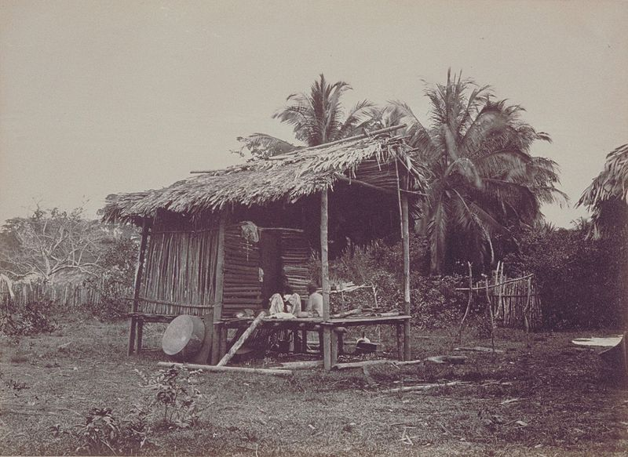

<h2 class="wp-block-heading">Timothy O’Sullivan: A Pioneer of Photography</h2>

<figure class="wp-block-image size-full"></figure>

Timothy O’Sullivan was an American photographer who is widely recognized for his significant contribution to the development of photography in the 19th century. Born in 1840, he began his career as a photographer at the young age of 20, serving as an apprentice to Mathew Brady - one of the most celebrated photographers of his time.

O’Sullivan was an expert in the wet-plate collodion process, which involved coating a glass plate with collodion and then sensitizing it with silver nitrate. This process allowed him to take high-quality photographs with excellent detail and clarity. He used this technique to capture images of the American West, which were published in various government reports and newspapers of the time.

Throughout his career, O’Sullivan worked on various photographic projects, including the Civil War, the geological surveys of the American West, and the construction of the Union Pacific Railroad. He was known for his ability to capture the beauty and grandeur of the American landscape, as well as the harsh realities of war and conflict.

O’Sullivan’s impact on photography is still felt today. He helped to establish photography as a legitimate art form and paved the way for future generations of photographers. His images of the American West inspired many artists and writers, including Ansel Adams and John Muir, and played a significant role in the preservation of America’s natural beauty.

Timothy O’Sullivan was a pioneer of photography who used his skills to capture some of the most recognized images of the 19th century. His contributions to the field of photography continue to inspire and influence photographers today.

