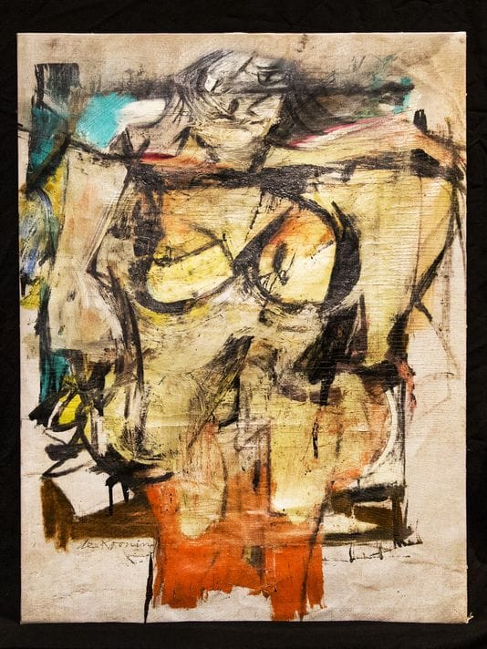
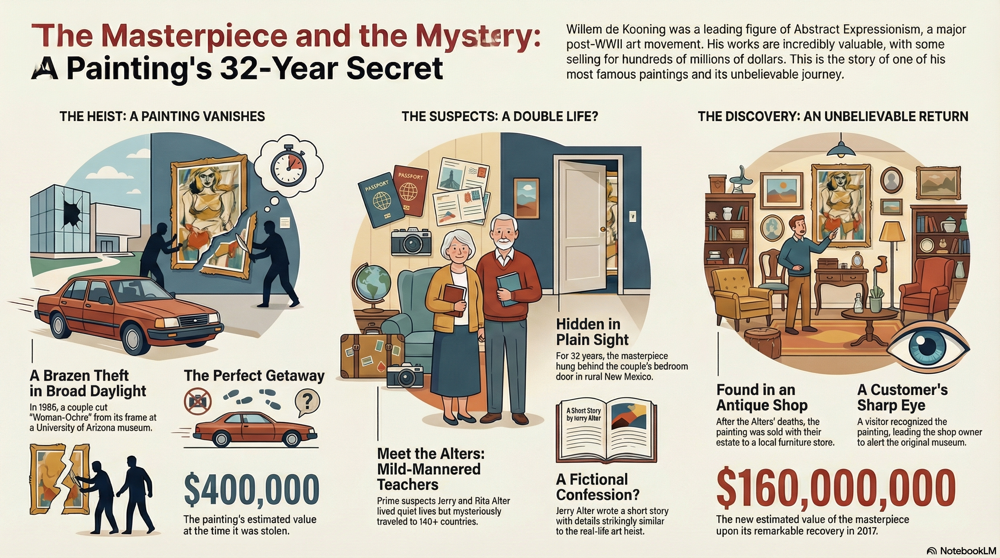

<iframe loading="lazy" width="100%" height="180" frameborder="no" scrolling="no" seamless="" src="https://share.transistor.fm/e/57cde03f"></iframe>

<h5 class="et_pb_toggle_title">Transcript</h5>
<h2><strong>Willem de Kooning: The $160 Million Art Heist and the Artist Who Broke All the Rules</strong></h2>

Hey everyone, and welcome back! Today, I will explore one of the most fascinating figures in modern art, whose story includes contradictions, crime, and a creative genius that no one can confine. I'm talking about Willem de Kooning, the Dutch-American painter who helped define Abstract Expressionism and then promptly broke all its rules.

Now, if you know anything about mid-20th century art, you've probably heard de Kooning's name thrown around alongside Jackson Pollock and Mark Rothko. He's often painted—pun intended—as this wild "action painter," someone who just attacked canvases with raw emotion and spontaneous energy. But here's the thing: that image? It's only half the story. Maybe not even half.

The real de Kooning was far more complex, more deliberate, and honestly, way more interesting than the myth suggests. He called himself a "slipping glimpser," someone who found meaning not in standing firm but in the fall, in the uncertainty. And when you look at his life and work through that lens, everything makes sense in a beautiful, chaotic way.

So buckle up—we’re about to explore five profound contradictions that defined this incredible artist, including a $160 million masterpiece that vanished for 32 years and was finally found hanging next to a toilet in a small-town New Mexico consignment shop. Trust me, you cannot make this stuff up.

<h3><strong>The Deliberate Spontaneity</strong></h3>

Let's start with what might be the biggest misconception about de Kooning: that his paintings were spontaneous explosions of emotion. When you stand in front of his famous "Woman" paintings, you can see that he absolutely created them in a fit of rage. Aggressive brushstrokes, clashing colors, and distorted, violent forms characterize the paintings. You'd think he just went at the canvas like a hurricane and called it done.

But here's the reality: de Kooning's process was painstakingly slow and deliberate. Yes, he'd have bursts of furious painting—moments where the energy just poured out of him. But then he'd stop. And he'd stare at the canvas for days. Sometimes weeks. He'd scrape paint off. Add more. Change colors. Rework entire sections. His process was as much about subtraction as addition, constantly editing, constantly questioning.

So, what's the takeaway here? The fury reads as spontaneous, but the paintings are built on slow edits, scraping, and revision—the performance of doubt made visible.

This wasn't the work of someone lost in the moment. This was the work of someone who understood that great art comes from struggle, from doubt, from that uncomfortable space between knowing and not knowing. De Kooning once said he was comfortable being a "slipping glimpser," and I think that perfectly captures his approach. He wasn't trying to nail down the perfect ultimate form. He was trying to capture the experience of almost seeing something, of meaning that shifts just as you grasp it.

And get this—he used some seriously unconventional materials to get the effect he wanted. He didn't just use standard oil paints. He wanted his paint to be really fluid, almost like ink, but still thick enough to hold its shape. So he mixed in things like Damar varnish and mineral spirits. But here's the kicker: he broke one of the cardinal rules of oil painting. He mixed oil and water.

Any art student will tell you that's a big no-no. Oil and water don't mix—literally. But de Kooning wanted what he called an "unhappy texture." He wanted the surface of his paintings to show the history of their creation, to reveal the struggle. And that's exactly what happened. His paintings developed a distinctive cracked, alligator-skin surface that's completely unique to his work. When you see de Kooning in person, you're not just seeing the last image. You're seeing every layer of doubt, every moment of destruction and reconstruction right there on the canvas.

<h3><strong>The Revolutionary Betrayal</strong></h3>

Now let's talk about the moment that shocked the art world and maybe defined de Kooning's career more than anything else. It's the early 1950s. Abstract Expressionism is at its absolute peak. Rothko is doing his color fields. Pollock is dripping and splashing, pushing toward pure non-representational art. The whole movement is about moving away from representation, from the human figure, from anything that looks like the "old" way of painting.

And what does De Kooning do? He brings the human figure back. But not gently, not subtly. He brings it roaring back with his "Woman" series, starting around 1950.

To many critics, ‌this looked like an absolute betrayal. Here was one of the leading figures of Abstract Expressionism—maybe THE leading figure after Pollock's death—turning his back on everything the movement stood for. Some people were genuinely angry. They felt he was setting art back, returning to outdated forms when everyone else was pushing forward.

But here's what makes this so brilliant: de Kooning wasn't retreating into the past. He was doing something far more radical. He was pulling from about 30,000 years of art history all at once. On one hand, he was looking at ancient fertility symbols like the Venus of Willendorf—those prehistoric female figures with exaggerated features. He was looking at 20th-century American pop culture: pin-up girls, magazine ads, cigarette advertisements.

He would ‌cut smiles out of cigarette ads and use them as starting points for his paintings. That mouth—often grotesque, distorted, almost threatening—became a central focus. These weren't beautiful women in any conventional sense. They were powerful, aggressive, sometimes violent presences that seemed to challenge the viewer. Some critics saw misogyny. Others saw a raw, honest confrontation with desire, fear, and the complexity of the feminine.

What I find so compelling about this is that de Kooning refused to be limited by what was "supposed" to happen next in art history. He wasn't interested in being revolutionary according to someone else's rules. He was going to paint what he needed to paint, even if it meant being called a traitor to his own movement. That takes serious courage.

<h3><strong>The Immigrant Success Story</strong></h3>

Before we go further, let's back up and talk about how de Kooning even got to America. Because that story itself is pretty remarkable. He was born in Rotterdam in 1904, and he didn't come to America through any official, legitimate channels. In 1926, at age 22, he stowed away on a ship bound for the United States. He ‌hid in the engine room to get here.

When he arrived, he had nothing. He worked as a house painter and a carpenter to survive. He was an illegal immigrant living in extreme poverty, trying to make art in whatever spare time he could find. This went on for years. He didn't have his first solo exhibition until 1948—when he was 44 years old. Think about that. <strong>Two decades.</strong> Working as an illegal immigrant, a house painter, constantly questioning if this whole “art thing” was even possible.

And then, almost overnight, he became one of the most celebrated artists in the world. By the 1950s, he was at the absolute peak of the art world, a genuine superstar. His paintings started selling for enormous sums. He became the face of American Abstract Expressionism, representing the creative freedom and innovation of the post-war era.

But here's the thing—success didn't make things easier for de Kooning. If anything, it complicated everything. He struggled with alcoholism for most of his life. Fame pressured him, and people expected things from him, and he felt the weight of being seen as a "master."

<h3><strong>The Public Masterpiece, The Private Treasure</strong></h3>

But the kind of fame de Kooning achieved—the kind that places his work in major museums and values it in the millions—also attracts another kind of attention: the criminal kind.

Okay, now we need to talk about what might be the most bizarre chapter in de Kooning's legacy. In 1985, one of his paintings became the center of one of the most audacious and mysterious art thefts in American history. And the way this story unfolds? You seriously could not make this up.

It happened the day after Thanksgiving, 1985, at the University of Arizona Museum of Art in Tucson. The painting is "Woman-Ochre," one of de Kooning's famous Woman series, valued at the time at around $400,000. Today? We're talking about $160 million.

So here's how it goes down. Just before the museum opens, a man and woman walk in together. The woman starts chatting up the security guard at the bottom of the stairs. Just friendly conversation, nothing suspicious. Classic distraction technique. While she's keeping the guard occupied, the man slips upstairs. He pulls out a blade—probably just a box cutter or something simple—and cuts the canvas right out of its frame. He rolls it up, and they're gone. The whole thing takes maybe 15 minutes.

They speed off in a rust-colored two-door car, and then... nothing. Complete silence. For 32 years, this painting just vanished. The trail goes completely cold. Everyone assumes that someone destroyed it or it sits in some private collector's vault somewhere, never to be seen again. Art theft experts, FBI agents, museum curators—nobody can find a single lead.

Key detail: a clean, fast grab with a simple blade—and then a decades-long void that only deepened the myth.

And then, in 2017, the painting resurfaces in the most unexpected way possible.

It's found in Cliff, New Mexico, a tiny town with a population of less than 300 people. The painting is in the home of Jerry and Rita Alter, a couple of retired teachers. Jerry taught music. Rita was a speech therapist. These were not high-flying art collectors. These were unassuming people who lived modestly and kept to themselves.

Unlikely provenance: a tiny town, retired teachers, and no collecting profile—exactly the kind of setting that kept a world-class painting out of sight.

Here's where it gets even stranger. After Rita passed away, their nephew hired an estate liquidator to handle all their belongings. The painting—this $160 million masterpiece—gets sold along with all their furniture to a local consignment shop called Manzanita Ridge. And the owners of this shop? They do not know what they've got. They think it's maybe a cheap print, a knockoff decoration piece.

But then a customer comes in, recognizes the style, and mentions it might be something significant. So, the shop owners do some research. And here's my absolute favorite part of this entire story: while they're trying to figure out what this painting is, other customers are in the shop touching it, trying to scratch it to see if it's a print or an original. The owners get worried that this old, weird painting might get damaged.

A sharp-eyed customer sparks the chain that brings it home.

So what do they do? They move it to the only room in the shop with a lock. The bathroom. That's right—a $160 million Willem de Kooning masterpiece ends up hanging in a bathroom, right next to the toilet, for safekeeping.

Here's why that matters: public value collides with private banality—an artwork built for audiences ends up hidden in plain life.

Eventually, someone Googles "de Kooning" and up pops an article from 2015 about the unsolved theft. They get the museum curator on the phone, and she asks if there are any horizontal lines or cracks on the canvas. There are—from being rolled up all those years ago. Also, because the painting was cut from the frame, it is about an inch smaller than the original dimensions. The damage from the crime itself became proof of authenticity.

Proof in the scars: the roll lines and trimmed edges told the story the thieves never meant to write.

It was Woman-Ochre. They'd found it.

<h3><strong>The Perfect Crime?</strong></h3>

So now the big question becomes: Who were Jerry and Rita Alter, really? Because the contrast between their public life and this hidden secret is absolutely staggering. They lived this quiet, small-town existence. They were known to be very frugal, careful with money. And yet Jerry retired at 48. On a teacher's salary. How does that work?

They also traveled extensively—all seven continents, with 13,000 slides documenting their trips. Their records also confirm they were in the United States when the painting was stolen, fitting the timeline. But it's all circumstantial, right? There's no confession, no direct evidence.

Let's pause on that for a moment: publicly, the Alters looked frugal and ordinary; privately, they curated a hidden gallery with careful precautions—intent, not accident.

Except... Well, there kind of is. And this is where things get genuinely eerie.

After Jerry and Rita died, investigators discovered that the painting had been hung very deliberately behind their master bedroom door. But here's the detail that got everyone's attention: they had screwed a thick screw into the baseboard, precisely positioned where the door would hit the wall. This screw stopped the doorknob from opening all the way, preventing it from hitting and damaging the canvas.

This wasn't accidental. This was premeditation. This was a painting hung specifically for them, and only them, to see in secret. Every morning, every night, they could close that door and look at their stolen treasure. Nobody else knew. It was their private museum, their secret possession.

And then there's the final, chilling piece of the puzzle. In 2011, Jerry Alter self-published a book of short stories. One of those stories is about a couple who steal a giant jewel from a museum. The woman distracts the guard. The man steals the jewel. They hide it behind a panel in their home, where they can take it out for their own private viewing pleasure.

It's almost beat-for-beat what happened. Was he confessing? Was he bragging? Or was this the only way he could share this massive secret he'd been carrying for decades—by hiding it in plain sight as fiction?

What makes this story so haunting is that the theft was clearly never about the money. If they'd wanted to sell it, they could have done so through underground channels. They could have been rich. Instead, they chose the secret.

They chose the private experience of possessing this masterpiece over any wealth it could have brought them.

They devoted their lives to guarding this secret, and then Jerry left this fictional confession for everyone to find after they were gone.

It raises this profound question: What does it really mean to possess a masterpiece if no one but you ever gets to see it? Is that still art, or does it become something else entirely? The consignment shop owners, by the way, refused the reward for finding the painting—a massive reward. They just said they were humbled to be part of returning it. A really beautiful moment in a story that's otherwise all about greed and secrecy.

<h3><strong>The Mind's Decay, The Hand's Memory</strong></h3>

There's one more controversy we need to talk about, and it's maybe the most philosophically complex. In the late 1980s, de Kooning was diagnosed with Alzheimer's disease. But he kept painting until 1991. Those final paintings sparked—and continue to spark—a huge debate in the art world.

These late works differ completely from everything that came before. They're light, spare, and very linear. All the thick, encrusted, gestural texture is gone. The violence and energy of the Woman series is replaced by something much quieter, more ethereal. Some people see this as a new phase of his genius, a master stripping away everything unnecessary to reach some pure essence. Others see them as simply the product of a failing mind.

There's a concept in psychology called "over-learning." It suggests that muscle memory—the physical act of doing something over and over—can continue even when higher cognitive function is compromised. In other words, de Kooning's hand might have remembered how to paint even when his mind couldn't fully direct it. His hand was acting on its own, following patterns laid down over decades.

So here's the question: If art requires intellect and intent, what does it mean when the intellect is gone but the hand continues? Are these paintings still art? Are they still de Kooning? The market, for what it's worth, has valued them highly, which only complicates things. If they're worth millions, they must be art, right? But is that really the right way to think about it?

I don't have an answer to this. I don't think anyone really does. But I think the question itself is important because it forces us to think about what we value in art. Is that the intention? Technical skill? The emotional impact? The signature? If de Kooning's hand could still create beautiful, compelling images even as his mind deteriorated, does that diminish the work or reveal something profound about creativity itself?

<h3><strong>The Legacy</strong></h3>

So what do we make of all this? Willem de Kooning was a man of profound contradictions. He was an immigrant who became the face of American art. As an action painter, he worked with painstaking deliberation. He was a leader of Abstract Expressionism who betrayed the movement by bringing back the figure. He struggled with addiction and doubt while being celebrated as a genius. And in his final years, his body continued to paint even as his mind slipped away.

His story reminds us that the truth behind great art is almost always messier and more complicated than the myths we build around it. De Kooning wasn't a force of nature attacking canvases in fits of spontaneous genius. He was a man who understood that meaning lives in uncertainty, in the space between knowing and not knowing. He was comfortable being a "slipping glimpser"—finding truth not in standing firm but in the fall.

And then there's the painting that was stolen, hidden for 32 years, and found in a bathroom in New Mexico. That story—as strange and compelling as it is—raises its own profound questions about possession, secrecy, and what it means to truly see and own a work of art. Jerry and Rita Alter chose the secret over the wealth. They chose a private experience. And in doing so, they created their own kind of art—a performance that continued for decades, with an audience of two.

De Kooning died in 1997 at 92. His paintings hang in major museums around the world, including the one that was stolen and found. They're studied, analyzed, debated. They sell for hundreds of millions of dollars. But beyond all that, they remain powerful testaments to the value of doubt, the importance of contradiction, and the beauty of never quite settling on a definitive answer.

Because in the end, maybe that's what makes his work so enduring. The answers it gives are not straightforward. It doesn't let us rest comfortably in what we think we know. It asks us to be slipping glimpses too—to find meaning not in certainty, but in that uncomfortable, thrilling space where everything is still possible.

Thanks so much for joining me today.

If you enjoyed this deep dive, please do three things:

<strong>One,</strong> subscribe to the Better World with Design podcast.

<strong>Two,</strong> share this episode with anyone who loves art, mystery, or just a great story.

<strong>Three,</strong> visit the website for additional show materials and resources.

Until next time, keep questioning, keep looking, and keep slipping.

<!-- notionvc: b73d0709-74e8-4a2b-b729-93dfea362f3a -->

<h5 class="et_pb_toggle_title">Close </h5>

<iframe loading="lazy" title="YouTube video" width="1080" height="608" src="https://www.youtube.com/embed/Y1tj9tfRc9M?feature=oembed" allow="accelerometer; autoplay; clipboard-write; encrypted-media; gyroscope; picture-in-picture; web-share" referrerpolicy="strict-origin-when-cross-origin" allowfullscreen></iframe>

