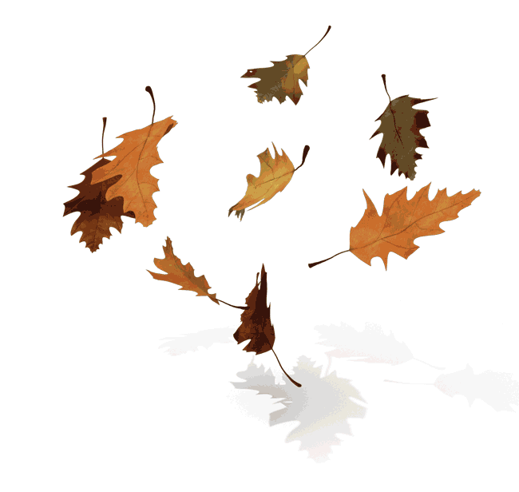
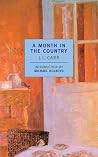

<figure class="wp-block-image size-full"></figure>

<a href="https://www.goodreads.com/book/show/60707.A_Month_in_the_Country">A Month in the Country</a> by <a href="https://www.goodreads.com/author/show/34170.J_L_Carr">J.L. Carr</a> 
 
A Month in the Country is a novella by J. L. Carr that tells the story of a young man named Tom Birkin who is recovering from shell shock he experienced during World War I. Birkin is hired to uncover a mural in a village church in Yorkshire, England. While there, he develops a relationship with a fellow veteran named Moon and becomes romantically involved with a local woman named Alice Keach. The story explores themes of love, healing, and the passage of time.  Moon becomes a close friend and confidant to Birkin, and their relationship is an important source of comfort for both men.  The art restoration plays an important role in Birkin's mental health as it provides him with a sense of purpose and a distraction from his traumatic memories of the war. Through his work on the mural, Birkin is able to find a sense of peace and healing. Additionally, the beauty of the mural and the history it represents serve as a reminder of the enduring nature of art and culture, providing Birkin with a sense of hope for the future.  Furthermore, Birkin's relationship with Moon also contributes to his mental well-being. As fellow veterans, they bond over their shared experiences as World War I veterans and support each other as they work through their emotional trauma. They are able to understand and support each other through their emotional struggles. Their friendship provides Birkin with a much-needed sense of companionship and belonging. Although their relationship is not sexual, it is an important source of comfort and understanding for both men.  In addition, Birkin's growing romance with Alice Keach also plays a role in his healing process. Alice is a kind and compassionate woman who helps Birkin to feel comfortable and accepted in the village. Through his relationship with her, Birkin is able to let go of some of his emotional baggage and begin to live in the present moment.  If Birkin had stayed in Yorkshire with Moon, it is likely that their friendship would have continued to grow and provide comfort and support to both men. Birkin would have continued to work on the mural and might have found other ways to contribute to the village community. It is also possible that his relationship with Alice Keach might have developed further. However, the novella does not provide a definite answer to this question, and it is left up to the reader's interpretation.  A Month in the Country is a powerful exploration of the ways in which love, healing, and the passage of time can help individuals to overcome emotional trauma and find a sense of peace and purpose in their lives.
  
<a href="https://www.goodreads.com/review/list/54140412-gary-crossey">View all my Goodreads Reviews</a>

