<figure class="wp-block-image size-full">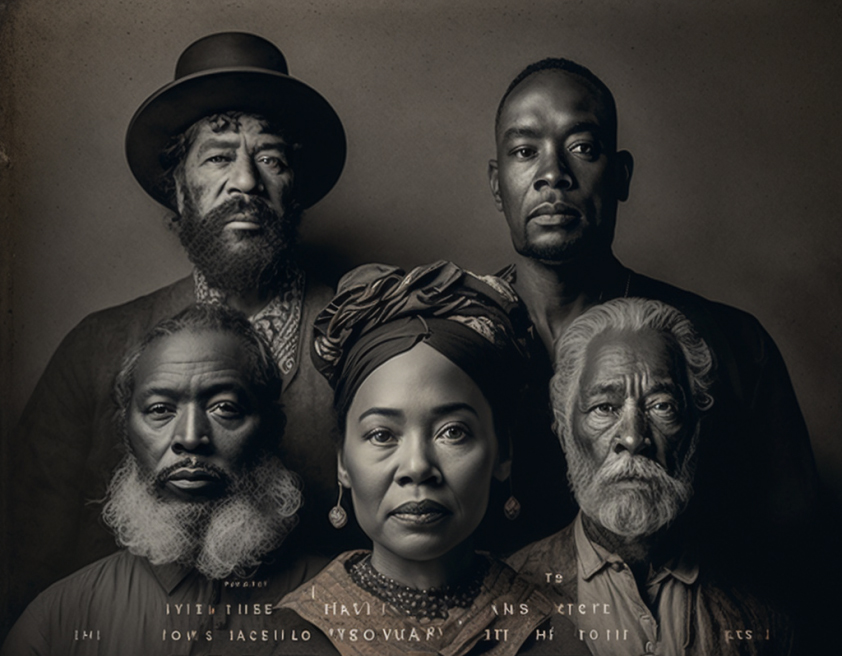</figure>

For this blog post, I will be reviewing "A People's History of the United States". This book provides a unique perspective on American history and highlights the often-overlooked voices and experiences of marginalized groups.

In my review, I will be focusing on two significant events from each chapter of the book. These events are important because they illustrate the ways in which people have resisted exploitation and oppression throughout history. These events underscore the importance of recognizing the struggles of marginalized groups and the need for greater social and economic justice. I will also be provide a brief compare and contrast between the two events and their impact on society. It is important to note that my review is not conclusive and only scratches the surface of the information presented in this dense and informative book.

Thank you for joining me on this journey as we explore the diverse and complex history of the United States through the lens of "A People's History".

<figure class="wp-block-image size-large">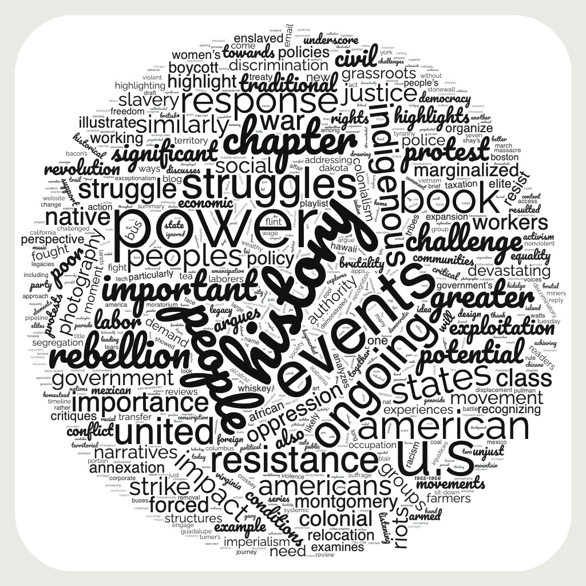<figcaption class="wp-element-caption">Word Cloud Infographic on the words used in this article.</figcaption></figure>

<h3 class="wp-block-heading">Chapter 1: Columbus, the Indians, and Human Progress</h3>

<ol class="has-tertiary-background-color has-background wp-block-list">
<li>Discusses Columbus's arrival in the Americas and his treatment of the indigenous peoples.</li>

<li>Challenges the traditional narrative of Columbus as a heroic figure.</li>
</ol>

<figure class="wp-block-image size-full">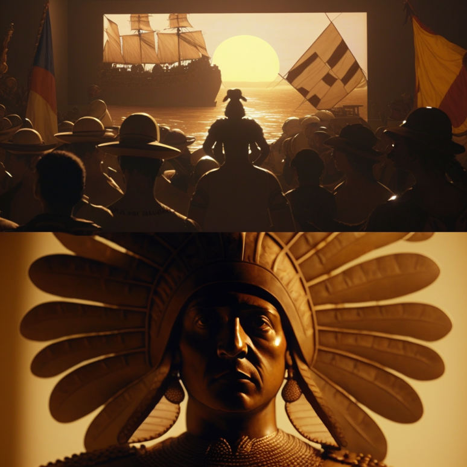</figure>

<ul class="wp-block-list">
<li>Native American tribes unite to protest the <strong>Dakota Access Pipeline</strong> in Standing Rock, North Dakota (2016)</li>

<li>The United States Congress passes the <strong>Indian Removal Act</strong>, leading to the forced relocation of Native American tribes (1830)</li>
</ul>

The importance of these events lies in their connection to the theme of the chapter, which is the legacy of colonialism and its impact on indigenous peoples. The protests against the <strong>Dakota Access Pipeline</strong> were a continuation of a long history of resistance against the exploitation of indigenous lands and resources. Similarly, the<strong> Indian Removal Act </strong>was a devastating example of the U.S. government's policy of forced relocation and genocide against Native American peoples. Both events illustrate the ongoing struggles of indigenous peoples against the legacies of colonialism and the importance of recognizing and addressing these historical injustices.

<h3 class="wp-block-heading">Chapter 2: Drawing the Color Line</h3>

<ul class="has-tertiary-background-color has-background wp-block-list">
<li>Examines the development of race-based slavery in the United States.</li>

<li>Argues that racism was created and perpetuated by those in power to maintain their own privilege.</li>
</ul>

<figure class="wp-block-image size-full">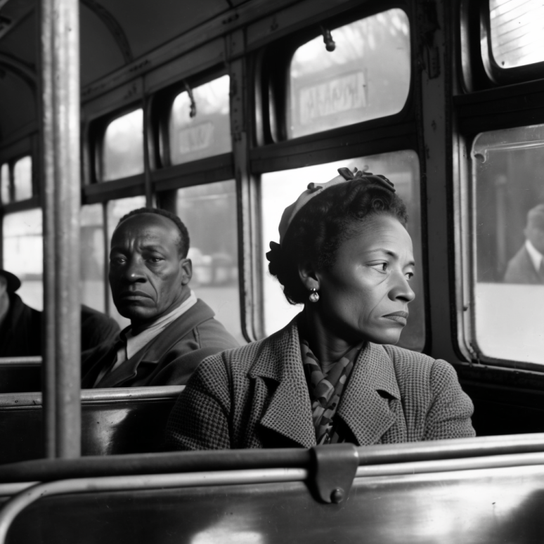</figure>

<ul class="wp-block-list">
<li><strong>The Montgomery Bus Boycott</strong>, a protest against segregation on public buses in Montgomery, Alabama (1955-1956)</li>

<li><strong>The Watts riots</strong>, a series of riots and protests against police brutality and racism in Los Angeles, California (1965)</li>
</ul>

These events are important because they illustrate the ongoing struggle against racial oppression in the United States, particularly with regard to the experiences of African Americans. The <strong>Montgomery Bus Boycott</strong> was a significant moment in the Civil Rights Movement and demonstrated the power of nonviolent resistance against segregation. The <strong>Watts riots</strong>, on the other hand, were a response to police brutality and economic inequality, highlighting the deep-seated anger and frustration among African Americans in urban areas. Both events underscore the importance of recognizing and addressing systemic racism and the ongoing struggle for racial justice in the United States.

<h3 class="wp-block-heading">Chapter 3: Persons of Mean and Vile Condition</h3>

<ul class="has-tertiary-background-color has-background wp-block-list">
<li>Explores the lives of the working class and poor in colonial America</li>

<li>Highlights their struggles and resistance against exploitation</li>
</ul>

<figure class="wp-block-image size-full">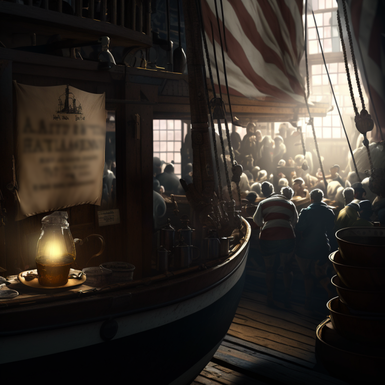</figure>

<ul class="wp-block-list">
<li><strong>Bacon's Rebellion</strong>, an armed rebellion against the colonial government of Virginia led by Nathaniel Bacon (1676)</li>

<li><strong>The Boston Tea Party</strong>, a protest against British taxation and colonial rule (1773)</li>
</ul>

<strong>Bacon's Rebellion</strong> is significant because it was one of the first rebellions against colonial authority and was fueled by the grievances of poor farmers and laborers who were being exploited by the wealthy elites. The rebellion was a response to Governor William Berkeley's refusal to protect small farmers from attacks by indigenous peoples and his support of the wealthy planter class. The rebellion signaled the potential for class conflict and resistance to colonial authority.

The <strong>Boston Tea Party</strong>, on the other hand, was a protest against British taxation and colonial rule. The event was significant because it was one of the key events leading up to the American Revolution and illustrated the power of direct action and civil disobedience in the face of unjust authority. The Boston Tea Party was also an example of how people could come together to challenge the power of the elite.

<h3 class="wp-block-heading">Chapter 4: Tyranny is Tyranny</h3>

<ul class="has-tertiary-background-color has-background wp-block-list">
<li>Analyzes the American Revolution from the perspective of the common people</li>

<li>Argues that the revolution was not a democratic movement, but rather a transfer of power from one elite group to another</li>
</ul>

<figure class="wp-block-image size-full">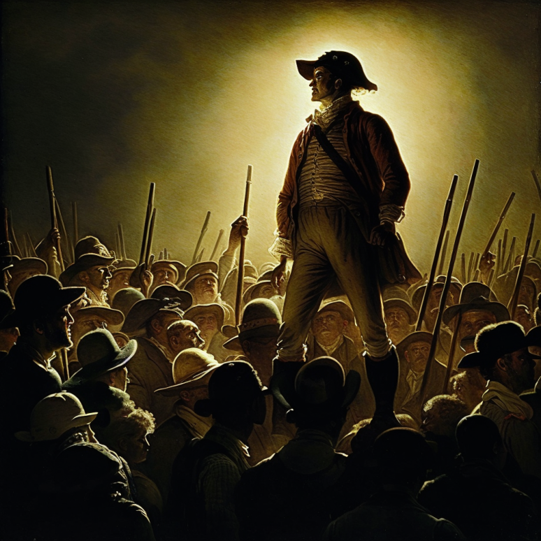</figure>

<ul class="wp-block-list">
<li><strong>Shay's Rebellion</strong>, an armed uprising of farmers and laborers in Massachusetts against the state government (1786-1787)</li>

<li><strong>The Whiskey Rebellion</strong>, a protest against a tax on whiskey imposed by the U.S. federal government (1791-1794)</li>
</ul>

These events are important because they highlight the ways in which regular people have challenged the power of the elite and fought for greater democracy. <strong>Shay's Rebellion</strong> was a response to economic hardship and political corruption, and indicated the potential for class conflict and resistance to colonial authority. The <strong>Whiskey Rebellion</strong> similarly showed the power of people to organize and resist unjust taxation.

The events also challenge traditional narratives of the American Revolution as a democratic movement, and argue that the revolution was not a transfer of power to the people, but rather a transfer of power from one elite group to another.

<h3 class="wp-block-heading">Chapter 5: A Kind of Revolution</h3>

<ul class="has-tertiary-background-color has-background wp-block-list">
<li>Examines the struggles of farmers and laborers in post-revolutionary America</li>

<li>Highlights the emergence of grassroots movements and the fight for greater democracy</li>
</ul>

<figure class="wp-block-image size-full">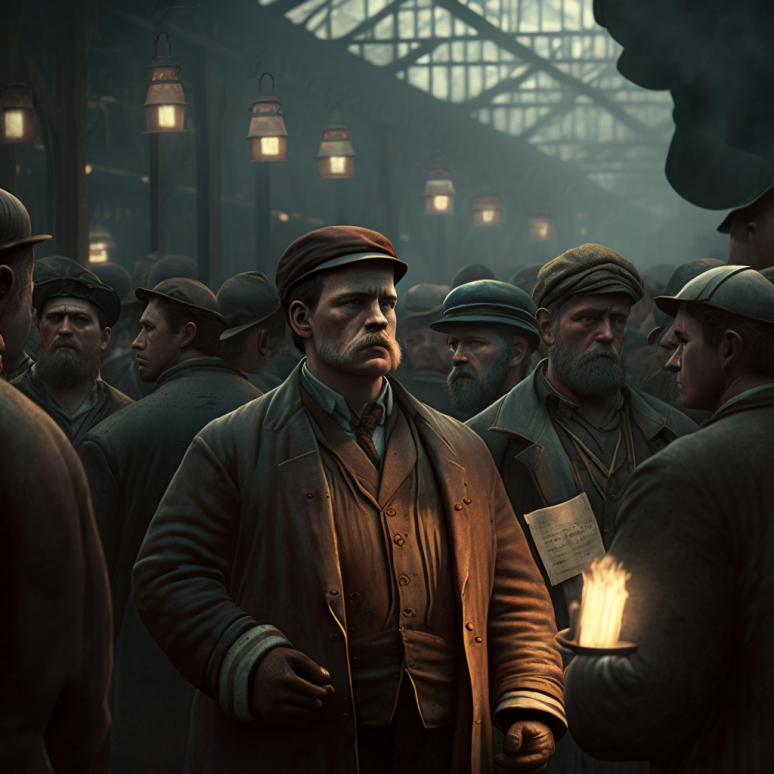</figure>

<ul class="wp-block-list">
<li><strong>The Homestead Strike</strong>, a labor dispute at a steel mill in Pittsburgh, Pennsylvania (1892)</li>

<li><strong>The Pullman Strike</strong>, a nationwide railroad strike in response to wage cuts and poor working conditions (1894)</li>
</ul>

These events are significant because they demonstrate the power of labor movements and the potential for people to organize and resist exploitation. The <strong>Homestead Strike</strong> was a response to wage cuts and poor working conditions, and revealed the potential for class conflict and resistance to corporate power. The <strong>Pullman Strike</strong> similarly disclosed the power of workers to organize and resist unjust policies.

They also highlight the potential for people to come together and challenge power structures in pursuit of greater democracy.

<h3 class="wp-block-heading">Chapter 6: The Intimately Oppressed</h3>

<ul class="has-tertiary-background-color has-background wp-block-list">
<li>Focuses on the experiences of women in American history</li>

<li>Discusses their struggles for equality and against sexism</li>
</ul>

<figure class="wp-block-image size-full">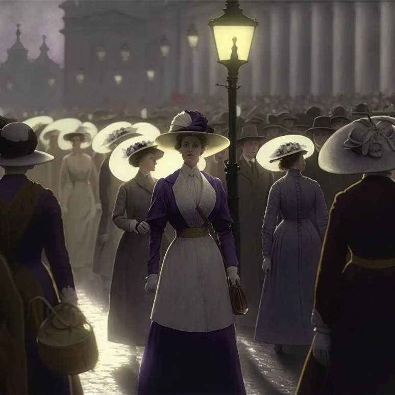</figure>

<ul class="wp-block-list">
<li><strong>Women's Suffrage Parade</strong>, a march in Washington D.C. to demand women's right to vote (1913)</li>

<li><strong>The Stonewall riots</strong>, a series of protests by members of the LGBTQ+ community against police harassment and discrimination (1969)</li>
</ul>

The <strong>Women's Suffrage Parade</strong> was a significant moment in the history of the women's rights movement voiced the power of grassroots activism in achieving social change. The <strong>Stonewall riots</strong> similarly publiced the power of people to challenge discriminatory policies and demand greater equality.

These events are important because they highlight the ongoing struggle against oppression and discrimination based on gender and sexual orientation. 

<h3 class="wp-block-heading">Chapter 7: As Long as Grass Grows or Water Runs</h3>

<ul class="has-tertiary-background-color has-background wp-block-list">
<li>Explores the history of Native American peoples and their struggles against white expansion and domination</li>

<li>Highlights the ongoing impact of colonization on indigenous communities</li>
</ul>

<figure class="wp-block-image size-full">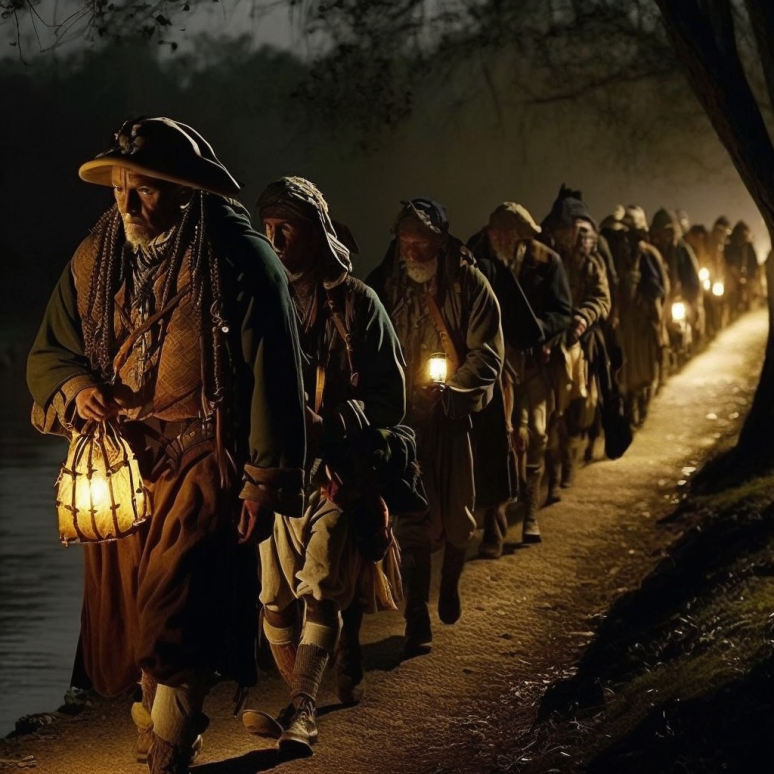</figure>

<ul class="wp-block-list">
<li><strong>The Trail of Tears</strong>, the forced relocation of Cherokee, Muscogee, Seminole, Chickasaw, and Choctaw tribes from their ancestral lands (1830s)</li>

<li><strong>The occupation of Alcatraz Island </strong>by Native American activists to protest government policies towards Native Americans (1969-1971)</li>
</ul>

These events are important because they illustrate the ongoing struggles of indigenous peoples against the legacies of colonialism and the importance of recognizing and addressing these historical injustices. The <strong>Trail of Tears</strong> was a devastating example of the U.S. government's policy of forced relocation and genocide against Native American peoples. The <strong>occupation of Alcatraz Island</strong> was a response to years of discriminatory policies towards Native Americans, including forced relocation, land theft, and cultural erasure. The occupation proves the power of grassroots activism and the importance of resistance against oppression and injustice.

These events underscore the ongoing struggle for indigenous rights and the need for greater recognition and support for indigenous communities. They also challenge traditional narratives of U.S. history that have ignored or downplayed the experiences and struggles of marginalized groups.

<h3 class="wp-block-heading">Chapter 8: We Take Nothing by Conquest, Thank God</h3>

<ul class="has-tertiary-background-color has-background wp-block-list">
<li>Analyzes the U.S. war with Mexico and its impact on both Mexicans and Americans</li>

<li>Critiques the idea of "Manifest Destiny" and argues for the importance of understanding imperialism</li>
</ul>

<figure class="wp-block-image size-full">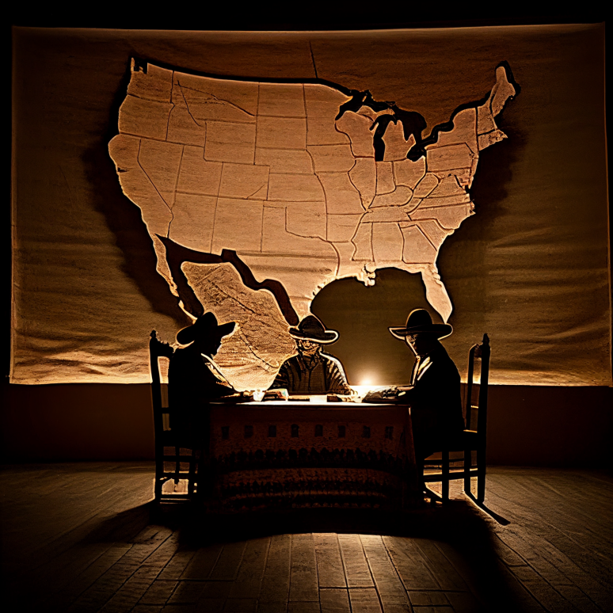</figure>

<ul class="wp-block-list">
<li><strong>The Treaty of Guadalupe Hidalgo</strong>, which ended the Mexican-American War and ceded a large portion of Mexican territory to the United States (1848)</li>

<li><strong>The Chicano Moratorium</strong>, a series of protests against the Vietnam War and police brutality towards Mexican Americans (1970)</li>
</ul>

These events are important because they highlight the ongoing legacy of colonialism and imperialism in the United States. The<strong> Treaty of Guadalupe Hidalgo</strong> was a devastating example of the U.S. government's policy of territorial expansion and the forced displacement of indigenous peoples. The treaty resulted in the annexation of a large portion of Mexican territory, including present-day California, Arizona, New Mexico, and Texas. The <strong>Chicano Moratorium</strong> was a response to ongoing discrimination and police brutality towards Mexican Americans and was part of a larger movement for civil rights and social justice.

These events underscore the ongoing struggle for particularly Latinx communities in the United States. They also challenge traditional narratives of non-white communities.

<h3 class="wp-block-heading">Chapter 9: Slavery Without Submission, Emancipation Without Freedom</h3>

<ul class="has-tertiary-background-color has-background wp-block-list">
<li>Examines the history of slavery in the United States and the struggle of enslaved people for freedom</li>

<li>Argues that even after emancipation, African Americans continued to face oppression and discrimination</li>
</ul>

<figure class="wp-block-image size-full">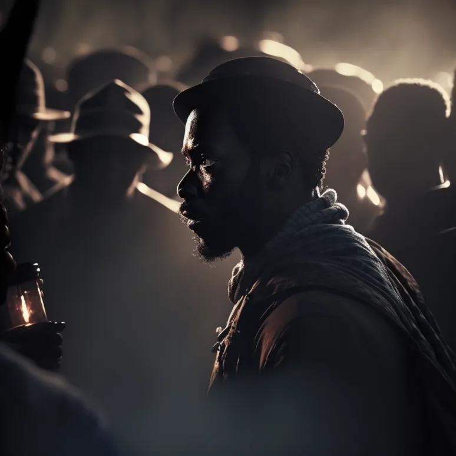</figure>

<ul class="wp-block-list">
<li><strong>Nat Turner's Rebellion</strong>, an armed rebellion of enslaved people in Virginia (1831)</li>

<li><strong>The Montgomery Bus Boycott</strong>, a protest against segregation on public buses in Montgomery, Alabama (1955-1956)</li>
</ul>

<strong>Nat Turner's Rebellion</strong> was a significant moment in the history of the struggle against slavery, as it indicates the potential for enslaved people to resist their oppressors and fight for their freedom. The rebellion was a response to the brutal conditions of slavery and the violence perpetrated against enslaved people. The <strong>Montgomery Bus Boycott</strong> was similarly a response to the ongoing discrimination and violence against African Americans, and validates the power of nonviolent resistance in achieving social change. The boycott was a significant moment in the Civil Rights Movement and showed how people could come together to challenge unjust policies and demand greater equality.

These events challenge traditional narratives of U.S. history that have ignored  the struggles of disenfranchised groups, and the need for greater recognition and support for those who have been historically marginalized.

<h3 class="wp-block-heading">Chapter 10: The Other Civil War</h3>

<ul class="has-tertiary-background-color has-background wp-block-list">
<li>Discusses the class struggles and resistance of poor whites during the Civil War</li>

<li>Critiques the idea that the war was fought solely to end slavery</li>
</ul>

<figure class="wp-block-image size-full">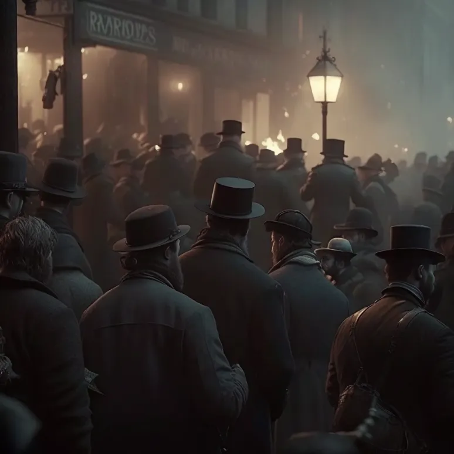</figure>

<ul class="wp-block-list">
<li><strong>The New York City draft riots</strong>, a violent protest against conscription during the Civil War (1863)</li>

<li><strong>The Battle of Blair Mountain</strong>, an armed labor conflict in West Virginia between coal miners and the state government (1921)</li>
</ul>

These events are important because they highlight the ways in which people have challenged power structures and fought for greater democracy and equality. The <strong>New York City draft riots </strong>were a response to the conscription of poor and working-class men to fight in the Civil War and authenticated the potential for class conflict and resistance to government authority. The <strong>Battle of Blair Mountain</strong> similarly connecting the power of workers to organize and resist exploitation, as coal miners fought against the state government and private corporations for better wages and working conditions.

<h3 class="wp-block-heading">Chapter 11: Robber Barons and Rebels</h3>

<ul class="has-tertiary-background-color has-background wp-block-list">
<li>Examines the rise of industrial capitalism and the exploitation of workers</li>

<li>Highlights the resistance of workers and the importance of labor movements</li>
</ul>

<figure class="wp-block-image size-full">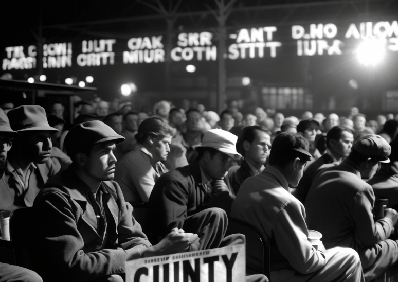</figure>

<ul class="wp-block-list">
<li><strong>The Haymarket affair</strong>, a labor protest in Chicago that turned violent and resulted in the execution of several labor organizers (1886)</li>

<li><strong>The Flint sit-down strike</strong>, a labor strike at a General Motors plant in Flint, Michigan (1936-1937)</li>
</ul>

These events are important because they highlight the power of grassroots movements. The <strong>Haymarket affair</strong> was a response to the brutal conditions faced by workers in the late 19th century and demonstrated the potential for solidarity and collective action among workers. The <strong>Flint sit-down strike</strong> was similarly a response to poor working conditions and saw the potential for workers to challenge corporate power and demand greater economic justice.

<h3 class="wp-block-heading">Chapter 12: The Empire and the People</h3>

<ul class="has-tertiary-background-color has-background wp-block-list">
<li>Analyzes the history of U.S. imperialism and the impact of U.S. foreign policy on other nations</li>

<li>Critiques the idea of American exceptionalism and argues for a more just and peaceful global order</li>
</ul>

<figure class="wp-block-image size-full">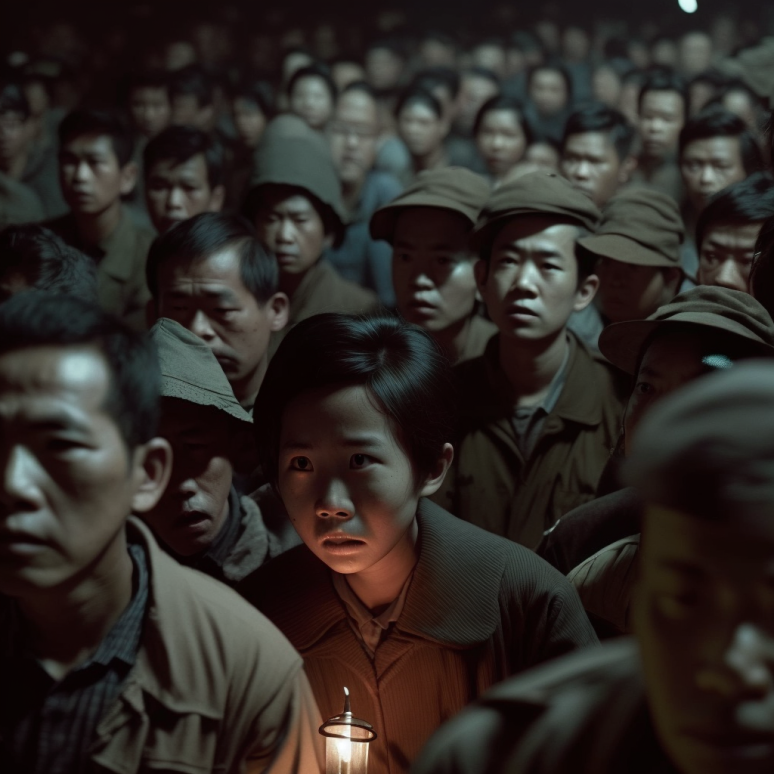</figure>

<ul class="wp-block-list">
<li><strong>The United States' annexation of Hawaii </strong>(1898)</li>

<li><strong>The My Lai Massacre</strong>, the killing of hundreds of Vietnamese civilians by U.S. soldiers during the Vietnam War (1968)</li>
</ul>

These events are important because they illustrate the ongoing legacy of U.S. imperialism and the impact of U.S. foreign policy on other nations. The <strong>annexation of Hawaii </strong>was a devastating example of U.S. territorial expansion and the forced displacement of indigenous peoples. The annexation resulted in the overthrow of the Hawaiian monarchy and the annexation of Hawaii as a U.S. territory. The <strong>My Lai Massacre </strong>similarly confirmed the devastating impact of U.S. military intervention on civilian populations, and underscored the need for greater accountability and oversight in U.S. foreign policy. Highlighting the ongoing struggle for social and economic justice, both domestically and internationally.

<h3 class="wp-block-heading">Conclusion</h3>

<ul class="wp-block-list">
<li>Summarizes the main arguments and themes of the book.</li>

<li>Offers reflections on the significance of the book and its impact on historical scholarship.</li>
</ul>

<h3 class="wp-block-heading">Impact of the Book</h3>

<ul class="wp-block-list">
<li>The book has been influential in challenging traditional narratives of U.S. history and highlighting the voices and struggles of marginalized groups</li>

<li>It has been widely read and has sold over 2 million copies</li>

<li>It continues to be an important title today, particularly in the context of ongoing struggles for social justice and against systemic oppression</li>

<li>The book has inspired many readers to engage in activism and to question dominant power structures</li>
</ul>

<h3 class="wp-block-heading">Major Points</h3>

<ul class="wp-block-list">
<li>The book argues that U.S. history has been shaped by class struggle and the resistance of marginalized groups against exploitation and oppression</li>

<li>It critiques the myth of American exceptionalism and challenges traditional narratives of U.S. history that emphasize the actions of powerful elites</li>

<li>It highlights the importance of grassroots movements and the struggles of ordinary people in shaping history</li>

<li>It is a call to action for readers to engage in critical thinking and to work towards a more just and equitable society.</li>
</ul>

If the book came out today, it would likely be met with both praise and criticism. While many readers would appreciate its critical approach to U.S. history, others would likely challenge its perspective and argue that it is too focused on the negative aspects of U.S. history. However, given the ongoing struggles for social justice and the need for critical analysis of power structures, the book would likely remain an important title in the field of history and political science.

<figure class="wp-block-image alignfull size-full"></figure>
