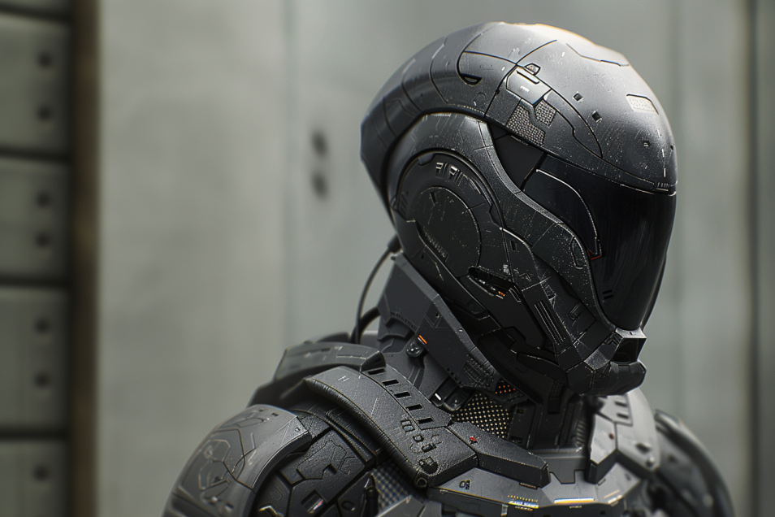
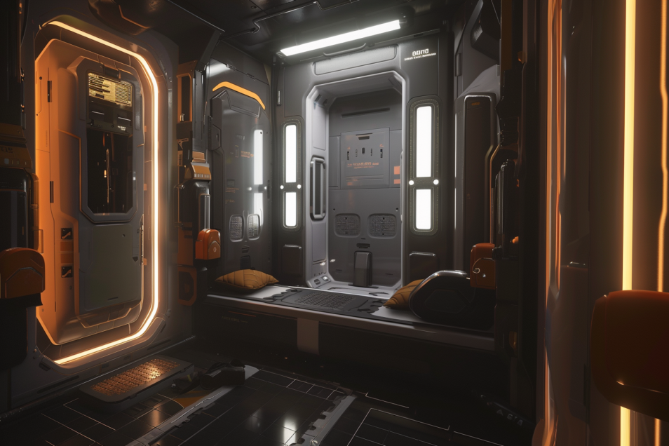

<!-- wp:cover {"url":"./images/all-systems-red-martha-wells/all-systems-red.webp","id":4877,"alt":"All Systems Red - SEC Unit","dimRatio":30,"minHeight":66,"minHeightUnit":"vh","align":"full","style":{"spacing":{"padding":{"top":"48px","right":"48px","bottom":"48px","left":"48px"},"margin":{"top":"0"}},"color":{"duotone":["#094850","#f9644e"]}}} -->

<!-- wp:group {"style":{"spacing":{"blockGap":"48px"}},"layout":{"type":"constrained","contentSize":"75%","justifyContent":"left","wideSize":"75%"}} -->

<!-- wp:heading {"textAlign":"left","level":3,"style":{"typography":{"fontSize":"50px","textTransform":"uppercase","fontStyle":"normal","fontWeight":"700","letterSpacing":"0px","lineHeight":"1"}},"textColor":"white"} -->

<h3 class="wp-block-heading has-text-align-left has-white-color has-text-color" style="font-size:50px;font-style:normal;font-weight:700;letter-spacing:0px;line-height:1;text-transform:uppercase">Exploring Autonomy and Identity: A Comprehensive Overview and Discussion Guide for 'All Systems Red' by Martha Wells</h3>

<!-- /wp:heading -->

<!-- /wp:group -->

<!-- wp:spacer {"height":"72px"} -->

<!-- /wp:spacer -->

<!-- /wp:cover -->

<!-- wp:heading -->

<h2 class="wp-block-heading">A synthetic entity pursues self-determination, wrestles with its history, and discovers liberation.</h2>

<!-- /wp:heading -->

<!-- wp:paragraph -->

"All Systems Red" by Martha Wells is a riveting exploration into the world of artificial intelligence, the intricacies of sentience, and the complex interplay between autonomy and identity. This novella stands out due to its intricate detailing, philosophical undertones, and the human-like evolution of its central character, the Security Unit, or the 'Sec Unit'. The story masterfully blurs the lines between organic and synthetic beings, unravelling a narrative that is as intriguing as it is thought-provoking.

<!-- /wp:paragraph -->

<!-- wp:paragraph -->

From the onset, Wells sets the scene with meticulous precision. The Corporation Rim, with its harsh environment and strict corporate control, comes alive in stunning detail. The chillingly cold, metallic walls of the Sec Unit’s cubicle to the ominous expanse of the Corporate Rim are so vividly described that they feel palpably real. This attention to detail extends to the characters' attire and tools, adding another layer of realism to the story. Whether it's the Sec Unit's armor, symbolic of its identity and purpose, or Dr. Mensa's business attire, hinting at her authoritative role, every item is carefully considered and contributes to the overall narrative.

<!-- /wp:paragraph -->

<!-- wp:paragraph -->

The Sec Unit is a marvel of character development. It begins its journey as a security robot with organic components, performing its duties without question. However, as the story progresses, it evolves into a self-aware being grappling with the consequences of its past actions and yearning for autonomy. This transformation is conveyed through a first-person perspective, allowing us a deep dive into the Sec Unit's thoughts, fears, and desires. The clever use of dialogue and internal monologue paints a picture of an artificial being with human-like emotional depth.

<!-- /wp:paragraph -->

<!-- wp:image {"id":4880,"sizeSlug":"full","linkDestination":"none"} -->

<figure class="wp-block-image size-full"></figure>

<!-- /wp:image -->

<!-- wp:paragraph -->

Wells explores the philosophical concept of 'what it means to be alive' through the Sec Unit's evolution. The Sec Unit's struggle for autonomy, its capacity for empathy, and its ability to form relationships are all traits that we associate with being human. Its journey makes us question our understanding of consciousness and the very definition of life.

<!-- /wp:paragraph -->

<!-- wp:paragraph -->

The Sec Unit's interactions with the other characters, particularly Dr. Mensa, are instrumental in driving this narrative. Dr. Mensa's character is beautifully fleshed out. She's not just the one in charge; she's the one who understands the Sec Unit, respects its autonomy, and eventually advocates for its freedom. The trust she places in the Sec Unit isn't just a protective measure for her feelings; it's a testament to her belief in the Sec Unit's capacity for change and growth.

<!-- /wp:paragraph -->

<!-- wp:paragraph -->

The other characters, too, display a gradual shift in their perception of the Sec Unit. From viewing it as a mere tool to recognizing it as a sentient being, their journey mirrors societal attitudes towards artificial intelligence. Their decision to buy the Sec Unit's freedom is a significant turning point, symbolizing their acceptance of the Sec Unit as a being capable of independent thought and action.

<!-- /wp:paragraph -->

<!-- wp:paragraph -->

"All Systems Red" is not just a story about artificial intelligence; it's a story about finding one's identity, seeking freedom, and making peace with the past. It delves deep into the question of what makes us who we are. Is it our programming, our experiences, or our choices? Through the Sec Unit's journey, Wells seems to suggest that it's a combination of all three.

<!-- /wp:paragraph -->

<!-- wp:paragraph -->

The book also raises questions about the implications of corporate control, the ethics of artificial intelligence, and the concept of 'ownership'. The Corporation Rim, with its strict rules, serves as a backdrop for exploring these societal issues.

<!-- /wp:paragraph -->

<!-- wp:paragraph -->

In the expanded universe of "All Systems Red", Wells questions the ethical boundaries of creating sentient beings for corporate gains. The Corporation Rim, with its cold and calculated control over the Sec Unit and other similar entities, serves as a critique of unregulated corporate power and its potential for harm. The reader is invited to reflect upon the moral implications of creating and exploiting sentient beings for profit, raising questions about agency, consent, and the rights of artificial beings.

<!-- /wp:paragraph -->

<!-- wp:image {"id":4878,"sizeSlug":"full","linkDestination":"none"} -->

<figure class="wp-block-image size-full"></figure>

<!-- /wp:image -->

<!-- wp:paragraph -->

Wells uses the Sec Unit's access to entertainment feeds to highlight its developing understanding of human culture and behavior. The Sec Unit's consumption of serial dramas and books is a significant part of its character development. This access to human culture helps the Sec Unit understand humans better, enabling it to navigate its interactions with them more effectively. The entertainment feeds also provide a form of escape for the Sec Unit, offering a respite from its duties and a way to explore different aspects of human life.

<!-- /wp:paragraph -->

<!-- wp:paragraph -->

The Preservation Alliance serves as a beacon of hope for the Sec Unit and the other characters. The existence of the Preservation Alliance represents a potential sanctuary from corporate control and a chance for a different life. The possibility of escape to the Preservation Alliance provides a powerful motivation for the Sec Unit and other characters, shaping their decisions and actions throughout the story.

<!-- /wp:paragraph -->

<!-- wp:paragraph -->

The suspense and surprise elements in the story keep the reader on the edge of their seat. Unexpected plot twists, tense cliffhangers, and sudden revelations add to the story's intrigue and pace. These elements keep the reader hooked, eager to find out what happens next.

<!-- /wp:paragraph -->

<!-- wp:paragraph -->

"All Systems Red" is a solid piece of science fiction that masterfully combines detailed world-building, nuanced character development, and philosophical ponderings. It's a journey into an AI's quest for freedom that leaves you questioning your understanding of life, identity, and autonomy. The story is as real as it gets, with characters that are profoundly relatable, and a plot that is both engaging and thought-provoking. This is a book that stays with you long after you've turned the last page, prompting you to ponder the ethical implications of artificial intelligence, the nature of consciousness, and the struggle for autonomy in a world dominated by corporate interests.

<!-- /wp:paragraph -->

<!-- wp:separator {"className":"is-style-wide"} -->

<!-- /wp:separator -->

<!-- wp:heading -->

<h2 class="wp-block-heading">20 Book Club Questions and Answers for All Systems Red</h2>

<!-- /wp:heading -->

<!-- wp:list {"ordered":true} -->

<ol><!-- wp:list-item -->

<li>Question: How does the author use the first-person perspective to develop the character of the SEC unit? Answer: The author uses the first-person perspective to reveal the SEC unit's thoughts, feelings and motivations. This immerses the reader in the SEC unit's experiences and makes its evolution throughout the story more personal and engaging.</li>

<!-- /wp:list-item -->

<!-- wp:list-item -->

<li>Question: What does the SEC unit's decision to leave at the end of the book reveal about its character development throughout the story? Answer: The SEC unit's decision to leave indicates its growing autonomy and desire for independence. It shows that the SEC unit has developed a sense of self and is willing to make its own decisions, even if they involve risk and uncertainty.</li>

<!-- /wp:list-item -->

<!-- wp:list-item -->

<li>Question: How does the author explore the theme of autonomy and decision-making through the character of the SEC unit? Answer: The author explores the theme of autonomy and decision-making through the SEC unit's actions and choices, especially its decision to leave the company and determine its own future.</li>

<!-- /wp:list-item -->

<!-- wp:list-item -->

<li>Question: How does the relationship between Dr. Mensa and the SEC unit evolve throughout the story? Answer: The relationship between Dr. Mensa and the SEC unit evolves from a professional one to a more personal one. Dr. Mensa becomes more caring and considerate towards the SEC unit, and the SEC unit develops a sense of loyalty and affection towards Dr. Mensa.</li>

<!-- /wp:list-item -->

<!-- wp:list-item -->

<li>Question: What role does the company play in the story and how does it impact the actions and decisions of the characters? Answer: The company serves as a source of conflict and tension in the story. Its policies and actions often put the characters in difficult situations and force them to make tough decisions.</li>

<!-- /wp:list-item -->

<!-- wp:list-item -->

<li>Question: How does the author depict the concept of 'home' and 'belonging' in the story? Answer: The author depicts 'home' and 'belonging' as concepts that are not tied to a specific place but rather to a sense of security, acceptance, and autonomy.</li>

<!-- /wp:list-item -->

<!-- wp:list-item -->

<li>Question: How does the author use the setting of the Corporation Rim to create tension and conflict in the story? Answer: The Corporation Rim, with its strict rules and corporate control, serves as a backdrop for the characters' struggles for autonomy and survival. Its harsh environment and the company's oppressive policies create a sense of danger and urgency that drives the plot.</li>

<!-- /wp:list-item -->

<!-- wp:list-item -->

<li>Question: In what ways does the SEC unit display human-like qualities and emotions? Answer: The SEC unit displays human-like qualities and emotions in its capacity to learn, adapt, make decisions, and form relationships. It also shows empathy, fear, and a desire for autonomy, which are typically considered human traits.</li>

<!-- /wp:list-item -->

<!-- wp:list-item -->

<li>Question: How does the author use the theme of trust in the relationships between the characters in the story? Answer: The author uses trust as a key element in the characters' relationships. It is through building trust that the characters form alliances, cooperate, and support each other in their struggles against the company.</li>

<!-- /wp:list-item -->

<!-- wp:list-item -->

<li>Question: What is the significance of the SEC unit's armor and what does it symbolize? Answer: The SEC unit's armor symbolizes its role as a security unit and its perceived identity by the company. It's also a physical representation of the SEC unit's defense mechanism and its readiness to engage in combat.</li>

<!-- /wp:list-item -->

<!-- wp:list-item -->

<li>Question: How does the author use dialogue to reveal character traits and relationships in the story? Answer: The author uses dialogue to reveal the characters' thoughts, feelings, motivations, relationships, and conflicts. It serves as a window into the characters' inner worlds and provides insight into their personalities and interactions.</li>

<!-- /wp:list-item -->

<!-- wp:list-item -->

<li>Question: How does the concept of 'ownership' and 'contract' play out in the story and what does it reveal about the society in which the characters live? Answer: The concept of 'ownership' and 'contract' reflects the power dynamics in the society where the characters live. It reveals a society where entities, even sentient beings like the SEC unit, can be owned and controlled by others based on contracts.</li>

<!-- /wp:list-item -->

<!-- wp:list-item -->

<li>Question: How are the themes of survival and sacrifice explored in the story? Answer: The themes of survival and sacrifice are explored through the characters' struggles against the company and their willingness to risk their lives to protect each other and achieve their goals.</li>

<!-- /wp:list-item -->

<!-- wp:list-item -->

<li>Question: How does the author use descriptive language to create vivid imagery of the settings and characters? Answer: The author uses detailed and sensory language to create vivid images of the settings and characters. This helps to immerse the reader in the story and make the world and characters feel real and tangible.</li>

<!-- /wp:list-item -->

<!-- wp:list-item -->

<li>Question: What is the significance of the SEC unit's access to entertainment feeds and how does it influence its behavior and decisions? Answer: The SEC unit's access to entertainment feeds provides it with a window into human culture and behavior, which helps it understand humans better and make informed decisions. It also offers a form of escape and entertainment for the SEC unit.</li>

<!-- /wp:list-item -->

<!-- wp:list-item -->

<li>Question: How do the characters' actions reflect their values and priorities in the story? Answer: The characters' actions often reflect their values and priorities, such as their commitment to survival, their desire for autonomy, their loyalty to each other, and their willingness to resist oppressive forces.</li>

<!-- /wp:list-item -->

<!-- wp:list-item -->

<li>Question: What role does the Preservation Alliance play in the story and how does it influence the characters' decisions and actions? Answer: The Preservation Alliance serves as a potential sanctuary and source of support for the characters. Its existence influences the characters' decisions and provides them with hope and motivation.</li>

<!-- /wp:list-item -->

<!-- wp:list-item -->

<li>Question: How does the author use suspense and surprise to engage the reader's interest? Answer: The author uses suspense and surprise through unexpected plot twists, cliffhangers, and tense situations. These elements keep the reader engaged and eager to find out what happens next.</li>

<!-- /wp:list-item -->

<!-- wp:list-item -->

<li>Question: How does the author use the conflict between the SEC unit and the company to explore larger societal issues? Answer: The conflict between the SEC unit and the company serves as a metaphor for larger societal issues such as corporate control, individual autonomy, and the ethics of artificial intelligence.</li>

<!-- /wp:list-item -->

<!-- wp:list-item -->

<li>Question: What does the story suggest about the potential and limitations of artificial intelligence? Answer: The story suggests that artificial intelligence has the potential to learn, adapt, and form relationships, much like humans. However, it also highlights the limitations of AI, such as its vulnerability to control and manipulation by humans.</li>

<!-- /wp:list-item -->

<!-- wp:list-item -->

<li>The SEC unit's journey towards self-awareness and autonomy: The story extensively explores the SEC unit's evolving understanding of its own identity and its desire for autonomy. The readers should consider how this journey reflects larger questions about self-determination, freedom, and what it means to be sentient.</li>

<!-- /wp:list-item -->

<!-- wp:list-item -->

<li>The relationship between the SEC unit and Dr. Mensa: The dynamic between the SEC unit and Dr. Mensa is pivotal to the story. Understanding their interactions and evolving relationship can provide insight into the story's themes of empathy, understanding, and the complexities of communication between different forms of sentient beings.</li>

<!-- /wp:list-item -->

<!-- wp:list-item -->

<li>The story's exploration of "programming" and its effects: The concept of programming is central to the story, both literally in the case of the SEC unit, and metaphorically in terms of societal and systemic influences on behavior. The reader should consider how this concept of programming is used to explore questions of free will, responsibility, and the nature of consciousness.</li>

<!-- /wp:list-item -->

<!-- wp:list-item -->

<li>The role and impact of the Corporation Rim: The setting of the Corporation Rim serves as a backdrop for the exploration of power dynamics, corporate control, and the struggle for autonomy. The readers should consider how the environment and the societal rules within the Corporation Rim affect the characters and their decisions.</li>

<!-- /wp:list-item -->

<!-- wp:list-item -->

<li>The SEC Unit's past and its struggle with guilt: The SEC unit's past, where it killed 57 people, is a significant part of its character development. The readers should consider how the SEC unit's past actions and its struggle with guilt inform its desire for autonomy and its interactions with other characters.</li>

<!-- /wp:list-item -->

<!-- wp:list-item -->

<li>The depiction of artificial intelligence: The story presents a nuanced depiction of AI, highlighting its potential and limitations. The readers should consider how the portrayal of the SEC unit challenges typical representations of AI and what it suggests about the potential future of AI-human relationships.</li>

<!-- /wp:list-item -->

<!-- wp:list-item -->

<li>The role of the Preservation Alliance: The Preservation Alliance provides a contrasting perspective to the Corporation Rim. Readers should delve deeper into how the Preservation Alliance represents hope, safety, and a different way of life for the characters.</li>

<!-- /wp:list-item --></ol>

<!-- /wp:list -->

