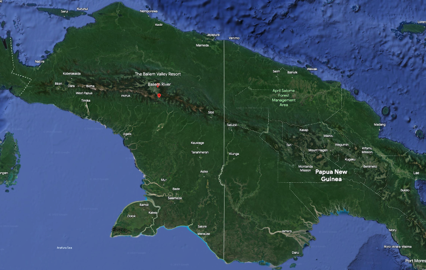
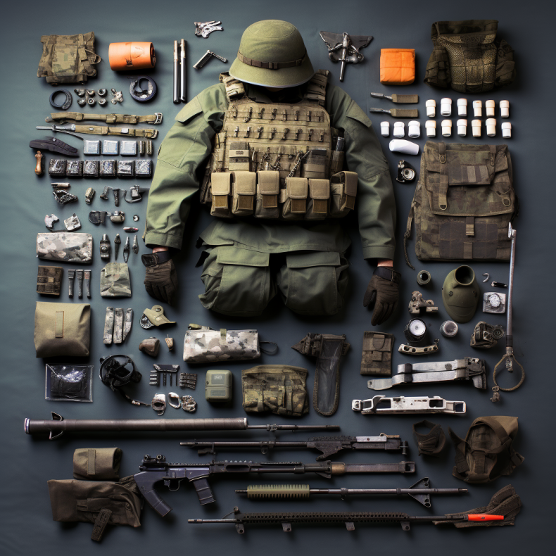

<figure class="wp-block-pullquote"><blockquote>
“Fear is something I don’t think you experience unless you have a choice. If you have a choice, then you’re liable to be afraid. But without a choice, what is there to be afraid of? You just go along doing what has to&nbsp; be done.”
<cite>Margent</cite></blockquote></figure>

<figure class="wp-block-image size-full"></figure>

Lost in Shangri-La received a largely positive response from readers and critics alike. This book tells the overlooked story of a plane crash on the Dutch island of New Guinea in the final months of World War II. The book was praised for its gripping storytelling, meticulous research, and the way it shed light on a lesser-known World War II incident. The vivid descriptions of the crash, the survivors' struggles, and the subsequent rescue mission captivated some readers. A non-fiction book based on extensive research and interviews conducted by the author, Mitchell Zuckoff. The book provides a detailed account of the crash and subsequent events, drawing from multiple sources, including survivors, military records, and historical archives.

<figure class="wp-block-image size-full"></figure>

On the surface Lost in Shangri-la explores themes of survival, resilience, and the indomitable human spirit. Despite the dire circumstances they found themselves in, the survivors refused to give up hope. They worked together, drawing on their individual strengths and skills, to overcome the challenges they faced. A real story of their determination and resilience served as a powerful reminder of the strength of the human spirit in the face of adversity. Lost in Shangri-La does highlight the power of storytelling and media and the impact it can have on our lives, and the lives of generations.

This survival story of the crash and subsequent rescue captured the imagination of people around the world. It became a symbol of hope and resilience during a time of war. And was held on the front page of most all News Papers across the United States and beyond. The story at the time had all the elements of a hollywood movie, especially with the arrival of a director cameraman.

<h2 class="wp-block-heading">Book Outline </h2>

<ul class="wp-block-list">
<li><strong speechify-initial-font-size="18px" style="font-size: 18px;">The Crash&nbsp;</strong>- In 1945, a plane carrying 24 soldiers and WACs (Women's Army Corps) crashed in a remote valley in New Guinea. Three survivors, Margaret Hastings, John McCollom, and Kenneth Decker, find themselves stranded in an heavily populated and unknown land to them.</li>

<li><strong speechify-initial-font-size="18px" style="font-size: 18px;">The Search&nbsp;</strong>- As news of the crash reaches the outside world, a rescue mission is organized. Lieutenant Colonel William "Bill" Quinn leads a team of paratroopers to find and rescue the survivors. They face numerous challenges, including treacherous terrain and natives.</li>

<li><strong>The Valley&nbsp;</strong>- Quinn and his team finally reach the valley where the survivors are believed to be. They encounter the Dani tribe, who have never seen outsiders before. The soldiers establish a base camp and begin their search for the survivors.</li>

<li><strong>The Survivors&nbsp;</strong>- Quinn's team discovers the three survivors, who have been living with the Dani tribe. Margaret, John, and Kenneth are in surprisingly good health, considering the circumstances. The soldiers must now figure out a way to bring them back to civilization.</li>

<li><strong>The Rescue&nbsp;</strong>- Quinn and his team face numerous challenges as they prepare for the rescue mission. They must build an airstrip in the valley to facilitate the evacuation. </li>

<li><strong>The Airlift&nbsp;</strong>- With the airstrip completed, the rescue plane arrives to evacuate the survivors. However, bad weather and mechanical issues delay the operation. The soldiers and survivors must endure several more days in the valley before they can finally leave.</li>

<li><strong speechify-initial-font-size="18px" style="font-size: 18px;">The Return&nbsp;</strong>- The survivors are airlifted out of the valley and brought back to civilization. They face media attention and medical examinations upon their return. </li>

<li><strong>The Aftermath&nbsp;</strong>- The survivors face various challenges in the aftermath of their rescue.  </li>

<li><strong speechify-initial-font-size="18px" style="font-size: 18px;">The Legacy&nbsp;</strong>- Decades later, the survivors and their families reflect on their experiences in the valley. The story of the crash and rescue mission continues to inspire and captivate people around the world.</li>
</ul>

<h2 class="wp-block-heading">Before the Crash </h2>

The book acknowledges the complexities of the time period and the motivations of the military and government. It explores the desire to boost morale and maintain a positive image during wartime. During World War II, the American army had a significant presence on New Guinea for several reasons. New Guinea, located in the Pacific region, held strategic importance for both the Allies and the Axis powers.

New Guinea offered a strategic location for military operations in the Pacific. It provided a stepping stone for the Allies to launch offensives against Japanese-held territories in the region. By establishing airfields and bases on New Guinea, the Allies were able to gain closer proximity to Japanese positions and create a staging area for future campaigns.

<figure class="wp-block-image size-full"></figure>

Control over New Guinea allowed the Allies to safeguard important lines of communication. The region served as a crucial link between the United States and Australia, facilitating the transportation of troops, equipment, and supplies. New Guinea's strategic location allowed for the establishment of supply lines and logistical support, which were vital for sustaining military operations in the Pacific.

New Guinea was rich in natural resources, including minerals, timber, and agricultural products. These resources were valuable for both military and civilian purposes. The Allies sought to secure these resources and prevent their exploitation by the Axis powers, particularly Japan, which had ambitions of expanding its empire in the region.

New Guinea also provided an opportunity for the Allies to engage in psychological warfare against the Japanese. By conducting successful military operations on New Guinea, the Allies were able to demonstrate their ability to counter Japanese aggression and bolster the morale of their own troops. The presence of the American army on New Guinea during World War II was driven by strategic considerations, the need to secure vital lines of communication, the desire to control important resources, and the opportunity to weaken the Japanese war effort in the Pacific.

<figure class="wp-block-image size-large"></figure>

The dedicated team on board the Gremlin Special were all part of the Fee-Ask maintenance division, diligently working to ensure smooth operations and maintenance of aircraft in the Far East.

The fact that the crash of the Gremlin Special occurred during what was a joyride is indeed a significant aspect of the story in "Lost in Shangri-La." It sheds light on the circumstances that led to the fateful event and adds complexity to the narrative. The book explores the motivations behind the sightseeing tour and the individuals' desire to experience the beauty of the New Guinea jungle. It acknowledges that joy rides were not uncommon during World War II, as a means for servicemen and women to temporarily escape the harsh realities of war and boost morale. Ultimately, the crash and the subsequent survival story that unfolds in Lost in Shangri-La <em speechify-initial-font-size="18px" style="font-size: 18px;">serve as a testament to the strength, resilience, and resourcefulness of the survivors</em>, regardless of the circumstances that led to the tragedy. The book focuses on their incredible journey and the heroic efforts made to rescue them, rather than dwelling on the circumstances that brought them to that point.

<h2 class="wp-block-heading">Treatment of the Natives </h2>

Another important theme explored in the book is the "clash" between different cultures. The book provides some insight into the mistreatment of the native people but does not delve deeply into the specifics. The book does acknowledge some instances of mistreatment, such as the stress caused to the native tribes by the low-flying aircraft. These incidents highlight the tensions that existed between the army personnel and the native people, and add depth to the historical context of the story.

<figure class="wp-block-image size-full"><figcaption class="wp-element-caption">Their spears and arrows</figcaption></figure>

<pre class="wp-block-verse has-tertiary-color has-foreground-background-color has-text-color has-background has-small-font-size" style="border-width:10px;border-radius:20px;padding-top:var(--wp--preset--spacing--50);padding-right:var(--wp--preset--spacing--50);padding-bottom:var(--wp--preset--spacing--50);padding-left:var(--wp--preset--spacing--50)">“His gut told&nbsp; him that the natives were no threat—he made a casual reference in&nbsp; his journal to their spears and arrows, and wrote that their “only&nbsp; means of cutting are stone axes.”</pre>

As the rescue mission got underway, the survivors encountered the Dani tribe, a remote indigenous group living in the jungle. The clash between the modern world and the ancient traditions of the Dani people creates a fascinating dynamic. Zuckoff delves into the cultural differences and explores how both sides navigated this unfamiliar territory, ultimately finding common ground and forming a bond.

<pre class="wp-block-verse has-tertiary-color has-foreground-background-color has-text-color has-background has-small-font-size" style="border-width:10px;border-radius:20px;padding-top:var(--wp--preset--spacing--50);padding-right:var(--wp--preset--spacing--50);padding-bottom:var(--wp--preset--spacing--50);padding-left:var(--wp--preset--spacing--50)">“Fired a few shots to see effect on natives and most of them&nbsp; didn’t stop running till they were out of sight, he wrote. His men&nbsp; followed suit, including one who fired a burst from a Thompson&nbsp; submachine gun, the famous Tommy Gun. As the natives fled”</pre>

It is clear that firing shots at a group of innocent and unpoked natives is not an appropriate or responsible action. In general, soldiers should be trained to use force only as a last resort and to prioritize protecting innocent civilians. If the soldiers had reason to believe that the natives posed a threat, they could have attempted to resolve the situation through nonviolent means or used minimal force to subdue any potential threats. 

<figure class="wp-block-image size-full"></figure>

<pre class="wp-block-verse has-tertiary-color has-foreground-background-color has-text-color has-background has-small-font-size" style="border-width:10px;border-radius:20px;padding-top:var(--wp--preset--spacing--50);padding-right:var(--wp--preset--spacing--50);padding-bottom:var(--wp--preset--spacing--50);padding-left:var(--wp--preset--spacing--50)">“The men were doing it just for the hell of it, to&nbsp; make the natives run and yell and whatnot,” he said.&nbsp; The guns’ noise frightened the natives, but Walter wrote in his&nbsp; journal that “they do not understand the killing power of the modern&nbsp; firearm.”</pre>

It is also important for soldiers to be aware of the cultural context and potential consequences of their actions, especially when operating in foreign countries. This group of soldiers were showing off their firearms and fired shots at a group of unarmed and non-threatening natives. One of the men fired a burst from a Thompson submachine gun. The natives fled and kept running until they were out of sight. The context and implications of this statement are concerning, as the group of men acted irresponsibly and put the lives of innocent people in danger.

<pre class="wp-block-verse has-tertiary-color has-foreground-background-color has-text-color has-background has-small-font-size" style="border-width:10px;border-radius:20px;padding-top:var(--wp--preset--spacing--50);padding-right:var(--wp--preset--spacing--50);padding-bottom:var(--wp--preset--spacing--50);padding-left:var(--wp--preset--spacing--50)">“Equally memorable to the tribespeople was the soldiers’ practice&nbsp;of digging a single hole covered by a tent where all of them went to&nbsp; defecate. Native practice called for bodily waste to pass in private”</pre>

<h2 class="wp-block-heading">What the Natives Thought </h2>

The natives believed that parachutes were spirits descending to the ground on ropes.

<figure class="wp-block-image size-full"><figcaption class="wp-element-caption">Good-looking enough for the men</figcaption></figure>

<pre class="wp-block-verse has-tertiary-color has-foreground-background-color has-text-color has-background has-small-font-size" style="border-width:10px;border-radius:20px;padding-top:var(--wp--preset--spacing--50);padding-right:var(--wp--preset--spacing--50);padding-bottom:var(--wp--preset--spacing--50);padding-left:var(--wp--preset--spacing--50)">“Don’t kill them. They are not human. If not for the maga, the six&nbsp; sleeping soldiers might have been ambushed and slaughtered by&nbsp;hundreds of spear-carrying warriors whom a regional big man could&nbsp; have summoned on short notice."</pre>

Their stories can inspire us and make us contemplate the courage and determination they displayed during their ordeal. However, it is also important to acknowledge those who didn't survive, as it reminds us of the tragic toll of such events and the potential futures that were lost.

Speculating about the paths that the non-survivors might have taken can be a poignant exercise. It allows us to reflect on the impact of their absence and the potential contributions they could have made. It also serves as a reminder to appreciate the value of life and the fragility of our existence.

While we may never know the exact stories of those who didn't make it, their absence is a stark reminder of the risks and sacrifices involved in such extraordinary circumstances. It adds depth and emotional weight to the narrative, prompting us to reflect on the unpredictability of life and the profound impact of tragic events.

<pre class="wp-block-verse has-tertiary-color has-foreground-background-color has-text-color has-background has-small-font-size" style="border-width:10px;border-radius:20px;padding-top:var(--wp--preset--spacing--50);padding-right:var(--wp--preset--spacing--50);padding-bottom:var(--wp--preset--spacing--50);padding-left:var(--wp--preset--spacing--50)">“"As she stared at the natives and the natives stared back, Margaret felt relief. Soon it spread into affection." Chapter 12, pg. 121</pre>

During her wait for rescue in late June, Margaret found solace by exploring a nearby native village close to the camp. It was there that she formed a bond with a native woman whom she affectionately named Queen. Their blossoming friendship led them to spend valuable time together, creating cherished memories along the way. Margaret's friendship with Queen was particularly significant. Queen's protective nature and genuine care for Margaret not only fostered a sense of safety and belonging but also challenged Margaret's assumptions about the native people. Through their shared experiences and lack of conversations, Margaret gained a deeper appreciation for their customs, traditions, and values.

The experience of meeting and befriending this woman had a profound impact on Margaret, challenging her preconceived notions and prejudices. The woman appeared to assume a protective stance towards Margaret, demonstrating her care and concern for her wellbeing. 

Many individuals found common ground with the locals, forming friendly relationships and engaging in regular trade activities.

<h2 class="wp-block-heading">Other Interesting Quotes from the Book</h2>

<pre class="wp-block-verse has-tertiary-color has-foreground-background-color has-text-color has-background has-small-font-size" style="border-width:10px;border-radius:20px;padding-top:var(--wp--preset--spacing--50);padding-right:var(--wp--preset--spacing--50);padding-bottom:var(--wp--preset--spacing--50);padding-left:var(--wp--preset--spacing--50)">“The first plane into the valley was the supply plane.&nbsp; “Does the queen think she wants to pull out of there today?” Major&nbsp; Gardner asked via walkie-talkie.&nbsp; “She’s been wanting to get out of here for a week,” Walter replied."</pre>

<pre class="wp-block-verse has-tertiary-color has-foreground-background-color has-text-color has-background has-small-font-size" style="border-width:10px;border-radius:20px;padding-top:var(--wp--preset--spacing--50);padding-right:var(--wp--preset--spacing--50);padding-bottom:var(--wp--preset--spacing--50);padding-left:var(--wp--preset--spacing--50)">“Well, they didn’t ever mingle,” he&nbsp; said later. “And I told the men, absolutely not. I don’t think any of&nbsp; them were good-looking enough for the men, anyway."</pre>

<pre class="wp-block-verse has-tertiary-color has-foreground-background-color has-text-color has-background has-small-font-size" style="border-width:10px;border-radius:20px;padding-top:var(--wp--preset--spacing--50);padding-right:var(--wp--preset--spacing--50);padding-bottom:var(--wp--preset--spacing--50);padding-left:var(--wp--preset--spacing--50)">““If anybody lays a hand on her, so&nbsp; help me God, you’re busted to private the next minute.”&nbsp; Walter explained: “I had to remind my men a couple of times that&nbsp; I sure as hell didn’t want a pregnant WAC flying out of there. . . . That&nbsp; would have given me a

“I wanted him to tell Maggie to leave the men alone,” Walter said.&nbsp; “I had one noncom that was the best-looking guy in the unit, Don&nbsp; Ruiz. He was one of my best noncoms, and also one of the handsomest men around. Maggie sort of had her eyes on him and

He&nbsp; knew there was no birth control in the valley, and he didn’t want&nbsp;unexpected consequences.

When Walter didn’t rise to the bait, he said, Margaret turned her&nbsp;attentions to one of his men, Sergeant Don Ruiz."</pre>

<blockquote class="instagram-media" data-instgrm-captioned data-instgrm-permalink="https://www.instagram.com/reel/Cw3Onkouelp/?utm_source=ig_embed&amp;utm_campaign=loading" data-instgrm-version="14" style=" background:#FFF; border:0; border-radius:3px; box-shadow:0 0 1px 0 rgba(0,0,0,0.5),0 1px 10px 0 rgba(0,0,0,0.15); margin: 1px; max-width:540px; min-width:326px; padding:0; width:99.375%; width:-webkit-calc(100% - 2px); width:calc(100% - 2px);">
 <a href="https://www.instagram.com/reel/Cw3Onkouelp/?utm_source=ig_embed&amp;utm_campaign=loading" style=" background:#FFFFFF; line-height:0; padding:0 0; text-align:center; text-decoration:none; width:100%;" target="_blank" rel="noopener"> 
 

 
 

 

 
<svg width="50px" height="50px" viewBox="0 0 60 60" version="1.1" xmlns="https://www.w3.org/2000/svg" xmlns:xlink="https://www.w3.org/1999/xlink"><g stroke="none" stroke-width="1" fill="none" fill-rule="evenodd"><g transform="translate(-511.000000, -20.000000)" fill="#000000"><g><path d="M556.869,30.41 C554.814,30.41 553.148,32.076 553.148,34.131 C553.148,36.186 554.814,37.852 556.869,37.852 C558.924,37.852 560.59,36.186 560.59,34.131 C560.59,32.076 558.924,30.41 556.869,30.41 M541,60.657 C535.114,60.657 530.342,55.887 530.342,50 C530.342,44.114 535.114,39.342 541,39.342 C546.887,39.342 551.658,44.114 551.658,50 C551.658,55.887 546.887,60.657 541,60.657 M541,33.886 C532.1,33.886 524.886,41.1 524.886,50 C524.886,58.899 532.1,66.113 541,66.113 C549.9,66.113 557.115,58.899 557.115,50 C557.115,41.1 549.9,33.886 541,33.886 M565.378,62.101 C565.244,65.022 564.756,66.606 564.346,67.663 C563.803,69.06 563.154,70.057 562.106,71.106 C561.058,72.155 560.06,72.803 558.662,73.347 C557.607,73.757 556.021,74.244 553.102,74.378 C549.944,74.521 548.997,74.552 541,74.552 C533.003,74.552 532.056,74.521 528.898,74.378 C525.979,74.244 524.393,73.757 523.338,73.347 C521.94,72.803 520.942,72.155 519.894,71.106 C518.846,70.057 518.197,69.06 517.654,67.663 C517.244,66.606 516.755,65.022 516.623,62.101 C516.479,58.943 516.448,57.996 516.448,50 C516.448,42.003 516.479,41.056 516.623,37.899 C516.755,34.978 517.244,33.391 517.654,32.338 C518.197,30.938 518.846,29.942 519.894,28.894 C520.942,27.846 521.94,27.196 523.338,26.654 C524.393,26.244 525.979,25.756 528.898,25.623 C532.057,25.479 533.004,25.448 541,25.448 C548.997,25.448 549.943,25.479 553.102,25.623 C556.021,25.756 557.607,26.244 558.662,26.654 C560.06,27.196 561.058,27.846 562.106,28.894 C563.154,29.942 563.803,30.938 564.346,32.338 C564.756,33.391 565.244,34.978 565.378,37.899 C565.522,41.056 565.552,42.003 565.552,50 C565.552,57.996 565.522,58.943 565.378,62.101 M570.82,37.631 C570.674,34.438 570.167,32.258 569.425,30.349 C568.659,28.377 567.633,26.702 565.965,25.035 C564.297,23.368 562.623,22.342 560.652,21.575 C558.743,20.834 556.562,20.326 553.369,20.18 C550.169,20.033 549.148,20 541,20 C532.853,20 531.831,20.033 528.631,20.18 C525.438,20.326 523.257,20.834 521.349,21.575 C519.376,22.342 517.703,23.368 516.035,25.035 C514.368,26.702 513.342,28.377 512.574,30.349 C511.834,32.258 511.326,34.438 511.181,37.631 C511.035,40.831 511,41.851 511,50 C511,58.147 511.035,59.17 511.181,62.369 C511.326,65.562 511.834,67.743 512.574,69.651 C513.342,71.625 514.368,73.296 516.035,74.965 C517.703,76.634 519.376,77.658 521.349,78.425 C523.257,79.167 525.438,79.673 528.631,79.82 C531.831,79.965 532.853,80.001 541,80.001 C549.148,80.001 550.169,79.965 553.369,79.82 C556.562,79.673 558.743,79.167 560.652,78.425 C562.623,77.658 564.297,76.634 565.965,74.965 C567.633,73.296 568.659,71.625 569.425,69.651 C570.167,67.743 570.674,65.562 570.82,62.369 C570.966,59.17 571,58.147 571,50 C571,41.851 570.966,40.831 570.82,37.631"></path></g></g></g></svg>

 
View this post on Instagram

 

 

 

 

 

 

 

 

 

 
 

 

</a>
<a href="https://www.instagram.com/reel/Cw3Onkouelp/?utm_source=ig_embed&amp;utm_campaign=loading" style=" color:#c9c8cd; font-family:Arial,sans-serif; font-size:14px; font-style:normal; font-weight:normal; line-height:17px; text-decoration:none;" target="_blank" rel="noopener">A post shared by Gary Crossey (@betterworldwithdesign)</a>

</blockquote> 
