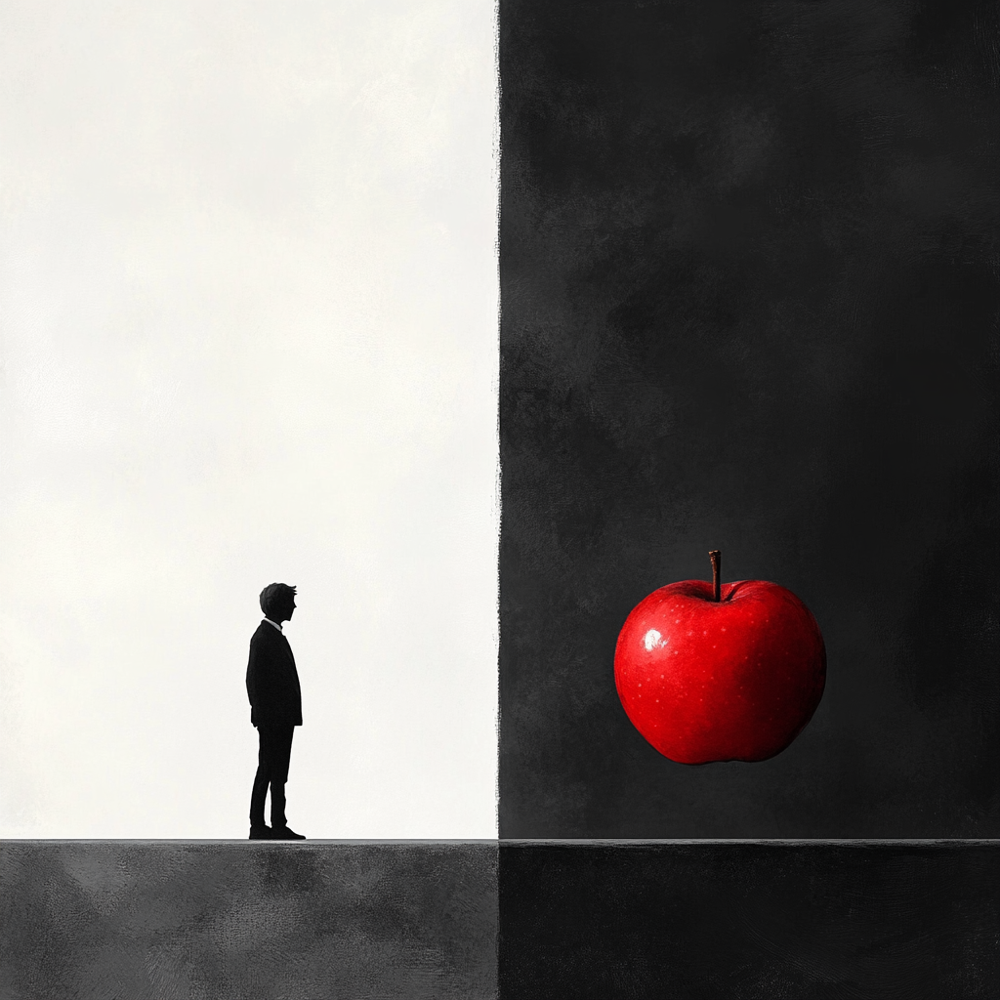
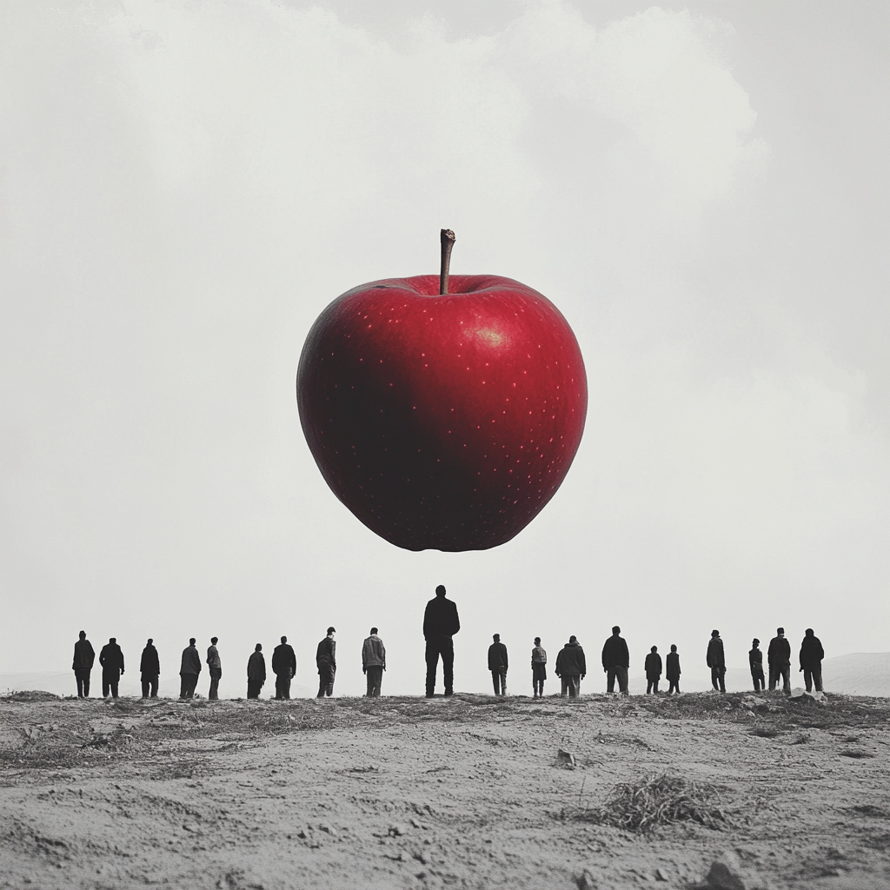
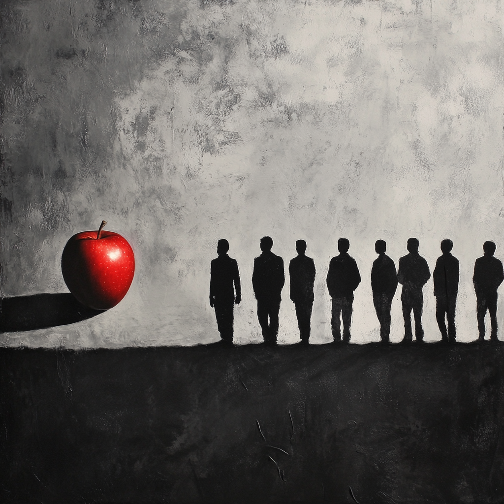
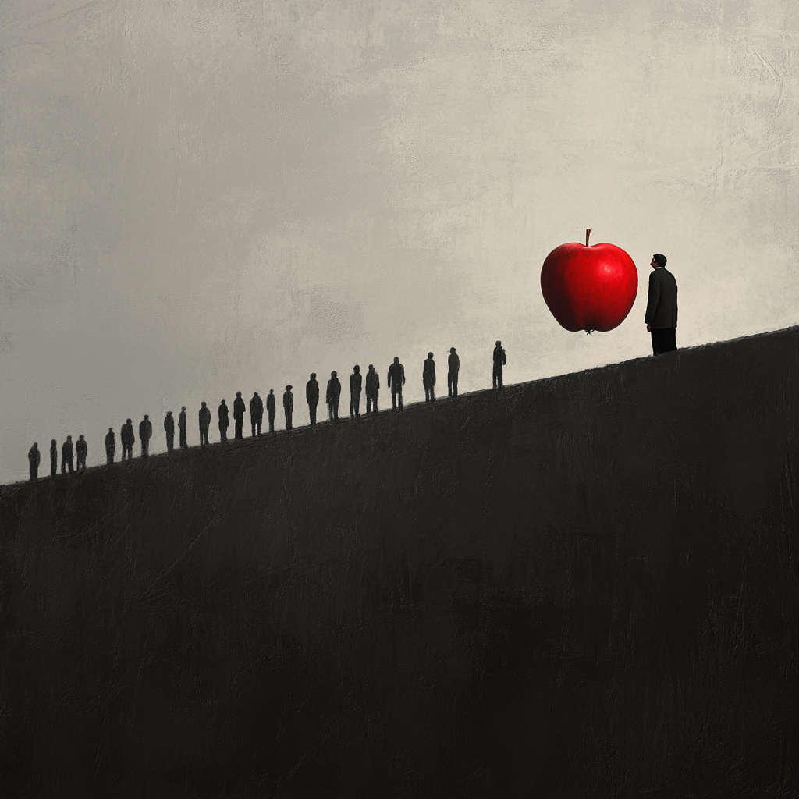
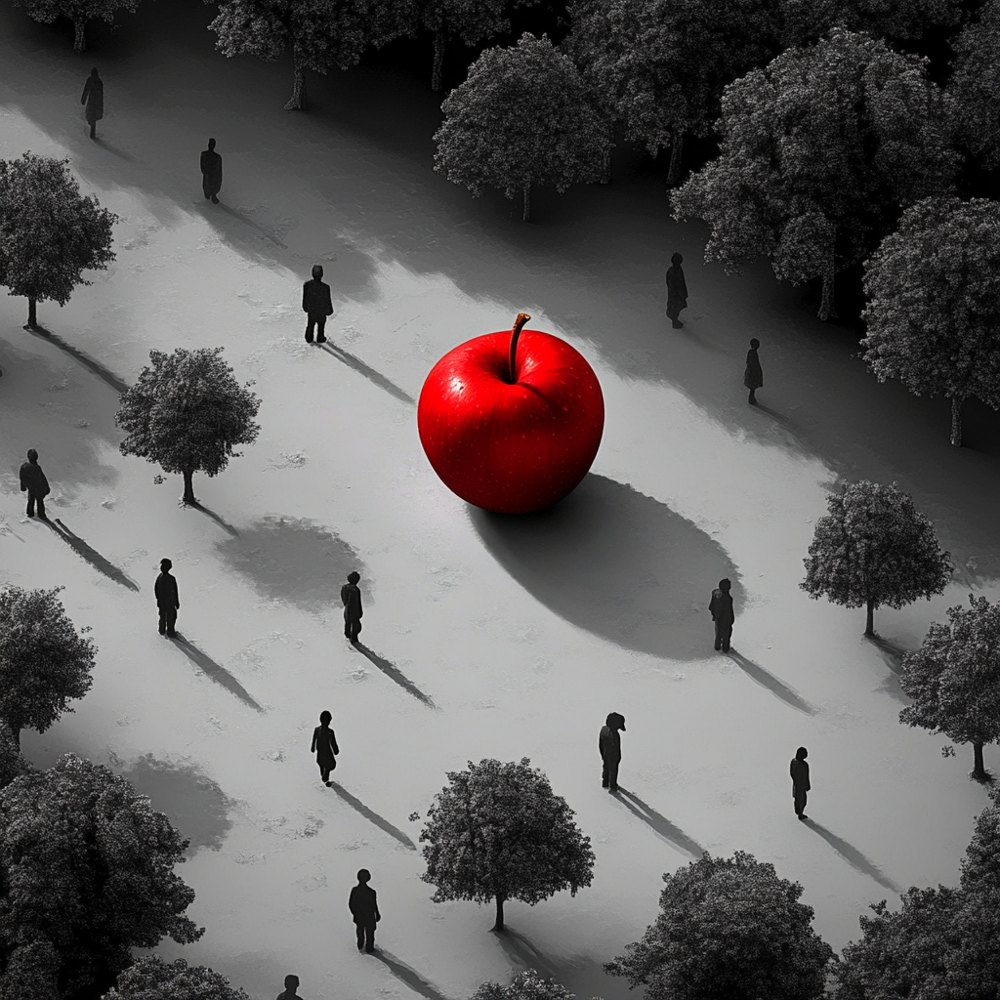
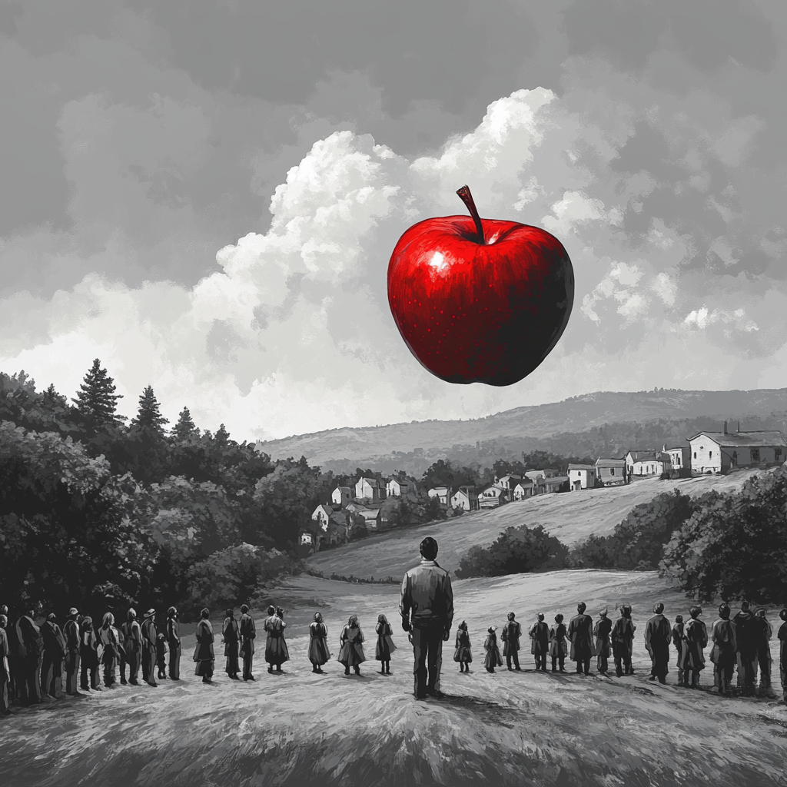
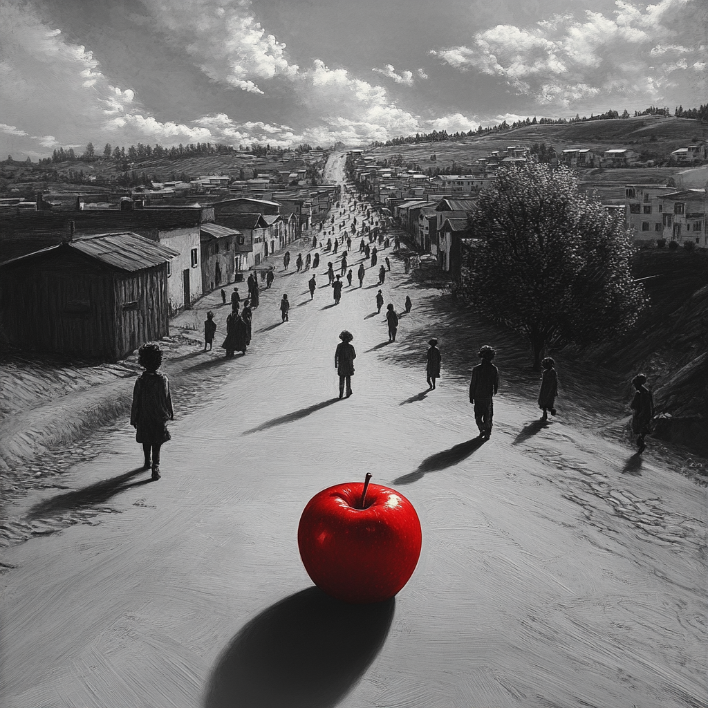

<figure class="wp-block-image size-full"></figure>

<h2 class="wp-block-heading">What is the book The Giver about?</h2>

"The Giver" is a dystopian novel that follows Jonas, a twelve-year-old boy living in what appears to be a perfect society where there is no war, fear, pain, or choice. The community is highly regulated, with every aspect of life controlled - from family units to career paths. At the age of twelve, Jonas is selected for a unique role: to become the next Receiver of Memory, tasked with holding all of humanity's memories that have been erased from the community's consciousness.

As Jonas begins his training with the current Receiver (whom he calls "The Giver"), he starts to experience things his community has eliminated: colors, emotions, and memories of both joy and pain. Through these transmitted memories, Jonas learns about the world that existed before his community's "Sameness" - a world with war and suffering, but also with deep love, music, and genuine human connection.

As his training progresses, Jonas discovers the dark truth behind his seemingly

<figure class="wp-block-image size-full"></figure>

<h2 class="wp-block-heading">What are the major themes explored in the book? How do they interrelate?</h2>

Based on the story, several major themes interweave throughout The Giver:

<ul class="wp-block-list">
<li><strong>Individual Freedom vs. Societal Control:</strong> The tension between personal liberty and social order is central to the narrative, shown through Jonas's growing awareness of his community's strict regulations and his ultimate choice to rebel.</li>

<li><strong>Memory and Human Experience:</strong> The importance of preserving and sharing memories, both painful and joyful, demonstrates how collective memory shapes human identity and understanding.</li>

<li><strong>The Price of Perfection:</strong> The story explores how the pursuit of a perfect, painless society leads to the loss of essential human experiences, emotions, and connections.</li>

<li><strong>Coming of Age and Self-Discovery:</strong> Jonas's journey from innocence to awareness parallels traditional coming-of-age narratives, as he discovers both the harsh realities and beautiful possibilities of life.</li>

<li><strong>Love and Human Connection:</strong> The development of emotional bonds, particularly Jonas's relationship with The Giver and his love for Gabriel, contrasts with the superficial relationships in his community.</li>
</ul>

These themes interrelate through their exploration of what makes us human. The suppression of memory and emotion (societal control) directly impacts the capacity for love and connection. The journey of self-discovery leads to questioning the price of perfection, while the preservation of memory becomes an act of resistance against control. Together, these themes create a complex examination of human nature and society.

<h2 class="wp-block-heading">How do the themes develop or evolve throughout the narrative?</h2>

The themes in The Giver develop progressively as Jonas gains awareness and understanding:

<ul class="wp-block-list">
<li><strong>Early Stages:</strong> The themes begin subtly, with hints of societal control through strict rules and structures, while Jonas accepts these limitations as normal.</li>

<li><strong>Middle Development:</strong> As Jonas receives memories, the themes deepen significantly. The contrast between individual freedom and societal control becomes stark, and the true cost of the community's "sameness" emerges.</li>

<li><strong>Later Evolution:</strong> The themes reach their peak complexity when Jonas begins to experience love, pain, and the full spectrum of human emotion, leading to profound moral dilemmas and choices.</li>
</ul>

The evolution of these themes parallels Jonas's journey from innocence to understanding:

<ul class="wp-block-list">
<li><strong>Memory and Experience:</strong> Initially presented as simple transfers of information, memories evolve into powerful catalysts for change and understanding.</li>

<li><strong>Love and Connection:</strong> Beginning with shallow family unit interactions, this theme develops into deep emotional bonds with The Giver and Gabriel.</li>

<li><strong>Freedom vs. Control:</strong> What starts as minor questioning of rules transforms into a fundamental rejection of the community's controlled existence.</li>
</ul>

By the narrative's conclusion, these themes converge in Jonas's final choice to leave the community, representing a full evolution from acceptance of control to the embrace of freedom, from superficial connections to deep love, and from ignorance to knowledge.

<figure class="wp-block-image size-full"></figure>

<h2 class="wp-block-heading">Who are the main characters? How do they change or grow throughout the story?</h2>

The main characters in The Giver undergo significant transformations throughout the narrative:

<ul class="wp-block-list">
<li><strong>Jonas (The Receiver):</strong> The protagonist evolves from an obedient, naive twelve-year-old to a questioning, emotionally aware young man. His growth is marked by his increasing ability to see beyond his community's façade, developing deep emotional connections, and ultimately choosing to act against the established order to save both himself and Gabriel.</li>

<li><strong>The Giver:</strong> Initially appearing as a mysterious mentor figure, The Giver reveals increasing vulnerability and hope through his relationship with Jonas. His character transforms from someone who has accepted his burden in isolation to an active participant in changing his community.</li>

<li><strong>Gabriel:</strong> Though an infant, Gabriel's character develops from a struggling "newchild" at risk of release to a symbol of hope and innocence. His bond with Jonas catalyzes much of the protagonist's growth and decision-making.</li>

<li><strong>Jonas's Parents:</strong> While they don't change significantly, their static nature becomes increasingly significant as Jonas grows to understand the superficiality of their conditioning and the limitations of their emotional capacity.</li>

<li><strong>Fiona:</strong> Initially Jonas's friend and crush, her character serves to highlight the contrast between those who remain within the community's conditioning and Jonas's growing awareness. Her continued acceptance of community norms emphasizes Jonas's divergent path.</li>

<li><strong>Asher:</strong> Like Fiona, Asher's character remains largely unchanged, but his role evolves from being Jonas's closest friend to representing the gulf that develops between Jonas and his former life as Jonas gains new understanding.</li>
</ul>

The characters' varying degrees of growth (or lack thereof) serve to highlight the central themes of awareness, choice, and the price of conformity in the story.

<h2 class="wp-block-heading">How do the relationships between characters contribute to the overall themes?</h2>

The relationships between characters in The Giver serve as powerful vehicles for exploring the novel's central themes:

<ul class="wp-block-list">
<li><strong>Jonas and The Giver:</strong> Their mentor-student relationship illustrates the themes of memory and knowledge transfer. As they grow closer, their bond demonstrates the power of genuine human connection in contrast to the superficial relationships prevalent in their society.</li>

<li><strong>Jonas and Gabriel:</strong> This relationship represents pure, unconditional love emerging in a society that suppresses emotion. Their connection challenges the community's notion of family units and highlights the theme of authentic human bonds versus artificial ones.</li>

<li><strong>Jonas and His Parents:</strong> The growing disconnect between Jonas and his parents emphasizes the theme of awakening versus conformity. As Jonas develops real emotions, his parents' conditioned responses become increasingly apparent, highlighting the cost of their society's emotional suppression.</li>

<li><strong>Jonas and His Friends (Asher and Fiona):</strong> These relationships demonstrate the isolation that comes with knowledge and awareness. As Jonas gains understanding, the growing distance between him and his friends underscores the price of individuality in a conformist society.</li>
</ul>

These relationships collectively highlight the contrast between authentic human connections and the regulated, emotionally sterile interactions that characterize their community. Each relationship either reinforces or challenges the community's values, contributing to the broader themes of freedom versus control and the cost of a "perfect" society.

<figure class="wp-block-image size-full"></figure>

<h2 class="wp-block-heading">What is the overall structure of the book (e.g., chronological, non-linear, episodic)?</h2>

The Giver follows a primarily chronological structure, with some key narrative elements:

<ul class="wp-block-list">
<li><strong>Linear Timeline:</strong> The story progresses chronologically, following Jonas from the time just before his Ceremony of Twelve through his training and eventual escape.</li>

<li><strong>Memory Interludes:</strong> The linear narrative is punctuated by the memories Jonas receives from The Giver, which provide historical context and depth to the story.</li>

<li><strong>Progressive Revelation:</strong> The structure supports a gradual unveiling of the community's true nature, with each chapter building upon previous revelations.</li>
</ul>

While the main narrative moves forward in time, the transmitted memories serve as windows into the past, adding layers of understanding to Jonas's present experience. This creates a contrast between the immediate story and the historical context that enriches it.

The pacing accelerates toward the climax, with the final chapters moving more quickly as Jonas makes his decisive break from the community, reflecting his urgent need to save Gabriel and himself.

<h2 class="wp-block-heading">How does the book's structure contribute to its themes or character development?</h2>

The book's structure effectively supports both thematic development and character growth in several ways:

<ul class="wp-block-list">
<li><strong>Gradual Revelation:</strong> The chronological structure allows for a measured unveiling of the community's true nature, paralleling Jonas's growing awareness and understanding. This supports the themes of awakening and discovery.</li>

<li><strong>Memory Integration:</strong> The interweaving of transmitted memories within the linear narrative creates a powerful contrast between the sterile present and the rich past, reinforcing themes about the importance of human experience and emotional depth.</li>

<li><strong>Accelerating Pace:</strong> The increasing narrative tempo toward the climax mirrors Jonas's growing sense of urgency and his character development from passive acceptance to active resistance.</li>

<li><strong>Dual Timeline Effect:</strong> The combination of present-day events with historical memories creates a layered understanding that helps develop both Jonas's character and the theme of collective memory versus individual experience.</li>
</ul>

The structure also builds tension effectively through the contrast between the rigid, organized nature of the community and the increasingly chaotic and emotional nature of Jonas's internal experience. This structural tension reinforces the central conflict between societal control and individual freedom.

<figure class="wp-block-image size-full"></figure>

<h2 class="wp-block-heading">Are there any recurring symbols or motifs? How do they relate to the themes?</h2>

The Giver employs several powerful recurring symbols and motifs that reinforce its themes:

<ul class="wp-block-list">
<li><strong>Color:</strong> The gradual appearance of color in Jonas's perception symbolizes awakening consciousness and emotional depth. The transition from black-and-white to color represents the journey from ignorance to knowledge and from emotional suppression to feeling.</li>

<li><strong>Snow and Sledding:</strong> Recurring images of snow and the red sled represent both freedom and danger, highlighting the duality of human experience. These symbols connect to themes of choice and the price of freedom.</li>

<li><strong>Eyes:</strong> The ability to see "beyond" becomes a motif representing deeper understanding and awareness. Characters' eyes often reflect their level of consciousness or conformity to the community's rules.</li>

<li><strong>Music:</strong> The rare appearances of music symbolize the beauty and emotion missing from the community's controlled existence. Music represents the depth of human experience that has been sacrificed for stability.</li>

<li><strong>Apple:</strong> The apple that first appears different to Jonas symbolizes the beginning of his awakening and connects to themes of knowledge and awareness.</li>
</ul>

These symbols and motifs work together to reinforce the novel's central themes about individual consciousness, emotional depth, and the cost of conformity. They provide a visual and emotional vocabulary for understanding the transformation that Jonas undergoes and the stark differences between his community's artificial perfection and genuine human experience.

<h2 class="wp-block-heading">How does the setting (time and place) influence the themes and characters?</h2>

The setting of The Giver plays a crucial role in shaping both the themes and characters:

<ul class="wp-block-list">
<li><strong>Controlled Environment:</strong> The highly regulated, climate-controlled community reflects the theme of sacrificing individual freedom for societal stability. The absence of weather variations and natural cycles emphasizes the artificial nature of their existence.</li>

<li><strong>Timeless Quality:</strong> The deliberately ambiguous time period (neither clearly future nor present) creates a sense of isolation and timelessness that reinforces the community's disconnection from human history and tradition.</li>

<li><strong>Physical Infrastructure:</strong> The uniform architecture, designated living spaces, and central administrative buildings physically represent the rigid social structure and lack of individuality in the community.</li>

<li><strong>Isolation:</strong> The community's physical isolation from other settlements reinforces themes of control and limited knowledge, while also serving as a barrier that Jonas must ultimately overcome.</li>
</ul>

The setting's influence on characters is equally significant:

<ul class="wp-block-list">
<li><strong>Character Conditioning:</strong> The sterile, controlled environment shapes the residents' behavior and thinking, making Jonas's awakening more dramatic and challenging.</li>

<li><strong>Environmental Constraints:</strong> The lack of natural variation and sensory experiences directly impacts characters' emotional and psychological development, limiting their capacity for deep feeling and understanding.</li>

<li><strong>Physical Boundaries:</strong> The community's physical layout and boundaries become both literal and metaphorical obstacles that characters must confront in their journey toward awareness and freedom.</li>
</ul>

<figure class="wp-block-image size-full"></figure>

<h2 class="wp-block-heading">Who are the main characters, and how do they develop throughout the story?</h2>

The main characters in The Giver each play crucial roles in the narrative and undergo significant development:

<ul class="wp-block-list">
<li><strong>Jonas:</strong> The protagonist begins as a typical twelve-year-old member of his community, following rules without question. Through his training as the Receiver of Memory, he transforms into a critically thinking individual who questions his society's values and ultimately chooses to act against them to save both himself and Gabriel.</li>

<li><strong>The Giver:</strong> As Jonas's mentor, The Giver evolves from a mysterious and burdened figure to a collaborative partner in change. His character reveals increasing layers of emotion and hope as he helps Jonas understand the true nature of their society.</li>

<li><strong>Gabriel:</strong> A struggling infant who fails to meet developmental milestones, Gabriel becomes central to Jonas's emotional awakening. Through his bond with Jonas, he transforms from a potential reject of the community to a symbol of hope and humanity.</li>

<li><strong>Fiona:</strong> Jonas's friend and love interest remains largely unchanged throughout the story, serving as a contrast to Jonas's development. Her continued acceptance of community norms highlights Jonas's growing divergence from their society.</li>

<li><strong>Asher:</strong> Jonas's best friend also remains relatively static, representing the community's conditioning. His unchanging nature emphasizes the profound transformation Jonas undergoes.</li>
</ul>

Each character's development (or lack thereof) serves to highlight the central themes of awareness, individual growth, and the effects of societal conditioning. The contrast between those who change and those who remain the same underscores the power of knowledge and emotion in personal development.

<h2 class="wp-block-heading">What is the setting and the plot of the story?</h2>

The Giver is set in what appears to be a futuristic utopian society that has eliminated pain, fear, war, and hatred. The community is highly regulated, with strict rules governing every aspect of life, from family units to career assignments. The setting is characterized by:

<ul class="wp-block-list">
<li><strong>Climate Control:</strong> The community maintains unchanging weather through climate control technology</li>

<li><strong>Organized Structure:</strong> The society is divided into family units, with precise rules about living arrangements and social interactions</li>

<li><strong>Isolated Community:</strong> The settlement exists in isolation from other communities, surrounded by "Elsewhere"</li>
</ul>

The plot follows twelve-year-old Jonas, who is selected to become the next Receiver of Memory. The story unfolds in these key stages:

<ul class="wp-block-list">
<li><strong>Initial Setting:</strong> Jonas anticipates his career assignment at the Ceremony of Twelve</li>

<li><strong>Selection and Training:</strong> Jonas begins training with The Giver, receiving memories of the past and experiencing emotions and sensations unknown to his community</li>

<li><strong>Growing Awareness:</strong> As Jonas learns more about the true nature of his society, including the dark reality of "release," he becomes increasingly disturbed by his community's practices</li>

<li><strong>Crisis and Decision:</strong> When Jonas learns that the infant Gabriel will be "released" (euthanized), he decides to take action</li>

<li><strong>Escape:</strong> Jonas flees the community with Gabriel, embarking on a dangerous journey toward Elsewhere to save both their lives and bring about change in their community</li>
</ul>

The plot builds tension as Jonas's growing awareness conflicts with his community's rigid structure, leading to his ultimate decision to reject the false utopia in favor of a more genuine, though challenging, existence.

<figure class="wp-block-image size-full"></figure>

<h2 class="wp-block-heading">What themes or messages does the author convey through the story?</h2>

The Giver explores several profound themes and messages:

<ul class="wp-block-list">
<li><strong>Individual Freedom vs. Societal Control:</strong> The novel examines the tension between personal liberty and social order, questioning whether perfect stability is worth the sacrifice of individual choice and emotion.</li>

<li><strong>The Value of Memory and Experience:</strong> Through Jonas's reception of memories, the story emphasizes how both painful and joyful experiences are essential to the full human experience.</li>

<li><strong>The Importance of Emotions:</strong> The novel demonstrates how the capacity to feel deeply, even when experiencing pain or loss, is fundamental to genuine human existence.</li>

<li><strong>The Price of Perfection:</strong> The story critically examines the cost of creating a "perfect" society, showing how eliminating pain also means eliminating true joy, love, and meaningful connection.</li>

<li><strong>Coming of Age and Awareness:</strong> Jonas's journey from innocence to understanding reflects the universal experience of growing up and confronting difficult truths about one's world.</li>

<li><strong>The Power of Choice:</strong> The story emphasizes how the ability to make choices, even difficult ones, is essential to human dignity and growth.</li>
</ul>

These themes interweave throughout the narrative, challenging readers to consider the balance between comfort and authenticity, and the true meaning of human community.

<h2 class="wp-block-heading">How does the author use language and literary techniques to convey the story or its themes?</h2>

The author employs several sophisticated literary techniques to tell the story and emphasize its themes:

<ul class="wp-block-list">
<li><strong>Limited Third-Person Perspective:</strong> The narrative follows Jonas closely, allowing readers to experience his growing awareness and emotional awakening alongside him while maintaining some objective distance.</li>

<li><strong>Precise Language Use:</strong> The community's emphasis on precise language reflects their controlled nature, while Jonas's growing emotional vocabulary mirrors his expanding consciousness.</li>

<li><strong>Sensory Description:</strong> The author gradually introduces more detailed sensory descriptions as Jonas gains the ability to see color and experience deeper emotions, making his awakening palpable to readers.</li>

<li><strong>Contrast and Juxtaposition:</strong> The stark differences between Jonas's community and the memories he receives are highlighted through contrasting descriptions, emphasizing the theme of sacrifice for stability.</li>

<li><strong>Symbolism:</strong> The author uses recurring symbols like color, light, and temperature to represent deeper meanings about awareness, emotion, and humanity.</li>
</ul>

These techniques work together to create a narrative that is both accessible and deeply layered, allowing readers to experience the story's themes on multiple levels:

<ul class="wp-block-list">
<li><strong>Gradual Revelation:</strong> The writing style becomes more complex and emotionally rich as Jonas's understanding grows, mirroring his development.</li>

<li><strong>Euphemistic Language:</strong> The community's use of euphemisms (like "release" for death) highlights how language can be used to mask uncomfortable truths.</li>

<li><strong>Emotional Progression:</strong> The author's language becomes more emotionally charged as Jonas develops the capacity to feel and understand deeper emotions.</li>
</ul>

<h2 class="wp-block-heading">How might different readers interpret the story or its characters?</h2>

The Giver can be interpreted in various ways by different readers:

<ul class="wp-block-list">
<li><strong>Political Lens:</strong> Some readers may view the story as a critique of totalitarian systems or extreme socialism, focusing on the dangers of government control and the suppression of individual rights.</li>

<li><strong>Philosophical Perspective:</strong> Others might interpret it as an exploration of utilitarianism, questioning whether the greatest good for the greatest number justifies the sacrifice of individual freedom and emotional depth.</li>

<li><strong>Psychological Reading:</strong> Some readers may focus on the psychological aspects, seeing it as a story about consciousness, memory, and the role of emotional experience in human development.</li>

<li><strong>Coming-of-Age Interpretation:</strong> Younger readers often connect with the coming-of-age aspects, relating to Jonas's journey of self-discovery and his questioning of authority.</li>

<li><strong>Religious/Spiritual View:</strong> Some might see religious or spiritual symbolism in Jonas's role as a savior figure and his journey to bring truth and enlightenment to his community.</li>
</ul>

Character interpretations can also vary significantly:

<ul class="wp-block-list">
<li><strong>The Giver:</strong> May be seen as either a wise mentor or a complicit figure who allowed the system to persist for too long.</li>

<li><strong>Jonas's Parents:</strong> Could be viewed as victims of their society or as willing participants in an oppressive system.</li>

<li><strong>Community Members:</strong> Might be interpreted as either innocent products of their environment or as willfully ignorant participants in an inherently harmful system.</li>
</ul>

<figure class="wp-block-image size-full"></figure>

<h2 class="wp-block-heading">When and why was The Giver banned?</h2>

"The Giver" has faced numerous challenges and bans in schools and libraries since its publication in 1993. The main reasons for these challenges include:

<ul class="wp-block-list">
<li><strong>Mature themes:</strong> The book deals with complex topics such as euthanasia, suicide, and infanticide through the concept of "release"</li>

<li><strong>Violence and darkness:</strong> Some parents and educators have expressed concern about the dark themes and descriptions of violence in the memories Jonas receives</li>

<li><strong>Sexual content:</strong> References to "stirrings" (the onset of puberty) and sexual feelings have been cited as inappropriate</li>

<li><strong>Questioning authority:</strong> Some have objected to the book's themes of challenging established societal structures and authority</li>
</ul>

Despite these challenges, "The Giver" remains widely taught in schools and is considered a significant work of young adult literature. The American Library Association has reported multiple instances of the book being challenged throughout the 1990s and 2000s, though many of these challenges were unsuccessful in achieving outright bans.

<h2 class="wp-block-heading">Is The Giver appropriate for 13 year olds?</h2>

"The Giver" is generally considered appropriate for 13-year-olds, as it aligns with their developmental and reading capabilities. Here's why:

<ul class="wp-block-list">
<li><strong>Reading Level:</strong> The book's vocabulary and sentence structure are accessible to middle school readers while still being engaging</li>

<li><strong>Emotional Maturity:</strong> 13-year-olds typically have the emotional maturity to process the book's themes about society, identity, and moral choices</li>

<li><strong>Relatable Protagonist:</strong> The main character, Jonas, is 12 years old, making his experiences and perspectives relatable to young teenage readers</li>

<li><strong>Critical Thinking:</strong> The book encourages age-appropriate critical thinking about society, rules, and individual responsibility</li>
</ul>

However, parental guidance may be helpful when discussing some of the book's more complex themes and concepts, particularly regarding "release" and social control.

<h2 class="wp-block-heading">What grade level is The Giver for?</h2>

"The Giver" is commonly taught and read in grades 7-8 (ages 12-14), though it's also used in some upper elementary and high school classes. Here's a breakdown of its grade-level appropriateness:

<ul class="wp-block-list">
<li><strong>Primary Reading Level:</strong> 7th-8th grade (ages 12-14)</li>

<li><strong>Reading Complexity:</strong> Lexile measure of 760L, making it accessible to middle school readers</li>

<li><strong>Curriculum Integration:</strong> Often included in middle school language arts and social studies programs</li>

<li><strong>Advanced Readers:</strong> May be suitable for mature 5th-6th grade students (ages 10-12)</li>

<li><strong>High School Use:</strong> Sometimes taught in 9th grade for deeper thematic analysis</li>
</ul>

The book's themes and content complexity make it most suitable for middle school students who are developing critical thinking skills and beginning to question social structures.

<h2 class="wp-block-heading">Why is The Giver inappropriate?</h2>

While "The Giver" has faced criticism and challenges, concerns about its inappropriateness typically center around several key aspects:

<ul class="wp-block-list">
<li><strong>Mature Themes:</strong> The book deals with challenging topics like euthanasia and death through the concept of "release"</li>

<li><strong>Complex Social Issues:</strong> The story addresses difficult subjects like population control, conformity, and suppression of individual freedoms</li>

<li><strong>Emotional Intensity:</strong> Some scenes involving memories of war, pain, and loss may be emotionally challenging for sensitive readers</li>

<li><strong>Coming-of-Age Elements:</strong> References to "stirrings" and physical maturation may concern some parents</li>
</ul>

However, these elements are handled thoughtfully and serve important narrative and thematic purposes. Many educators argue that these aspects make the book valuable for promoting meaningful discussions and critical thinking among young readers when presented with appropriate guidance and context.

