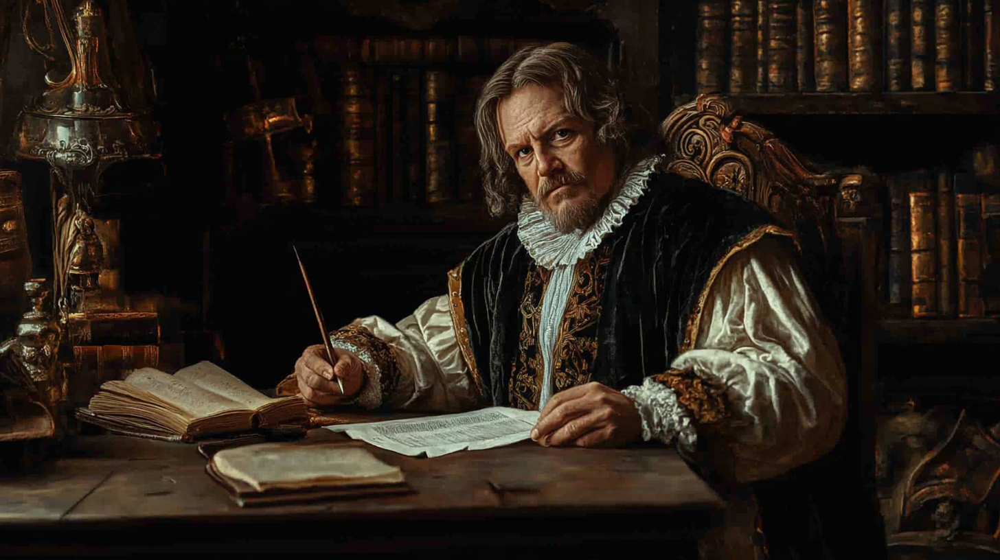

<!-- wp:heading -->

<h2 class="wp-block-heading">The Complete Essays of Montaigne</h2>

<!-- /wp:heading -->

<!-- wp:image {"id":4994,"sizeSlug":"large","linkDestination":"none","align":"wide"} -->

<figure class="wp-block-image alignwide size-large"></figure>

<!-- /wp:image -->

<!-- wp:heading -->

<h2 class="wp-block-heading">What philosophical questions or problems does the author address?</h2>

<!-- /wp:heading -->

<!-- wp:paragraph -->

In this chapter, Montaigne addresses several key philosophical questions:

<!-- /wp:paragraph -->

<!-- wp:list -->

<ul class="wp-block-list"><!-- wp:list-item -->

<li>The nature of trust and suspicion in leadership - examining whether leaders should be naturally trusting or suspicious of others</li>

<!-- /wp:list-item -->

<!-- wp:list-item -->

<li>The relationship between courage and prudence - exploring whether excessive caution undermines noble action</li>

<!-- /wp:list-item -->

<!-- wp:list-item -->

<li>The ethics of self-preservation versus honor - analyzing situations where leaders must choose between personal safety and maintaining dignity</li>

<!-- /wp:list-item -->

<!-- wp:list-item -->

<li>The psychology of power and authority - investigating how different approaches to wielding power (forceful vs. gentle) affect outcomes</li>

<!-- /wp:list-item -->

<!-- wp:list-item -->

<li>The role of fear in decision-making - considering how fear can either protect or paralyze leaders in dangerous situations</li>

<!-- /wp:list-item --></ul>

<!-- /wp:list -->

<!-- wp:paragraph -->

Through various historical examples and anecdotes, Montaigne explores these themes to understand the complex nature of leadership, courage, and human behavior under threat.

<!-- /wp:paragraph -->

<!-- wp:heading -->

<h2 class="wp-block-heading">How does the author use reasoning or argumentation to explore these issues?</h2>

<!-- /wp:heading -->

<!-- wp:paragraph -->

Montaigne employs several key argumentative strategies to explore these philosophical issues:

<!-- /wp:paragraph -->

<!-- wp:list -->

<ul class="wp-block-list"><!-- wp:list-item -->

<li>Historical examples and case studies - He presents detailed accounts of leaders like Caesar, Scipio, and others to illustrate his points about trust, courage, and leadership</li>

<!-- /wp:list-item -->

<!-- wp:list-item -->

<li>Comparative analysis - He contrasts different approaches to similar situations, such as comparing forceful versus gentle leadership styles in handling threats</li>

<!-- /wp:list-item -->

<!-- wp:list-item -->

<li>Counter-examples - He often presents cases where conventional wisdom (like being overly cautious) proved counterproductive, challenging common assumptions</li>

<!-- /wp:list-item -->

<!-- wp:list-item -->

<li>Personal observation - He incorporates firsthand accounts and observations, like the story of the gentleman governor he witnessed as a boy</li>

<!-- /wp:list-item -->

<!-- wp:list-item -->

<li>Practical reasoning - Rather than pure theoretical arguments, he focuses on real-world outcomes and practical consequences of different leadership approaches</li>

<!-- /wp:list-item --></ul>

<!-- /wp:list -->

<!-- wp:paragraph -->

His argumentative style is notably non-dogmatic - he presents various perspectives and examples, allowing readers to draw their own conclusions while subtly guiding them toward his views on the superiority of bold, trusting leadership over excessive caution and suspicion.

<!-- /wp:paragraph -->

<!-- wp:heading -->

<h2 class="wp-block-heading">What philosophical theories or viewpoints does the author present or critique?</h2>

<!-- /wp:heading -->

<!-- wp:paragraph -->

Montaigne presents and engages with several key philosophical viewpoints in this chapter:

<!-- /wp:paragraph -->

<!-- wp:list -->

<ul class="wp-block-list"><!-- wp:list-item -->

<li>Stoic philosophy - He explores the Stoic ideal of maintaining composure and dignity in the face of danger, particularly through Caesar's example</li>

<!-- /wp:list-item -->

<!-- wp:list-item -->

<li>Machiavellian pragmatism - While acknowledging practical concerns of leadership, he often critiques purely pragmatic approaches to power and security</li>

<!-- /wp:list-item -->

<!-- wp:list-item -->

<li>Classical virtue ethics - He emphasizes traditional virtues like courage, honor, and dignity as essential elements of good leadership</li>

<!-- /wp:list-item -->

<!-- wp:list-item -->

<li>Psychological theories of power - He presents views on how different displays of authority (forceful vs. gentle) affect human behavior</li>

<!-- /wp:list-item -->

<!-- wp:list-item -->

<li>Political philosophy - He critiques both excessive suspicion in governance and naive trust, advocating for a balanced approach based on confident leadership</li>

<!-- /wp:list-item --></ul>

<!-- /wp:list -->

<!-- wp:paragraph -->

Through these various philosophical lenses, Montaigne develops his own nuanced perspective that values authenticity, measured courage, and dignified leadership over purely tactical or overly cautious approaches to power and authority.

<!-- /wp:paragraph -->

<!-- wp:image {"id":4995,"sizeSlug":"large","linkDestination":"none","align":"wide"} -->

<figure class="wp-block-image alignwide size-large"></figure>

<!-- /wp:image -->

<!-- wp:heading -->

<h2 class="wp-block-heading">How does this work engage with or respond to other philosophical works or thinkers?</h2>

<!-- /wp:heading -->

<!-- wp:paragraph -->

Montaigne's chapter engages with several important philosophical traditions and thinkers:

<!-- /wp:paragraph -->

<!-- wp:list -->

<ul class="wp-block-list"><!-- wp:list-item -->

<li>Classical historians - He draws extensively from Plutarch, Appian, and other ancient historians to source his examples and case studies</li>

<!-- /wp:list-item -->

<!-- wp:list-item -->

<li>Roman Stoic philosophy - His discussion of Caesar's approach to threats shows influence from Seneca's ideas about maintaining composure under pressure</li>

<!-- /wp:list-item -->

<!-- wp:list-item -->

<li>Aristotelian ethics - His analysis of leadership virtues reflects Aristotelian concepts of the mean between extremes (e.g., between excessive trust and paranoia)</li>

<!-- /wp:list-item -->

<!-- wp:list-item -->

<li>Machiavelli - While not directly referenced, his treatment of leadership and power provides an implicit critique of Machiavellian approaches to governance</li>

<!-- /wp:list-item -->

<!-- wp:list-item -->

<li>Classical Republican thought - His examples often draw from Republican Rome, engaging with ideas about civic virtue and leadership</li>

<!-- /wp:list-item --></ul>

<!-- /wp:list -->

<!-- wp:paragraph -->

Montaigne's approach is distinctive in how he synthesizes these various philosophical traditions through concrete historical examples rather than abstract theoretical discussion. He engages with these thinkers not through direct philosophical debate, but by examining how their ideas play out in real historical situations.

<!-- /wp:paragraph -->

<!-- wp:heading -->

<h2 class="wp-block-heading">What are the practical implications or applications of the author's theories or arguments?</h2>

<!-- /wp:heading -->

<!-- wp:paragraph -->

Montaigne's arguments have several practical implications for leadership and decision-making:

<!-- /wp:paragraph -->

<!-- wp:list -->

<ul class="wp-block-list"><!-- wp:list-item -->

<li>Leadership style - Leaders should cultivate an appearance of confident trust rather than suspicious fear, as this tends to inspire loyalty and reduce threats</li>

<!-- /wp:list-item -->

<!-- wp:list-item -->

<li>Crisis management - In dangerous situations, maintaining dignity and composure often proves more effective than showing fear or attempting to placate threats</li>

<!-- /wp:list-item -->

<!-- wp:list-item -->

<li>Security measures - Excessive security precautions can sometimes create more dangers than they prevent, suggesting a need for balanced approaches to protection</li>

<!-- /wp:list-item -->

<!-- wp:list-item -->

<li>Organizational culture - Building trust through open and confident leadership creates better outcomes than fostering an environment of suspicion and fear</li>

<!-- /wp:list-item -->

<!-- wp:list-item -->

<li>Personal conduct - When facing threats or challenges, maintaining composure and dignity often proves more effective than showing fear or weakness</li>

<!-- /wp:list-item --></ul>

<!-- /wp:list -->

<!-- wp:paragraph -->

These practical lessons remain relevant for modern leaders in business, politics, and other fields where trust, authority, and security concerns intersect. They suggest that effective leadership often requires balancing prudent caution with bold confidence.

<!-- /wp:paragraph -->

<!-- wp:heading -->

<h2 class="wp-block-heading">What theories or concepts does the author use to support their argument?</h2>

<!-- /wp:heading -->

<!-- wp:paragraph -->

Montaigne uses several key theoretical frameworks and concepts to support his arguments:

<!-- /wp:paragraph -->

<!-- wp:list -->

<ul class="wp-block-list"><!-- wp:list-item -->

<li>Theory of noble leadership - He develops a theory that true nobility in leadership comes from displaying confidence and trust rather than fear and suspicion</li>

<!-- /wp:list-item -->

<!-- wp:list-item -->

<li>Psychological concepts of reciprocity - He explores how leaders' attitudes and behaviors tend to elicit similar responses from followers</li>

<!-- /wp:list-item -->

<!-- wp:list-item -->

<li>Theory of balanced virtue - He suggests that effective leadership requires finding the right balance between opposing qualities (trust/suspicion, boldness/caution)</li>

<!-- /wp:list-item -->

<!-- wp:list-item -->

<li>Concept of strategic vulnerability - He develops the idea that showing controlled vulnerability can sometimes be more effective than displaying excessive strength</li>

<!-- /wp:list-item -->

<!-- wp:list-item -->

<li>Historical pattern analysis - He uses recurring patterns in historical examples to develop theories about effective leadership approaches</li>

<!-- /wp:list-item --></ul>

<!-- /wp:list -->

<!-- wp:paragraph -->

These theoretical frameworks are typically demonstrated through historical examples rather than explicitly stated, reflecting Montaigne's preference for practical demonstration over abstract theorizing.

<!-- /wp:paragraph -->

<!-- wp:heading -->

<h2 class="wp-block-heading">How does the author interpret or challenge existing knowledge on the subject?</h2>

<!-- /wp:heading -->

<!-- wp:paragraph -->

Montaigne challenges existing knowledge in several significant ways:

<!-- /wp:paragraph -->

<!-- wp:list -->

<ul class="wp-block-list"><!-- wp:list-item -->

<li>Questioning conventional wisdom about security - He challenges the common assumption that more security measures always lead to better protection</li>

<!-- /wp:list-item -->

<!-- wp:list-item -->

<li>Reinterpreting classical examples - He often presents fresh interpretations of well-known historical events, finding new lessons in familiar stories</li>

<!-- /wp:list-item -->

<!-- wp:list-item -->

<li>Challenging Machiavellian approaches - He questions the effectiveness of power based on fear and manipulation, proposing alternative leadership models</li>

<!-- /wp:list-item -->

<!-- wp:list-item -->

<li>Critiquing excessive caution - He challenges the traditional view that leaders should always err on the side of caution and suspicion</li>

<!-- /wp:list-item -->

<!-- wp:list-item -->

<li>Reexamining virtue - He presents a more nuanced view of virtues like courage, suggesting that true courage often involves showing trust rather than force</li>

<!-- /wp:list-item --></ul>

<!-- /wp:list -->

<!-- wp:paragraph -->

Through these challenges to conventional wisdom, Montaigne develops a more sophisticated understanding of leadership and human behavior, one that emphasizes the importance of authenticity and measured confidence over traditional displays of power and authority.

<!-- /wp:paragraph -->

<!-- wp:heading -->

<h2 class="wp-block-heading">How does the book contribute to the field it is written in?</h2>

<!-- /wp:heading -->

<!-- wp:paragraph -->

This chapter makes several significant contributions to philosophical and political thought:

<!-- /wp:paragraph -->

<!-- wp:list -->

<ul class="wp-block-list"><!-- wp:list-item -->

<li>Novel approach to leadership theory - Montaigne develops a unique perspective on leadership that combines classical wisdom with practical observation</li>

<!-- /wp:list-item -->

<!-- wp:list-item -->

<li>Literary innovation - His use of historical examples and personal anecdotes to explore philosophical ideas helps establish the essay as a new form of philosophical writing</li>

<!-- /wp:list-item -->

<!-- wp:list-item -->

<li>Psychological insights - His analysis of human behavior under threat and power dynamics offers early psychological observations that remain relevant</li>

<!-- /wp:list-item -->

<!-- wp:list-item -->

<li>Political philosophy - He contributes new perspectives on governance, particularly regarding the relationship between trust, power, and security</li>

<!-- /wp:list-item -->

<!-- wp:list-item -->

<li>Ethical framework - His examination of virtue in leadership helps bridge classical and modern approaches to political ethics</li>

<!-- /wp:list-item --></ul>

<!-- /wp:list -->

<!-- wp:paragraph -->

The chapter's enduring influence can be seen in later political philosophy, leadership studies, and ethical discussions about power and governance. Its method of using concrete examples to explore abstract principles has influenced subsequent philosophical writing.

<!-- /wp:paragraph -->

<!-- wp:heading -->

<h2 class="wp-block-heading">What are the most compelling or memorable parts of the book?</h2>

<!-- /wp:heading -->

<!-- wp:paragraph -->

Several moments and examples from this chapter stand out as particularly compelling:

<!-- /wp:paragraph -->

<!-- wp:list -->

<ul class="wp-block-list"><!-- wp:list-item -->

<li>The story of the prince at Rouen - His remarkable composure in dealing with an assassination plot demonstrates the power of dignified leadership</li>

<!-- /wp:list-item -->

<!-- wp:list-item -->

<li>The contrasting examples of governors - The vivid comparison between the fearful and confident governors illustrates how leadership style affects outcomes</li>

<!-- /wp:list-item -->

<!-- wp:list-item -->

<li>The tale of the Roman fugitive - The poignant story of the man who chose to face death rather than live in perpetual fear offers profound insights about courage and dignity</li>

<!-- /wp:list-item -->

<!-- wp:list-item -->

<li>Caesar's approach to threats - His bold strategy of reading threatening letters after battles showcases an extraordinary demonstration of leadership psychology</li>

<!-- /wp:list-item -->

<!-- wp:list-item -->

<li>The gentleman's noble death - The account of how a cornered gentleman chose to die fighting rather than surrender illustrates Montaigne's ideas about honor</li>

<!-- /wp:list-item --></ul>

<!-- /wp:list -->

<!-- wp:paragraph -->

These memorable examples effectively illustrate Montaigne's philosophical points about leadership, courage, and human nature while providing vivid historical illustrations that make his arguments more compelling and accessible.

<!-- /wp:paragraph -->

<!-- wp:heading -->

<h2 class="wp-block-heading">How does the author's background or perspective influence their interpretation of the topic?</h2>

<!-- /wp:heading -->

<!-- wp:paragraph -->

Montaigne's background and perspective significantly influence his interpretation of leadership and power in several ways:

<!-- /wp:paragraph -->

<!-- wp:list -->

<ul class="wp-block-list"><!-- wp:list-item -->

<li>Noble upbringing - As a member of the French nobility, he had firsthand experience with leadership responsibilities and court politics</li>

<!-- /wp:list-item -->

<!-- wp:list-item -->

<li>Classical education - His extensive education in Latin and classical literature shaped his frequent use of ancient examples and moral philosophy</li>

<!-- /wp:list-item -->

<!-- wp:list-item -->

<li>Political experience - His role as mayor of Bordeaux and involvement in French politics gave him practical insight into leadership challenges</li>

<!-- /wp:list-item -->

<!-- wp:list-item -->

<li>Philosophical skepticism - His skeptical mindset led him to question conventional wisdom about power and security</li>

<!-- /wp:list-item -->

<!-- wp:list-item -->

<li>Personal observations - His experience witnessing political upheaval in France during religious wars informed his views on leadership during crisis</li>

<!-- /wp:list-item --></ul>

<!-- /wp:list -->

<!-- wp:paragraph -->

These personal and professional experiences help explain his preference for practical, measured approaches to leadership over purely theoretical or traditionally aggressive methods. His position as both an insider and thoughtful observer of power structures gives his analysis particular depth and nuance.

<!-- /wp:paragraph -->

<!-- wp:heading -->

<h2 class="wp-block-heading">How does the author handle opposing viewpoints or arguments?</h2>

<!-- /wp:heading -->

<!-- wp:paragraph -->

Montaigne handles opposing viewpoints in several sophisticated ways:

<!-- /wp:paragraph -->

<!-- wp:list -->

<ul class="wp-block-list"><!-- wp:list-item -->

<li>Direct acknowledgment - He often explicitly states counter-arguments before addressing them, particularly regarding conventional wisdom about security and power</li>

<!-- /wp:list-item -->

<!-- wp:list-item -->

<li>Balanced presentation - He presents multiple perspectives on issues like trust versus suspicion, allowing readers to see the merits of different approaches</li>

<!-- /wp:list-item -->

<!-- wp:list-item -->

<li>Historical counter-examples - He uses historical cases that seem to support opposing views, then analyzes why these examples might be misleading or incomplete</li>

<!-- /wp:list-item -->

<!-- wp:list-item -->

<li>Nuanced analysis - Rather than dismissing opposing views entirely, he often shows how they might be partially valid while explaining their limitations</li>

<!-- /wp:list-item -->

<!-- wp:list-item -->

<li>Practical testing - He examines how different approaches work in practice, using real-world outcomes to evaluate competing theories about leadership</li>

<!-- /wp:list-item --></ul>

<!-- /wp:list -->

<!-- wp:paragraph -->

His approach to opposing arguments is characteristically measured and fair-minded, reflecting his broader philosophical commitment to careful consideration of different perspectives rather than dogmatic assertion of a single view.

<!-- /wp:paragraph -->

<!-- wp:heading -->

<h2 class="wp-block-heading">Does the book stimulate new questions or lines of inquiry for you?</h2>

<!-- /wp:heading -->

<!-- wp:paragraph -->

This chapter raises several intriguing questions and potential areas for further inquiry:

<!-- /wp:paragraph -->

<!-- wp:list -->

<ul class="wp-block-list"><!-- wp:list-item -->

<li>How do modern security protocols and leadership practices compare to the historical examples Montaigne discusses?</li>

<!-- /wp:list-item -->

<!-- wp:list-item -->

<li>What role does cultural context play in determining effective leadership styles? Would Montaigne's observations apply equally across different societies?</li>

<!-- /wp:list-item -->

<!-- wp:list-item -->

<li>How do digital age threats and cybersecurity concerns affect the balance between trust and suspicion in leadership?</li>

<!-- /wp:list-item -->

<!-- wp:list-item -->

<li>What psychological studies might support or challenge Montaigne's observations about human behavior under different leadership styles?</li>

<!-- /wp:list-item -->

<!-- wp:list-item -->

<li>How do gender dynamics influence the effectiveness of different leadership approaches? Does Montaigne's analysis reflect gender-specific assumptions?</li>

<!-- /wp:list-item --></ul>

<!-- /wp:list -->

<!-- wp:paragraph -->

These questions suggest potential directions for interdisciplinary research combining historical analysis with modern leadership studies, psychology, and sociological perspectives.

<!-- /wp:paragraph -->

<!-- wp:heading -->

<h2 class="wp-block-heading">How does the book's content relate to current events or contemporary issues?</h2>

<!-- /wp:heading -->

<!-- wp:paragraph -->

Montaigne's observations remain remarkably relevant to contemporary issues:

<!-- /wp:paragraph -->

<!-- wp:list -->

<ul class="wp-block-list"><!-- wp:list-item -->

<li>Modern leadership challenges - His insights about balancing security with openness apply to current debates about surveillance, privacy, and organizational transparency</li>

<!-- /wp:list-item -->

<!-- wp:list-item -->

<li>Political polarization - His analysis of how fear and suspicion can erode leadership effectiveness relates to current political discourse and governance challenges</li>

<!-- /wp:list-item -->

<!-- wp:list-item -->

<li>Corporate culture - His observations about trust-based versus fear-based leadership styles remain relevant to modern workplace dynamics and management theory</li>

<!-- /wp:list-item -->

<!-- wp:list-item -->

<li>Security vs. liberty - His discussion of the trade-offs between protection and freedom echoes contemporary debates about national security measures</li>

<!-- /wp:list-item -->

<!-- wp:list-item -->

<li>Crisis management - His insights about maintaining composure during threats apply to modern crisis leadership, from pandemic response to corporate emergencies</li>

<!-- /wp:list-item --></ul>

<!-- /wp:list -->

<!-- wp:paragraph -->

These contemporary applications demonstrate how Montaigne's analysis of human nature and leadership continues to offer valuable insights for modern challenges, despite the significant changes in social and political contexts since his time.

<!-- /wp:paragraph -->

<!-- wp:heading -->

<h2 class="wp-block-heading">What assumptions does the author make, and are they justified?</h2>

<!-- /wp:heading -->

<!-- wp:paragraph -->

Montaigne makes several key assumptions in this chapter that warrant examination:

<!-- /wp:paragraph -->

<!-- wp:list -->

<ul class="wp-block-list"><!-- wp:list-item -->

<li>Human nature consistency - He assumes that human responses to leadership styles remain relatively consistent across different situations and cultures</li>

<!-- /wp:list-item -->

<!-- wp:list-item -->

<li>Virtue in nobility - He often assumes that noble birth predisposes leaders to certain virtuous behaviors, reflecting his aristocratic background</li>

<!-- /wp:list-item -->

<!-- wp:list-item -->

<li>Universal applicability - His examples, drawn mainly from European and classical sources, are assumed to provide universal lessons about leadership</li>

<!-- /wp:list-item -->

<!-- wp:list-item -->

<li>Rational actors - He generally assumes that both leaders and followers act rationally in response to different leadership approaches</li>

<!-- /wp:list-item -->

<!-- wp:list-item -->

<li>Honor-based society - Many of his arguments assume an honor-based social context that may not translate directly to modern circumstances</li>

<!-- /wp:list-item --></ul>

<!-- /wp:list -->

<!-- wp:paragraph -->

While some of these assumptions reflect the limitations of his historical context, many are supported by his careful observation of human behavior and extensive historical examples. His core insights about human psychology and leadership dynamics have proven remarkably durable, even where his specific social assumptions may be dated.

<!-- /wp:paragraph -->

<!-- wp:heading -->

<h2 class="wp-block-heading">How does the book fit into the larger context of the author's work?</h2>

<!-- /wp:heading -->

<!-- wp:paragraph -->

This chapter exemplifies several characteristic elements of Montaigne's Essays:

<!-- /wp:paragraph -->

<!-- wp:list -->

<ul class="wp-block-list"><!-- wp:list-item -->

<li>Integration of personal anecdotes - Like many of his essays, this chapter combines historical examples with contemporary observations and personal experiences</li>

<!-- /wp:list-item -->

<!-- wp:list-item -->

<li>Skeptical methodology - The chapter demonstrates Montaigne's typical approach of questioning conventional wisdom and examining issues from multiple angles</li>

<!-- /wp:list-item -->

<!-- wp:list-item -->

<li>Moral philosophy focus - This chapter reflects his broader interest in practical moral philosophy and human behavior</li>

<!-- /wp:list-item -->

<!-- wp:list-item -->

<li>Literary style - His use of vivid examples and clear prose to explore complex ideas is characteristic of his overall writing approach</li>

<!-- /wp:list-item -->

<!-- wp:list-item -->

<li>Political commentary - The chapter's analysis of leadership connects to his broader examination of power and governance throughout the Essays</li>

<!-- /wp:list-item --></ul>

<!-- /wp:list -->

<!-- wp:paragraph -->

This chapter also shows Montaigne's evolution as a writer and thinker, demonstrating his mature ability to weave together multiple examples and arguments into a coherent philosophical discussion. It reflects his characteristic blend of classical learning with practical observation, which appears throughout his essays.

<!-- /wp:paragraph -->

<!-- wp:heading -->

<h2 class="wp-block-heading">What main themes are conveyed in Montaigne's essay?</h2>

<!-- /wp:heading -->

<!-- wp:paragraph -->

Several key themes emerge throughout this essay:

<!-- /wp:paragraph -->

<!-- wp:list -->

<ul class="wp-block-list"><!-- wp:list-item -->

<li><strong>The relationship between fear and leadership</strong> - Montaigne explores how fear can either strengthen or undermine leadership effectiveness</li>

<!-- /wp:list-item -->

<!-- wp:list-item -->

<li><strong>The power of composed behavior</strong> - He emphasizes how maintaining dignity and composure in the face of threats can be more effective than reactive responses</li>

<!-- /wp:list-item -->

<!-- wp:list-item -->

<li><strong>Trust versus suspicion</strong> - The essay examines the delicate balance between necessary caution and excessive suspicion in leadership</li>

<!-- /wp:list-item -->

<!-- wp:list-item -->

<li><strong>Courage and authenticity</strong> - Montaigne explores how true courage often manifests in showing trust and maintaining one's principles rather than in aggressive displays</li>

<!-- /wp:list-item -->

<!-- wp:list-item -->

<li><strong>The psychology of leadership</strong> - He analyzes how different leadership styles affect follower behavior and overall outcomes</li>

<!-- /wp:list-item -->

<!-- wp:list-item -->

<li><strong>The paradox of security</strong> - The essay demonstrates how excessive security measures can sometimes create more vulnerability</li>

<!-- /wp:list-item --></ul>

<!-- /wp:list -->

<!-- wp:paragraph -->

These themes interweave throughout the various examples and anecdotes, building a complex picture of effective leadership and human behavior under pressure.

<!-- /wp:paragraph -->

<!-- wp:image {"id":4996,"sizeSlug":"large","linkDestination":"none","align":"wide"} -->

<figure class="wp-block-image alignwide size-large"></figure>

<!-- /wp:image -->

<!-- wp:heading -->

<h2 class="wp-block-heading">What can we learn from Montaigne?</h2>

<!-- /wp:heading -->

<!-- wp:paragraph -->

Montaigne's insights from Chapter 23 offer several valuable lessons that are particularly relevant to contemporary culture:

<!-- /wp:paragraph -->

<!-- wp:list -->

<ul class="wp-block-list"><!-- wp:list-item -->

<li><strong>Leadership in the Digital Age</strong> - His observations about trust and transparency are crucial for modern leaders managing remote teams and digital communications. While technology has changed how we interact, the fundamental need for authentic leadership remains essential.</li>

<!-- /wp:list-item -->

<!-- wp:list-item -->

<li><strong>Social Media and Public Image</strong> - Montaigne's emphasis on maintaining composure under pressure is especially relevant in an era where leaders face constant scrutiny and potential viral criticism. His advice about dignified responses to threats applies well to managing online reputation.</li>

<!-- /wp:list-item -->

<!-- wp:list-item -->

<li><strong>Corporate Culture and Trust</strong> - His insights about fear-based versus trust-based leadership speak directly to ongoing debates about workplace culture, employee surveillance, and management styles in modern organizations. Companies struggling with employee engagement might benefit from his observations about how trust fosters loyalty.</li>

<!-- /wp:list-item -->

<!-- wp:list-item -->

<li><strong>Political Discourse</strong> - In an age of increasing political polarization, Montaigne's approach to understanding opposing viewpoints and maintaining measured responses offers valuable guidance for constructive political dialogue.</li>

<!-- /wp:list-item --></ul>

<!-- /wp:list -->

<!-- wp:paragraph -->

Modern Applications of Montaigne's Wisdom:

<!-- /wp:paragraph -->

<!-- wp:list -->

<ul class="wp-block-list"><!-- wp:list-item -->

<li><strong>Crisis Management</strong> - His examples of leaders maintaining composure during threats provide excellent models for modern crisis management, whether dealing with cyber threats, public relations challenges, or organizational changes.</li>

<!-- /wp:list-item -->

<!-- wp:list-item -->

<li><strong>Personal Privacy</strong> - His discussion of security versus freedom remains relevant to contemporary debates about data privacy, surveillance, and personal liberty in the digital age.</li>

<!-- /wp:list-item -->

<!-- wp:list-item -->

<li><strong>Professional Relationships</strong> - Montaigne's insights about building trust and avoiding excessive suspicion can help modern professionals navigate complex workplace relationships and network building.</li>

<!-- /wp:list-item --></ul>

<!-- /wp:list -->

<!-- wp:paragraph -->

Contemporary Cultural Relevance:

<!-- /wp:paragraph -->

<!-- wp:list -->

<ul class="wp-block-list"><!-- wp:list-item -->

<li><strong>Mental Health Awareness</strong> - His observations about the psychological impact of constant fear and suspicion connect to modern discussions about workplace stress, anxiety, and the importance of psychological safety in organizations.</li>

<!-- /wp:list-item -->

<!-- wp:list-item -->

<li><strong>Authenticity in Leadership</strong> - In an era where authenticity is highly valued, particularly by younger generations, Montaigne's emphasis on genuine behavior over artificial displays of authority resonates strongly.</li>

<!-- /wp:list-item -->

<!-- wp:list-item -->

<li><strong>Global Leadership</strong> - His principles about human nature and leadership can help modern leaders navigate cross-cultural challenges in our increasingly interconnected world.</li>

<!-- /wp:list-item --></ul>

<!-- /wp:list -->

<!-- wp:paragraph -->

Practical Applications for Today:

<!-- /wp:paragraph -->

<!-- wp:list -->

<ul class="wp-block-list"><!-- wp:list-item -->

<li><strong>Decision-Making</strong> - His balanced approach to risk assessment can guide modern leaders in making decisions about cybersecurity, business expansion, or organizational change.</li>

<!-- /wp:list-item -->

<!-- wp:list-item -->

<li><strong>Personal Development</strong> - Montaigne's emphasis on self-reflection and questioning conventional wisdom provides a valuable model for personal and professional growth in today's rapidly changing world.</li>

<!-- /wp:list-item -->

<!-- wp:list-item -->

<li><strong>Conflict Resolution</strong> - His insights about handling threats and maintaining dignity can inform modern approaches to conflict resolution in professional and personal contexts.</li>

<!-- /wp:list-item --></ul>

<!-- /wp:list -->

<!-- wp:paragraph -->

Looking Forward:

<!-- /wp:paragraph -->

<!-- wp:paragraph -->

As we face new challenges in artificial intelligence, climate change, and global cooperation, Montaigne's fundamental insights about human nature, leadership, and trust remain remarkably applicable. His emphasis on balancing security with openness, maintaining composure under pressure, and building trust-based relationships provides a valuable framework for addressing contemporary challenges.

<!-- /wp:paragraph -->

<!-- wp:paragraph -->

Perhaps most importantly, Montaigne's approach to questioning assumptions and examining issues from multiple perspectives offers a valuable model for navigating the complexity of modern life. In an era of rapid change and increasing polarization, his measured, thoughtful approach to leadership and human interaction becomes even more relevant.

<!-- /wp:paragraph -->

<!-- wp:image {"id":4997,"sizeSlug":"large","linkDestination":"none","align":"wide"} -->

<figure class="wp-block-image alignwide size-large"><figcaption class="wp-element-caption">Leadership Styles</figcaption></figure>

<!-- /wp:image -->

<!-- wp:heading -->

<h2 class="wp-block-heading"><strong>What is the main theme of the essay?</strong></h2>

<!-- /wp:heading -->

<!-- wp:paragraph -->

The main theme of Montaigne's essay revolves around the principle that similar events or circumstances can produce vastly different outcomes depending on how leaders respond to them. This fundamental observation has profound implications both in its historical context and our modern world.

<!-- /wp:paragraph -->

<!-- wp:heading {"level":3} -->

<h3 class="wp-block-heading">Historical Context and Significance</h3>

<!-- /wp:heading -->

<!-- wp:paragraph -->

In Montaigne's 16th-century France, this theme carried particular weight due to several factors:

<!-- /wp:paragraph -->

<!-- wp:list -->

<ul class="wp-block-list"><!-- wp:list-item -->

<li>The volatile political landscape of the French Wars of Religion demanded swift yet measured leadership responses</li>

<!-- /wp:list-item -->

<!-- wp:list-item -->

<li>Noble families faced constant threats to their power and security, making their reaction strategies crucial for survival</li>

<!-- /wp:list-item -->

<!-- wp:list-item -->

<li>The prevalence of honor-based social codes meant that a leader's public handling of challenges could dramatically affect their authority</li>

<!-- /wp:list-item -->

<!-- wp:list-item -->

<li>Personal relationships and alliances were central to political power, requiring careful balance between trust and vigilance</li>

<!-- /wp:list-item --></ul>

<!-- /wp:list -->

<!-- wp:paragraph -->

Leaders in Montaigne's era had to navigate complex webs of loyalty, betrayal, and political maneuvering. Their success often depended not on the nature of the challenges they faced, but on their ability to respond with appropriate measure and dignity.

<!-- /wp:paragraph -->

<!-- wp:heading {"level":3} -->

<h3 class="wp-block-heading">Contemporary Relevance</h3>

<!-- /wp:heading -->

<!-- wp:paragraph -->

Today, this theme resonates even more strongly across various domains:

<!-- /wp:paragraph -->

<!-- wp:list -->

<ul class="wp-block-list"><!-- wp:list-item -->

<li><strong>Corporate Leadership</strong><!-- wp:list -->
<ul class="wp-block-list"><!-- wp:list-item -->

<li>Managing cyber threats and data breaches</li>

<!-- /wp:list-item -->

<!-- wp:list-item -->

<li>Responding to market disruptions and competition</li>

<!-- /wp:list-item -->

<!-- wp:list-item -->

<li>Handling public relations crises</li>

<!-- /wp:list-item -->

<!-- wp:list-item -->

<li>Navigating organizational change</li>

<!-- /wp:list-item --></ul>

<!-- /wp:list --></li>

<!-- /wp:list-item -->

<!-- wp:list-item -->

<li><strong>Political Leadership</strong><!-- wp:list -->
<ul class="wp-block-list"><!-- wp:list-item -->

<li>Addressing global security challenges</li>

<!-- /wp:list-item -->

<!-- wp:list-item -->

<li>Managing economic uncertainties</li>

<!-- /wp:list-item -->

<!-- wp:list-item -->

<li>Responding to public health crises</li>

<!-- /wp:list-item -->

<!-- wp:list-item -->

<li>Dealing with social movements and protests</li>

<!-- /wp:list-item --></ul>

<!-- /wp:list --></li>

<!-- /wp:list-item -->

<!-- wp:list-item -->

<li><strong>Organizational Management</strong><!-- wp:list -->
<ul class="wp-block-list"><!-- wp:list-item -->

<li>Balancing remote work security with employee trust</li>

<!-- /wp:list-item -->

<!-- wp:list-item -->

<li>Building inclusive workplace cultures</li>

<!-- /wp:list-item -->

<!-- wp:list-item -->

<li>Managing cross-cultural teams</li>

<!-- /wp:list-item -->

<!-- wp:list-item -->

<li>Implementing technological changes</li>

<!-- /wp:list-item --></ul>

<!-- /wp:list --></li>

<!-- /wp:list-item --></ul>

<!-- /wp:list -->

<!-- wp:paragraph -->

The modern application of Montaigne's insights reveals several key principles:

<!-- /wp:paragraph -->

<!-- wp:list -->

<ul class="wp-block-list"><!-- wp:list-item -->

<li><strong>Response Quality Matters More Than Threat Severity</strong> - How leaders react to challenges often has more impact than the initial problem itself</li>

<!-- /wp:list-item -->

<!-- wp:list-item -->

<li><strong>Balance is Essential</strong> - Effective leadership requires balancing security measures with trust-building initiatives</li>

<!-- /wp:list-item -->

<!-- wp:list-item -->

<li><strong>Composure Creates Strength</strong> - Maintaining dignity and calm during crises often proves more effective than reactive responses</li>

<!-- /wp:list-item -->

<!-- wp:list-item -->

<li><strong>Trust Builds Resilience</strong> - Organizations built on trust rather than fear demonstrate greater adaptability and strength</li>

<!-- /wp:list-item --></ul>

<!-- /wp:list -->

<!-- wp:paragraph -->

The digital age has introduced new dimensions to these principles:

<!-- /wp:paragraph -->

<!-- wp:list -->

<ul class="wp-block-list"><!-- wp:list-item -->

<li>Social media amplifies leadership responses, making measured reactions even more crucial</li>

<!-- /wp:list-item -->

<!-- wp:list-item -->

<li>Global connectivity means local decisions can have international repercussions</li>

<!-- /wp:list-item -->

<!-- wp:list-item -->

<li>Digital surveillance capabilities require careful balance between security and privacy</li>

<!-- /wp:list-item -->

<!-- wp:list-item -->

<li>Remote work environments demand new approaches to building trust and maintaining security</li>

<!-- /wp:list-item --></ul>

<!-- /wp:list -->

<!-- wp:paragraph -->

<a href="https://betterworldwithdesign.com/chapter-23-various-events-form-the-same-counsel/">Chapter 23 - Various events form the same counsel</a>

<!-- /wp:paragraph -->

<!-- wp:paragraph -->

Looking toward the future, several factors make this theme increasingly relevant:

<!-- /wp:paragraph -->

<!-- wp:list -->

<ul class="wp-block-list"><!-- wp:list-item -->

<li><strong>Technological Evolution</strong><!-- wp:list -->
<ul class="wp-block-list"><!-- wp:list-item -->

<li>Artificial intelligence and automation changing leadership dynamics</li>

<!-- /wp:list-item -->

<!-- wp:list-item -->

<li>Cybersecurity threats requiring sophisticated response strategies</li>

<!-- /wp:list-item -->

<!-- wp:list-item -->

<li>Digital transformation affecting organizational trust structures</li>

<!-- /wp:list-item --></ul>

<!-- /wp:list --></li>

<!-- /wp:list-item -->

<!-- wp:list-item -->

<li><strong>Social Changes</strong><!-- wp:list -->
<ul class="wp-block-list"><!-- wp:list-item -->

<li>Increasing workplace diversity demanding adaptable leadership styles</li>

<!-- /wp:list-item -->

<!-- wp:list-item -->

<li>Growing emphasis on transparency and authenticity</li>

<!-- /wp:list-item -->

<!-- wp:list-item -->

<li>Evolution of organizational structures and hierarchies</li>

<!-- /wp:list-item --></ul>

<!-- /wp:list --></li>

<!-- /wp:list-item -->

<!-- wp:list-item -->

<li><strong>Global Challenges</strong><!-- wp:list -->
<ul class="wp-block-list"><!-- wp:list-item -->

<li>Climate change requiring coordinated leadership responses</li>

<!-- /wp:list-item -->

<!-- wp:list-item -->

<li>Economic uncertainties demanding strategic adaptation</li>

<!-- /wp:list-item -->

<!-- wp:list-item -->

<li>Geopolitical tensions necessitating diplomatic solutions</li>

<!-- /wp:list-item --></ul>

<!-- /wp:list --></li>

<!-- /wp:list-item --></ul>

<!-- /wp:list -->

<!-- wp:paragraph -->

The enduring value of Montaigne's insights lies in their universal application to human behavior and leadership dynamics. Whether in Renaissance France or today's digital world, the principle remains: effective leadership is not just about the challenges faced, but about how those challenges are met and transformed into opportunities for growth and strengthening relationships.

<!-- /wp:paragraph -->

<!-- wp:paragraph -->

This theme continues to inform leadership development, organizational strategy, and personal growth in our rapidly evolving world. It reminds us that while circumstances may change, the fundamental principles of effective leadership - maintaining composure, building trust, and responding with measured wisdom - remain constant across time and culture.

<!-- /wp:paragraph -->

