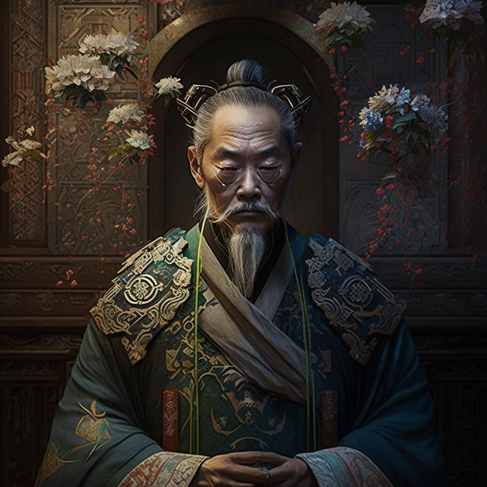
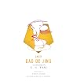

Dao De Jing

<a href="https://www.goodreads.com/book/show/53834595-dao-de-jing">Dao De Jing</a> by <a href="https://www.goodreads.com/author/show/17330857.C_C_Tsai">C.C. Tsai</a> 
  
Dao De Jing, also known as Tao Te Ching, is a book of Chinese philosophy written by Laozi in the 6th century BC. This book is considered one of the most important works in Chinese literature and philosophy, and it has been translated into many languages.  The book is important today because it presents ideas that are still relevant to modern society. It discusses the concept of the "Dao", or the way, which represents the ultimate reality of the universe. The book also presents the idea of the "De", or virtue, which is the way in which people should live their lives to be in harmony with the Dao. These concepts are still studied and applied in modern society, particularly in areas such as philosophy, religion, and self-help.  When the book was first published, the concepts presented in it were not widely accepted. The book was considered too radical and unconventional, and it was not until the Han Dynasty that it gained popularity. However, its influence continued to grow, and it eventually became a cornerstone of Chinese philosophy.  Without this book, the world would be without the profound philosophical ideas that have influenced countless people throughout history. The concepts of the Dao and De have had a significant impact on Chinese culture and society, and they have also influenced Western philosophy through the works of philosophers such as Friedrich Nietzsche and Martin Heidegger.  After reading this book, the reader should reflect on the ideas presented and consider how they can be applied to their own life. The book emphasizes the importance of living in harmony with the natural world and cultivating inner peace, and the reader should strive to incorporate these values into their daily life. Additionally, the book encourages the reader to embrace simplicity and humility, which can lead to a more fulfilling and meaningful life.  Dao De Jing is a timeless work of philosophy that continues to be relevant in modern society. Its concepts have had a profound impact on Chinese culture and philosophy, and they have also influenced Western thought.
 <a href="https://www.goodreads.com/review/list/54140412-gary-crossey">View all my Goodreads reviews</a>

<figure class="wp-block-image size-full"></figure>
