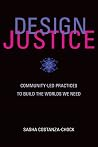

<figure class="wp-block-image size-full"><figcaption class="wp-element-caption">Community Design System </figcaption></figure>

<a href="https://www.goodreads.com/book/show/51151807-design-justice">Design Justice: Community-Led Practices to Build the Worlds We Need</a> by <a href="https://www.goodreads.com/author/show/5104096.Sasha_Costanza_Chock">Sasha Costanza-Chock</a> 
Design Justice is a book that explores the principles of community-led design and its potential to create a more just and equitable society. Sasha Costanza-Chock, a scholar and activist, has done a remarkable job of bringing this subject to the forefront of today's global culture. The book has been validated by a number of prominent scholars and activists, including Angela Davis and Tim Brown.<h3>Chapter Analysis</h3>### Chapter 1: What is Design Justice?  Chapter 1 provides a clear definition of Design Justice and why it is needed. The author explains how design can perpetuate social inequalities, and how community-led design can help to address these issues. This chapter lays the foundation for the rest of the book and is essential reading for anyone interested in learning more about Design Justice.  ### Chapter 2: The Design Justice Network  Chapter 2 introduces a comprehensive overview of the Design Justice Network, a community of designers and activists who are working tirelessly to promote the principles of design justice. The Design Justice Network is a unique and groundbreaking organization that is dedicated to creating a more equitable and just society through the power of design. By promoting the principles of design justice, the network is able to tackle a wide range of issues and challenges in our society, including social inequality, injustice, and discrimination. Through a range of initiatives and projects, the Design Justice Network is able to empower communities, promote diversity and inclusivity, and foster a culture of innovation and creativity. The Design Justice Network is committed to educating and engaging individuals of all backgrounds in the power and importance of design justice, and inspiring them to take action to create a better world for all.  ### Chapter 3: Community-Led Design Frameworks  Costanza-Chock presents a comprehensive and well-structured framework for community-led design, a collaborative approach in which community members are actively involved in the design process. This framework consists of several stages, including community mapping, visioning, co-design, and implementation.  Costanza-Chock also delves into various models of community-led design, such as the Participatory Action Research (PAR) model and the Asset-Based Community Development (ABCD) model. Examining the strengths and limitations of each model and provides examples of successful community-led design projects.  By emphasizing the importance of community-led design, Costanza-Chock highlights the need for designers and researchers to move beyond traditional top-down approaches and to engage with diverse communities throughout the design process. This not only leads to more inclusive and innovative designs but also empowers communities and fosters social change.  ### Chapter 4: Design Justice in Action  This chapter showcases various case studies of community-led design projects and their contribution to the betterment of communities. The studies provide a detailed analysis of the projects' conception, planning, execution, and impact. While delving into the unique characteristics of each project, including the challenges faced and how they were overcome. This selection refers to a report or presentation that discusses the different parties involved in a project, their individual contributions to the project's success, and the role they played. It highlights the importance of collaboration and teamwork in achieving project goals. Overall, the case studies aim to illustrate how community-led design projects can empower communities and lead to sustainable development.  ### Chapter 5: Designing for the Margins  In this chapter, Costanza-Chock discusses the importance of designing for marginalized communities and explores different approaches to doing so. One important point made is about the need to truly listen to the communities being designed for - this means not just assuming what their needs are, but actually engaging with them in a meaningful way. Another approach discussed is the use of co-design, where the community members themselves are involved in the design process. This can lead to more relevant and effective design outcomes, as the people who will actually be using the product or service are intimately involved in its creation. Furthermore, the author highlights the importance of an intersectional approach to design, recognizing that marginalized communities are not homogenous and that their needs may differ based on factors such as race, gender, and class.  ### Chapter 6: Design Justice and the Digital Age  The author delves into the intricate relationship between design justice and technology, and how the latter can be utilized to promote the former. By examining the current state of design and technology, the author highlights the potential for technology to be used in the service of design justice, while also acknowledging the challenges that such an approach may face. Through a careful analysis of the intersection between these two fields, the author provides a thought-provoking and nuanced perspective on the ways in which technology can be harnessed to promote design justice.  ### Chapter 7: Towards a Just Design Future  The final chapter of the book is devoted to exploring the concept of design justice, which is the idea that the design of products, systems, and infrastructure can have a significant impact on equity and justice. This is an important concept to consider as we move towards creating a more just and equitable future. The author argues that we must take a critical approach to design, questioning the assumptions and biases that underlie many design decisions. By doing so, we can create products and systems that are more inclusive and fair, and that better serve the needs of all people, particularly those who have historically been marginalized or excluded. The author also suggests that there is a need for greater collaboration between designers and communities to ensure that design solutions are context-specific and responsive to the needs and values of the people they are intended to serve. Overall, the chapter provides a compelling argument for the importance of design justice, and offers a roadmap for how we can work towards a more just and equitable future through design.  This book provides a framework and case studies that inform and inspire community-led design projects. It contributes to the field of design and activism and is recommended reading for anyone interested in building a more just society. After reading, the reader will have a better understanding of the principles of design justice and its potential to create equity and justice.
  
<a href="https://www.goodreads.com/review/list/54140412-gary-crossey">View all my Goodreads reviews</a>

