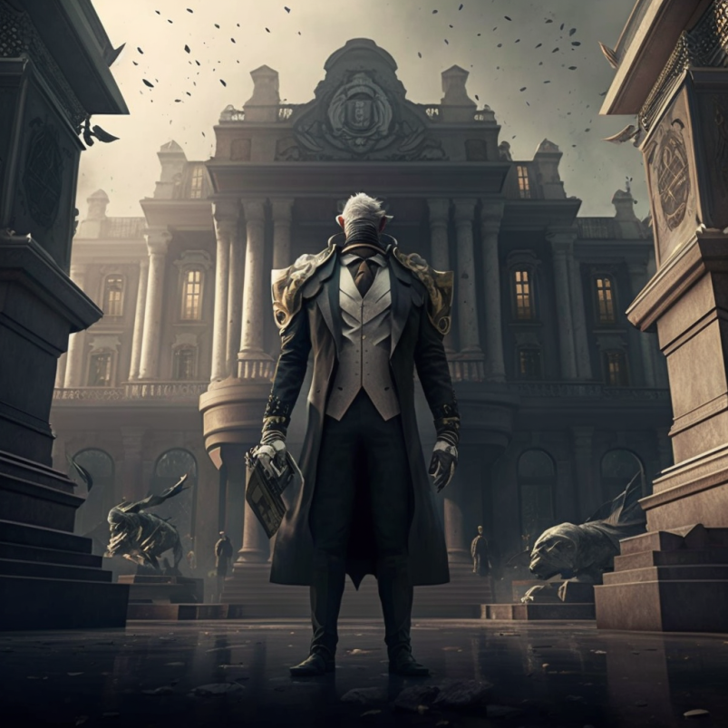
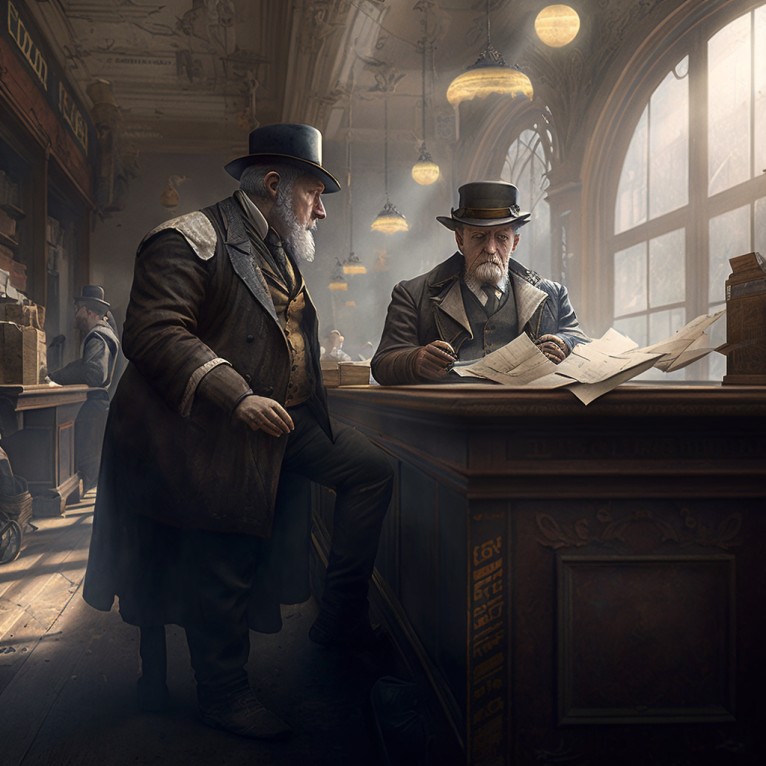
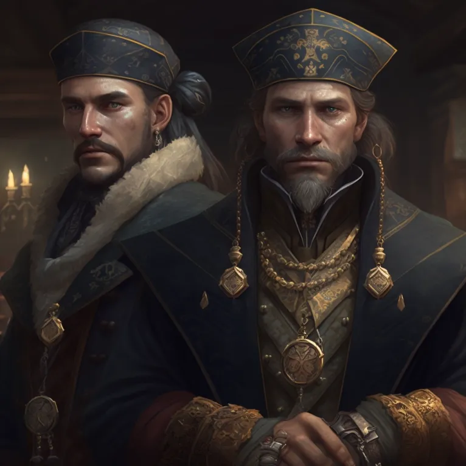
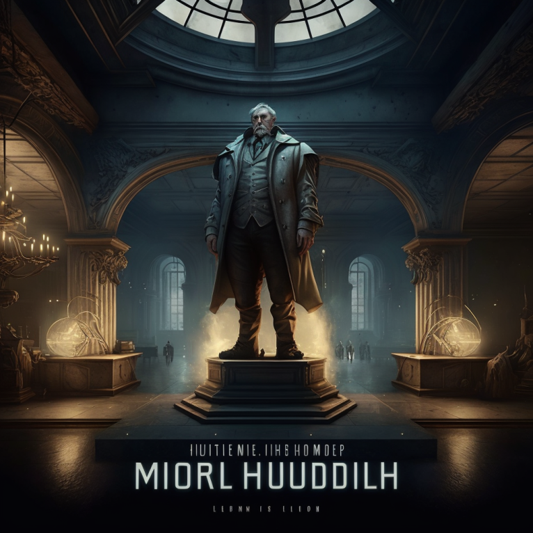
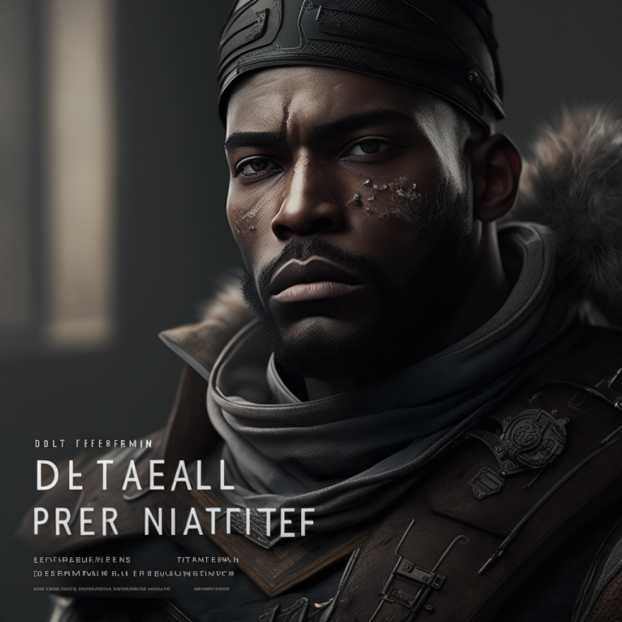
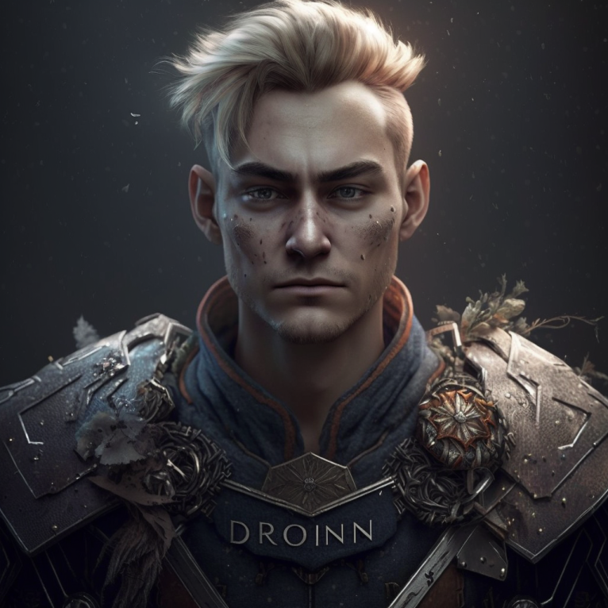
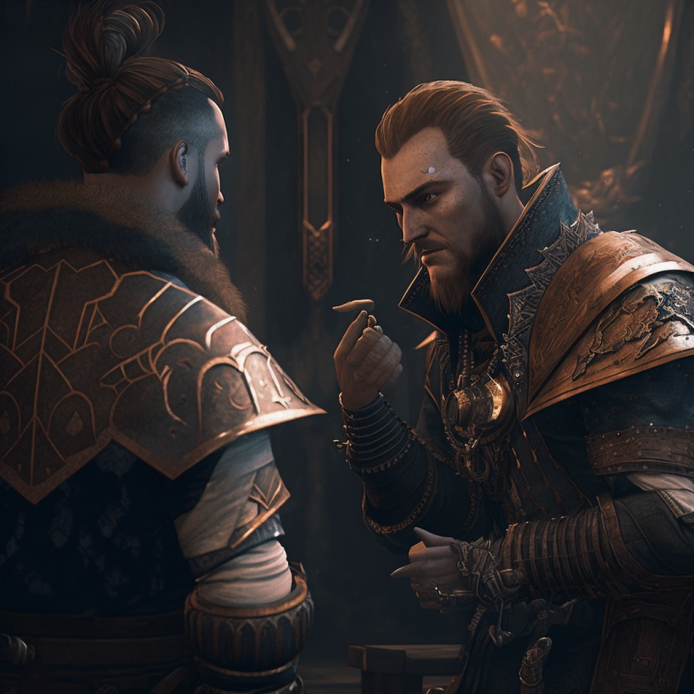
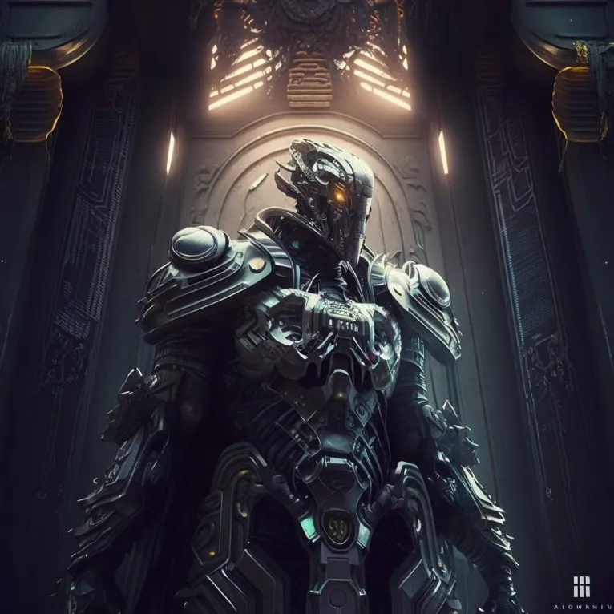

<a href="https://betterworldwithdesign.com/foundation-by-isaac-asimov/">View Post</a>

<figure class="wp-block-image alignfull size-full"><figcaption class="wp-element-caption">Digital Ai Art by Gary Crossey</figcaption></figure>

<h2 class="wp-block-heading">Foundation&nbsp;</h2>

Foundation by Isaac Asimov is a rich and complex science fiction novel that explores the concept of psychohistory, nature of power, knowledge, civilization, and the fall of empires. Set in a future universe where the Galactic Empire is in decline and a new dark age is predicted to last for 30,000 years, the protagonist, Hari Seldon, has developed a new field of study called psychohistory, which can predict the behavior of large groups of people using mathematical equations.

Foundation can be seen as a metaphor for the decline of empires throughout history. The rise and fall of the Galactic Empire can be seen as a reflection of the rise and fall of real-world empires such as the Roman Empire or the British Empire. The book raises important concerns about the nature of power and the role of individuals and groups in shaping the course of history.

Asimov uses a variety of techniques, including character development, political intrigue, and scientific concepts, to explore these themes in depth. The book asks us to question the role of individuals and groups in shaping the course of history, the importance of knowledge and understanding in preserving civilization, and the dangers of becoming too reliant on one person or group for power.

The symbolism in Foundation is complex and multi-layered.

The concept of psychohistory can be seen as a metaphor for the power of knowledge and the importance of understanding the past in order to shape the future. The Encyclopedia Galactica is a symbol of the importance of preserving knowledge and the danger of losing it during times of upheaval. The Foundation itself can be seen as a symbol of the importance of planning and foresight in creating a better future.

Foundation's themes and symbolism are still relevant to today's readers. The rise and fall of empires is a recurring theme throughout history, and the danger of becoming too reliant on one person or group for power is still a relevant concern. The importance of knowledge and foresight in shaping the future is also a timeless concept that is still relevant. In addition, the book's exploration of the role of individuals and groups in shaping the course of history is a thought-provoking concept.

The events of Foundation take place over a period of several hundred years. The timeline is divided into five parts, each of which covers a different period of time. The Psychohistorians covers the earliest period, while The Traders covers the latest.

<figure class="wp-block-image size-full is-resized"><figcaption class="wp-element-caption">Digital Ai Art by Gary Crossey</figcaption></figure>

<h5 class="wp-block-heading"><strong>Foundation Parts &amp; Timeline:</strong></h5>

<ul class="wp-block-list">
<li>The Psychohistorians</li>

<li>The Encyclopedists</li>

<li>The Mayors</li>

<li>The Traders</li>

<li>The Merchant Princes</li>
</ul>

In each section, Asimov explores the themes of power, knowledge, and civilization in different ways. 

<h2 class="wp-block-heading">The Psychohistorians</h2>

<figure class="wp-block-image size-full"><figcaption class="wp-element-caption">Psychohistorians Digital Ai Art created by Gary Crossey</figcaption></figure>

In The Psychohistorians, we are introduced to Seldon and his team of mathematicians, who are working to save civilization from its inevitable decline. Asimov introduces the concept of psychohistory and explores the idea that human behavior can be predicted and controlled, which raises ethical questions about the role of free will in society.

Seldon believes that he can use psychohistory to predict the fall of the Galactic Empire and the rise of a new dark age that will last for 30,000 years. He creates a plan called the Foundation, which is designed to shorten the dark age to only 1,000 years.

Psychohistorians also introduces us to several other characters, including Gaal Dornick, a young mathematician who has come to Trantor to work with Seldon, and the Emperor, who is skeptical of Seldon's predictions. We also learn about the Hari Seldon hologram, which is a virtual representation of Seldon that appears throughout the book to offer guidance to the characters.

Asimov raises important questions about the nature of power and the role of individuals and groups in shaping the course of history. The characters in the novel each play a significant role in the story and the development of the Foundation. For example, Salvor Hardin is instrumental in defeating Anacreon without violence, which helps to establish the Foundation's independence. Hober Mallow helps to make the Foundation more self-sufficient and prosperous, which is essential for its survival. Jorane Sutt's skepticism of Mallow's trading ultimately leads to his downfall, which solidifies Mallow's position as mayor.

Asimov's exploration of the nature of power and the role of individuals and groups in shaping the course of history is a thought-provoking concept that is still relevant. The rise and fall of empires is a recurring theme throughout history. The importance of knowledge and foresight in shaping the future is also a timeless concept. The book's exploration of the relationship between power and knowledge is especially gripping, as it raises important questions about the role of individuals and groups in shaping the course of history.

As the story progresses, the characters continue to shape the Foundation and its future. Gaal Dornick, the young mathematician, provides the reader with a sense of wonder and excitement as he explores the galaxy and discovers new worlds. Hari Seldon's hologram acts as a guiding force throughout the novel, offering advice and direction to the characters as they navigate the challenges of building a new society. Salvor Hardin, Hober Mallow, and Jorane Sutt each represent different approaches to leadership and the exercise of power. Asimov skillfully weaves these characters together to create a complex and multifaceted exploration of power, knowledge, and civilization.

<h2 class="wp-block-heading">The Encyclopedists</h2>

<figure class="wp-block-image size-full"><figcaption class="wp-element-caption">Encyclopedists Digital Ai Art by Gary Crossey</figcaption></figure>

In The Encyclopedists, Asimov explores the shifting of political power and the importance of understanding when to make a move and when to keep control. The Encyclopedists are blind to the fact that they are vulnerable to attack and believe that the empire is still there to protect them, even as it rapidly loses power. Salvor Hardin, the mayor of Terminus, recognizes this and decides that the time is right to overthrow the council and become the leader. 

In this section, we see the creation of the Encyclopedia Galactica, which is a massive project designed to collect and preserve all of the knowledge in the galaxy. The Encyclopedia is being compiled on the planet Terminus, which is the first location of the Foundation. The section introduces us to a new set of characters, including Salvor Hardin, the mayor of Terminus, and Yugo Amaryl, a member of the Board of Trustees.

However, Hardin does not take over immediately. Instead, he works on setting up an environment that is right for rebellion. Firstly, he secretly gains control of 60% of the planet's newspapers and uses them to express his opinion and turn public opinion against the Encyclopedists. Secondly, he goes to great lengths to understand the enemy and the declining empire, recording Dorwin's conversation. Thirdly, he undermines the Encyclopedists' confidence with his superior political knowledge. By the end of the section, Salvor Hardin has guided the Foundation through its first crisis and onto its next phase.

The Encyclopedist also explores the relationship between Terminus and the neighboring planet, Anacreon. Anacreon is a powerful kingdom that is trying to assert control over Terminus. Hardin realizes that he cannot defeat Anacreon militarily, so he uses a clever strategy to defeat them without violence.

<h2 class="wp-block-heading">The Mayors</h2>

<figure class="wp-block-image size-full"><figcaption class="wp-element-caption">Digital Ai Art created by Gary Crossey</figcaption></figure>

In The Mayors, Asimov explores the importance of ideology through the character of Hardin. Hardin develops a solid political structure through the trade of nuclear power and realizes that the masses see the Foundation's ability to create nuclear power as mystical. He uses this to his advantage by setting up a religion that controls the masses and puts the Foundation in a powerful position. This shows the strength of the Seldon Plan, which predicts the behavior of mass groups and makes them easier to control. However, Asimov foreshadows potential problems with Hardin's approach by showing a rebellion forming within his own government.

In this section, we see the rise of a new mayor of Terminus, named Hober Mallow. Mallow is a trader who realizes that the Foundation needs to become more self-sufficient if it is going to survive. He begins trading with neighboring planets and brings in new technology that helps Terminus become more prosperous.

The section also introduces us to a new character named Jorane Sutt, who is a member of the Board of Trustees. Sutt is skeptical of Mallow's trading and believes that it will lead to the downfall of the Foundation. However, Mallow is able to outmaneuver Sutt and solidify his position as mayor.

While the reader may not see Sermak take over, there is a feeling that the Foundation needs a new change to take it through to its next phase. In fact, the section ends similarly to the previous section, with Asimov suggesting that Hardin is about to be overthrown by Sermak. Hardin spies Sermak having an animated conversation with his right-hand man Lewis Bort, indicating that a new change is on the horizon.

<h2 class="wp-block-heading">The Traders</h2>

<figure class="wp-block-image size-full"><figcaption class="wp-element-caption">Digital Ai Art by Gary Crossey</figcaption></figure>

During The Traders, we see the Foundation expand its trading operations to other planets. Mallow travels to the planet Korell, where he discovers that the people are rebelling against their ruler. Mallow realizes that he can use this rebellion to his advantage and takes control of the planet.

The section also introduces us to a new character named Lathan Devers, who is a trader from Korell. Devers is initially hostile to Mallow, but the two eventually become allies. Together, they are able to defeat a group of conspirators who are trying to overthrow Mallow.

In The Traders, Asimov explores the concept of expansion and the importance of trade in maintaining power. Hober Mallow, the new mayor of Terminus, expands the Foundation's trading operations to other planets and takes control of the planet Korell by using a rebellion to his advantage. He also forms an alliance with Lathan Devers, a trader from Korell, who initially was hostile to Mallow. Together, they are able to defeat a group of conspirators who are trying to overthrow Mallow.

<figure class="wp-block-image size-full"><figcaption class="wp-element-caption">Digital Ai Art by Gary Crossey</figcaption></figure>

In the Traders section, Asimov presents the idea that the religion is losing its power and the Foundation now needs the traders to spread their message. As an example, Ponyets sells Askonce nuclear power by providing important people with what either they want or what they need to progress. The Grandmaster is only interested in gold, and Ponyet shows his salesman's instincts by claiming that if he buys the nuclear device, he can use the gold to develop the planet's religious shrines. Later on, Ponyet visits Pherl and sells him the machine by saying he can use it to buy himself into power.

However, the traders do not possess the subtlety of the mayors or encyclopedists, and their straightforward approach shows the Foundation for what it is. Here the reader can see that the Foundation is not necessarily a force for good, but one that has a clear objective. They can control other planets because they have built their own planet and ideologies around a solid structure that has allowed and even encouraged change. From this respect, the Foundation would not have survived if the Traders came earlier because people would have seen through who they were. Ponyet can sell Pherl nuclear devices now because he has the structure of a powerful planet behind him.

<h2 class="wp-block-heading">The Merchant Princes</h2>

<figure class="wp-block-image size-full"><figcaption class="wp-element-caption">Digital Ai Art by Gary Crossey</figcaption></figure>

The section focuses on the rise of a new group of powerful traders known as the Merchant Princes, who threaten the stability of the Foundation. Asimov raises questions about the nature of power and the importance of having a system of checks and balances to prevent corruption and abuse of power.

In this section, Asimov connects consumerism with individuality. Religion is now on the downslide and it is mentioned in this section that other planets are now wary of the Foundation because of what happened in the previous section with Askonce. In this environment, the Foundation requires a strong and highly independent trader like Mallow to come to the forefront.

Mallow is different from the major characters because he is not a native of the Foundation, but was born on Smyrno. Asimov expresses Mallow's difference by showing he is interested in nothing except how to advance himself both financially and politically. For example, he accepts Sutt's mission, even though he knows Sutt wants to get rid of him, because he is confident once he is there he can still sell Commdor his goods. Unlike in the previous section where Ponyet encouraged people to buy goods for the good of society, here they are no more than fashion accessories. However, the environment is right for Mallow to make a lot of money and he uses the money to buy his way into power.

Like all the other main characters, Mallow knows how to play the political game, and everything is done firstly for a reason and secondly with caution. He accepts Sutt's mission in the knowledge Sutt wants to get rid of him but at the same time knows that this knowledge puts him in a stronger position.

Asimov shows that the rise of the Merchant Princes is a natural consequence of the Foundation's focus on trade and consumerism. While the Foundation was originally created to preserve knowledge and ensure its survival, it has become too focused on trade and power. The Merchant Princes are a reflection of this shift in priorities and represent a threat to the stability of the Foundation.

<h3 class="wp-block-heading">Characters and their roles</h3>

<figure class="wp-block-image size-full"><figcaption class="wp-element-caption">Digital Ai Art by Gary Crossey</figcaption></figure>

<h4 class="wp-block-heading">Hari Seldon</h4>

Hari Seldon is a mathematician who has developed a new field of study called psychohistory, which is the science of predicting the behavior of large groups of people using mathematical equations. Seldon believes that he can use psychohistory to predict the fall of the Galactic Empire and the rise of a new dark age that will last for 30,000 years. He creates a plan called the Foundation, which is designed to shorten the dark age to only 1,000 years. Throughout the novel, Seldon appears as a hologram to offer guidance to the characters.

<figure class="wp-block-image size-full"><figcaption class="wp-element-caption">Digital Ai Art by Gary Crossey</figcaption></figure>

<h4 class="wp-block-heading">Gaal Dornick</h4>

Gaal Dornick is a young mathematician who has come to Trantor to work with Seldon. He is one of the main characters in the first section, The Psychohistorians.

<figure class="wp-block-image aligncenter size-full"><figcaption class="wp-element-caption">Digital Ai Art by Gary Crossey</figcaption></figure>

<h4 class="wp-block-heading">The Emperor</h4>

The Emperor is skeptical of Seldon's predictions and is introduced in the first section, The Psychohistorians.

<figure class="wp-block-image size-full"><figcaption class="wp-element-caption">Digital Ai Art by Gary Crossey</figcaption></figure>

<h4 class="wp-block-heading">Salvor Hardin</h4>

Salvor Hardin is the mayor of Terminus in the second section, The Encyclopedists. He realizes that he cannot defeat the powerful neighboring kingdom of Anacreon militarily, so he uses a clever strategy to defeat them without violence.

<figure class="wp-block-image size-full"><figcaption class="wp-element-caption">Digital Ai Art by Gary Crossey</figcaption></figure>

<h4 class="wp-block-heading">Yugo Amaryl</h4>

Yugo Amaryl is a member of the Board of Trustees in the second seciton, The Encyclopedists.

<figure class="wp-block-image size-full"><figcaption class="wp-element-caption">Digital Ai Art by Gary Crossey</figcaption></figure>

<h4 class="wp-block-heading">Hober Mallow</h4>

Hober Mallow is the new mayor of Terminus in the third section, The Mayors. He is a trader who realizes that the Foundation needs to become more self-sufficient if it is going to survive. He begins trading with neighboring planets and brings in new technology that helps Terminus become more prosperous.

<figure class="wp-block-image size-full"><figcaption class="wp-element-caption">Digital Ai Art by Gary Crossey</figcaption></figure>

<h4 class="wp-block-heading">Jorane Sutt</h4>

Jorane Sutt is a member of the Board of Trustees in the third section, The Mayors. He is skeptical of Mallow's trading and believes that it will lead to the downfall of the Foundation.

<figure class="wp-block-image size-full"><figcaption class="wp-element-caption">Digital Ai Art by Gary Crossey</figcaption></figure>

<h4 class="wp-block-heading">Lathan Devers</h4>

Lathan Devers is a trader from Korell in the fourth section, The Traders. Initially, he is hostile to Mallow, but the two eventually become allies. Together, they are able to defeat a group of conspirators who are trying to overthrow Mallow.

<figure class="wp-block-image size-full"><figcaption class="wp-element-caption">Digital Ai Art by Gary Crossey</figcaption></figure>

<h4 class="wp-block-heading">Sermak</h4>

Sermak is a character in The Mayors section who is a member of the Foundation's government. He is initially hostile to Hober Mallow's trading and eventually leads a rebellion against him.

<figure class="wp-block-image size-full"><figcaption class="wp-element-caption">Digital Ai Art by Gary Crossey</figcaption></figure>

<h4 class="wp-block-heading">Lewis Bort</h4>

Lewis Bort is a character in The Mayors section who is a member of Sermak's faction. He is seen having an animated conversation with Sermak, indicating that a rebellion is brewing.

<figure class="wp-block-image size-full"><figcaption class="wp-element-caption">Digital Ai Art by Gary Crossey</figcaption></figure>

<h4 class="wp-block-heading">Commodor</h4>

Commdor is a character in The Traders section who is the ruler of the planet, Kalgan. He is initially hostile to Hober Mallow, but Mallow is able to win him over by providing him with advanced technology. Commdor becomes an ally of the Foundation and helps to defeat the Merchant Princes.

<figure class="wp-block-image size-full"><figcaption class="wp-element-caption">Digital Ai Art by Gary Crossey</figcaption></figure>

<h4 class="wp-block-heading">Askone</h4>

Askone is a planet that is mentioned in The Traders section. The people of Askone are described as being primitive and superstitious, and they are easily swayed by the Foundation's technology. Hober Mallow visits Askone and sells them a nuclear device by convincing the Grandmaster that it has mystical powers.

<figure class="wp-block-image size-full"><figcaption class="wp-element-caption">Digital Ai Art by Gary Crossey</figcaption></figure>

<h4 class="wp-block-heading">Dorwin</h4>

Dorwin is a character in The Encyclopedists section who is the representative of the neighboring planet, Anacreon. He comes to Terminus to demand tribute from the Foundation, but Salvor Hardin outmaneuvers him by recording their conversation and using the recording to blackmail him.

<figure class="wp-block-image size-full"><figcaption class="wp-element-caption">Digital Ai Art by Gary Crossey</figcaption></figure>

<h4 class="wp-block-heading">Math</h4>

Psychohistory, the field of study developed by Hari Seldon, is a fictional concept in the book. While the author does not provide a detailed explanation of the math used in the book, it is clear that psychohistory is based on the idea of using statistical analysis to predict the behavior of large groups of people.

<h3 class="wp-block-heading">Impact of characters on the story</h3>

Each of the characters listed above plays a significant role in the story and the development of the Foundation. For example, Salvor Hardin is instrumental in defeating Anacreon without violence, which helps to establish the Foundation's independence. Hober Mallow helps to make the Foundation more self-sufficient and prosperous, which is essential for its survival. Jorane Sutt's skepticism of Mallow's trading ultimately leads to his downfall, which solidifies Mallow's position as mayor.

The Encyclopedists were responsible for creating the Encyclopedia Galactica, which is a massive project designed to collect and preserve all of the knowledge in the galaxy. The project is led by a group of scholars who are tasked with collecting and organizing information on all aspects of galactic history, science, and culture. The Encyclopedists are essential to the Foundation's mission of preserving knowledge and ensuring that it is not lost during the dark ages that are predicted to follow the fall of the Galactic Empire. They are also responsible for training new generations of scholars and scientists who will continue to build on their work and expand humanity's understanding of the universe.

<figure class="wp-block-image alignfull size-full"><figcaption class="wp-element-caption">Digital Ai Art by Gary Crossey</figcaption></figure>

<blockquote class="instagram-media" data-instgrm-captioned data-instgrm-permalink="https://www.instagram.com/reel/Cw3Onkouelp/?utm_source=ig_embed&amp;utm_campaign=loading" data-instgrm-version="14" style=" background:#FFF; border:0; border-radius:3px; box-shadow:0 0 1px 0 rgba(0,0,0,0.5),0 1px 10px 0 rgba(0,0,0,0.15); margin: 1px; max-width:540px; min-width:326px; padding:0; width:99.375%; width:-webkit-calc(100% - 2px); width:calc(100% - 2px);">
 <a href="https://www.instagram.com/reel/Cw3Onkouelp/?utm_source=ig_embed&amp;utm_campaign=loading" style=" background:#FFFFFF; line-height:0; padding:0 0; text-align:center; text-decoration:none; width:100%;" target="_blank" rel="noopener"> 
 

 
 

 

 
<svg width="50px" height="50px" viewBox="0 0 60 60" version="1.1" xmlns="https://www.w3.org/2000/svg" xmlns:xlink="https://www.w3.org/1999/xlink"><g stroke="none" stroke-width="1" fill="none" fill-rule="evenodd"><g transform="translate(-511.000000, -20.000000)" fill="#000000"><g><path d="M556.869,30.41 C554.814,30.41 553.148,32.076 553.148,34.131 C553.148,36.186 554.814,37.852 556.869,37.852 C558.924,37.852 560.59,36.186 560.59,34.131 C560.59,32.076 558.924,30.41 556.869,30.41 M541,60.657 C535.114,60.657 530.342,55.887 530.342,50 C530.342,44.114 535.114,39.342 541,39.342 C546.887,39.342 551.658,44.114 551.658,50 C551.658,55.887 546.887,60.657 541,60.657 M541,33.886 C532.1,33.886 524.886,41.1 524.886,50 C524.886,58.899 532.1,66.113 541,66.113 C549.9,66.113 557.115,58.899 557.115,50 C557.115,41.1 549.9,33.886 541,33.886 M565.378,62.101 C565.244,65.022 564.756,66.606 564.346,67.663 C563.803,69.06 563.154,70.057 562.106,71.106 C561.058,72.155 560.06,72.803 558.662,73.347 C557.607,73.757 556.021,74.244 553.102,74.378 C549.944,74.521 548.997,74.552 541,74.552 C533.003,74.552 532.056,74.521 528.898,74.378 C525.979,74.244 524.393,73.757 523.338,73.347 C521.94,72.803 520.942,72.155 519.894,71.106 C518.846,70.057 518.197,69.06 517.654,67.663 C517.244,66.606 516.755,65.022 516.623,62.101 C516.479,58.943 516.448,57.996 516.448,50 C516.448,42.003 516.479,41.056 516.623,37.899 C516.755,34.978 517.244,33.391 517.654,32.338 C518.197,30.938 518.846,29.942 519.894,28.894 C520.942,27.846 521.94,27.196 523.338,26.654 C524.393,26.244 525.979,25.756 528.898,25.623 C532.057,25.479 533.004,25.448 541,25.448 C548.997,25.448 549.943,25.479 553.102,25.623 C556.021,25.756 557.607,26.244 558.662,26.654 C560.06,27.196 561.058,27.846 562.106,28.894 C563.154,29.942 563.803,30.938 564.346,32.338 C564.756,33.391 565.244,34.978 565.378,37.899 C565.522,41.056 565.552,42.003 565.552,50 C565.552,57.996 565.522,58.943 565.378,62.101 M570.82,37.631 C570.674,34.438 570.167,32.258 569.425,30.349 C568.659,28.377 567.633,26.702 565.965,25.035 C564.297,23.368 562.623,22.342 560.652,21.575 C558.743,20.834 556.562,20.326 553.369,20.18 C550.169,20.033 549.148,20 541,20 C532.853,20 531.831,20.033 528.631,20.18 C525.438,20.326 523.257,20.834 521.349,21.575 C519.376,22.342 517.703,23.368 516.035,25.035 C514.368,26.702 513.342,28.377 512.574,30.349 C511.834,32.258 511.326,34.438 511.181,37.631 C511.035,40.831 511,41.851 511,50 C511,58.147 511.035,59.17 511.181,62.369 C511.326,65.562 511.834,67.743 512.574,69.651 C513.342,71.625 514.368,73.296 516.035,74.965 C517.703,76.634 519.376,77.658 521.349,78.425 C523.257,79.167 525.438,79.673 528.631,79.82 C531.831,79.965 532.853,80.001 541,80.001 C549.148,80.001 550.169,79.965 553.369,79.82 C556.562,79.673 558.743,79.167 560.652,78.425 C562.623,77.658 564.297,76.634 565.965,74.965 C567.633,73.296 568.659,71.625 569.425,69.651 C570.167,67.743 570.674,65.562 570.82,62.369 C570.966,59.17 571,58.147 571,50 C571,41.851 570.966,40.831 570.82,37.631"></path></g></g></g></svg>

 
View this post on Instagram

 

 

 

 

 

 

 

 

 

 
 

 

</a>
<a href="https://www.instagram.com/reel/Cw3Onkouelp/?utm_source=ig_embed&amp;utm_campaign=loading" style=" color:#c9c8cd; font-family:Arial,sans-serif; font-size:14px; font-style:normal; font-weight:normal; line-height:17px; text-decoration:none;" target="_blank" rel="noopener">A post shared by Gary Crossey (@betterworldwithdesign)</a>

</blockquote> 
