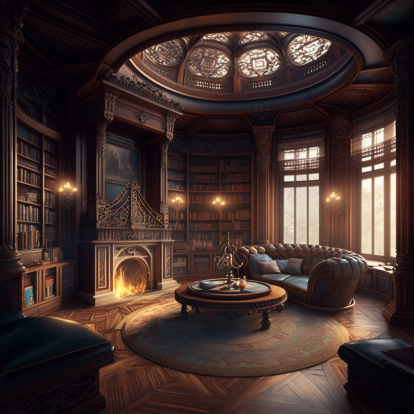
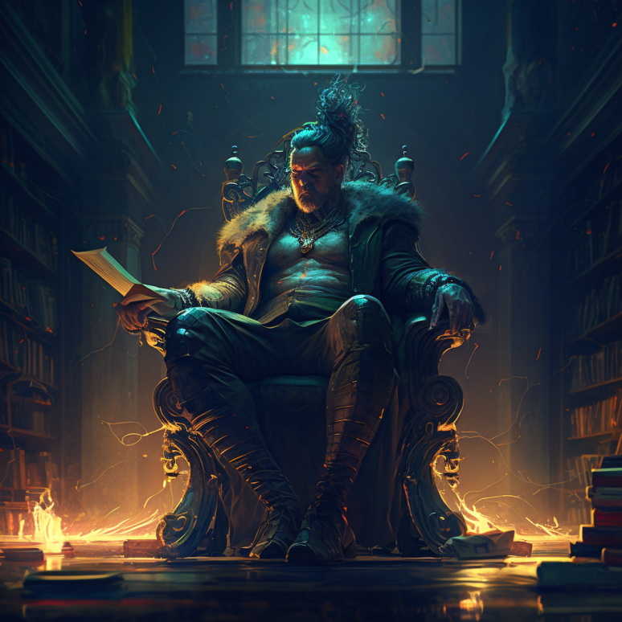
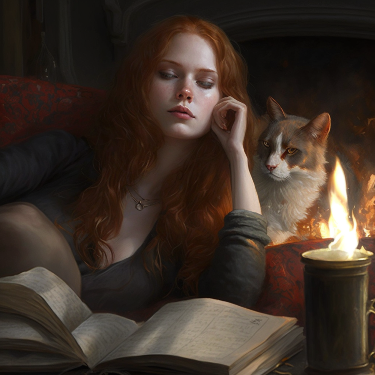
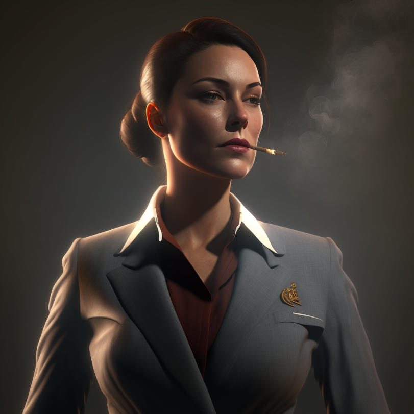

<figure class="wp-block-embed is-type-video is-provider-youtube wp-block-embed-youtube wp-embed-aspect-16-9 wp-has-aspect-ratio">

<iframe loading="lazy" title="If We Were Villains Review: When Theater Students Become the Tragedy They&#039;re Performing" width="1080" height="608" src="https://www.youtube.com/embed/5tN52U_-Nc4?feature=oembed"  allow="accelerometer; autoplay; clipboard-write; encrypted-media; gyroscope; picture-in-picture; web-share" referrerpolicy="strict-origin-when-cross-origin" allowfullscreen></iframe>

</figure>

<iframe loading="lazy" width="100%" height="180" frameborder="no" scrolling="no" seamless="" src="https://share.transistor.fm/e/e6d36db5"></iframe>

<figure class="wp-block-image size-full"><figcaption class="wp-element-caption">Library Study</figcaption></figure>

Through the lens of Shakespearean plays, M.L. Rio’s “If We Were Villains” intricately weaves together a tale that explores the relationship between art and reality, the power of storytelling, and the consequences of our actions. The novel offers an in-depth look into human nature and its complexities, highlighting the obsession, love, and ambition that drive individuals to take extreme measures. Murder, guilt, and failure are key themes that are explored in the novel. The impact of their actions on others forces the characters to face the consequences of their mistakes.

While the characters may lack depth, the plot offers surprising twists that can engage certain readers. However, different readers may find varying levels of appeal in this story.

Oliver and his classmates navigate through intense pressures of their craft while also developing complex relationships between them.

The book's characters are flawed and self-absorbed, and their obsession with Shakespeare can at times feel contrived. The characters mostly come across as flat, which is precisely the point. They are theater students who are deeply invested in their roles, and their interactions with each other are often characterized by the dramatic language and gestures of the plays they are studying. The competitive atmosphere of the school and the pressure to perform well also contribute to the tension between the characters. As a result, they often prioritize their roles over their personal relationships, blurring the lines between their true identities and the characters they are portraying.

The connection between the characters is rooted in their shared passion for Shakespeare and their status as theater students at the elite Dellecher Classical Conservatory. As fourth-year students, they are part of a select group that has survived the rigorous training and competition required to reach that level. The pressure to perform well and excel in their craft has created a cult-like atmosphere in which the students prioritize their roles over their personal relationships. The fact that they live and study together in a closed environment also contributes to the intensity of their relationships, blurring the lines between their true identities and the characters they are portraying.

The book is told through the perspective of Oliver, one of the students, who has just been released from prison after serving ten years for a crime he may or may not have committed. The main plot of the novel is to uncover the truth behind the crime Oliver was convicted of in 1997. The story is told through a frame narrative of Oliver's confession to Colbourne. There are also several subplots, such as Oliver's conflicting feelings for Meredith and James, Richard's violent tendencies, and Alexander's substance abuse. These subplots work together. Each chapter builds towards the resolution of the novel - the discovery of James' culpability.

One of the primary themes of the book is the relationship between art and reality. The characters in the novel are so absorbed in their roles that they often lose sight of their true identities. This theme is further explored through the use of Shakespeare's plays, which are not only performative but also deeply philosophical. And dealing with issues such as power, and morality.

The novel is structured in five acts, each corresponding to a Shakespearean play.

<ul class="wp-block-list">
<li>Act I introduces the characters and sets up the drama with Richard's attack on James.</li>

<li>Act II focuses on the cast's preparation for and performance of Julius Caesar.</li>

<li>Act III contains the novel's climax with Richard's death and ends with Oliver's realization of his love for James.</li>

<li>Act IV explores Oliver and Meredith's relationship, as well as Alexander's drug issues.</li>

<li>Act V explains how Oliver came to take the blame for Richard's death.</li>
</ul>

The chapters in the book are referred to as "scenes" to further emphasize the theatrical theme. Rio's writing is elegant and immersive. Although the novel's structure is heavily influenced by Shakespeare's plays, with each act corresponding to a play and the characters often speaking in iambic pentameter, an appreciation for Shakespeare is not necessary to enjoy the book. The themes and characters are universal, and the novel can be appreciated by anyone who loves literature and theater.

<h2 class="wp-block-heading">Characters </h2>

<strong>Oliver Marks </strong>the main protagonist and a senior theater student at Dellecher Classical Conservatory. He is one of the seven fourth-year students in the Shakespeare program.

<strong>James</strong> also a student in the Shakespeare program at Dellecher and a close friend of Oliver Marks. He is known for his talent in playing comedic roles and is often the comic relief in their productions. James is described as being kind-hearted and loyal to his friends.

<strong>Richard</strong> is an accomplished actor who excels at portraying regal and authoritative characters on stage. His commanding presence and gravitas lend themselves well to these roles, and he has become known for his talent and dedication. Richard's performances have earned admiration of his audience.

<figure class="wp-block-image size-full"></figure>

<strong>Meredith</strong> is a fellow theater student at Dellecher. She is a highly skilled actress with a talent for playing strong, independent women. Meredith is a supportive friend to Oliver, and they work together on various theater productions.

<figure class="wp-block-image size-full"></figure>

<strong>Filippa</strong> is a talented student at Dellecher  who is known for her impressive range as an actor. She often takes on male roles in theater productions and is particularly skilled in portraying complex and nuanced characters.

<figure class="wp-block-image size-full"></figure>

<strong>Alexander </strong>Another fourth-year student in the Shakespeare program and one of Oliver's close friends. 

<strong>Detective Colbourne</strong> investigated Richard's death and was certain that Oliver wasn't at fault.

<strong>Wren</strong> is Richard’s cousin and a member of the Dellecher class. Her petite frame and delicate facial features have often drawn comparisons to a pixie or fairy.&nbsp;

<strong>Gwendolyn </strong>plays a vital role as a drama instructor at Dellecher. She works hard to equip students with the emotional and spiritual tools they need to deliver exemplary performances.

<strong>Frederick</strong> is a dedicated drama teacher at Dellecher. He has a special interest in interpreting Shakespearean works and is well-versed in the language and style of his texts.

<h2 class="wp-block-heading">ACT 1 </h2>

In the first act the reader is introduced to the main characters of the novel. The students at the Dellecher Classical Conservatory are doling out harsh criticism to one another as they rehearse Shakespeare's plays. They are stoic in their approach to their craft, often prioritizing their roles over their personal relationships.

The muse of the students is Shakespeare, whose quintessentially theatrical language is the perfect vehicle for their emotions. The characters are curious about one another, constantly trying to uncover hidden truths and motivations. They are also resilient in the face of adversity, banding together to overcome challenges both inside and outside the theater.

The setting of the Dellecher Classical Conservatory plays a significant role in shaping the characters' actions. The school's remote location and insular community create an atmosphere of intense pressure and competition, which is heightened by the characters' shared passion for Shakespeare. This pressure is particularly evident in the characters' interactions with one another, as they constantly compare themselves to their peers and compete for recognition and approval. The tension between the characters is further exacerbated by the fact that they live and work together, blurring the lines between their personal and professional lives. The setting of Act I thus serves as a powerful force that shapes the characters' actions and emotions throughout the novel.

Rio makes use of the frame narrative structure to tell Oliver's last year at Dellecher. It builds up tension, as the reader is already aware that something bad happened which resulted in Oliver being jailed for ten years. The frame narrative in the novel establishes its confessional style, with Oliver telling the story to Coulbourne. The prologue provides plenty of insight into Oliver's mental state with Shakespearean quotes mixed in his dialogue as well as stage directions. Even after serving his sentence, Oliver remains devoted to his acting career and can't seem to break away from the path he had chosen before being incarcerated.

The theme of homoeroticism and repressed sexuality is introduced early in the book through the friendship of James and Oliver. At the end of the first scene, Oliver's feelings toward James become obvious; he confides in his closest friend and flatmate about his admiration, “You’ll have to be Cressida… You’re the only one of us pretty enough” (19). James' emotions are subtly exposed through the joke he tells to his friend while they are lying side by side. It is more information than he would choose to reveal consciously. Oliver is still not completely comfortable with his sexuality. However, spending time with James brings out a more carefree, romantic side of him which is usually held back due to his anxiety.

During the combat lesson, James' strong bond with Oliver is evident. When Camilo instructs James to think of a reason why he should be mad at Oliver, it's astonishing how his expressions changed rapidly from being peaceful to hurt and vengeful: “James had never really been angry with me, to my knowledge."

<figure class="wp-block-table is-style-stripes has-small-font-size"><table class="has-black-color has-text-color has-link-color has-fixed-layout"><thead><tr><th>Character Name</th><th>Primary Archetype/Role</th><th>Shakespearean Parallel</th><th>Key Traits and Motivation</th><th>Fate or Final Status</th><th></th></tr></thead><tbody><tr><td></td><td></td><td></td><td></td><td></td><td></td></tr><tr><td>Oliver Marks</td><td>Protagonist, narrator, and the perpetual understudy.</td><td>Lear (gradual recognition/blindness), Kent (loyalty/sacrifice), Benvolio (observer/peacekeeper).</td><td>Observational, loyal, and chameleonic; motivated by his deep, often suppressed devotion to James and the desire to protect the group.</td><td>Served ten years in prison for Richard's murder to protect James; ends up living with Meredith in Chicago and searching for the truth of James' death.</td><td>Represents the ultimate sacrifice and the blurring of personal identity through total devotion to a role (both on stage and as a martyr).</td></tr><tr><td>James Fane</td><td>The star and leading man of the group.</td><td>Macbeth (guilt/madness), Brutus (assassination for 'greater good'), Romeo (tragic romance).</td><td>Brilliant, star-quality, and increasingly fragile; driven by a descent into madness and psychological guilt after killing Richard.</td><td>Revealed to have killed Richard; faked his own death by drowning after Oliver's imprisonment; current whereabouts unknown (implied alive).</td><td>Embraces the destructive nature of guilt and the inability to escape the tragic narratives of the characters he portrays.</td></tr><tr><td>Richard Stirling</td><td>The group leader and antagonist; typically plays the tyrant.</td><td>Julius Caesar (the fallen tyrant), Tybalt (instigator of violence).</td><td>Charismatic, demanding, and abusive; motivated by dominance and maintaining his status as the group's alpha.</td><td>Died in Act III after being struck by James with a boat hook and left to drown in the lake.</td><td>Represents the toxicity of hierarchy and how the 'role' of a tyrant can manifest in real-life abuse and violence.</td></tr><tr><td>Meredith Diciacci</td><td>The ingenue and femme fatale.</td><td>Lady Macbeth (ambition), Cordelia (recognition of truth), Juliet.</td><td>Beautiful, isolationist, and resilient; motivated by her complex romantic ties to both Oliver and Richard and her need for belonging.</td><td>Lives in Chicago ten years later; reunites with Oliver and reveals she always knew the truth about the night Richard died.</td><td>Symbolizes the isolation caused by being defined solely by one's appearance and the friction between staged and genuine intimacy.</td></tr><tr><td>Filippa Kosta</td><td>The anchor and pragmatist; the group's conscience.</td><td>Horatio (the loyal survivor/witness).</td><td>Intelligent, secretive, and observant; motivated by group survival and protecting her friends' secrets.</td><td>Remained at Dellecher as a teacher; provides Oliver with the final clues regarding James' potential survival.</td><td>Represents complicity through silence and the moral ambiguity of protecting those one loves.</td></tr><tr><td>Alexander Vass</td><td>The fool and comic relief.</td><td>The Fool, Mercutio (the reckless friend).</td><td>Sarcastic, hedonistic, and reckless; uses drugs and humor to cope with the pressure and eventual guilt of the group.</td><td>Survives the novel's timeline after a near-fatal overdose in his fourth year; remains haunted by Richard's death.</td><td>Illustrates the use of humor as a defense mechanism and the eventual collapse of the 'comic' mask under real tragedy.</td></tr><tr><td>Wren Stirling</td><td>The ingenue and Richard’s cousin; plays supporting roles.</td><td>Ophelia (psychological fragility), Juliet.</td><td>Vulnerable and empathetic; motivated by her family ties to Richard and her romantic interest in James.</td><td>Diagnosed with PTSD after Richard's death and her own physical assault; survives but remains deeply scarred.</td><td>Represents the collateral damage of tyranny and the psychological cost of being caught in others' dramatic conflicts.</td></tr></tbody></table></figure>
