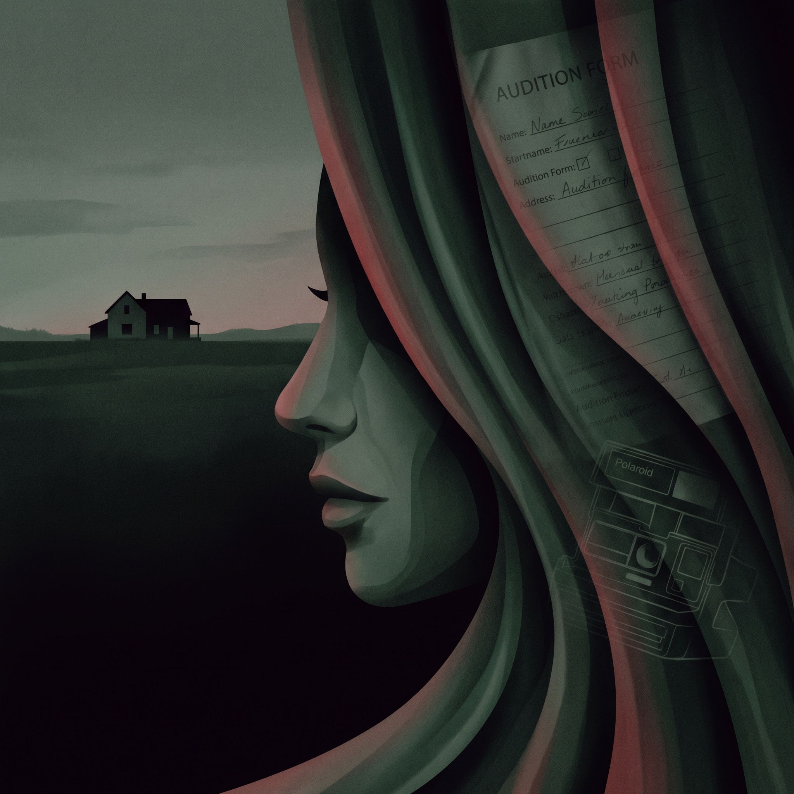

<!-- wp:html --> 
<iframe loading="lazy" width="100%" height="180" frameborder="no" scrolling="no" seamless="" src="https://share.transistor.fm/e/4b09becf"></iframe> 
<!-- /wp:html -->

<!-- wp:quote {"style":{"color":{"background":"#dddddd"}}} -->

<blockquote class="wp-block-quote has-background" style="background-color:#dddddd">
<!-- wp:paragraph -->

<strong>Quick answer</strong>: <em>Tom Lake</em> (Ann Patchett) is a shallow, overpraised comfort-read that treats whiteness and nostalgia as the default setting and expects you to call that “universal.” I did not finish it admiring anything. I finished it irritated: it keeps hinting at confession and consequence, then refuses to go there.

<!-- /wp:paragraph -->
</blockquote>

<!-- /wp:quote -->

<!-- wp:image {"id":7474,"sizeSlug":"large","linkDestination":"none"} -->

<figure class="wp-block-image size-large"></figure>

<!-- /wp:image -->

<!-- wp:paragraph -->

I finished <em>Tom Lake</em> with a feeling I do not like to admit: confusion, and then irritation, and then a quiet sense of being left outside the farmhouse door while everyone inside was nodding along. I have lived long enough to know that every book is not written for me, and I do not demand that it be. But I do expect to be able to meet a novel halfway. With this one, I kept walking and it felt like the book kept backing away, insisting I admire the scenery while refusing to tell me why the trip mattered.

<!-- /wp:paragraph -->

<!-- wp:paragraph -->

And I kept tripping over the same quiet assumption: the book treats a very specific whiteness as if it is neutral. Not <em>a</em> life, but <em>life</em>. I am white too, so I am not speaking from outside of that. I am speaking as someone who has watched, for decades, which stories get treated as naturally relatable and which stories get treated as “universal,” and which stories get treated as niche.

<!-- /wp:paragraph -->

<!-- wp:paragraph -->

On paper, the premise should work. A woman in midlife, stuck at home with her adult daughters during a strange season of the world, tells the story of a famous actor she once knew and the summer stock theatre that shaped her. Memory, performance, motherhood, the stories families tell themselves to survive. Fine. The problem is the <em>way</em> the story is framed: three daughters pulling at their mother like a sweater unraveling, demanding a narrative with a particular payoff. Who is he, what happened, when does he show up, tell us the part that matters. And there I was, on the other side of the page, feeling the same resistance the narrator claims to feel. I did not want to be yanked through it, and I did not like being told, implicitly, that the emotional engine of the book is this tug-of-war between a mother’s reluctance and her daughters’ entitlement.

<!-- /wp:paragraph -->

<!-- wp:paragraph -->

As I read, I kept thinking: if the main character does not want to share this story, why am I being made to hear it? There is a difference between reluctance that becomes revelation and reluctance that becomes a gimmick. The narrator says, in effect, “You want Duke, you want the romantic myth, you want the glamour,” and then the book proceeds to circle that very thing for hundreds of pages, like a dog worrying a bone. If the story is truly about the cost of glamour and the truth behind performance, then the book has a responsibility to make that cost feel earned. Instead, I often felt I was watching a careful storyteller prolong a moment because prolonging it is the point.

<!-- /wp:paragraph -->

<!-- wp:paragraph -->

Maybe this is where my own life experience is getting in the way, or maybe it is exactly what I bring that the book never acknowledges. I come from a country where storytelling is sometimes a form of currency, but also a form of camouflage. You learn early when a story is being used to keep you at a safe distance. I have been in the U.S. long enough to recognize a particular kind of American nostalgia too: the remembered small town that is presented as both ordinary and sacred, the high school gymnasium glowing with meaning, the local theatre production serving as a moral education. That can be true. But it can also become a self-flattering myth, a way of polishing a life until it looks inevitable.

<!-- /wp:paragraph -->

<!-- wp:paragraph -->

And then there is the question that kept nagging at me, the one I did not want to admit because it can sound petty: is this just a white woman narrating her white life, and expecting that whiteness to be the default setting in which “universal” feelings occur? I am white too, so I am not speaking from outside of that. I am speaking as someone who has watched, for decades, which stories get treated as naturally relatable and which stories get treated as “niche.” A woman’s youth, her brushes with fame, her marriage, her children, her life in the orchard. All of it is rendered with care, and yet it is also cushioned. Even the darker turns feel processed into something tasteful. The world’s problems exist, but mostly as weather outside the window. I found myself wondering what the book would have looked like if it had let the outside world actually disturb the inside world, not just provide atmosphere.

<!-- /wp:paragraph -->

<!-- wp:paragraph -->

The daughters, for me, are the biggest obstacle to whatever the book wants to be. I understand that they are meant to function as a chorus, a contemporary audience, a device that forces the narrator to revisit her choices. But they also create a kind of hostage situation: the mother is telling a story, but she is not free to tell it. She is being managed. And I, as a reader, felt managed as well. I kept thinking that without the daughters, we could have had an entirely different novel: a woman alone with her memories, forced to confront what she did and what she did not do, without having to perform motherhood while doing it. Instead, the daughters become an excuse for commentary, interruption, and a constant pressure to “get to the good part.”

<!-- /wp:paragraph -->

<!-- wp:paragraph -->

That pressure is familiar in the ugliest way. It is the same pressure that turns real lives into entertainment. It is the pressure that makes people demand the traumatic detail, the scandal, the headline, and then pretend they are entitled to it because they are family, or fans, or readers. The book seems aware of this, but it also indulges it. It is hard to say, “Look how awful it is that these girls want the story,” while continuing to feed the reader the story in precisely the form the girls want. The novel has its cake and eats it.

<!-- /wp:paragraph -->

<!-- wp:paragraph -->

I do not need every book to be about queerness, but I could not stop noticing how relentlessly heterosexual the gravitational pull is. The “part that matters” is a man. A handsome famous man. A summer romance. A marriage plot in the background. Even when the narrator is insisting it is not about that, the structure keeps returning to it. I have spent years watching straight culture treat romance with men as the default dramatic fuel, the thing that is supposed to light up a woman’s entire life in retrospect. I am tired of that mythology. Not angry at it, just tired. And this book felt like a carefully upholstered room built around that myth, even as it occasionally points out the seams.

<!-- /wp:paragraph -->

<!-- wp:paragraph -->

What was I meant to get out of it? Maybe a meditation on performance: how we are always auditioning, always learning how to present ourselves. Maybe an argument that a person can be decent without being heroic, that ordinary life is not a consolation prize. Maybe a reminder that memory is a story we keep revising to survive. I can see all of those themes sitting there like labeled boxes. I just did not feel them land. The voice kept me at arm’s length, and the framing device kept me bracing for the next tug.

<!-- /wp:paragraph -->

<!-- wp:paragraph -->

In the end, my frustration is simple. I wanted the book to choose to either refuse the story entirely, or to tell it with full honesty. Instead, I felt trapped in the middle: a story being pulled out, a reader being pulled along, and a lingering sense that the most interesting version of this novel is the one the narrator never wanted to perform.

<!-- /wp:paragraph -->

<!-- wp:paragraph -->

What made <em>Tom Lake</em> feel shallow to me was not the subject matter. It was the narrator’s relationship to her own story. The book keeps telling us there is a “real” story here, something charged and consequential, and then repeatedly refuses to say it plainly. Instead, it gives you the thinned-out version of everything: the safe version, the polished version, the version that never quite commits to what it claims is at stake.

<!-- /wp:paragraph -->

<!-- wp:paragraph -->

This is where my frustration lands: the novel wants the gravity of confession without the honesty of confession. It wants the intimacy of a family story without the risk that makes intimacy matter.

<!-- /wp:paragraph -->

<!-- wp:paragraph -->

That choice has a cost. If the one thing worth hearing is treated as too private, too fraught, or too dangerous to share, then the everyday material has to do real work. It has to reveal character, sharpen conflict, or change what we understand.

<!-- /wp:paragraph -->

<!-- wp:paragraph -->

But when the narrator smooths every edge and narrates around the point, the ordinary detail starts to feel interchangeable. It is not texture. It is filler. The book asks me to treat “the boring parts” as meaningful, while also signaling that the only meaningful part is the one it will not fully tell.

<!-- /wp:paragraph -->

<!-- wp:paragraph -->

And because it does not land there, the ordinary detail does not always feel like illumination. It sometimes reads like delay.

<!-- /wp:paragraph -->

<!-- wp:paragraph -->

That is why, for me, it was a waste of time.

<!-- /wp:paragraph -->

<!-- wp:image {"id":7476,"sizeSlug":"large","linkDestination":"none","style":{"color":{"duotone":"unset"}}} -->

<figure class="wp-block-image size-large"></figure>

<!-- /wp:image -->

<!-- wp:heading -->

<h2 class="wp-block-heading">Who are the main characters, and how do they develop throughout the story?</h2>

<!-- /wp:heading -->

<!-- wp:paragraph -->

I’m not going to pretend I “know” these people like real neighbors. I’m just telling you how they came across to me on the page.

<!-- /wp:paragraph -->

<!-- wp:paragraph -->

Lara is the centre of the thing, but not in the way I first wrote it.

<!-- /wp:paragraph -->

<!-- wp:paragraph -->

What I felt more strongly is this: the daughters arrive with a story already half-written in their heads, and Lara has the option to either <em>ignite it</em> or <em>deflate it</em>. They want the version where Peter Duke means something clean and glamorous. Lara does not seem to want to give them that. She drags her feet, slows the pace, adds context, and in doing that she is not just “withholding.” She is trying to keep her own past from being turned into their entertainment.

<!-- /wp:paragraph -->

<!-- wp:paragraph -->

But I also kept wondering if something else is going on underneath the carefulness: a refusal to look straight at the failure.

<!-- /wp:paragraph -->

<!-- wp:paragraph -->

Because the thing about being “the one who almost…” is that it is humiliating in a quiet way. Years later, people do not talk about what you nearly did. They talk about the person who made it. They talk about the people you worked with who became names. And if you are the footnote—if your big story ends up as a small anecdote in someone else’s—then the temptation is to curate the past until it feels less like a loss.

<!-- /wp:paragraph -->

<!-- wp:paragraph -->

That is the version of Lara I can’t stop thinking about: an older white woman processing (or not processing) the fact that her brush with significance did not become a life of significance, and trying to tell the story in a way that keeps her from being reduced to “the one who knew him.”

<!-- /wp:paragraph -->

<!-- wp:paragraph -->

The daughters, for me, work less as three distinct personalities and more as a single pressure. They want Duke. They want the charged part. They want the story to mean something clean. And I kept noticing how their hunger pushes Lara into a performance she resists and then still delivers.

<!-- /wp:paragraph -->

<!-- wp:paragraph -->

Joe stays mostly in the background, but he matters as a kind of ballast. He is the quiet reminder that the present is not just a frame around the past. It is a whole life, full of work and compromise.

<!-- /wp:paragraph -->

<!-- wp:paragraph -->

And Peter Duke, for me, is less a fully realised person than a moving target. He becomes whatever the listener needs him to be: youthful possibility, glamour, escape, proof that life could have forked.

<!-- /wp:paragraph -->

<!-- wp:image {"id":7478,"sizeSlug":"large","linkDestination":"none"} -->

<figure class="wp-block-image size-large"></figure>

<!-- /wp:image -->

<!-- wp:heading -->

<h2 class="wp-block-heading">How does Ann Patchett use language and literary techniques in <em>Tom Lake</em>?</h2>

<!-- /wp:heading -->

<!-- wp:paragraph -->

Patchett’s main tools here, for me, are <strong>framing</strong>, <strong>withholding</strong>, and <strong>tone control</strong>. The book is less interested in big events than in managing how you feel about the events.

<!-- /wp:paragraph -->

<!-- wp:heading {"level":3} -->

<h3 class="wp-block-heading">The framing device turns “story” into a power struggle</h3>

<!-- /wp:heading -->

<!-- wp:paragraph -->

A mother telling a story to her daughters while they work should feel intimate. Here it often feels transactional.

<!-- /wp:paragraph -->

<!-- wp:paragraph -->

The book basically builds its engine out of the daughters’ impatience and the mother’s control of pace.

<!-- /wp:paragraph -->

<!-- wp:paragraph -->

That is craft. It is also the tell. The entire novel is built on <em>endurance</em> and <em>delay</em>.

<!-- /wp:paragraph -->

<!-- wp:heading {"level":3} -->

<h3 class="wp-block-heading">Withholding is treated like depth, even when it starts to feel like avoidance</h3>

<!-- /wp:heading -->

<!-- wp:paragraph -->

Patchett uses pacing and deflection to keep the “charged” material just out of reach.

<!-- /wp:paragraph -->

<!-- wp:paragraph -->

When withholding turns into a pattern, it can start to feel like the book is hinting at consequence without paying it off. That is where my irritation came from.

<!-- /wp:paragraph -->

<!-- wp:heading {"level":3} -->

<h3 class="wp-block-heading">Concrete detail creates texture, but sometimes it becomes softening</h3>

<!-- /wp:heading -->

<!-- wp:paragraph -->

Patchett can write physical space very clearly: work, rooms, objects, routines. In theory that is what makes the ordinary matter.

<!-- /wp:paragraph -->

<!-- wp:paragraph -->

But if the emotional or moral stakes keep getting rounded off, the specificity starts to feel like <em>cushioning</em>. The detail does not sharpen. It pads.

<!-- /wp:paragraph -->

<!-- wp:heading {"level":3} -->

<h3 class="wp-block-heading">The theatre motif is not just “theatre,” it’s a manual for self-presentation</h3>

<!-- /wp:heading -->

<!-- wp:paragraph -->

The book keeps circling performance: auditioning, playing a part, saying the line the right way, not saying the line at all.

<!-- /wp:paragraph -->

<!-- wp:paragraph -->

That could have been a ruthless theme about self-deception and failure.

<!-- /wp:paragraph -->

<!-- wp:paragraph -->

For me, it often reads as a way to make self-editing sound elegant.

<!-- /wp:paragraph -->

<!-- wp:heading {"level":3} -->

<h3 class="wp-block-heading">Tone management keeps the book readable and keeps it safe</h3>

<!-- /wp:heading -->

<!-- wp:paragraph -->

Patchett’s voice slides: lightly comic, then a controlled tenderness, then back to clean composure.

<!-- /wp:paragraph -->

<!-- wp:paragraph -->

That’s a technique. It keeps the book moving.

<!-- /wp:paragraph -->

<!-- wp:paragraph -->

It also keeps the sharp edge from staying sharp long enough to cut.

<!-- /wp:paragraph -->

<!-- wp:heading -->

<h2 class="wp-block-heading">Where I land on <em>Tom Lake</em></h2>

<!-- /wp:heading -->

<!-- wp:paragraph -->

If I had to put my reaction in one line, it’s this: <em>Tom Lake</em> is a white, insulated comfort story that keeps hinting at deeper risk, then choosing safety instead. I walked away irritated, not impressed, and honestly baffled by the praise.

<!-- /wp:paragraph -->

<!-- wp:heading {"level":3} -->

<h3 class="wp-block-heading"><em>Tom Lake</em> treats “universal” as code for “unmarked whiteness”</h3>

<!-- /wp:heading -->

<!-- wp:paragraph -->

I am white, and I am Irish, and that outsider angle has made American whiteness feel <em>loud</em> to me over the years. In this book, it is everywhere and nowhere at once.

<!-- /wp:paragraph -->

<!-- wp:paragraph -->

The orchard, the theatre pipeline, the family’s protected space, the way the world stays mostly outside the window: it is written as if this can stand in for “life itself.” Not <em>a</em> life. <em>Life.</em>

<!-- /wp:paragraph -->

<!-- wp:paragraph -->

That is where my patience ran out. Not because I need every novel to be about race explicitly, but because I can feel when whiteness is being used as air: the unmarked default that gets to call itself universal.

<!-- /wp:paragraph -->

<!-- wp:heading {"level":3} -->

<h3 class="wp-block-heading">The book still treats “proximity to a famous man” as narrative gravity</h3>

<!-- /wp:heading -->

<!-- wp:paragraph -->

The daughters’ hunger for Duke is meant to look shallow. The book keeps winking at it. It keeps promising it will be about something else.

<!-- /wp:paragraph -->

<!-- wp:paragraph -->

But the narrative magnet keeps swinging back to him anyway. Even when Lara insists “this is not what you think,” the structure keeps treating Duke as the gravitational center.

<!-- /wp:paragraph -->

<!-- wp:paragraph -->

For me, that is not just a celebrity critique. It is a cultural critique: a woman’s life can be farm work, friendship, motherhood, endurance, and moral compromise, and yet the book still knows what it has to dangle to keep attention.

<!-- /wp:paragraph -->

<!-- wp:heading {"level":3} -->

<h3 class="wp-block-heading">The framing device makes me feel managed as a reader</h3>

<!-- /wp:heading -->

<!-- wp:paragraph -->

The daughters are not, for me, three separate souls. They are a mechanism: <em>tell me the good part, give me the charged part, hand me the confession.</em>

<!-- /wp:paragraph -->

<!-- wp:paragraph -->

And I kept feeling the same irritation as Lara claims to feel—except I was the one being pulled through it. The device creates the sensation of being steered, and that steering undercuts the intimacy the novel wants.

<!-- /wp:paragraph -->

<!-- wp:heading {"level":3} -->

<h3 class="wp-block-heading">The book’s comfort reads like insulation</h3>

<!-- /wp:heading -->

<!-- wp:paragraph -->

Patchett’s control is obvious. The prose is clean. The work is rendered with care. The household feels warm.

<!-- /wp:paragraph -->

<!-- wp:paragraph -->

But that competence also acts like padding. It keeps the story readable. It keeps the sharp edges rounded. It keeps the world’s pressure as “weather” instead of force.

<!-- /wp:paragraph -->

<!-- wp:paragraph -->

A book can be domestic and still be dangerous. This one often felt domestic and safe.

<!-- /wp:paragraph -->

<!-- wp:heading {"level":3} -->

<h3 class="wp-block-heading">The book hints at confession, then backs away from consequences</h3>

<!-- /wp:heading -->

<!-- wp:paragraph -->

The structure is confession-shaped: a mother withholding, a family demanding, a story circling what is “really” being protected.

<!-- /wp:paragraph -->

<!-- wp:paragraph -->

I kept waiting for the moment where the book stops curating itself—where the narrator’s carefulness becomes an unflattering truth instead of a controlled performance of honesty.

<!-- /wp:paragraph -->

<!-- wp:paragraph -->

Sometimes it gestures toward that deeper place. But for me it rarely lands there. And because it does not land there, the ordinary detail does not always feel like illumination. It sometimes reads like delay.

<!-- /wp:paragraph -->

<!-- wp:heading {"level":3} -->

<h3 class="wp-block-heading">The question I cannot stop asking: why does this story keep getting the whole stage?</h3>

<!-- /wp:heading -->

<!-- wp:paragraph -->

This is the sharpest part of my reaction, and it is personal.

<!-- /wp:paragraph -->

<!-- wp:paragraph -->

I did not finish the book thinking, “How dare she write about a white woman.” I finished thinking: <strong>why does this still get to be the default “serious” story?</strong> Another white woman’s interiority. Another brush with a famous man. Another nostalgic American frame that feels protected from the world.

<!-- /wp:paragraph -->

<!-- wp:paragraph -->

I can see what people praise sentence by sentence and still feel, by the end, that I have been asked to call something “deep” because it is quiet and competent.

<!-- /wp:paragraph -->

<!-- wp:paragraph -->

That is not enough for me.

<!-- /wp:paragraph -->

