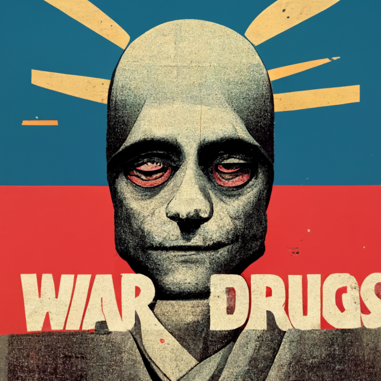
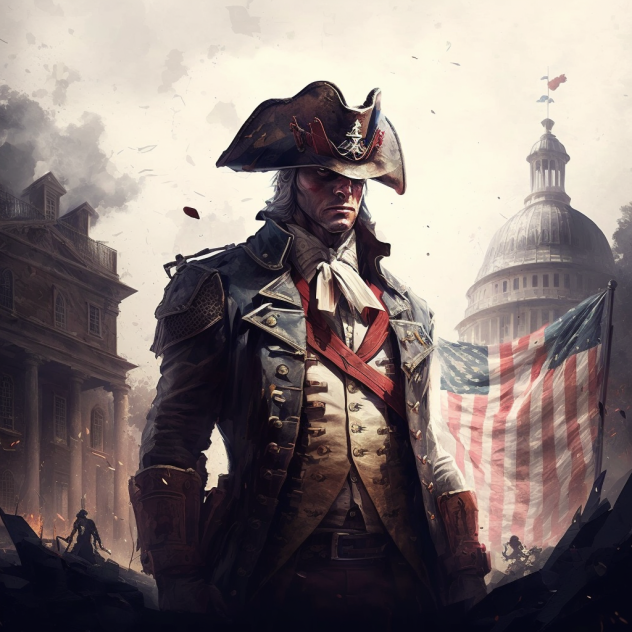
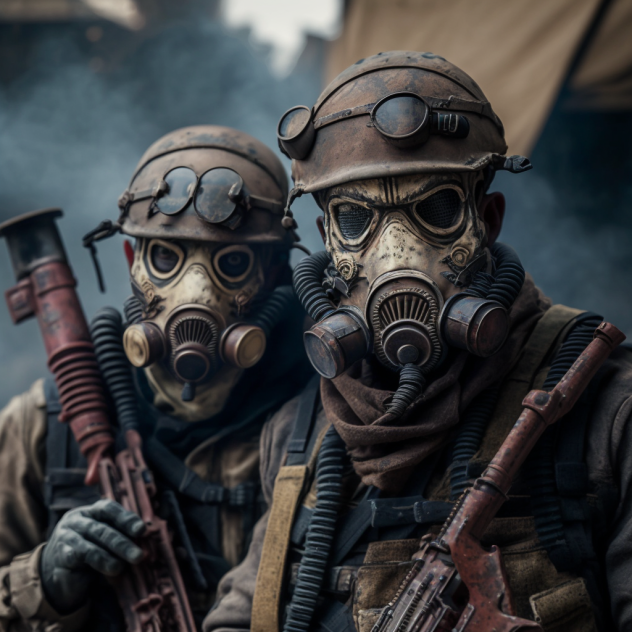
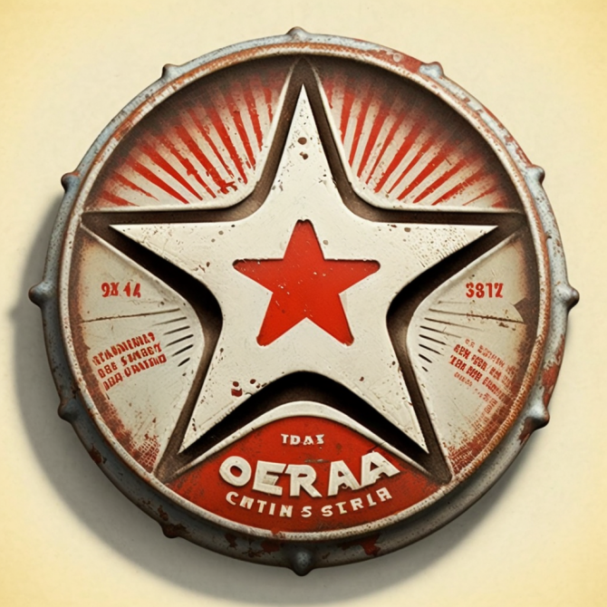
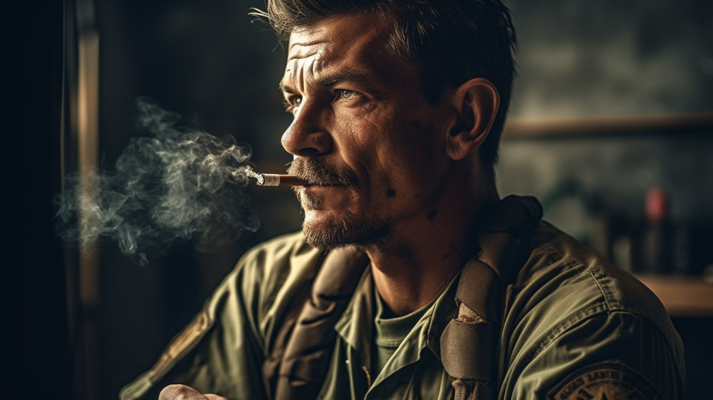
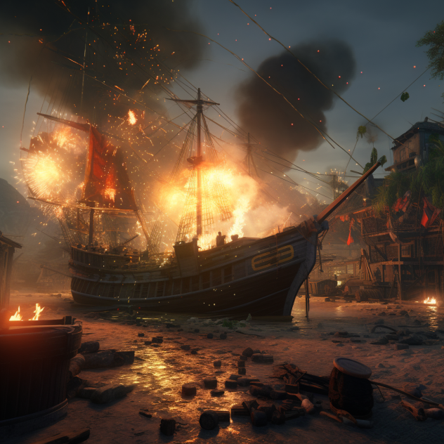
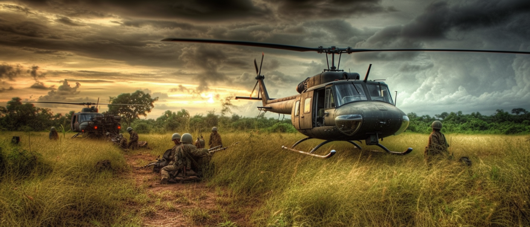
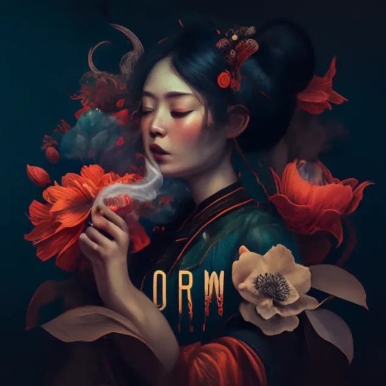
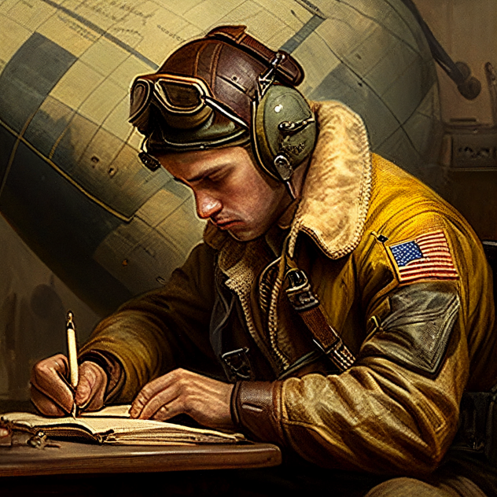
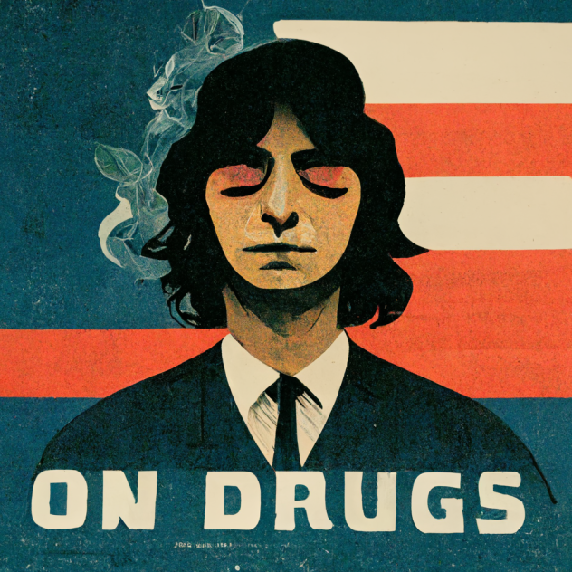

<figure class="wp-block-video"><video height="1080" style="aspect-ratio: 1920 / 1080;" width="1920" controls src="https://betterworldwithdesign.com/wp-content/uploads/2023/04/video-over.mp4"></video><figcaption class="wp-element-caption">Weird AI Voice Over</figcaption></figure>

<h2 class="wp-block-heading has-large-font-size">The main points of the book. </h2>

<ol class="wp-block-list">
<li>The use of drugs in warfare is not a recent phenomenon, but rather a long-standing tradition that dates back to ancient times.</li>

<li>Governments have played a significant role in the spread of drugs, and drugs have been used as a tool of colonialism.</li>

<li>The use of drugs to control and manipulate soldiers is a common practice throughout history, from keeping them awake to boosting their aggression.</li>
</ol>

Killer High is an Interesting book that explores the history of war through the lens of six different <em>drugs</em>.

Peter Andreas, a professor of international studies at Brown University, takes readers on a journey through history to explore the role of drugs in warfare.

The book is well-researched and provides a unique perspective on the history of war through the lens of drugs. However, it should be noted that the dates jump around a lot and sometimes the connections from one instance to the next is a bit of a pull. Nonetheless, Killer High is an engaging and informative exploration of a topic that is often overlooked in traditional histories of war.

In his book, Andreas focuses on six drugs that have played a significant role in warfare throughout history. He explores how each drug was used, the effects it had on soldiers, and how it impacted the outcome of wars. And explores the role of governments in the spread of drugs. He sheds light on a little-known aspect of military history, and his insights are sure to spark discussion and debate among readers. 

In this book, Andreas digs into the effects of drugs on colonialism and how governments have used this to their advantage. He posits that opium was highly instrumental in helping Britain gain control over China and other nations.

<h2 class="wp-block-heading alignfull has-text-align-center has-background-color has-text-color has-background" style="background-color:#004158">Chapter Summaries </h2>

<h3 class="wp-block-heading alignfull has-text-align-center">Introduction </h3>

Peter Andreas takes readers on a (bumpy) journey through the history of warfare from a unique perspective - the role of drugs. The author emphasizes the undeniable impact of drugs in warfare, and highlights that recognizing this history is essential to grasping what war itself embodies.

<h3 class="wp-block-heading alignfull has-text-align-center">Alcohol</h3>

<h4 class="wp-block-heading has-large-font-size">American Revolution</h4>

<ul class="wp-block-list">
<li>Year: 1765-1783</li>

<li>Who was involved: Thirteen Colonies vs. Great Britain</li>

<li>Description: A colonial revolt which occurred between 1765 and 1783. The American Patriots in the Thirteen Colonies defeated the British in the American Revolutionary War with the assistance of France, winning independence from Great Britain and establishing the United States of America.</li>
</ul>

<h4 class="wp-block-heading has-large-font-size">World War I</h4>

<ul class="wp-block-list">
<li>Year: 1914-1918</li>

<li>Who was involved: Allied Powers vs. Central Powers</li>

<li>Description: A global war that lasted from 1914 to 1918. It was predominantly called the World War or the Great War from its occurrence until the start of World War II in 1939, and the First World War or World War I thereafter.</li>
</ul>

The author examines how alcohol has been used in wars over time &amp; how it has impacted the soldiers. According to them, alcohol was not only used to elevate morale but also for providing comfort &amp; helping soldiers tackle stressful situations on combat grounds. 

How was alcohol used during World War II? The sobering reality is that many of our Armed Forces used alcohol as a way to cope with the trauma of war.

There were indeed many stills creating rum on the east coast of the United States in the early days of settlement. In fact, it was one of the most popular drinks in the colonies during the 17th and 18th centuries. However, during the American Revolution, the British cut off the supply of molasses needed to make rum, which led to a shift towards locally-made whiskey, using grains like rye and corn. This was encouraged by figures like George Washington, who saw it as a way to promote self-sufficiency and reduce dependence on foreign imports.

<h3 class="wp-block-heading alignfull has-text-align-center">Caffeine</h3>

The author delves deep into the history of caffeine and its role in warfare. From tea and coffee to energy drinks, caffeine has been used for centuries to keep soldiers awake &amp;amp; alert. Its impact on modern warfare is undeniable and the chapter explores it in detail.

For many years, the coffee industry in Central American countries has been dominated by a few wealthy families owning large coffee farms. They had a stranglehold on the entire process; right from processing to distribution, leaving poorer farmers unable to join the race.

<figure class="wp-block-image size-full has-custom-border"></figure>

In the early 1940’s, Soviet General Georgy Zhukov requested a special color-free version of Coca-Cola to disguise its American origins and make it look like vodka. With President Harry Truman's blessing, Coca-Cola was happy to comply with the request, and sent Zhukov shipments of bottles with no labels other than a white cap with a red Soviet star.

<h3 class="wp-block-heading alignfull has-text-align-center">Nicotine</h3>

<figure class="wp-block-image size-large has-custom-border"></figure>

The chapter on nicotine explores the use of tobacco in warfare, from the early days of smoking to the development of modern nicotine products. Andreas argues that before World War I, the United States was strongly opposed to nicotine, due to knowing the health dangers.

However, during the war, the US military began providing cigarettes to soldiers as a way to boost morale and reduce stress. This led to a significant increase in cigarette use, which continued after the war and contributed to the rise of smoking culture in America. Andreas suggests that this shift in attitude towards nicotine was a result of wartime propaganda efforts that portrayed smoking as a patriotic duty.

Nicotine has been used to calm nerves and provide a sense of comfort, but that it has also led to addiction and other negative consequences.

<h3 class="wp-block-heading alignfull has-text-align-center">Opium</h3>

<h4 class="wp-block-heading has-large-font-size">Opium Wars</h4>

<ul class="wp-block-list">
<li>Year: 1839-1860</li>

<li>Who was involved: China vs. Britain</li>

<li>Description: Two wars fought between Great Britain and China in the mid-19th century over the British trade in opium, a key factor in the damaging of the Chinese economy by forcing the Chinese to trade valuable commodities for a drug that was devastating their population.</li>
</ul>

<h4 class="wp-block-heading has-large-font-size">Vietnam War</h4>

<ul class="wp-block-list">
<li>Year: 1955-1975</li>

<li>Who was involved: North Vietnam vs. South Vietnam and United States</li>

<li>Description: A Cold War-era proxy war that occurred in Vietnam, Laos, and Cambodia from 1 November 1955 to the fall of Saigon on 30 April 1975. It was fought between North Vietnam, supported by the Soviet Union, China, and other communist allies, and South Vietnam, supported by the United States, South Korea, the Philippines, Australia, Thailand, and other anti-communist allies.</li>
</ul>

<figure class="wp-block-image size-full has-custom-border"></figure>

The author examines the historical context and implications of opium. How it diffused across China, and how its consumption has changed in the past century. Starting from ancient China. Then exploring the 19th century Opium Wars before finally arriving at modern-day Afghanistan. In this chapter, the author looks into how opium consumption has evolved and how various changes in its composition have made it more potent &amp;amp; addictive.

According to the author, opium had a major impact in facilitating Britain's influence in China. The opium trade seemed to have contributed significantly to this effect. It is worth noting that the Vietnam War had a massive influence on the development of the heroin industry, especially in Southeast Asia’s Golden Triangle region - including portions of Laos, Myanmar, and Thailand.During the Vietnam War, the United States government aided anti-communist forces in the region, unfortunately, these forces were also associated with heroin production and trafficking.

The main goal of the United States concerning the Vietnam War was to contain Communism by preventing its growth in Southeast Asia. Conversely, the North Vietnamese and Viet Cong were striving for Vietnam to be reunited under a communist government.

<h3 class="wp-block-heading alignfull has-text-align-center">Amphetamines</h3>

<h4 class="wp-block-heading has-large-font-size">World War II</h4>

<ul class="wp-block-list">
<li>Year: 1939-1945</li>

<li>Who was involved: Axis Powers vs. Allied Powers</li>

<li>Description: A global war that lasted from 1939 to 1945. It involved the majority of the world's nations, including all of the great powers, organized into two opposing military alliances: the Allies and the Axis. It was the most widespread war in history, and directly involved more than 100 million people from more than 30 countries.</li>
</ul>

This chapter takes a look into how amphetamines have been used in combat, ranging from Benzedrine in WW2 to newer stimulants currently being researched. The author's does say while amphetamines may help troops stay awake and responsive, they can also lead to addiction and other adverse effects.

<blockquote class="wp-block-quote is-layout-flow wp-block-quote-is-layout-flow">

This chapter provides a brief look into how drugs are utilized in conflict, however there may be more details and subtleties that were not touched upon. Take a look at <a href="https://betterworldwithdesign.com/blitzed-drugs-in-the-third-reich/" data-type="post" data-id="2715">Norman Ohler's - Blitzed</a> - it gives an in-depth and accurate look into how drugs were used during Nazi Germany.

</blockquote>

Fact - during World War II, German soldiers took Pervitin which was an OTC drug with amphetamines.

This chapter is all about amphetamines and their use in warfare. We take a look at the early use of Benzedrine during WW2 and its evolution into the stimulants we have now. The writer's point is that, although drugs like amphetamines have been taken by soldiers to stay vigilant and sharp, they also cause dependency and other undesirable results.

Pharmacologist Leslie Iversen writes about the non-medical use of amphetamines spreading rapidly in the 20 years after the Second World War. While the use of amphetamines to enhance soldier performance was abandoned after World War II, the availability of amphetamines increased in the post-war years, leading to their widespread use for non-medical purposes. 

<h3 class="wp-block-heading alignfull has-text-align-center" style="padding-top:var(--wp--preset--spacing--30);padding-right:var(--wp--preset--spacing--30);padding-bottom:var(--wp--preset--spacing--30);padding-left:var(--wp--preset--spacing--30)">Cocaine</h3>

The chapter on cocaine explores the use of cocaine in warfare, from its early use as a local anesthetic to its development as a stimulant.

<figure class="wp-block-image size-full"><figcaption class="wp-element-caption">The War on Drugs</figcaption></figure>

The War on Drugs, which was initiated by the United States government in the 1970s, has been heavily criticized for its disproportionate impact on minority communities and for its failure to effectively reduce drug use and drug-related crime. Additionally, there have been allegations of United States government involvement in the drug trade, particularly in the context of the Iran-Contra affair in the 1980s, where the United States government was accused of facilitating the sale of drugs in order to fund the Contras in Nicaragua. These allegations have been the subject of much debate and investigation, and it is unclear to what extent they are true.

<h2 class="wp-block-heading">Conclusion</h2>

The book wraps up with a summary of the main points made &amp; topics discussed. The writer believes drugs have been an important part of wars all throughout and understanding this is essential to knowing what war truly is.

Is a fascinating read, as it provides a fresh perspective on war history by looking at six distinct drugs and their influences. This book dives deep into a lesser-known part of military history.

<blockquote class="instagram-media" data-instgrm-captioned data-instgrm-permalink="https://www.instagram.com/reel/Cw3Onkouelp/?utm_source=ig_embed&amp;utm_campaign=loading" data-instgrm-version="14" style=" background:#FFF; border:0; border-radius:3px; box-shadow:0 0 1px 0 rgba(0,0,0,0.5),0 1px 10px 0 rgba(0,0,0,0.15); margin: 1px; max-width:540px; min-width:326px; padding:0; width:99.375%; width:-webkit-calc(100% - 2px); width:calc(100% - 2px);">
 <a href="https://www.instagram.com/reel/Cw3Onkouelp/?utm_source=ig_embed&amp;utm_campaign=loading" style=" background:#FFFFFF; line-height:0; padding:0 0; text-align:center; text-decoration:none; width:100%;" target="_blank" rel="noopener"> 
 

 
 

 

 
<svg width="50px" height="50px" viewBox="0 0 60 60" version="1.1" xmlns="https://www.w3.org/2000/svg" xmlns:xlink="https://www.w3.org/1999/xlink"><g stroke="none" stroke-width="1" fill="none" fill-rule="evenodd"><g transform="translate(-511.000000, -20.000000)" fill="#000000"><g><path d="M556.869,30.41 C554.814,30.41 553.148,32.076 553.148,34.131 C553.148,36.186 554.814,37.852 556.869,37.852 C558.924,37.852 560.59,36.186 560.59,34.131 C560.59,32.076 558.924,30.41 556.869,30.41 M541,60.657 C535.114,60.657 530.342,55.887 530.342,50 C530.342,44.114 535.114,39.342 541,39.342 C546.887,39.342 551.658,44.114 551.658,50 C551.658,55.887 546.887,60.657 541,60.657 M541,33.886 C532.1,33.886 524.886,41.1 524.886,50 C524.886,58.899 532.1,66.113 541,66.113 C549.9,66.113 557.115,58.899 557.115,50 C557.115,41.1 549.9,33.886 541,33.886 M565.378,62.101 C565.244,65.022 564.756,66.606 564.346,67.663 C563.803,69.06 563.154,70.057 562.106,71.106 C561.058,72.155 560.06,72.803 558.662,73.347 C557.607,73.757 556.021,74.244 553.102,74.378 C549.944,74.521 548.997,74.552 541,74.552 C533.003,74.552 532.056,74.521 528.898,74.378 C525.979,74.244 524.393,73.757 523.338,73.347 C521.94,72.803 520.942,72.155 519.894,71.106 C518.846,70.057 518.197,69.06 517.654,67.663 C517.244,66.606 516.755,65.022 516.623,62.101 C516.479,58.943 516.448,57.996 516.448,50 C516.448,42.003 516.479,41.056 516.623,37.899 C516.755,34.978 517.244,33.391 517.654,32.338 C518.197,30.938 518.846,29.942 519.894,28.894 C520.942,27.846 521.94,27.196 523.338,26.654 C524.393,26.244 525.979,25.756 528.898,25.623 C532.057,25.479 533.004,25.448 541,25.448 C548.997,25.448 549.943,25.479 553.102,25.623 C556.021,25.756 557.607,26.244 558.662,26.654 C560.06,27.196 561.058,27.846 562.106,28.894 C563.154,29.942 563.803,30.938 564.346,32.338 C564.756,33.391 565.244,34.978 565.378,37.899 C565.522,41.056 565.552,42.003 565.552,50 C565.552,57.996 565.522,58.943 565.378,62.101 M570.82,37.631 C570.674,34.438 570.167,32.258 569.425,30.349 C568.659,28.377 567.633,26.702 565.965,25.035 C564.297,23.368 562.623,22.342 560.652,21.575 C558.743,20.834 556.562,20.326 553.369,20.18 C550.169,20.033 549.148,20 541,20 C532.853,20 531.831,20.033 528.631,20.18 C525.438,20.326 523.257,20.834 521.349,21.575 C519.376,22.342 517.703,23.368 516.035,25.035 C514.368,26.702 513.342,28.377 512.574,30.349 C511.834,32.258 511.326,34.438 511.181,37.631 C511.035,40.831 511,41.851 511,50 C511,58.147 511.035,59.17 511.181,62.369 C511.326,65.562 511.834,67.743 512.574,69.651 C513.342,71.625 514.368,73.296 516.035,74.965 C517.703,76.634 519.376,77.658 521.349,78.425 C523.257,79.167 525.438,79.673 528.631,79.82 C531.831,79.965 532.853,80.001 541,80.001 C549.148,80.001 550.169,79.965 553.369,79.82 C556.562,79.673 558.743,79.167 560.652,78.425 C562.623,77.658 564.297,76.634 565.965,74.965 C567.633,73.296 568.659,71.625 569.425,69.651 C570.167,67.743 570.674,65.562 570.82,62.369 C570.966,59.17 571,58.147 571,50 C571,41.851 570.966,40.831 570.82,37.631"></path></g></g></g></svg>

 
View this post on Instagram

 

 

 

 

 

 

 

 

 

 
 

 

</a>
<a href="https://www.instagram.com/reel/Cw3Onkouelp/?utm_source=ig_embed&amp;utm_campaign=loading" style=" color:#c9c8cd; font-family:Arial,sans-serif; font-size:14px; font-style:normal; font-weight:normal; line-height:17px; text-decoration:none;" target="_blank" rel="noopener">A post shared by Gary Crossey (@betterworldwithdesign)</a>

</blockquote> 
