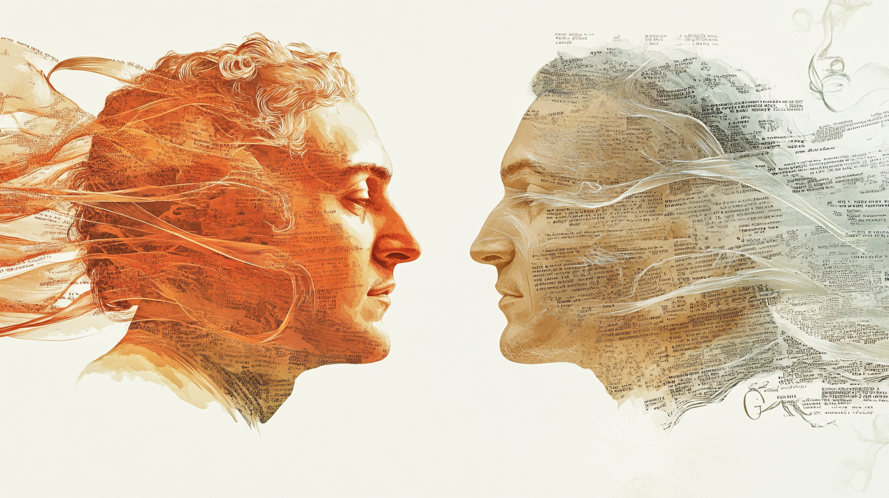

<figure class="wp-block-image alignfull size-large"></figure>

<a href="https://www.gutenberg.org/cache/epub/3600/pg3600-images.html#link2HCH0026">CHAPTER XXVI —&nbsp;</a>FOLLY TO MEASURE TRUTH AND ERROR BY OUR OWN CAPACITY

<a class="wp-block-button__link wp-element-button" href="https://www.gutenberg.org/cache/epub/3600/pg3600-images.html#link2HCH0026">Read Essay - Chapter 26</a>

<h3 class="wp-block-heading">My Take - An Analysis of Montaigne's Essay on Truth and Error</h3>

Montaigne's essay "That It Is Folly to Measure Truth and Error by Our Own Capacity" stands as a masterful exploration of human cognition and epistemology that resonates powerfully in our contemporary era. At its core, the essay presents a compelling critique of intellectual presumption through a sophisticated analysis of how we form and validate beliefs.

The essay's genius begins with its central metaphor comparing belief formation to a seal's impression on wax. This vivid analogy illuminates how uncritical minds can be easily molded by external influences. In our modern context of algorithmic content delivery and digital echo chambers, this insight takes on new urgency, highlighting how technological systems can shape beliefs without fostering critical examination.

Montaigne's unique perspective was shaped by several crucial biographical elements. His Renaissance humanist education provided him with deep knowledge of classical texts, while his experience as a nobleman and magistrate during the French Wars of Religion offered practical insights into human nature and decision-making. This combination of theoretical understanding and real-world experience fostered his balanced approach to knowledge - neither completely skeptical nor naively accepting.

The essay's treatment of opposing viewpoints demonstrates remarkable sophistication. Rather than dismissing contrary positions, Montaigne carefully examines their merits through a dialectical method that places arguments in proper historical context. His approach embodies intellectual charity, recognizing that opposing viewpoints often contain partial truths worthy of consideration.

The relevance to contemporary issues is striking, particularly regarding information literacy and public discourse. His insights about belief formation directly apply to current challenges in scientific literacy, especially public understanding of complex topics like climate change and vaccine technology. His framework for evaluating claims offers valuable guidance for navigating online information and addressing cultural polarization.

Montaigne's emphasis on intellectual humility - the recognition that reality may extend beyond our capacity to understand it - provides a crucial framework for approaching complex issues. This perspective helps balance expertise with openness to alternative viewpoints, a particularly vital skill in our era of competing truth claims.

The essay raises profound questions about cognitive bias and belief formation that remain central to contemporary psychological research. His observations about how cultural conditioning influences what we consider possible or impossiblealign with modern understandings of cognitive biases and social influence.

While some of Montaigne's assumptions reflect period biases, particularly regarding social hierarchy, his core insights about human cognition and the limits of knowledge prove remarkably prescient. His integration of classical wisdom with personal observation creates a philosophical perspective that values practical wisdom over abstract theory.

The essay's contribution to Montaigne's broader work is significant, establishing key epistemological principles that inform his other writings. It exemplifies his mature style, seamlessly blending classical quotations with original analysis while maintaining a personal voice that speaks to universal observations.

In our current era of rapid technological advancement and global challenges, Montaigne's insights offer valuable guidance for navigating complex issues in AI, biotechnology, and international cooperation. His balanced approach to skepticism and openness provides a model for constructive dialogue on contentious issues.

The essay's enduring value lies in its practical framework for developing better critical thinking while maintaining intellectual humility. As we face increasingly complex global challenges, Montaigne's warning against measuring truth solely by our own understanding becomes ever more relevant, reminding us that genuine wisdom often begins with acknowledging the limitations of our perspective.

<figure class="wp-block-image size-large"><figcaption class="wp-element-caption">Photo Josh Bell / Asheville Citizen Times (click to ready article) </figcaption></figure>

<h2 class="wp-block-heading">Modern Impact and Relevance</h2>

Montaigne's closing observation about contradictions in our judgments and how quickly "articles of faith" can become "fables" resonates powerfully with current events. The recent Hands Off! demonstrations across America provide a striking illustration of his insights about human judgment and belief.

Consider how these protests reflect the rapid shifts in public opinion and belief that Montaigne described. Just as he noted how quickly yesterday's certainties become today's fables, we've witnessed dramatic swings in public sentiment about political figures, technological progress, and social movements. The recent trajectory of Elon Musk's public image - from being widely celebrated as a tech visionary to becoming increasingly controversial - illustrates how public opinion can shift dramatically, demonstrating the volatility of public judgment that Montaigne observed.

His warning about glory and curiosity as "scourges of the soul" takes on new meaning in our digital age. The "curiosity" that prompts us to "thrust our noses into everything" perfectly describes our modern information consumption habits, while the "glory" that "forbids us to leave anything doubtful and undecided" mirrors the pressure to take immediate, definitive stances on complex issues.

The nationwide scale of these protests, involving diverse groups from civil rights organizations to labor unions, demonstrates how different segments of society can unite around shared concerns - yet also raises questions about how we form and validate our collective judgments. Montaigne would likely urge us to examine the foundations of our certainties, whether in support of or opposition to any particular cause.

His insights about measuring truth by our own capacity have special relevance when considering how social media and news ecosystems can create parallel realities, each with its own "truths" that seem self-evident to its adherents. The polarization evident in these protests - with sharply divided views about the same events and policies - exemplifies the dangers of measuring truth solely by our personal or ideological frameworks.

Perhaps most importantly, Montaigne's emphasis on intellectual humility offers a valuable approach for navigating our complex political landscape. His recognition that yesterday's articles of faith can become today's fables suggests we should hold our own convictions with some degree of tentativeness, remaining open to new evidence and perspectives while maintaining our capacity for critical thinking.

As we witness mass movements and counter-movements, each certain of its righteousness, Montaigne's warnings about the dangers of absolute certainty and the importance of questioning our own judgments become increasingly vital. His insights remind us that deepening our understanding often requires acknowledging the limitations of our own perspective and remaining open to the possibility that reality might be more nuanced than our current views suggest.

