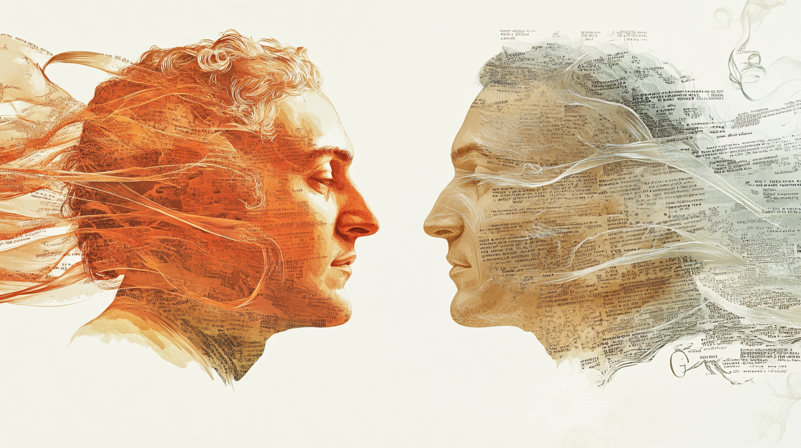

<figure class="wp-block-image alignwide size-large"></figure>

<h2 class="wp-block-heading">What philosophical questions or problems does the author address?</h2>

Montaigne's friendship essay addresses several fundamental philosophical questions about the nature and essence of true friendship. The primary philosophical problem he explores is what constitutes genuine friendship versus superficial relationships. This inquiry echoes Aristotle's discussions in "Nicomachean Ethics," where he distinguishes between friendships of pleasure, utility, and virtue. Like Aristotle, Montaigne argues that the highest form of friendship transcends mere utility or pleasure, though he takes this concept even further.

The philosophical problem of friendship's rarity and perfectibility forms a central theme. While Cicero's "De Amicitia" presents friendship as relatively achievable among good men, Montaigne takes a more exclusive view, suggesting that perfect friendship is so rare as to be almost miraculous. This connects to Plato's concept in "Symposium" of souls seeking their other half, though Montaigne's vision is more grounded in earthly reality.

Through his personal experience of losing his friend Étienne de La Boétie, Montaigne explores the philosophical dimensions of loss and human attachment. This resonates with the Stoic philosophy of Seneca, particularly his "Letters to Lucilius," though Montaigne diverges from Stoic detachment by embracing the pain of loss as integral to the friendship experience.

The essay examines the tension between utility-based relationships and pure friendship, a theme that recalls Epicurean ideas about friendship as both pleasurable and useful. However, Montaigne's vision aligns more closely with Augustine's concept of spiritual friendship as described in "Confessions," where the connection transcends worldly benefits.

Montaigne uniquely addresses how true friendship relates to self-knowledge and personal identity. His suggestion that we become "halves" of each other in perfect friendship both builds upon and challenges classical notions of self-sufficiency. This idea anticipates modern philosophical discussions about relational identity, as later developed by thinkers like Martin Buber in "I and Thou."

The essay also explores how friendship contributes to human flourishing and virtue, connecting to both Aristotelian virtue ethics and Renaissance humanist ideals about the role of friendship in moral development. Unlike many classical philosophers, however, Montaigne emphasizes the emotional and personal aspects of friendship over its purely moral or intellectual benefits.

<h2 class="wp-block-heading">How does the author use reasoning or argumentation to explore these issues?</h2>

Montaigne employs several sophisticated argumentative strategies to explore the nature of friendship. His primary method combines personal experience with classical references, creating a unique blend of empirical and literary evidence. This approach reflects the Renaissance humanist tradition while introducing a more personal, experiential dimension to philosophical argumentation.

His central argument about perfect friendship develops through what modern philosophers would recognize as phenomenological description. Like Maurice Merleau-Ponty's later works on intersubjectivity, Montaigne describes friendship as it is lived and experienced rather than constructing abstract theoretical frameworks. He supports this through vivid metaphors and analogies, such as the comparison of friendship to painting, where he contrasts the central perfect friendship with lesser "grotesque" relationships.

The essay employs a form of negative argumentation similar to the via negativa of medieval philosophy. By systematically distinguishing perfect friendship from other types of relationships (familial, romantic, political), Montaigne defines its unique characteristics. This method recalls Aquinas's approach in the Summa Theologica, though applied to secular rather than religious subjects.

Montaigne's use of classical quotations, particularly from Horace and Catullus, serves a dual argumentative purpose. First, it establishes authority through reference to respected sources. Second, and more innovatively, he uses these quotations not merely as supporting evidence but as jumping-off points for his own original insights, a technique that philosopher Pierre Hadot later identified as characteristic of ancient philosophical practices.

His argumentation is notably influenced by Cicero's dialectical method, particularly in how he presents and then challenges conventional views about friendship. However, unlike Cicero's more formal dialogues, Montaigne develops his arguments through a more fluid, essayistic style that philosopher Stephen Toulmin would later praise as an alternative to rigid logical formalism.

The autobiographical elements of his argumentation anticipate modern philosophical approaches like existentialism. His personal loss becomes a philosophical lens through which to examine friendship's essence, similar to how Kierkegaard would later use personal experiences to explore philosophical concepts. This integration of personal experience with philosophical inquiry creates what contemporary philosopher Martha Nussbaum calls "moral knowledge through emotional engagement."

<h2 class="wp-block-heading">What philosophical theories or viewpoints does the author present or critique?</h2>

Montaigne presents several interconnected philosophical viewpoints about friendship that both build upon and challenge classical theories. His central theory posits friendship as a complete fusion of wills and identities - "two souls in one body" - a concept that extends beyond Aristotle's notion of friends as "other selves." This idea was first explored by Pythagoras, who saw friendship as a mystical harmony between souls, but Montaigne transforms it into a more psychological and emotional framework.

He critiques the classical utilitarian view of friendship, particularly challenging Cicero's more pragmatic approach in "De Amicitia." While ancient philosophers often saw friendship as serving social and political functions, Montaigne argues for a purely personal bond that transcends utility. This perspective influenced later philosophers like Michel Foucault, who explored how intimate relationships could exist outside societal structures.

Montaigne develops a theory of friendship's exclusivity that contrasts with both Stoic and Christian views of universal brotherhood. He argues that perfect friendship can exist only between two individuals, an idea that anticipates modern psychological theories about attachment and intimate relationships. This viewpoint influences contemporary discussions about the nature of close relationships, particularly in works by philosophers like Marilyn Friedman who examine the ethics of partiality in friendship.

His theory about friendship's role in self-knowledge predates but parallels Martin Buber's I-Thou philosophy. Montaigne suggests that true friendship provides unique access to self-understanding, an idea that has become central to modern psychological and philosophical approaches to identity formation. Contemporary philosophers like Alexander Nehamas have built upon this concept in exploring how friendships shape personal identity.

Montaigne also presents a radical view of friendship as superior to familial and romantic love, challenging traditional hierarchies of relationship. This perspective continues to influence modern debates about chosen versus biological families and the nature of intimate relationships, particularly in queer theory and contemporary philosophy of love.

<h2 class="wp-block-heading">How does this work engage with or respond to other philosophical works or thinkers?</h2>

Montaigne's essay on friendship engages extensively with ancient philosophical traditions while developing innovative perspectives that influenced modern thought. His primary dialogue is with classical thinkers, particularly Aristotle's "Nicomachean Ethics" and Cicero's "De Amicitia," though he significantly transforms their ideas. While Aristotle categorized friendship into three types (pleasure, utility, and virtue), Montaigne radically simplifies this by presenting perfect friendship as a singular, transcendent category that exists beyond traditional classifications.

The essay responds directly to Plutarch's moral essays, especially "On Having Many Friends," though Montaigne takes a more extreme position on friendship's exclusivity. His insistence on the rarity and intensity of true friendship challenges Plutarch's more sociable vision. This perspective later influenced Jean-Jacques Rousseau's ideas about authentic relationships in "Emile" and "Confessions."

Montaigne's work also engages with Epicurean ideas about friendship, particularly those preserved in Lucretius's "De Rerum Natura." However, where Epicureans saw friendship as a means to ataraxia (tranquility), Montaigne presents it as valuable in itself, even when it brings pain - a view that anticipates existentialist perspectives on authentic relationships.

His emphasis on the transformative power of friendship responds to Neoplatonic ideas, especially those of Marsilio Ficino, while secularizing them. This secularization influenced later philosophers like Friedrich Nietzsche, who developed similar ideas about friendship's role in self-overcoming in "Thus Spoke Zarathustra."

The essay's impact extends to contemporary philosophy, particularly in discussions of relational autonomy and identity. Philosophers like Marilyn Friedman and Michael Sandel have built upon Montaigne's insights about how intimate relationships shape selfhood. His views on friendship's role in self-knowledge anticipate contemporary philosophical work on intersubjectivity, particularly in phenomenological traditions from Edmund Husserl through Maurice Merleau-Ponty.

<h2 class="wp-block-heading">What are the practical implications or applications of the author's theories or arguments?</h2>

Montaigne's theories about friendship have significant practical implications that continue to resonate in modern contexts. His concept of perfect friendship, while influenced by classical thinkers like Aristotle and Cicero, has evolved to shape contemporary understanding of relationships and mental health. The practical applications span several domains:

In psychological counseling, Montaigne's emphasis on authentic friendship as a path to self-knowledge has influenced modern therapeutic approaches. Contemporary psychotherapists, building on Carl Rogers' person-centered therapy, often incorporate the idea that genuine relationships facilitate self-discovery. This concept has become central to group therapy and peer support programs.

In organizational psychology, Montaigne's critique of utility-based relationships has important implications for workplace dynamics. Modern management theorists like Peter Drucker have drawn parallels to Montaigne's ideas when arguing against purely transactional professional relationships. This has led to the development of more holistic approaches to workplace relationships and team building.

In digital age social networks, Montaigne's theories about the rarity of true friendship provide a framework for understanding the limitations of online connections. His distinction between authentic friendship and superficial acquaintance helps explain modern phenomena like "social media fatigue" and the paradox of increased connectivity leading to greater loneliness.

In education, his ideas about friendship's role in personal growth influence modern pedagogical approaches. Contemporary educational theorists like Nel Noddings have built upon Montaigne's concept of friendship as an educational tool, developing "ethics of care" approaches in education that emphasize genuine relationships between teachers and students.

In mental health practice, Montaigne's insights about friendship's therapeutic value anticipate modern research on social support's role in psychological well-being. Recent studies in positive psychology, led by researchers like Martin Seligman, confirm Montaigne's intuition about friendship's crucial role in mental health and resilience.

The application of Montaigne's theories extends to modern grief counseling, where his personal experience of losing a close friend provides insights into healthy grieving processes. His perspective influences contemporary approaches to bereavement therapy, particularly in understanding how deep friendship affects identity and loss recovery.

<h2 class="wp-block-heading">What theories or concepts does the author use to support their argument?</h2>

Montaigne employs several fundamental philosophical concepts to support his argument about friendship, drawing from and transforming classical ideas while anticipating modern theories. The concept of "soul-friendship" originated with Pythagoras, who conceived of friendship as a harmonious union of souls. Montaigne develops this into a more psychological framework that presages modern theories of interpersonal psychology and attachment theory.

His use of the "mirror concept" - where friends serve as reflective surfaces for self-knowledge - builds on Plato's theory of self-knowledge but transforms it into something more personal. This concept has become central to modern psychological theories, particularly in the work of psychologist Carl Rogers and his ideas about authentic relationships in therapeutic settings.

The author employs the classical concept of "virtue friendship" from Aristotle but radically reinterprets it. While Aristotle saw virtue friendship as one type among many, Montaigne elevates it to the only true form of friendship. This exclusive view anticipates modern psychological concepts of "deep relationships" and "quality over quantity" in social connections, as explored by contemporary psychologists like Robin Dunbar.

Montaigne develops the concept of "voluntary kinship," which challenges traditional Roman ideas about family bonds being supreme. This theoretical framework has become particularly relevant in modern discussions of chosen families and LGBTQ+ communities, influencing contemporary sociological theories about the nature of kinship and belonging.

The author's concept of "perfect friendship" as transcending utility anticipates modern philosophical discussions about authenticity in human relationships, particularly in existentialist thought. His ideas about friendship's role in identity formation have influenced contemporary theories of relational identity, as developed by philosophers like Charles Taylor and feminist theorists like Carol Gilligan.

<h2 class="wp-block-heading">How does the author interpret or challenge existing knowledge on the subject?</h2>

Montaigne radically challenges existing classical and medieval interpretations of friendship in several innovative ways. While Aristotle and Cicero viewed friendship primarily through sociopolitical and ethical lenses, Montaigne transforms it into a deeply personal, almost mystical bond. This interpretation challenged the dominant medieval Christian view, which emphasized divine love (agape) over personal friendship, and anticipates modern psychological theories about intimate relationships.

His most significant challenge to existing knowledge was his rejection of the classical idea that friendship should serve some higher purpose. While Plato's Symposium presented friendship as a path to philosophical enlightenment, and Stoic philosophers saw it as a means to virtue, Montaigne argues for friendship's intrinsic value. This revolutionary perspective influenced later philosophers like Michel de Montaigne and Jean-Jacques Rousseau, who similarly emphasized authentic personal relationships over social utility.

Montaigne also challenges traditional hierarchies of relationship types. Where medieval and Renaissance society prioritized family bonds and political alliances, Montaigne elevates friendship above all other relationships. This radical reordering anticipates modern sociological concepts like "chosen family" and has influenced contemporary LGBTQ+ theory about alternative kinship structures.

His interpretation of friendship as a complete merging of identities challenges both classical moderation and Christian warnings against excessive attachment to worldly relationships. This intense view of friendship has influenced modern psychological theories about attachment and interpersonal boundaries, particularly in the work of psychoanalysts like Donald Winnicott and contemporary relationship theorists.

Montaigne's emphasis on friendship's role in self-knowledge challenges traditional epistemological frameworks. While ancient philosophers generally saw self-knowledge as achieved through solitary contemplation, Montaigne argues that we truly know ourselves only through intimate friendship. This interpretation anticipates modern psychological theories about the social construction of identity and the role of relationships in personal development.

<h2 class="wp-block-heading">How does the Montaigne friendship essay contribute to the field it is written in?</h2>

Montaigne's "Of Friendship" makes groundbreaking contributions to both philosophical literature and the personal essay genre. While Plato and Aristotle pioneered philosophical discussions of friendship in works like "Lysis" and "Nicomachean Ethics," Montaigne revolutionizes the field by introducing an intensely personal narrative approach to philosophical inquiry. This innovation establishes him as the founder of both the personal essay genre and a new form of philosophical investigation that integrates personal experience with theoretical analysis.

The essay's most significant contribution is its transformation of classical friendship theory into a modern psychological framework. While ancient philosophers like Cicero approached friendship through political and social lenses, Montaigne introduces psychological depth and emotional complexity that anticipates modern psychoanalytic theories. His work directly influenced later philosophers like Ralph Waldo Emerson, whose essay "Friendship" builds upon Montaigne's ideas about the psychological dimensions of intimate relationships.

Montaigne's emphasis on authentic personal experience in philosophical writing has profoundly impacted modern philosophy. His approach influenced phenomenologists like Maurice Merleau-Ponty and existentialists like Jean-Paul Sartre, who similarly grounded philosophical insights in lived experience. Contemporary philosophers like Martha Nussbaum explicitly acknowledge their debt to Montaigne's method of combining personal narrative with philosophical analysis.

The essay's contribution extends beyond philosophy into modern psychology and social theory. Montaigne's insights about friendship's role in identity formation anticipate attachment theory, developed by John Bowlby and Mary Ainsworth. His emphasis on the therapeutic value of friendship influences contemporary positive psychology, particularly Martin Seligman's research on well-being and relationships.

In literary studies, this essay establishes the personal essay as a legitimate form of philosophical inquiry. Modern writers like Joan Didion and Susan Sontag follow Montaigne's model of using personal experience to explore broader philosophical questions. This legacy continues in contemporary creative nonfiction and autobiographical theory.

The most compelling aspects of Montaigne's "Of Friendship" center on his revolutionary portrayal of his friendship with Étienne de La Boétie. His description of their connection - "because it was him, because it was me" - represents one of literature's most profound expressions of platonic love. This idea, while drawing from Aristotle's concept of "another self" in friendship, transforms it into something more intimate and personal that continues to resonate in modern discussions of deep friendship and chosen family.

Particularly memorable is Montaigne's radical assertion that true friendship transcends all other relationships, including family bonds and romantic love. This concept, which challenged medieval social hierarchies, finds modern expression in contemporary discussions of chosen families, particularly in LGBTQ+ communities and in modern psychological theories about attachment and belonging.

The essay's exploration of friendship as a mirror for self-knowledge is especially compelling. While this metaphor originated with Socrates and Plato, Montaigne's personal application of it influenced modern psychological concepts of mirroring in child development, as later developed by Donald Winnicott, and continues to inform contemporary psychotherapy practices.

His vivid description of grief following La Boétie's death remains powerfully relevant, anticipating modern understandings of bereavement. His portrayal of loss as not just emotional but identity-altering influenced later writers like C.S. Lewis in "A Grief Observed" and continues to inform contemporary grief counseling approaches.

The essay's most enduring passage may be its description of friendship as a "nameless and ineffable" connection that defies conventional categories. This concept influenced Romantic writers like Ralph Waldo Emerson and continues to resonate in modern discussions of platonic intimacy and emotional intelligence in works by contemporary psychologists like Daniel Goleman.

<h2 class="wp-block-heading">How does the author's background or perspective influence their interpretation of the topic?</h2>

Montaigne's interpretation of friendship was profoundly shaped by his Renaissance humanist education and his personal experiences, particularly his deep friendship with Étienne de La Boétie. His aristocratic background and classical education at the Collège de Guyenne exposed him to ancient Greek and Roman texts on friendship, notably those of Cicero and Aristotle, which he both embraced and challenged through his personal lens.

While ancient philosophers like Plato in "Lysis" approached friendship theoretically, Montaigne's perspective was deeply influenced by his role as a nobleman in sixteenth-century France. His position allowed him to observe various forms of political and social alliances, leading him to distinguish between true friendship and relationships based on utility or circumstance.

His skeptical philosophical outlook, influenced by Pyrrhonism, led him to question traditional assumptions about friendship and social bonds. This skepticism resonates with modern philosophical approaches to relationships, particularly in existentialist thought and contemporary critiques of social media connections.

The personal tragedy of La Boétie's death in 1563 profoundly influenced Montaigne's writing on friendship. This experience connects to modern psychological theories about grief and attachment, as developed by theorists like John Bowlby and Elisabeth Kübler-Ross.

Montaigne's perspective as a Catholic during the French Wars of Religion also colored his view of friendship as transcending religious and political divisions. This perspective influences modern discussions about friendship across cultural and ideological boundaries, particularly in conflict resolution and peace studies.

<h2 class="wp-block-heading">How does the author handle opposing viewpoints or arguments?</h2>

Montaigne handles opposing viewpoints with remarkable sophistication, engaging directly with classical philosophers while developing his own unique perspective. While Aristotle and Cicero viewed friendship primarily as a virtue-based relationship serving social and political purposes, Montaigne challenges this view by emphasizing the personal and emotional aspects of friendship. He acknowledges these traditional perspectives but systematically demonstrates why they fall short of capturing friendship's true essence.

His treatment of the Christian theological argument against intense worldly friendships is particularly nuanced. Where Augustine warned against strong personal attachments that might compete with divine love, Montaigne carefully argues that profound friendship actually enriches rather than diminishes spiritual life. This debate continues in modern theological discussions about the relationship between human and divine love.

Montaigne also addresses the Stoic view, represented by Seneca, that the wise man should be self-sufficient and not dependent on friendships. He challenges this by arguing that true self-knowledge and personal growth require deep friendship, anticipating modern psychological theories about the importance of relationships in personal development. His counter-arguments influence contemporary debates in positive psychology about the role of relationships in well-being.

The essay engages with Epicurean arguments about friendship's utility, where philosophers like Lucretius saw friendship primarily as a means of securing pleasure and avoiding pain. Montaigne transforms this view by arguing for friendship's intrinsic value beyond its practical benefits. This perspective influences modern philosophical discussions about authenticity in relationships, particularly in existentialist thought.

His response to political theorists who prioritized civic friendship over personal bonds remains relevant to contemporary political philosophy. While Machiavelli emphasized political alliances, Montaigne argues for the superiority of personal friendship, influencing modern discussions about the relationship between private bonds and public life, particularly in works by Hannah Arendt and Martha Nussbaum.

<h2 class="wp-block-heading">Does the essay stimulate new questions or lines of inquiry for you?</h2>

Montaigne's exploration of friendship stimulates several intriguing modern questions. While Plato first explored friendship's role in philosophical development through dialogues like "Lysis," Montaigne's personal approach raises new questions about how digital technology affects authentic friendship. How do social media platforms impact our capacity for deep friendship in ways Montaigne couldn't have imagined? This connects to contemporary research by Sherry Turkle on digital relationships and Jonathan Haidt's work on social media's effect on genuine human connection.

The essay prompts questions about friendship across cultural boundaries. While ancient philosophers like Aristotle assumed friendship required shared cultural values, Montaigne's emphasis on personal connection over social convention raises questions relevant to our globalized world. How do cross-cultural friendships challenge or reinforce Montaigne's ideas? This connects to modern anthropological work by <a href="https://en.wikipedia.org/wiki/Ruth_Benedict">Ruth Benedict</a> and contemporary research on intercultural relationships.

Montaigne's concept of friendship as identity formation raises questions about modern psychological development. While Carl Jung first formally explored the role of relationships in individuation, Montaigne's insights anticipate contemporary questions about identity formation in an increasingly isolated society. How do modern living arrangements and work patterns affect our capacity for deep friendship? This relates to Robert Putnam's research on declining social connections and modern studies on loneliness by Vivek Murthy.

The essay also prompts questions about gender and friendship. While classical writers largely focused on male friendship, Montaigne's universal principles raise questions about gender differences in friendship patterns. How do his ideas apply to female friendships or cross-gender friendships? This connects to Carol Gilligan's work on gender and relationships and modern feminist theory about friendship as a political act.

<h2 class="wp-block-heading">How does the essays content relate to current events or contemporary issues?</h2>

Montaigne's views on friendship have striking relevance to contemporary social issues. While Aristotle first explored friendship's social dimensions in "Nicomachean Ethics," Montaigne's emphasis on authentic connection speaks directly to modern concerns about loneliness and social isolation in the digital age. His insights about genuine friendship versus superficial connections parallel current debates about social media relationships, as explored in research by <a href="https://www.sherryturkle.com/">Sherry Turkle</a> and <a href="https://jonathanhaidt.com/">Jonathan Haidt</a> on digital technology's impact on human connection.

The essay's emphasis on friendship transcending social boundaries has particular resonance amid current political polarization. While Cicero first discussed friendship's role in civic life, Montaigne's vision of friendship bridging social divides offers insights for contemporary challenges of political tribalism and cultural division. His ideas influence modern approaches to dialogue across difference, as seen in the work of moral psychologist Jonathan Haidt on political polarization.

Montaigne's discussion of friendship's role in mental health anticipates contemporary psychological research. While Hippocrates first noted social connections' importance for well-being, Montaigne's detailed analysis of friendship's psychological benefits connects to modern research on loneliness as a public health crisis, particularly relevant during post-pandemic social rebuilding. His insights align with recent work by former Surgeon General Vivek Murthy on loneliness's health impacts.

The essay's exploration of chosen family through friendship has special relevance for modern LGBTQ+ communities. While classical philosophers saw friendship as supplementary to family bonds, Montaigne's elevation of chosen friendship above traditional kinship structures resonates with contemporary discussions of alternative family structures and chosen families, particularly in marginalized communities.

Montaigne's insights about friendship's role in personal development relate to modern workplace concerns about remote work and professional isolation. His emphasis on face-to-face connection speaks to current debates about virtual versus in-person interaction in professional settings, connecting to research by organizational psychologists on workplace relationships and professional development.

<h2 class="wp-block-heading">What assumptions does the author make, and are they justified?</h2>

Montaigne makes several significant assumptions in his essay on friendship, building upon and sometimes challenging earlier philosophical traditions. While Plato first proposed in "Symposium" that true friendship requires equality between parties, Montaigne extends this to assume that perfect friendship can only exist between two individuals. This assumption, though limiting, influences modern psychological theories about attachment and intimate relationships, particularly in the work of John Bowlby and Mary Ainsworth.

Another key assumption, following Aristotle's conception of friendship, is that the highest form of friendship requires virtue. However, Montaigne uniquely assumes that this virtue emerges from the friendship itself rather than preceding it. This perspective anticipates modern developmental psychology's understanding of how relationships shape character, as seen in the work of <a href="https://en.wikipedia.org/wiki/Carol_Dweck">Carol Dweck</a> on growth mindset and relationship development.

Montaigne also assumes that deep friendship is rare and cannot be replicated multiple times, contrasting with Epicurean views on friendship's abundance. While potentially limiting, this assumption resonates with contemporary research on close relationships, particularly Robin Dunbar's work on the cognitive limits of meaningful social connections and Daniel Kahneman's studies on social decision-making.

Perhaps his most controversial assumption is that true friendship transcends romantic and familial bonds. While this builds on classical Stoic ideas about chosen relationships, Montaigne's elevation of friendship above all other ties influences modern discussions of chosen family and alternative relationship structures, particularly in works by anthropologist <a href="https://en.wikipedia.org/wiki/Kath_Weston">Kath Weston</a> on LGBTQ+ kinship patterns.

<h2 class="wp-block-heading">How does the essay fit into the larger context of the author's work?</h2>

Montaigne's essay on friendship represents a pivotal moment in his literary development. While Augustine first explored personal introspection in his "Confessions," Montaigne's treatment of friendship marks a significant evolution in his philosophical approach, moving from academic commentary to deeply personal reflection. This shift influenced modern memoir writing and personal essays, particularly evident in writers like Virginia Woolf and Joan Didion.

The essay stands out among Montaigne's works for its emotional intensity. While Stoic philosophers like Seneca emphasized emotional restraint, Montaigne's raw expression of grief and attachment in this piece marked a departure from his typically measured tone. This emotional openness influenced modern confessional literature and therapeutic writing, as seen in the work of therapists like James Pennebaker on expressive writing's healing potential.

Within his collected essays, this piece uniquely combines classical scholarship with personal experience. While earlier humanists like Petrarch primarily analyzed classical texts academically, Montaigne's integration of personal experience with classical learning created a new model for intellectual autobiography. This approach influences modern academic writing on personal experience, particularly in feminist scholarship and autoethnography.

The essay also marks a crucial development in Montaigne's skeptical philosophy. While ancient skeptics like Pyrrho questioned the possibility of certain knowledge, Montaigne's treatment of friendship suggests that direct personal experience can provide a form of understanding beyond rational doubt. This perspective influences modern phenomenological approaches to understanding human relationships, particularly in the work of philosophers like Maurice Merleau-Ponty.

This essay exemplifies Montaigne's revolutionary approach to essay writing itself. While classical rhetoric emphasized formal argumentation, Montaigne's meandering, personal style in discussing friendship established a new literary form that continues to influence modern creative nonfiction and personal essays, as seen in the work of contemporary essayists like David Foster Wallace and Rebecca Solnit.

<h2 class="wp-block-heading">Quick Take -</h2>

<h3 class="wp-block-heading"><strong>What does Montaigne say about friendship?</strong></h3>

Montaigne views friendship as a profound spiritual and emotional union between souls that surpasses ordinary relationships. He believes true friendship is extremely rare, possible only between equals, and characterized by complete trust and openness. Unlike relationships based on utility or pleasure, genuine friendship involves a complete merging of wills and judgments. Montaigne distinguishes it from family ties, political alliances, and romantic relationships, considering it superior to all these bonds. Drawing from his experience with Étienne de La Boétie, he argues that authentic friendship enhances self-knowledge and personal growth, creating a bond so complete that friends become essentially one soul in two bodies.

<h3 class="wp-block-heading"><strong>What was the main point of Montaigne's essays?</strong></h3>

The main point of Montaigne's essays was to explore human nature and the self through personal reflection and observation. His revolutionary approach combined classical learning with intimate self-examination, creating a new form of intellectual autobiography. Through his essays, he questioned conventional wisdom, embraced skepticism, and demonstrated that personal experience could be a valid source of philosophical insight. His work emphasized the importance of personal judgment, intellectual honesty, and the acceptance of human imperfection while maintaining a curious and open mind about life's fundamental questions.

<h3 class="wp-block-heading"><strong>What is the key characteristic of true friendship according to Montaigne?</strong></h3>

According to Montaigne, the key characteristic of true friendship is complete spiritual and emotional unity between two individuals. Unlike relationships based on utility or circumstance, true friendship involves a total fusion of wills, judgments, and souls. Montaigne describes it as a unique connection where two beings merge into one, characterized by absolute trust, mutual understanding, and unwavering loyalty. This complete merging of identities transcends ordinary social bonds and creates what he calls "one soul in two bodies."

<h3 class="wp-block-heading"><strong>What is the summary of the essay of friendship?</strong></h3>

Montaigne's essay "Of Friendship" explores the profound nature of true friendship through both philosophical analysis and personal reflection. Drawing heavily from his own friendship with Étienne de La Boétie, Montaigne argues that genuine friendship is a rare and transcendent bond that surpasses all other human relationships, including family ties and romantic love. He presents friendship as a complete fusion of two souls, characterized by absolute trust, mutual understanding, and perfect equality between partners. The essay challenges traditional views of friendship based on utility or pleasure, instead elevating it to a spiritual union that enhances self-knowledge and personal growth. Montaigne distinguishes this perfect friendship from common acquaintanceships and political alliances, emphasizing its voluntary nature and the complete merging of wills and judgments. Throughout the essay, he weaves classical philosophical references with intimate personal experience to create a deeply moving meditation on friendship's transformative power.

<h3 class="wp-block-heading"><strong>What is the main message about friendship?</strong></h3>

The main message about friendship in Montaigne's essay is that true friendship represents a rare and profound spiritual union that transcends ordinary relationships. He emphasizes that authentic friendship involves a complete merging of souls, characterized by absolute trust, mutual understanding, and perfect equality. Unlike relationships based on utility or circumstance, genuine friendship leads to personal growth and self-discovery through the deep connection between two individuals who essentially become "one soul in two bodies." This transformative bond surpasses familial ties, romantic relationships, and social alliances in both depth and significance.

<h3 class="wp-block-heading"><strong>What was Montaigne's famous quote?</strong></h3>

One of Montaigne's most famous quotes about friendship is: "In true friendship, wherein I am perfect, I more give myself to my friend, than I endeavor to attract him to me. I am not only better pleased in doing him service, than if he conferred a benefit upon me, but, moreover, had rather he should do himself good than me, and he most obliges me when he does so."

Another notable quote that captures his philosophy is: "If you press me to say why I loved him, I can say no more than because he was he, and I was I."

On self-knowledge, he famously wrote: "I study myself more than any other subject. That is my metaphysics, that is my physics."

<a href="https://betterworldwithdesign.com/tag/montaigne/">Read the series of Montaigne Overviews</a>

<figure class="wp-block-embed is-type-wp-embed is-provider-better-world-with-design wp-block-embed-better-world-with-design">

<blockquote class="wp-embedded-content" data-secret="VDbPwEC0ZZ"><a href="https://betterworldwithdesign.com/chapter-23-various-events-form-the-same-counsel/">Montaigne &#8211; Chapter 23 &#8211; Various events form the same counsel</a></blockquote><iframe loading="lazy" class="wp-embedded-content" sandbox="allow-scripts" security="restricted" style="position: absolute; visibility: hidden;" title="&#8220;Montaigne &#8211; Chapter 23 &#8211; Various events form the same counsel&#8221; &#8212; Better World With Design" src="https://betterworldwithdesign.com/chapter-23-various-events-form-the-same-counsel/embed/#?secret=dFagqZIgnE#?secret=VDbPwEC0ZZ" data-secret="VDbPwEC0ZZ" width="600" height="338" frameborder="0" marginwidth="0" marginheight="0" scrolling="no"></iframe>

</figure>

<figure class="wp-block-embed is-type-wp-embed is-provider-better-world-with-design wp-block-embed-better-world-with-design">

<blockquote class="wp-embedded-content" data-secret="iC5E03G0SO"><a href="https://betterworldwithdesign.com/montaigne-chapter-26-that-it-is-folly-to-measure-truth-and-error-by-our-own-capacity/">Montaigne &#8211; Chapter 26 &#8211; That It Is Folly To Measure Truth And Error By Our Own Capacity</a></blockquote><iframe loading="lazy" class="wp-embedded-content" sandbox="allow-scripts" security="restricted" style="position: absolute; visibility: hidden;" title="&#8220;Montaigne &#8211; Chapter 26 &#8211; That It Is Folly To Measure Truth And Error By Our Own Capacity&#8221; &#8212; Better World With Design" src="https://betterworldwithdesign.com/montaigne-chapter-26-that-it-is-folly-to-measure-truth-and-error-by-our-own-capacity/embed/#?secret=iCaAc9W4ap#?secret=iC5E03G0SO" data-secret="iC5E03G0SO" width="600" height="338" frameborder="0" marginwidth="0" marginheight="0" scrolling="no"></iframe>

</figure>

