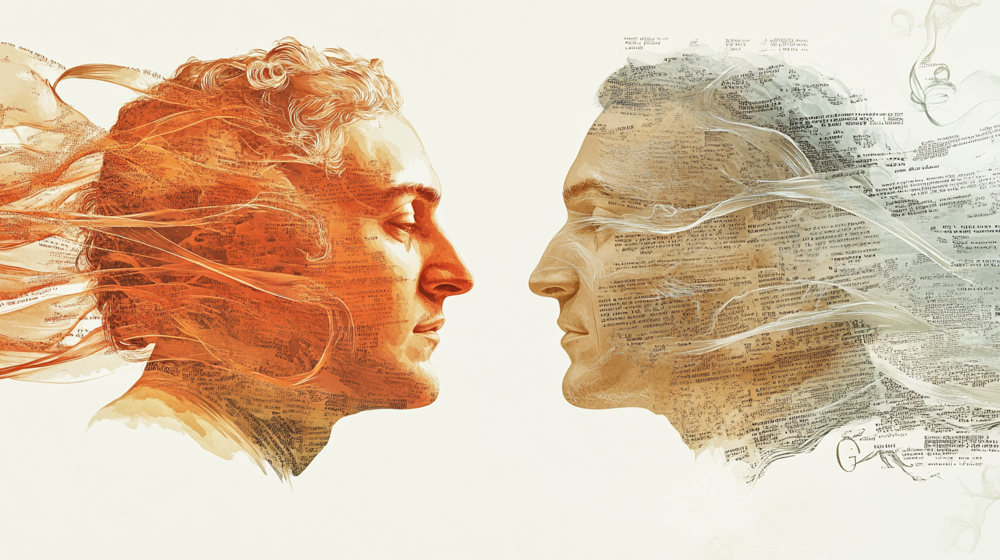

<figure class="wp-block-image alignwide size-large"></figure>

<h2 class="wp-block-heading">What philosophical questions or problems does Montaigne address?</h2>

In this chapter, Montaigne addresses several key philosophical questions:

<ul class="wp-block-list">
<li>The nature and limits of moderation: He explores whether virtues can become vices when pursued too extremely</li>

<li>The relationship between pleasure and morality: Particularly in marriage and human relationships, questioning how to balance natural desires with moral obligations</li>

<li>The paradox of human happiness: He examines how humans often create doctrines and rules that limit their pleasures, potentially making themselves more miserable</li>

<li>The nature of religious and cultural practices: He questions the rationality of various cultural beliefs, especially regarding sacrifice and religious practices</li>

<li>The relationship between physical and spiritual well-being: He explores how both religious and medical authorities prescribe suffering as a path to improvement</li>
</ul>

Montaigne particularly focuses on the complex relationship between excess and virtue, questioning whether the pursuit of moderation itself can become immoderate. He challenges the notion that complete suppression of natural pleasures is necessary for moral living.

<h2 class="wp-block-heading">How does Montaigne use reasoning or argumentation to explore these issues?</h2>

Montaigne employs several key argumentative strategies in this chapter:

<ul class="wp-block-list">
<li>Historical examples and classical references: He draws from various historical sources and classical literature to support his points about moderation and excess</li>

<li>Personal observations and anecdotes: He uses examples from contemporary life and personal reflection to make his arguments more relatable and concrete</li>

<li>Comparative analysis: He examines different cultural practices and beliefs to highlight the relativity of moral standards</li>

<li>Paradoxical reasoning: He demonstrates how attempts to achieve virtue through extreme measures often lead to their opposite</li>

<li>Appeal to nature: He frequently argues that natural inclinations and pleasures shouldn't be completely suppressed, questioning artificial restrictions</li>
</ul>

His argumentative style is notably non-systematic and exploratory, preferring to examine issues from multiple angles rather than building a rigid philosophical system. He often uses irony and skepticism to challenge conventional wisdom and established doctrines.

<h2 class="wp-block-heading">What philosophical theories or viewpoints does Montaigne present or critique?</h2>

In this essay, Montaigne presents and critiques several philosophical viewpoints:

<ul class="wp-block-list">
<li>Stoic views on virtue: He challenges the Stoic notion that virtue can never be excessive, arguing that even virtuous pursuits can become harmful when taken to extremes</li>

<li>Platonic theories of marriage and love: He examines Plato's views on marital relations and critiques overly rigid moral standards</li>

<li>Religious asceticism: He questions the belief that physical suffering and deprivation lead to spiritual growth</li>

<li>Medical theory of contraries: He challenges the traditional medical belief that illnesses must be cured by their opposites</li>

<li>Cultural relativism: Through his discussion of different cultural practices, he implicitly presents a form of moral relativism</li>
</ul>

Montaigne particularly critiques philosophical absolutism - the tendency to establish universal rules or extreme positions. He favors a more nuanced, experiential approach that acknowledges human nature and its limitations. His skepticism toward rigid philosophical systems is evident in how he questions both extreme hedonism and extreme asceticism.

<h2 class="wp-block-heading">How does this work engage with or respond to other philosophical works or thinkers?</h2>

Montaigne engages with and responds to several major philosophical traditions and thinkers:

<ul class="wp-block-list">
<li>Classical philosophers: He frequently references and critiques Stoic philosophers, particularly their views on virtue and moderation. He also engages with Aristotelian concepts of the mean between extremes</li>

<li>Roman writers: He draws heavily from Horace, Cicero, and other Roman thinkers, both supporting and challenging their views on morality and human nature</li>

<li>Religious thinkers: He examines and often questions Christian ascetic traditions and theological interpretations of suffering and virtue</li>

<li>Ancient historians: He uses accounts from Plutarch and others to explore how different societies and leaders approached questions of morality and moderation</li>

<li>Contemporary humanist thought: His work reflects and responds to Renaissance humanist interpretations of classical texts and ideas</li>
</ul>

Montaigne's engagement with these thinkers is characteristically non-dogmatic. Rather than simply accepting or rejecting their ideas wholesale, he uses their writings as starting points for his own exploration of human nature and morality. His approach often involves testing philosophical ideas against practical experience and common sense, showing both respect for classical authority and willingness to question it.

<h2 class="wp-block-heading">What are the practical implications or applications of Montaigne's theories or arguments?</h2>

Montaigne's arguments have several practical implications for modern life and personal development:

<ul class="wp-block-list">
<li>Balanced approach to self-improvement: His critique of extreme measures suggests adopting moderate, sustainable approaches to personal growth rather than radical lifestyle changes</li>

<li>Cultural tolerance: His analysis of different cultural practices encourages understanding and respect for diverse perspectives and ways of life</li>

<li>Mental health and well-being: His insights about human happiness suggest avoiding unnecessary self-imposed restrictions and accepting natural pleasures in moderation</li>

<li>Decision-making: His emphasis on practical experience over rigid rules encourages flexible, context-sensitive approaches to moral and practical decisions</li>

<li>Self-acceptance: His recognition of human limitations and natural desires promotes a more realistic and compassionate attitude toward oneself and others</li>
</ul>

These implications are particularly relevant in today's world, where extreme lifestyle trends, strict self-help regimens, and absolutist thinking often dominate popular discourse. Montaigne's emphasis on moderation and practical wisdom offers a more sustainable approach to personal development and social interaction.

<h2 class="wp-block-heading">What theories or concepts does the author use to support their argument?</h2>

Montaigne employs several theoretical frameworks and concepts to support his arguments in this chapter:

<ul class="wp-block-list">
<li>Natural law theory: He frequently appeals to the concept of natural order and human nature to critique excessive restrictions on human behavior</li>

<li>Virtue ethics: He examines traditional concepts of virtue but challenges rigid interpretations, suggesting that virtues must be understood in relation to human nature</li>

<li>Cultural relativism: He uses examples from different cultures to demonstrate the variety of moral practices and question universal moral standards</li>

<li>Medical theory: He discusses and critiques contemporary medical concepts, particularly the theory of contraries in treatment</li>

<li>Classical philosophy: He draws on concepts from ancient Greek and Roman philosophy, especially regarding moderation and excess</li>
</ul>

His theoretical approach is notably eclectic and skeptical, combining elements from various philosophical traditions while maintaining a critical stance toward absolute or extreme positions. Rather than building a systematic theoretical framework, he uses these concepts as tools for exploring human nature and behavior.

<h2 class="wp-block-heading">How does the author interpret or challenge existing knowledge on the subject?</h2>

Montaigne challenges existing knowledge in several significant ways:

<ul class="wp-block-list">
<li>Questioning traditional virtue theory: He challenges the conventional wisdom that virtues are always good, arguing that even virtuous pursuits can become problematic when taken to extremes</li>

<li>Reinterpreting religious practices: He questions established religious interpretations of suffering and sacrifice, suggesting that many religious practices may be misguided or harmful</li>

<li>Challenging medical doctrine: He disputes the traditional medical principle that ailments must be cured by their opposites, offering counter-examples and alternative perspectives</li>

<li>Critiquing moral absolutism: He challenges the tendency of philosophers and moralists to establish universal rules, advocating instead for a more nuanced understanding of human behavior</li>

<li>Reexamining marriage customs: He questions conventional wisdom about marriage and relationships, suggesting that overly strict moral codes may be counterproductive</li>
</ul>

His interpretative approach is characterized by skepticism toward received wisdom and a preference for practical observation over theoretical abstractions. Rather than completely rejecting existing knowledge, he often reframes it through the lens of personal experience and common sense, suggesting more moderate and practical interpretations.

<h2 class="wp-block-heading">How does the essay contribute to the field it is written in?</h2>

This essay makes several significant contributions to philosophical discourse and literary style:

<ul class="wp-block-list">
<li>Development of the essay form: Montaigne essentially invented the personal essay as a genre, introducing a more informal, exploratory approach to philosophical writing that influenced countless later writers</li>

<li>Skeptical methodology: His approach to questioning established wisdom while maintaining intellectual humility created a new model for philosophical inquiry</li>

<li>Cultural analysis: His comparative examination of different cultural practices laid groundwork for anthropological and sociological approaches to understanding human behavior</li>

<li>Practical philosophy: His focus on applying philosophical concepts to everyday life helped bridge the gap between theoretical philosophy and practical wisdom</li>

<li>Literary style: His personal, conversational writing style demonstrated how complex philosophical ideas could be discussed in accessible language</li>
</ul>

The essay's specific contribution to the discussion of moderation is particularly notable, as it challenges both extreme asceticism and hedonism while advocating for a more nuanced understanding of human nature. This middle-path approach influenced later philosophical discussions about virtue and human behavior.

<h2 class="wp-block-heading">What are the most compelling or memorable parts of the essay?</h2>

Several aspects of this essay stand out as particularly compelling:

<ul class="wp-block-list">
<li>The powerful opening metaphor of the "infectious touch" - how human handling can corrupt even virtuous things through excessive zeal</li>

<li>The striking example of Cortez and the three types of gifts - illustrating cultural misunderstanding and different conceptions of divinity</li>

<li>The vivid paradox presented in the Latin quote about how even the pursuit of wisdom can make a wise man foolish</li>

<li>The provocative discussion of marriage and how excessive moral strictness can harm rather than help relationships</li>

<li>The memorable analysis of religious sacrifices, particularly the disturbing account of human sacrifice and its rationalization</li>
</ul>

These elements are memorable not just for their dramatic content, but for how Montaigne uses them to illustrate his larger argument about the dangers of extremism and the importance of moderation. His ability to move from philosophical abstractions to concrete, often shocking examples makes his arguments particularly compelling.

<h2 class="wp-block-heading">How does the Montaigne's background or perspective influence their interpretation of the topic?</h2>

Montaigne's background significantly shaped his perspective on moderation:

<ul class="wp-block-list">
<li>Classical education: His extensive training in Latin and Greek literature from an early age gave him deep familiarity with classical philosophies about moderation and virtue</li>

<li>French nobility: His position as a nobleman exposed him to both the excesses of aristocratic life and the philosophical discussions of his time</li>

<li>Political experience: His role as mayor of Bordeaux and witness to religious wars likely influenced his preference for moderate approaches over extremism</li>

<li>Personal health struggles: His experiences with kidney stones and other ailments informed his skepticism of extreme medical treatments</li>

<li>Renaissance humanism: His education in humanist traditions encouraged his questioning of established authorities while maintaining respect for classical wisdom</li>
</ul>

These elements of his background contribute to his balanced approach, combining skepticism toward extremes with practical wisdom drawn from personal experience. His privileged position also allowed him the freedom to observe and critique society from a relatively detached perspective, while his education enabled him to connect personal observations with broader philosophical traditions.

<h2 class="wp-block-heading">How does the author handle opposing viewpoints or arguments?</h2>

Montaigne handles opposing viewpoints in several sophisticated ways:

<ul class="wp-block-list">
<li>Respectful engagement: He presents opposing arguments fairly before critiquing them, showing genuine consideration for different perspectives</li>

<li>Dialectical approach: Rather than outright dismissing contrary views, he often explores their merits and limitations through dialogue and examples</li>

<li>Historical context: He situates opposing arguments within their historical and cultural contexts, acknowledging their origins and evolution</li>

<li>Personal experience: He frequently tests opposing viewpoints against his own experiences, using practical examples to evaluate theoretical positions</li>

<li>Synthesis attempts: Where possible, he tries to find middle ground between opposing positions, especially when discussing moral and philosophical issues</li>
</ul>

His approach to opposing viewpoints reflects his broader philosophical method - skeptical but not cynical, critical but not dismissive. He often acknowledges partial truths in opposing positions while pointing out their limitations or potential dangers when taken to extremes.

<h2 class="wp-block-heading">Does the book stimulate new questions or lines of inquiry for you?</h2>

This essay raises several intriguing questions for modern readers:

<ul class="wp-block-list">
<li>How do we define "moderation" in an age of extremes, where social media and technology often push us toward polarized positions?</li>

<li>Can Montaigne's ideas about balance and moderation be applied to digital consumption and online behavior?</li>

<li>How do we maintain a middle path in personal development when surrounded by messages promoting radical transformation and extreme lifestyle changes?</li>

<li>What role does cultural context play in defining moderation, especially in our globally connected world?</li>

<li>How can organizations and leaders apply Montaigne's principles of moderation in decision-making and policy implementation?</li>
</ul>

These questions suggest new areas for research in psychology, social media studies, organizational behavior, and cultural studies. They also prompt personal reflection on how we might apply Montaigne's wisdom to contemporary challenges.

<h2 class="wp-block-heading">How does the book's content relate to current events or contemporary issues?</h2>

Montaigne's discussion of moderation has striking relevance to many contemporary issues:

<ul class="wp-block-list">
<li>Political polarization: His warnings about extremism and the importance of moderate discourse are particularly relevant in today's highly polarized political climate</li>

<li>Social media dynamics: The essay's insights about how zealotry can corrupt virtuous causes relates to modern "cancel culture" and online moral outrage</li>

<li>Wellness culture: His critique of excessive virtue applies to contemporary wellness and self-improvement movements that often promote extreme lifestyle changes</li>

<li>Environmental activism: His balanced approach offers perspective on debates between radical environmental action and moderate reform strategies</li>

<li>Mental health: His advocacy for moderation speaks to current discussions about work-life balance, digital detox, and psychological well-being</li>
</ul>

The essay's themes also resonate with current debates about religious fundamentalism, dietary extremism, and the balance between personal freedom and social responsibility, particularly in public health contexts. Montaigne's emphasis on practical wisdom over ideological purity offers valuable insights for addressing these contemporary challenges.

<h2 class="wp-block-heading">What assumptions does Montaigne make, and are they justified?</h2>

Montaigne makes several key assumptions in his essay:

<ul class="wp-block-list">
<li>Human nature is relatively constant: He assumes that fundamental aspects of human behavior and psychology are consistent across cultures and time periods</li>

<li>Experience trumps theory: He assumes that practical experience and observation are more reliable guides than abstract theoretical frameworks</li>

<li>Moderation is universally beneficial: He presupposes that balance and moderation are inherently better than extremes in most situations</li>

<li>Cultural practices reflect human nature: He assumes that widespread cultural practices reveal important truths about natural human tendencies</li>

<li>Reason has limits: He assumes that pure rational thought cannot fully comprehend or guide human behavior</li>
</ul>

Most of these assumptions appear justified based on historical evidence and modern understanding of human psychology and sociology. His assumption about human nature's consistency is supported by anthropological research, while his emphasis on experience over theory aligns with modern empirical approaches. However, his assumption about the universal benefit of moderation might be questioned in situations requiring decisive action or radical change.

The strength of Montaigne's assumptions lies in their grounding in observable human behavior and their flexibility - he generally presents them as working principles rather than absolute truths, consistent with his skeptical approach.

<h2 class="wp-block-heading">How does the essay fit into the larger context of Montaigne's work?</h2>

This essay on moderation is a central piece in Montaigne's Essays, reflecting many of his key philosophical and literary approaches:

<ul class="wp-block-list">
<li>Thematic connections: The essay's focus on moderation complements other essays dealing with self-knowledge, skepticism, and practical wisdom</li>

<li>Stylistic consistency: It demonstrates his characteristic blend of personal observation, classical quotation, and informal philosophical reasoning</li>

<li>Evolutionary development: Written and revised over multiple editions, it shows his maturing thought process and growing emphasis on personal experience</li>

<li>Philosophical methodology: The essay exemplifies his skeptical approach and preference for practical over theoretical knowledge</li>

<li>Literary innovation: It showcases his development of the personal essay form, combining scholarly reference with conversational style</li>
</ul>

The essay also demonstrates Montaigne's characteristic ability to move between personal anecdotes and universal observations, a technique that appears throughout his Essays. Its placement within the larger work suggests its importance to his overall philosophical project of self-examination and practical wisdom.

<h2 class="wp-block-heading">How do the essay’s core ideas connect to current social media trends and digital communication patterns?</h2>

Montaigne's ideas about moderation have striking parallels to current social media dynamics:

<ul class="wp-block-list">
<li>Viral outrage cycles: His warnings about how virtue can become vice when pursued too zealously mirror the way social media can amplify moral outrage to destructive levels</li>

<li>Echo chambers: His emphasis on considering multiple perspectives challenges the tendency of social media algorithms to create ideological bubbles</li>

<li>Digital wellness: His arguments for moderation apply directly to current debates about screen time and digital detox practices</li>

<li>Online discourse: His critique of extremism relates to how social media platforms often reward the most extreme or inflammatory content</li>

<li>Content creation pressure: His thoughts on balance speak to content creators facing pressure to constantly produce and engage</li>
</ul>

The essay's insights about how human behavior can corrupt good intentions are particularly relevant to understanding how social media platforms, despite their potential for connection and learning, often become vehicles for polarization and extreme behavior. His advocacy for measured response and balanced judgment offers valuable guidance for digital citizenship.

<h2 class="wp-block-heading">Which modern thought leaders or influencers are actively building upon or challenging the essay's key concepts?</h2>

Several contemporary thought leaders are engaging with Montaigne's concepts of moderation and balance:

<ul class="wp-block-list">
<li>Cal Newport - His work on "digital minimalism" echoes Montaigne's ideas about moderation in the context of technology use</li>

<li>Jonathan Haidt - His research and writing on social media's polarizing effects and the need for balanced discourse aligns with Montaigne's warnings about extremism</li>

<li>Nassim Nicholas Taleb - His concept of "antifragility" and critique of extremes in decision-making builds upon similar principles</li>

<li>Daniel Goleman - His work on emotional intelligence incorporates ideas about balance and measured response in emotional regulation</li>

<li>Ryan Holiday - His modern interpretations of stoic philosophy often parallel Montaigne's emphasis on practical moderation</li>
</ul>

<h2 class="wp-block-heading">How do Montaigne's predictions or theories align with recent technological advancements or societal changes?</h2>

Montaigne's theories show remarkable relevance to recent technological and societal developments:

<ul class="wp-block-list">
<li><strong>Social media paradox:</strong> His observations about how virtuous intentions can lead to harmful outcomes align with how social networking platforms, initially designed to connect people, often lead to isolation and division</li>

<li><strong>Information overload:</strong> His advocacy for measured consumption of information predicted current challenges with digital overwhelm and the need for intentional content curation</li>

<li><strong>Artificial Intelligence ethics:</strong> His discussions about the limits of human wisdom parallel modern debates about the boundaries and ethical constraints needed in AI development</li>

<li><strong>Remote work balance:</strong> His ideas about moderation apply to current struggles with work-life boundaries in the age of remote work and always-on connectivity</li>

<li><strong>Digital identity:</strong> His thoughts on authenticity and self-presentation resonate with current challenges of managing online personas and digital reputation</li>
</ul>

These alignments suggest that Montaigne's understanding of human nature and societal dynamics remains remarkably applicable even in our technologically advanced era. His emphasis on finding balance amid competing forces offers valuable guidance for navigating modern challenges.

<h2 class="wp-block-heading">What current academic research or studies validate or contradict the essay's main arguments?</h2>

Recent academic research provides both support and some challenges to Montaigne's arguments about moderation:

<ul class="wp-block-list">
<li><strong>Psychological studies on balance:</strong> Research in positive psychology validates Montaigne's views, showing that psychological well-being often correlates with balanced rather than extreme approaches to life activities</li>

<li><strong>Behavioral economics:</strong> Studies on decision-making support his observations about how extremism can lead to poor choices, demonstrating that moderate, measured approaches often yield better outcomes</li>

<li><strong>Neuroscience research:</strong> Brain imaging studies suggest that balanced emotional regulation, rather than suppression or excess, leads to better mental health outcomes</li>

<li><strong>Social psychology:</strong> Research on group polarization validates his concerns about how extreme positions can escalate and become self-reinforcing</li>

<li><strong>Contrasting evidence:</strong> Some studies in motivation science suggest that intense commitment and "extreme" dedication can sometimes lead to breakthrough achievements, particularly in sports and creative pursuits</li>
</ul>

While most modern research tends to support Montaigne's general principles about moderation, some fields identify specific contexts where more intense approaches might be beneficial, suggesting a need for nuanced application of his ideas.

<h2 class="wp-block-heading">How might the essay's principles evolve or adapt in response to emerging global challenges and cultural shifts?</h2>

Montaigne's principles of moderation face new challenges and opportunities for adaptation in our rapidly evolving world:

<ul class="wp-block-list">
<li><strong>Climate change response:</strong> His ideas about balance might need recalibration when addressing urgent environmental threats that may require rapid, decisive action rather than moderate approaches</li>

<li><strong>Technological acceleration:</strong> His principles will need to address the increasing pace of technological change and its impact on human behavior and society</li>

<li><strong>Global interconnectedness:</strong> His concepts of moderation may need to expand to accommodate diverse cultural perspectives in an increasingly connected world</li>

<li><strong>Artificial Intelligence integration:</strong> His ideas about human wisdom and balance will need to evolve to address questions of human-AI interaction and ethical AI development</li>

<li><strong>Mental health challenges:</strong> His principles might adapt to address modern psychological pressures, particularly in digital environments and remote work settings</li>
</ul>

The core wisdom of Montaigne's moderate approach remains valuable, but its application may need to become more nuanced and context-sensitive to address contemporary challenges. Future interpretations might focus on finding dynamic rather than static balance, acknowledging that different situations may require different degrees of moderation or decisive action.

Additionally, his principles might evolve to address new forms of extremism emerging in digital spaces and provide guidance for maintaining balanced perspectives in an increasingly polarized world. The challenge will be preserving the essential wisdom of moderation while adapting it to meet unprecedented global challenges.

<h2 class="wp-block-heading"><strong>What was the main point of Montaigne's essays?</strong></h2>

The main point of Montaigne's essays was to explore human nature and share his personal observations and reflections on life, morality, and philosophy. Through his unique writing style, which combined personal anecdotes with classical learning, he aimed to:

<ul class="wp-block-list">
<li>Examine human experience and behavior through careful self-observation</li>

<li>Question accepted wisdom and challenge conventional thinking</li>

<li>Promote skepticism and critical thinking about established beliefs</li>

<li>Share honest, personal reflections that reveal universal truths about human nature</li>

<li>Advocate for moderation and practical wisdom in daily life</li>
</ul>

Rather than presenting absolute truths or rigid philosophical systems, Montaigne's essays emphasized the importance of personal experience, skeptical inquiry, and the acceptance of human imperfection. His work pioneered the essay as a literary form and established a tradition of personal, reflective writing that continues to influence literature and philosophy today.

<h2 class="wp-block-heading"><strong>What was Montaigne's famous quote?</strong></h2>

One of Montaigne's most famous quotes is "What do I know?" ("Que sais-je?"), which encapsulates his philosophical skepticism and humble approach to knowledge. Other notable quotes include:

<ul class="wp-block-list">
<li>"I quote others only in order to better express myself."</li>

<li>"On the highest throne in the world, we still sit only on our own bottom."</li>

<li>"The great and glorious masterpiece of man is to know how to live to purpose."</li>

<li>"My life has been full of terrible misfortunes most of which never happened."</li>
</ul>

These quotes reflect his key philosophical principles: self-knowledge, skepticism, pragmatism, and the importance of living well.

<h2 class="wp-block-heading"><strong>What main themes are conveyed in Montaigne's essay?</strong></h2>

The main themes conveyed in Montaigne's essay "Of Moderation" include:

<ul class="wp-block-list">
<li><strong>Balance in virtue:</strong> The idea that even positive qualities can become harmful when pursued to extremes</li>

<li><strong>Skepticism of absolutes:</strong> Questioning the notion that virtues are always beneficial regardless of degree</li>

<li><strong>Natural order:</strong> The importance of following nature's moderation rather than imposing artificial extremes</li>

<li><strong>Practical wisdom:</strong> Emphasis on real-world application rather than theoretical ideals</li>

<li><strong>Human limitations:</strong> Recognition that human nature requires balance and moderation</li>
</ul>

These themes reflect Montaigne's broader philosophical approach of skepticism, practical wisdom, and understanding human nature through observation and experience. The essay demonstrates his characteristic style of weaving together classical references, personal observations, and philosophical reflection to explore fundamental aspects of human behavior and morality.

<h2 class="wp-block-heading"><strong>How do you pronounce Michel Montaigne?</strong></h2>

Michel Montaigne is pronounced as "mee-SHELL mon-TAYN" in English, or in French "mee-SHEL mon-TEN-yuh". The French pronunciation (Michel de Montaigne) is closer to "mee-SHEL duh mon-TEN-yuh".

The first name "Michel" is pronounced with emphasis on the second syllable, and "Montaigne" typically has emphasis on the first syllable in English and the second syllable in French.

<a href="https://betterworldwithdesign.com/tag/montaigne/">Read the series of Montaigne Overviews</a>

<figure class="wp-block-embed is-type-wp-embed is-provider-better-world-with-design wp-block-embed-better-world-with-design">

<blockquote class="wp-embedded-content" data-secret="17BBCXuQMf"><a href="https://betterworldwithdesign.com/chapter-23-various-events-form-the-same-counsel/">Montaigne &#8211; Chapter 23 &#8211; Various events form the same counsel</a></blockquote><iframe loading="lazy" class="wp-embedded-content" sandbox="allow-scripts" security="restricted" style="position: absolute; visibility: hidden;" title="&#8220;Montaigne &#8211; Chapter 23 &#8211; Various events form the same counsel&#8221; &#8212; Better World With Design" src="https://betterworldwithdesign.com/chapter-23-various-events-form-the-same-counsel/embed/#?secret=DHf8rQSyrO#?secret=17BBCXuQMf" data-secret="17BBCXuQMf" width="600" height="338" frameborder="0" marginwidth="0" marginheight="0" scrolling="no"></iframe>

</figure>

<figure class="wp-block-embed is-type-wp-embed is-provider-better-world-with-design wp-block-embed-better-world-with-design">

<blockquote class="wp-embedded-content" data-secret="vVx72Q4qdA"><a href="https://betterworldwithdesign.com/montaigne-chapter-26-that-it-is-folly-to-measure-truth-and-error-by-our-own-capacity/">Montaigne &#8211; Chapter 26 &#8211; That It Is Folly To Measure Truth And Error By Our Own Capacity</a></blockquote><iframe loading="lazy" class="wp-embedded-content" sandbox="allow-scripts" security="restricted" style="position: absolute; visibility: hidden;" title="&#8220;Montaigne &#8211; Chapter 26 &#8211; That It Is Folly To Measure Truth And Error By Our Own Capacity&#8221; &#8212; Better World With Design" src="https://betterworldwithdesign.com/montaigne-chapter-26-that-it-is-folly-to-measure-truth-and-error-by-our-own-capacity/embed/#?secret=Pb29koxTFb#?secret=vVx72Q4qdA" data-secret="vVx72Q4qdA" width="600" height="338" frameborder="0" marginwidth="0" marginheight="0" scrolling="no"></iframe>

</figure>

