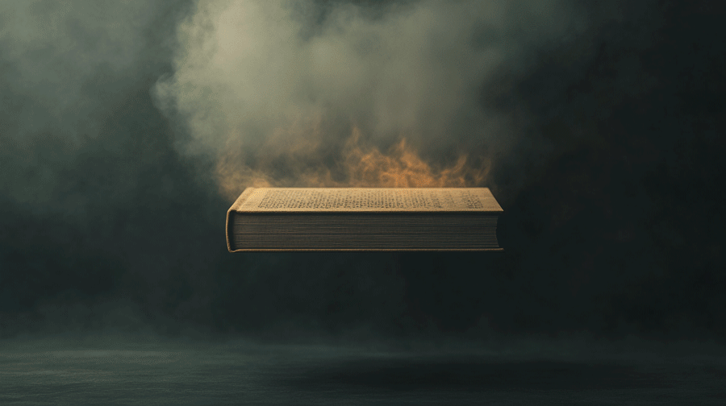
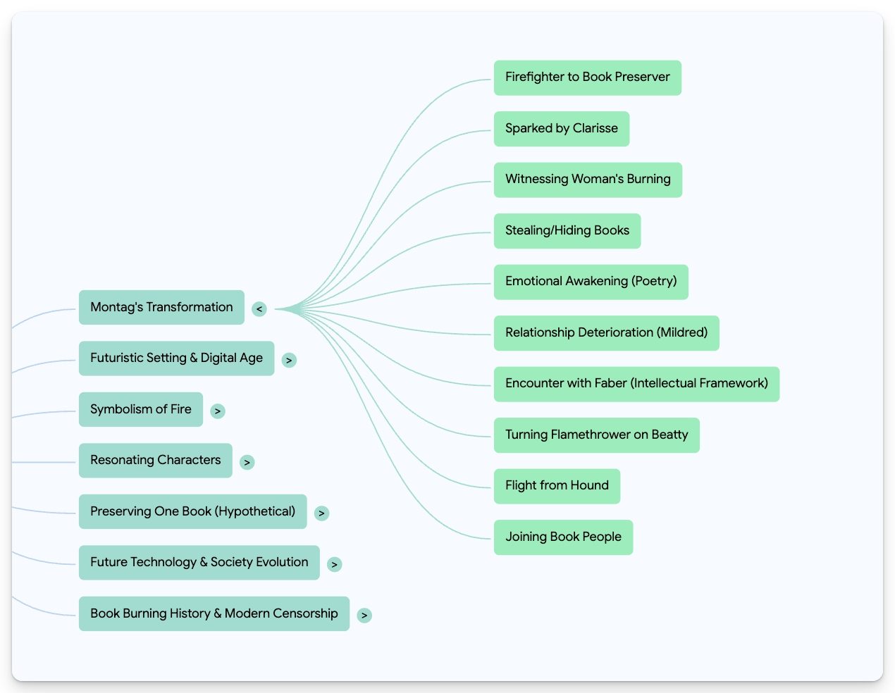
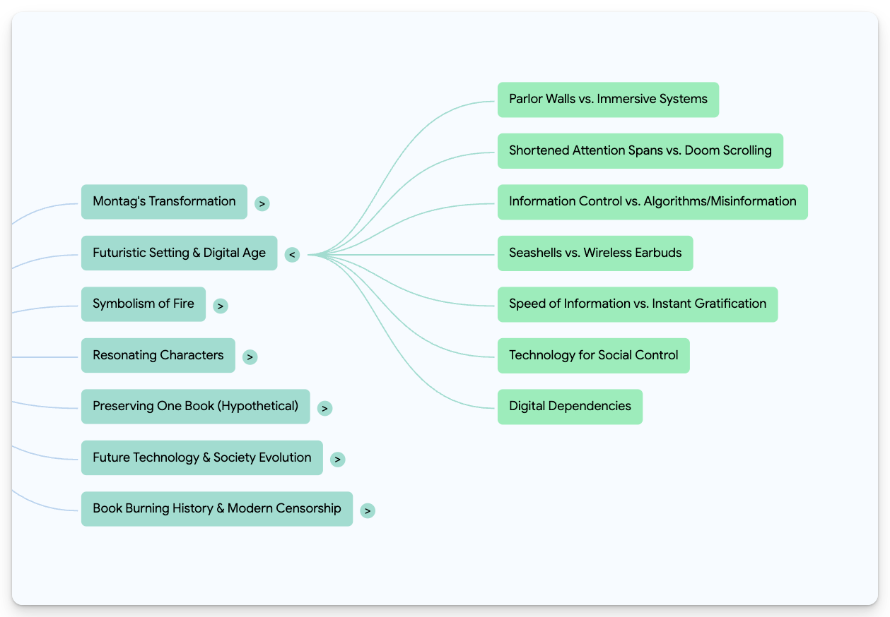
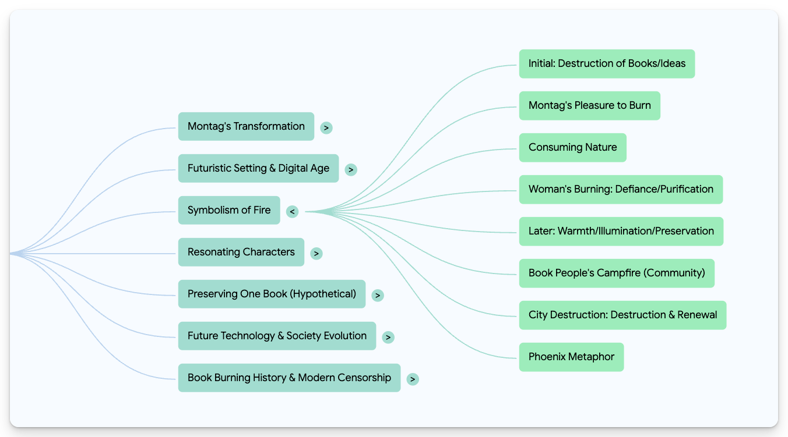
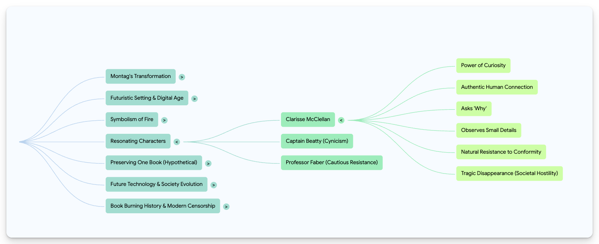
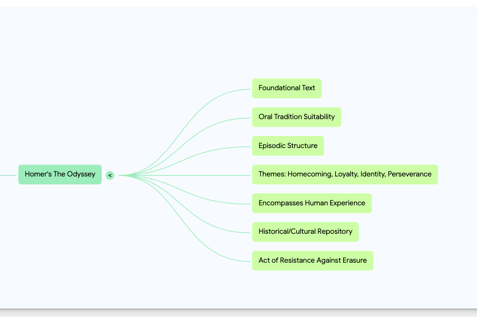
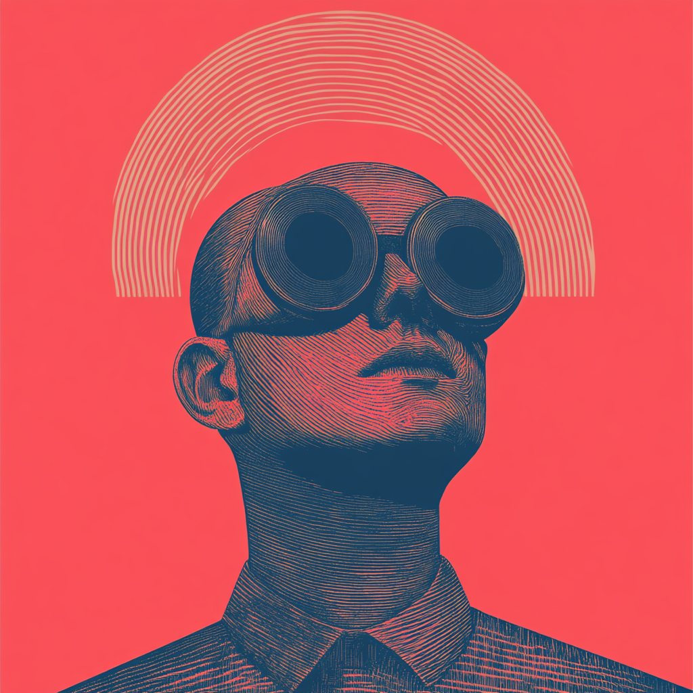
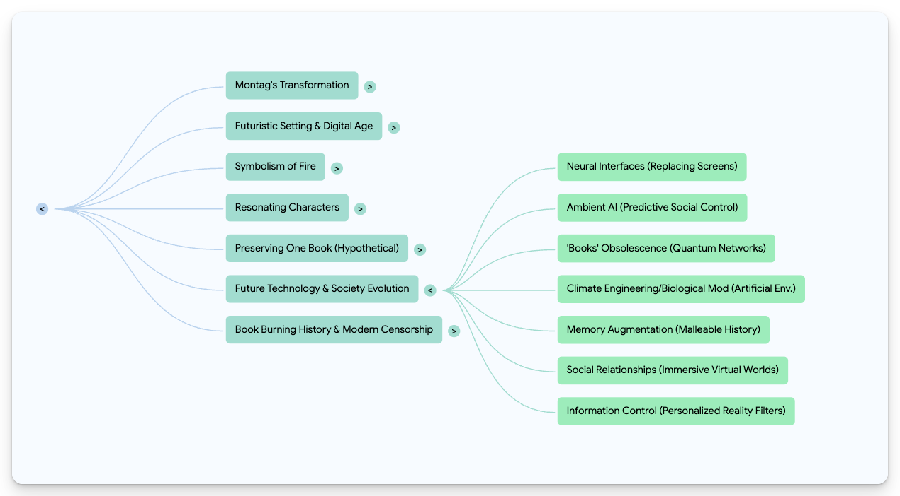
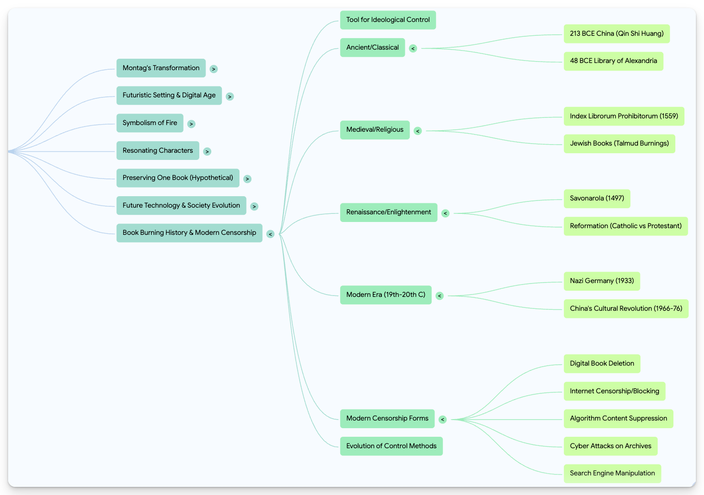

<h2 class="wp-block-heading has-text-align-center has-large-font-size">Fahrenheit 451 🔥📖</h2>

<h2 class="wp-block-heading has-x-large-font-size" style="font-style:normal;font-weight:600">Exploring Fahrenheit 451: Essential Book Club Discussion Guide</h2>

<figure class="wp-block-audio aligncenter"><audio controls src="./images/my-take-fahrenheit-451/my-take-fahrenheit-451.mp3"></audio><figcaption class="wp-element-caption">Podcast overview - Fahrenheit 451</figcaption></figure>

<h3 class="wp-block-heading">In what ways does Montag's transformation from firefighter to book preserver reflect broader societal changes? What moments mark his key turning points?</h3>

Montag's transformation from dedicated firefighter to book preserver represents one of literature's most compelling journeys of awakening. His evolution begins with simple curiosity, sparked by Clarisse's innocent questions about happiness and meaning. Initially, Montag performs his book-burning duties without question, taking pride in the kerosene smell and the act of destruction.

The pivotal moment occurs when he witnesses the woman who chooses to burn with her books. This shocking event forces him to confront the value these people place on literature and knowledge. His subsequent decision to steal and hide books marks his first active resistance against the system he once served.

As Montag begins reading in secret, his transformation accelerates. He experiences emotional awakening through poetry, leading to profound discomfort with his previous life. His relationship with Mildred deteriorates as he recognizes the emptiness of their technology-focused existence. The gap between his new awareness and society's willful ignorance becomes increasingly unbearable.

His encounter with Faber provides intellectual framework for his rebellion, helping him understand not just what he's fighting against, but what he's fighting for: the preservation of human thought and experience through literature. This mentorship transforms his initial emotional response into a reasoned philosophical stance.

The culmination of Montag's journey arrives when he turns his flamethrower on Beatty. This act symbolizes complete rejection of his former life and values. His subsequent flight from the mechanical hound represents both physical and spiritual escape from the controlling system. When he joins the book people, Montag completes his transformation from destroyer to preserver of knowledge.

Through Montag's journey, Bradbury illustrates how personal awakening can lead to radical transformation, suggesting that even those deeply embedded within oppressive systems can recognize truth and choose to stand against conformity.

<figure class="wp-block-image size-large"></figure>

<h2 class="wp-block-heading">How does the novel's futuristic setting mirror issues in our current digital age? Consider the role of screens, shortened attention spans, and information control.</h2>

Bradbury's prescient vision of a screen-dominated future bears striking parallels to our contemporary digital landscape. The novel's parlor walls mirror today's immersive entertainment systems and social media platforms, where individuals become absorbed in artificial relationships with "TV families" much like modern parasocial relationships with online personalities.

The novel's depiction of shortened attention spans is particularly relevant. Characters like Mildred cannot sustain meaningful conversations or engage with complex ideas, preferring quick, superficial entertainment - a phenomenon eerily similar to today's "doom scrolling" and snippet-based content consumption. The three-wall television system's constant stimulation reflects our modern struggle with digital device addiction and the challenge of finding quiet moments for reflection.

<figure class="wp-block-image size-large"></figure>

Information control in the novel operates through systematic elimination of complex literature and ideas, replaced by simplified, government-approved content. This mirrors contemporary concerns about algorithm-curated content, echo chambers, and the spread of misinformation. The "seashell" radio earpieces worn by characters parallel modern wireless earbuds, creating personal bubbles that isolate individuals from direct human interaction.

The speed of information in Bradbury's world, where billboards stretch hundreds of feet long to accommodate fast-moving vehicles, reflects our current climate of instant gratification and rapid content consumption. This acceleration of information delivery has led to similar consequences: decreased comprehension, reduced critical thinking, and the prioritization of entertainment over enlightenment.

Perhaps most significantly, the novel's portrayal of technology as a tool for social control and conformity raises important questions about our own digital dependencies. Just as Mildred's identity is shaped by her screen experiences, modern individuals increasingly define themselves through digital personas and online interactions, potentially sacrificing authentic human connections and independent thought.

<figure class="wp-block-image aligncenter size-full is-resized"><figcaption class="wp-element-caption">Mythical phoenix rising from its own ashes.</figcaption></figure>

<h2 class="wp-block-heading">Discuss the symbolism of fire throughout the novel - how does its meaning evolve from destruction to potential preservation of knowledge?</h2>

Fire serves as a complex and evolving symbol throughout Fahrenheit 451, transforming from an agent of destruction to a beacon of renewal. Initially, fire represents society's destructive power, employed by firefighters to eliminate books and the dangerous ideas they contain. Montag takes pride in this destructive force, describing the "pleasure to burn" in the novel's opening lines, revealing how fire embodies authorized violence against knowledge and free thought.

The novel's early portrayal of fire emphasizes its consuming nature - it devours not just books but history, culture, and human expression. The kerosene-fueled flames represent the systematic erasure of intellectual heritage, with each burning serving as a ritual of enforced conformity. The salamander insignia of the firefighters further reinforces this destructive symbolism, despite the historical irony of salamanders being traditionally associated with surviving fire.

<figure class="wp-block-image size-large"></figure>

However, as Montag's consciousness evolves, fire's symbolism undergoes a parallel transformation. The turning point comes when the woman chooses to burn with her books, transforming fire from a tool of oppression into an instrument of defiant self-determination. This act introduces fire's purifying aspect - the notion that through destruction, something valuable can be preserved or reborn.

In the novel's latter half, fire begins to represent warmth, illumination, and preservation. When Montag meets the book people by their campfire, fire becomes a source of community and preservation. This campfire serves not to destroy but to provide warmth, cook food, and gather people together for the sharing of knowledge. The gentle, controlled flame stands in stark contrast to the violent infernos of the city.

Ultimately, when the city is destroyed by bombs, fire comes full circle. The apocalyptic fire represents both destruction and renewal, clearing away the corrupt society while offering the possibility of rebuilding. Like the mythical phoenix rising from its own ashes, this final conflagration suggests that destruction can lead to rebirth, with fire serving as the catalyst for societal transformation.

<h2 class="wp-block-heading">Which character resonates most with you and why? Consider Clarisse's curiosity, Beatty's cynicism, or Faber's cautious resistance.</h2>

Among the central characters in Fahrenheit 451, Clarisse McClellan stands out as the most compelling and transformative presence. Her character embodies the power of curiosity and authentic human connection in a world increasingly devoid of both. Despite her brief appearance in the novel, Clarisse's impact resonates throughout the entire narrative, making her the catalyst for Montag's awakening.

<figure class="wp-block-image size-large"></figure>

Clarisse's simple yet profound questions about happiness and meaning demonstrate the revolutionary power of basic human inquiry. In a society that discourages questioning, her willingness to ask "why" rather than just accepting "what" marks her as both dangerous and refreshing. Her observation of small details - the taste of rain, the way people walk, the shapes of clouds - highlights what society has lost in its pursuit of mindless entertainment and superficial pleasure.

What makes Clarisse particularly resonant is her natural resistance to conformity without actively trying to rebel. Unlike Montag's later conscious rebellion or Faber's calculated resistance, Clarisse simply remains true to her authentic self. Her genuine interest in face-to-face conversation and real human experiences stands in stark contrast to the artificial relationships and digital interactions that dominate her society.

Moreover, Clarisse's tragic disappearance underscores the novel's themes about society's hostility toward independent thinking. Her fate serves as a warning about the consequences of being different, while simultaneously emphasizing the precious nature of the qualities she embodied - curiosity, empathy, and genuine human connection.

Through Clarisse's character, Bradbury suggests that true revolution begins not with grand gestures or violent rebellion, but with the simple act of questioning, observing, and maintaining one's humanity in the face of mechanical conformity. Her influence on Montag, and by extension the reader, demonstrates how one person's authentic engagement with life can spark profound change in others.

<h2 class="wp-block-heading">If you were to preserve one book in memory, like the book people at the end of the novel, which would you choose and why?</h2>

If tasked with preserving a single book in memory, I would choose Homer's "The Odyssey." This epic poem serves as a foundational text of Western literature, combining adventure, human psychology, and timeless themes that continue to resonate across cultures and generations. The choice reflects both practical and symbolic considerations in a scenario like Fahrenheit 451's book people.

The Odyssey's oral tradition origins make it particularly suitable for memorization, as it was originally preserved through spoken word before being written down. Its episodic structure, memorable characters, and poetic meter would aid in the mental retention process, making it a practical choice for preservation through memory.

<figure class="wp-block-image size-large"></figure>

The epic's themes of homecoming, loyalty, identity, and perseverance against overwhelming odds parallel the situation of the book people themselves. Like Odysseus, they are guardians of knowledge making a long journey through hostile territory, preserving their cultural heritage against forces that would destroy it.

The Odyssey encompasses numerous essential elements of human experience: family relationships, the tension between duty and desire, the price of pride, the value of cunning over brute force, and the importance of hospitality and human connection. These universal themes make it a particularly valuable text to preserve for future generations.

The work also serves as a historical and cultural repository, offering insights into ancient Greek civilization, mythology, and values. By preserving The Odyssey, one would maintain not just a single story, but an entire worldview and cultural framework that has influenced countless subsequent works of literature.

In a world where books are burned, preserving The Odyssey would be an act of resistance against the erasure of human complexity and imagination. Its rich imagery, complex characters, and layered meanings stand in direct opposition to the simplified, sanitized content preferred by the authorities in Fahrenheit 451's society.

<figure class="wp-block-image size-full"></figure>

<h2 class="wp-block-heading">How might technology and society evolve over the next 70 years, and what parallels can we draw with Bradbury's predictions?</h2>

Just as Bradbury envisioned a world dominated by wall-screens and earshells that eerily predicted our current digital landscape, projecting 70 years into our future reveals potentially transformative developments. The integration of neural interfaces might replace today's smartphones and screens, creating a world where digital information flows directly into our consciousness. This could realize Bradbury's fear of constant stimulation but at an even more intimate level - where the barrier between human thought and digital input becomes nearly indistinguishable.

Artificial Intelligence might evolve beyond today's algorithms to become ambient and omnipresent, making independent human decision-making increasingly rare. Similar to how Bradbury's mechanical hound represented automated enforcement, future AI systems might regulate human behavior through predictive social control, subtly nudging society toward prescribed norms without obvious coercion.

The concept of "books" themselves might become obsolete, not through burning but through evolution. Information could be stored and transmitted through quantum networks, accessible through neural links, making traditional learning methods seem as outdated as scrolls did to Bradbury's generation. The "book people" of our future might be those who insist on maintaining organic, unaugmented human consciousness and direct experiential learning.

<figure class="wp-block-image size-large"></figure>

Climate engineering and biological modification could create artificial environments where humans live in climate-controlled megastructures, disconnected from the natural world. This mirrors Bradbury's portrayal of a society alienated from nature, where Clarisse's appreciation for rain and flowers marked her as an outsider. Future resistance might center on preserving natural human experiences in an increasingly synthetic world.

Memory augmentation technology could make it possible to download, edit, or erase memories, creating a society where personal history becomes malleable. The preservation of authentic human memory - a central theme in Fahrenheit 451 - might become a form of resistance against corporate or government-mandated memory modification.

The evolution of social relationships might mirror Mildred's "TV family" but through immersive virtual worlds where the line between real and simulated relationships becomes meaningless. Physical human gatherings, like the book people's fireside community, might become acts of rebellion against the metaverse-dominated social norm.

Most disturbingly, the control of information might shift from overt censorship to subtle manipulation through personalized reality filters, where each person experiences a curated version of truth tailored to maintain social stability. Like Beatty's justification for burning books, this could be presented as a way to prevent conflict and ensure happiness, while actually serving to eliminate independent thought.

<figure class="wp-block-image size-full"></figure>

<h2 class="wp-block-heading">How has book burning been used throughout history as a tool for suppression, and what parallels can we draw to modern forms of censorship?</h2>

The practice of book burning has a long and disturbing history as a tool for ideological control and cultural suppression. From ancient civilizations to modern times, the deliberate destruction of written works has symbolized attempts to erase ideas, reshape historical narratives, and control public thought.

<h4 class="wp-block-heading">Ancient and Classical Period</h4>

The earliest recorded book burning occurred in 213 BCE when China's Emperor Qin Shi Huang ordered the burning of historical and philosophical texts to control how history would remember his predecessors. This event, known as "burning of books and burying of scholars," set a precedent for using book destruction as a political tool.

In 48 BCE, the Great Library of Alexandria suffered its first major burning during Julius Caesar's civil war, resulting in the loss of countless ancient texts and scholarly works. This catastrophic event represents one of history's greatest losses of cultural knowledge.

<h4 class="wp-block-heading">Medieval and Religious Persecution</h4>

During the medieval period, book burning became increasingly associated with religious persecution. The Catholic Church's Index Librorum Prohibitorum (List of Prohibited Books), established in 1559, led to systematic destruction of texts deemed heretical. Jewish books were particularly targeted, with mass burnings occurring throughout Europe, including the Talmud burning in Paris (1242) and Rome (1553).

<h4 class="wp-block-heading">Renaissance and Enlightenment</h4>

Even as literacy and printing technology spread, book burning continued. In 1497, Savonarola's "Bonfire of the Vanities" in Florence saw the destruction of books, art, and other items considered sinful. During the Protestant Reformation, both Catholic and Protestant factions engaged in destroying each other's religious texts.

<h4 class="wp-block-heading">Modern Era: 19th-20th Centuries</h4>

The most infamous book burning in modern history occurred during Nazi Germany's reign (1933-1945). The Nazi Student Union's coordinated book burnings in 1933 targeted works by Jewish authors, communists, and other "un-German" writers, destroying an estimated 25,000 books in a single night in Berlin.

During China's Cultural Revolution (1966-1976), countless books, manuscripts, and artifacts were destroyed in an attempt to purge traditional and foreign influences from Chinese society.

<h2 class="wp-block-heading">Timeline of Notable Book Burning Events</h2>

<ul class="wp-block-list">
<li>213 BCE: Qin Dynasty book burning in China</li>

<li>48 BCE: Partial destruction of the Library of Alexandria</li>

<li>303 CE: Diocletian's decree to burn Christian texts</li>

<li>1242: Burning of the Talmud in Paris</li>

<li>1497: Savonarola's Bonfire of the Vanities</li>

<li>1559: Implementation of Index Librorum Prohibitorum</li>

<li>1933: Nazi book burnings across Germany</li>

<li>1966-1976: Chinese Cultural Revolution book destruction</li>
</ul>

<figure class="wp-block-image size-full"></figure>

<figure class="wp-block-image size-large"></figure>

<h2 class="wp-block-heading">Modern Forms of Censorship</h2>

Today, while physical book burning still occurs, digital censorship has emerged as a more subtle but equally effective means of controlling information. Modern parallels include:

<ul class="wp-block-list">
<li>Digital book deletion from e-readers and platforms</li>

<li>Internet censorship and content blocking</li>

<li>Algorithm-based content suppression</li>

<li>Cyber attacks on digital libraries and archives</li>

<li>Strategic manipulation of search engine results</li>
</ul>

The evolution from physical book burning to digital censorship reflects how methods of controlling information have adapted to technological change while maintaining the same fundamental goal: controlling narrative and suppressing dissenting voices.

This historical pattern of destroying knowledge reminds us why Fahrenheit 451's message remains relevant today. Whether through flames or algorithms, the impulse to control information and limit access to diverse perspectives continues to threaten intellectual freedom and cultural memory.

<blockquote class="wp-block-quote is-layout-flow wp-block-quote-is-layout-flow">
<h4 class="wp-block-heading">Need more book related questions click to visit <a href="https://sandymushcommunitycenter.org/may-book-club-fahrenheit-451/">SMCC Book Club page</a></h4>
</blockquote>
