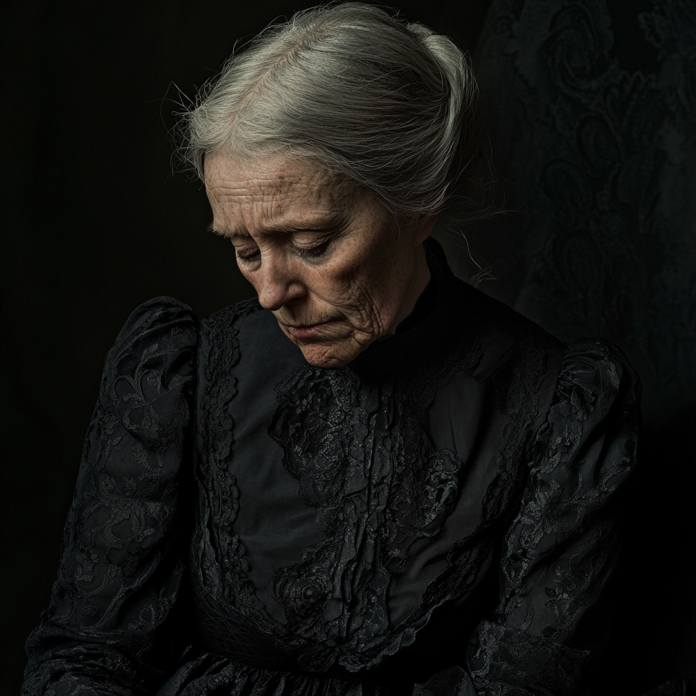
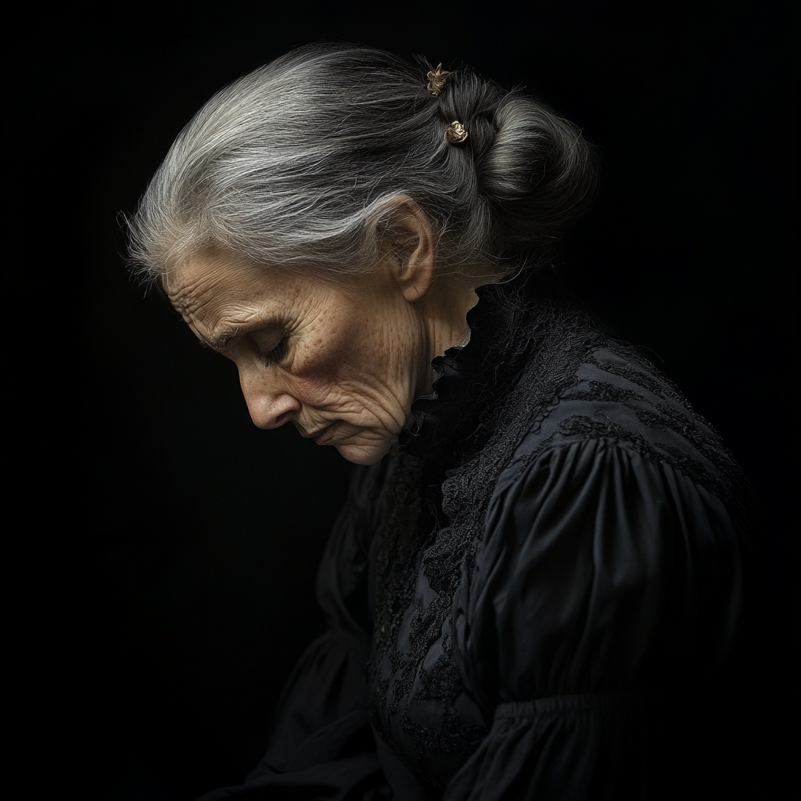
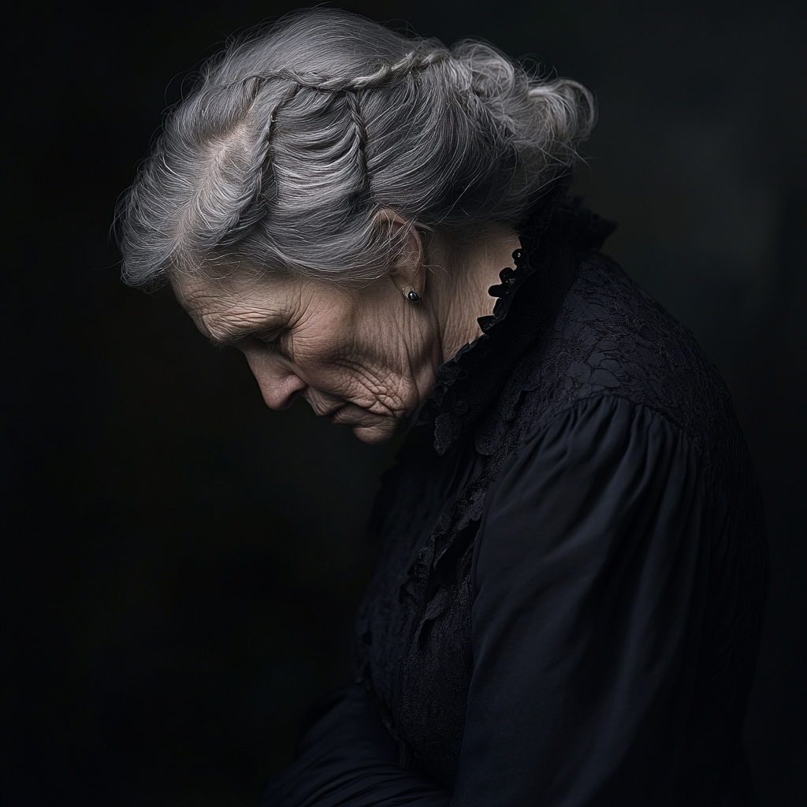
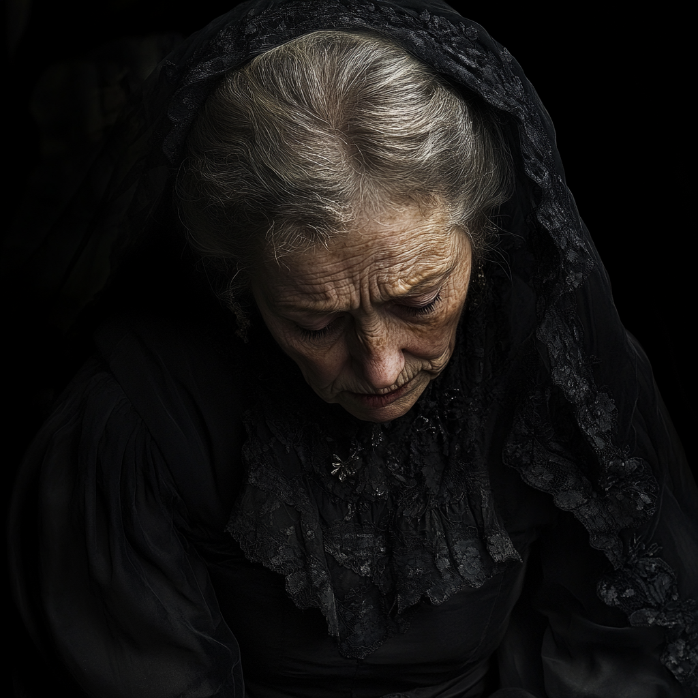
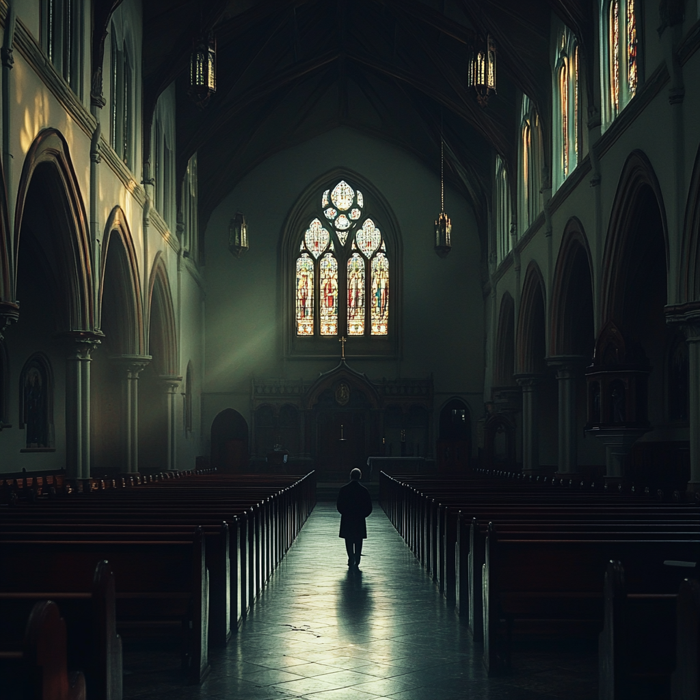
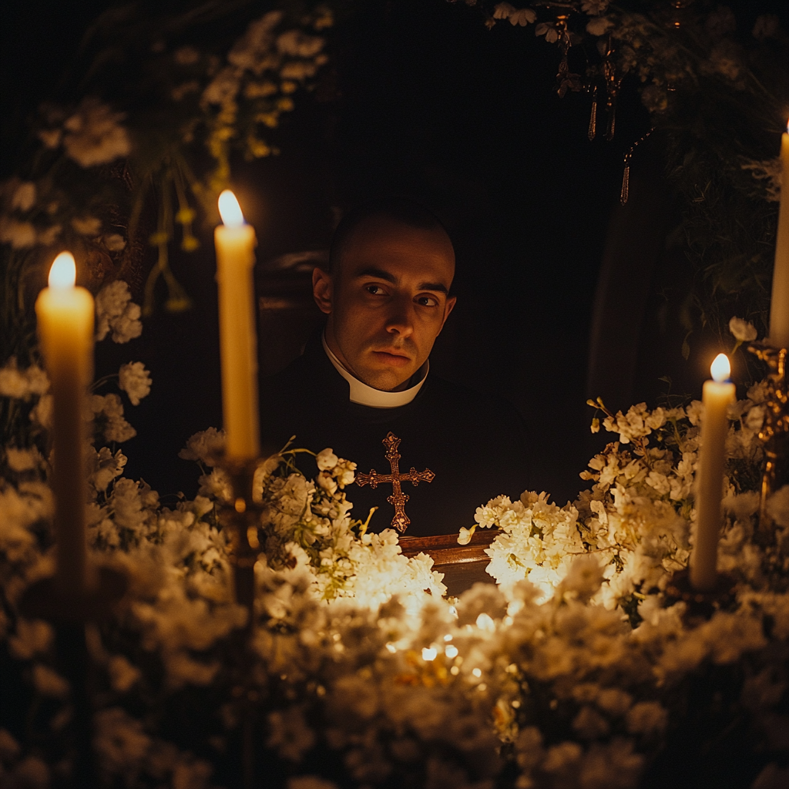
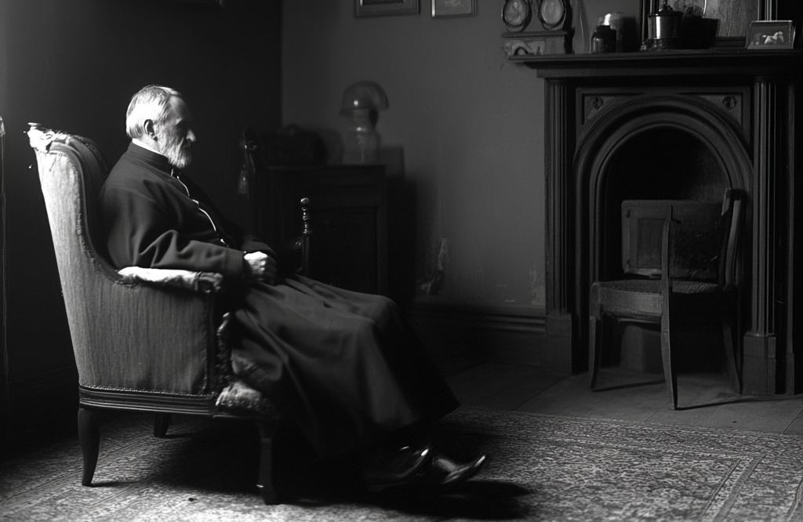

<figure class="wp-block-gallery alignfull has-nested-images columns-4 has-foreground-background-color has-background wp-block-gallery-1 is-layout-flex wp-block-gallery-is-layout-flex" style="border-width:43px;border-radius:10px">
<figure class="wp-block-image size-medium"></figure>

<figure class="wp-block-image size-medium"></figure>

<figure class="wp-block-image size-medium"></figure>

<figure class="wp-block-image size-medium"></figure>
</figure>

<figure class="wp-block-embed is-type-video is-provider-youtube wp-block-embed-youtube wp-embed-aspect-16-9 wp-has-aspect-ratio">

<iframe loading="lazy" title="THE SISTERS, A Short Story by James Joyce" width="1080" height="608" src="https://www.youtube.com/embed/Az36LRL0T6o?feature=oembed" frameborder="0" allow="accelerometer; autoplay; clipboard-write; encrypted-media; gyroscope; picture-in-picture; web-share" referrerpolicy="strict-origin-when-cross-origin" allowfullscreen></iframe>

</figure>

Joyce's "The Sisters" is a masterfully crafted exploration of mortality, religious corruption, and the complex relationship between spiritual authority and human frailty. As someone who grew up in Northern Ireland, the story's Dublin setting resonates with familiar cultural and religious undertones that persist even a century later.

<h3 class="wp-block-heading">Contemporary Reception and Controversy</h3>

When "The Sisters" was first published in The Irish Homestead in 1904, it provoked considerable controversy among readers. The story's deliberate ambiguity and its treatment of a Catholic priest scandalized many in Dublin's conservative society. The publication received numerous letters of complaint, with readers expressing dismay at both the story's content and its unconventional narrative style.

The primary source of public discomfort stemmed from Joyce's refusal to provide clear answers. The story's open-ended nature, with its suggestions of impropriety and mental illness in a priest, challenged the traditional narrative expectations of the time. Readers, accustomed to morally unambiguous tales with clear resolutions, found themselves confronted with a story that raised more questions than it answered.

The Irish Homestead, primarily an agricultural journal, typically published straightforward, pastoral stories that reflected traditional Irish values. Joyce's complex psychological narrative, with its hints of corruption within the clergy, represented a significant departure from this norm. The editor, H.F. Norman, while defending the story's literary merit, faced significant pressure from subscribers who viewed the piece as an attack on religious institutions.

Particularly controversial was Joyce's portrayal of Father Flynn's mental deterioration and the subtle implications of misconduct. In an era when the Catholic Church's authority was rarely questioned in Irish literature, the mere suggestion of a priest's moral failing was considered deeply subversive. Some readers interpreted the story as an indictment of the entire clerical system, while others were troubled by its refusal to either condemn or absolve Father Flynn explicitly.

The story's modernist techniques - its use of suggestion rather than statement, its focus on psychological rather than physical action, and its deliberate omissions - also confused and frustrated contemporary readers. Many found the narrative style unnecessarily obscure and the lack of a clear moral message disturbing. This reaction foreshadowed the broader controversy that would surround Joyce's later works, particularly "Dubliners," of which "The Sisters" became the opening story.

Interestingly, the negative reception of "The Sisters" strengthened Joyce's resolve to continue writing in his distinctive style. He viewed the public's discomfort as confirmation that he was successfully challenging the complacency of Irish society and its institutions. The controversy surrounding the story ultimately contributed to Joyce's decision to leave Ireland, believing that his artistic vision would face constant opposition in his homeland's conservative literary environment.

<figure class="wp-block-image size-full"></figure>

<h3 class="wp-block-heading">Historical Context and Religious Authority</h3>

Written in early 20th century Ireland (1904-1914), the story emerged during a period of significant political and social upheaval. The Catholic Church wielded immense social and moral authority during the Home Rule movement, which sought Irish self-governance from Britain. Joyce wrote this story in 1904, the same year he left Ireland, during a time when the Irish Literary Revival was attempting to establish a distinct cultural identity. The character of Father Flynn represents this institutional power, but Joyce subverts expectations by presenting him as a deeply flawed figure. The story contains carefully constructed temporal markers - the three strokes occurring over time, the nightly observations of the window, and the priest's gradual descent into madness - which mirror Ireland's own struggle with religious authority. The story's subtle hints at possible sexual transgression - through words like "simony" and the priest's mysterious behavior - speak to a darker undercurrent that would be handled very differently in modern literature. Notably, 1904 also saw the establishment of the Catholic Association for the Suppression of Intemperance, adding another layer to Father Flynn's apparent moral and physical deterioration..

<h3 class="wp-block-heading">Modern Parallels and Social Evolution</h3>

Today's society, while increasingly secular, continues to wrestle with themes of institutional abuse and power dynamics that Joyce explored over a century ago. The key difference lies not just in how we process these issues, but in how dramatically the landscape of accountability and public discourse has evolved. Having grown up in Northern Ireland during a period of significant social transformation, I've observed firsthand how religious authority has undergone a fundamental shift from being virtually unassailable to being subject to intense public scrutiny.

This transformation has been particularly evident in how we discuss clerical misconduct. Where Joyce had to rely on careful symbolism and subtle suggestion - employing words like "paralysis" and "simony" to hint at deeper corruptions - modern narratives about institutional abuse are strikingly direct. The media now openly reports on investigations, survivors share their stories publicly, and society engages in frank discussions about accountability and reform.

The change I witnessed in Northern Ireland was particularly dramatic. In my early years, religious institutions maintained an almost impenetrable authority, their representatives treated with unquestioning deference. This mirrors the world Joyce depicted in "The Sisters," where even hints of impropriety had to be whispered behind closed doors. However, as various abuse scandals came to light throughout the 1990s and 2000s, I observed a seismic shift in public attitude. The community's response evolved from initial disbelief and denial to demands for transparency and justice.

This evolution reflects broader changes in how society handles institutional power. The internet and social media have demolished the walls of silence that once protected institutions from scrutiny. Where Father Flynn's story would have remained largely hidden in Joyce's time, today it would likely become part of a larger public conversation about institutional responsibility and reform. The modern equivalent of Joyce's young narrator wouldn't be left to piece together vague hints and suggestions - they would have access to news reports, survivor testimonies, and public investigations.

Yet despite these changes in how we discuss and address institutional abuse, the fundamental themes Joyce explored remain remarkably relevant. The tension between institutional power and individual vulnerability, the complex relationship between community and authority, and the struggle to confront uncomfortable truths - these elements continue to resonate in our contemporary discourse about religious and institutional authority.

<h3 class="wp-block-heading">Symbolism and Psychological Depth</h3>

The story's opening word "paralysis" serves multiple functions - it describes Father Flynn's physical condition but also symbolizes the spiritual and moral stagnation within the church. The young narrator's fascination with words like "gnomon" and "simony" suggests an awakening consciousness to institutional corruption. Joyce's use of these linguistic elements creates a sophisticated interplay between innocence and knowledge.

Joyce's masterful use of symbolism in "The Sisters" demonstrates his revolutionary approach to modernist writing. The opening word "paralysis" and the young narrator's preoccupation with words like "gnomon" and "simony" create multiple layers of meaning that work simultaneously on different levels.

Let's examine how Joyce achieves this complexity:

<strong>1. Layered Symbolism</strong> The word "paralysis" functions brilliantly on three levels:

<ul class="wp-block-list">
<li>Physical: Describing Father Flynn's medical condition</li>

<li>Spiritual: Representing the moral stagnation within the church</li>

<li>Social: Depicting Dublin's cultural paralysis under religious authority</li>
</ul>

<strong>2. Psychological Depth</strong> The young narrator's fascination with specific words reveals Joyce's innovative approach to character development. Through this linguistic curiosity, Joyce portrays both childhood innocence and dawning awareness of corruption, without ever directly stating either.

<strong>3. Structural Innovation</strong> The story's construction mirrors its themes. Just as the word "gnomon" represents something incomplete or missing, Joyce's narrative technique relies heavily on deliberate omissions and suggestions rather than explicit statements. This was revolutionary for its time, when readers were accustomed to more straightforward moral tales.

<strong>4. Social Commentary Through Suggestion</strong> Joyce manages to critique religious institutions without direct confrontation. The story caused considerable controversy despite (or perhaps because of) its subtle approach. The Irish Homestead's readers, used to straightforward pastoral stories, found themselves challenged by Joyce's complex psychological narrative.

<strong>5. Multiple Interpretive Layers</strong> The story works effectively on both surface and deeper levels:

<ul class="wp-block-list">
<li>As a simple narrative about a priest's death and its impact on a community</li>

<li>As a complex exploration of religious authority and corruption</li>

<li>As a psychological study of childhood innocence encountering adult complexity</li>
</ul>

Joyce's genius lies in how he weaves these elements together seamlessly. While contemporary readers were often confused and frustrated by this approach, it established a new way of storytelling that influenced literature for generations to come. His refusal to provide clear answers or moral certaintiesmarked a significant departure from traditional narrative expectations.

The story's enduring power comes from how Joyce presents institutional corruption through the lens of a child's growing awareness, allowing readers to experience both innocence and knowledge simultaneously. This technique creates what we might call a "double vision" - the ability to see both the surface narrative and its deeper implications at once.

What makes Joyce's approach particularly masterful is that none of these elements feels forced or artificial. The symbolism emerges naturally from the story's events and observations, making it accessible to readers who might miss the deeper implications while rewarding those who delve deeper into its meanings.

The controversy the story generated upon its publication, far from being a drawback, actually validated Joyce's approach. He had managed to challenge social and religious norms while maintaining plausible deniability through his use of suggestion and implication rather than direct statement.

This ability to present a simple story that simultaneously functions as a complex critique established a new paradigm in literary modernism, demonstrating how fiction could address controversial subjects while maintaining artistic integrity and psychological truth.

<h3 class="wp-block-heading">Community and Social Change</h3>

The story's intimate portrayal of Dublin community life - with its whispered conversations and careful observations - represents a social fabric that has undergone dramatic transformation in our digital age. Recent studies highlight this shift: according to a 2023 Pew Research survey, 45% of Americans report knowing only a few or none of their neighbors, a stark contrast to the interconnected communities of Joyce's era.

In modern Belfast or Dublin, such stories would unfold radically differently. Instead of whispered conversations in local shops or over garden fences, community gossip now spreads through WhatsApp groups and Facebook feeds. The "careful dance of innuendo and suggestion" that Joyce masterfully depicts has been replaced by instant messaging and social media posts, fundamentally altering how communities process and share information.

This transformation is particularly evident in urban settings, where research from the University of Manchester's Urban Institute shows that the average city resident spends less than 30 minutes per day in face-to-face interaction with neighbors. The ubiquity of wireless earbuds, smartphones, and other personal devices has created what sociologists term "digital bubbles" - personal spaces that, while connecting us globally, often isolate us locally. Walking down any street in modern Dublin or Belfast, one observes people moving through shared spaces while remaining psychologically separate, their attention focused on screens or lost in private audio streams.

The implications of this disconnection are profound. A 2024 study in the Journal of Urban Psychology found correlations between decreased local community engagement and reduced civic participation. When people don't know their neighbors, they're less likely to engage in local issues or feel invested in community outcomes. This detachment creates what sociologist Robert Putnam calls "social atomization" - the breakdown of traditional community bonds that once served as informal support networks and social controls.

The kind of community oversight that made Father Flynn's story so compelling in Joyce's time - where every unusual behavior was noted and discussed - has largely evaporated. Modern urban dwellers often don't notice, let alone discuss, the struggles of their neighbors. A 2023 study by Trinity College Dublin found that 67% of urban residents couldn't identify their neighbors in a photo lineup, and 82% had never had a meaningful conversation with someone living two doors down.

This anonymity has created what psychologist Dr. Sarah Mitchell terms "community immunity" - a psychological state where people feel less accountable to their immediate community because they perceive themselves as essentially invisible within it. Unlike in Joyce's Dublin, where reputation and community standing were paramount, modern urban dwellers often operate with a sense of social invisibility that would have been unthinkable in earlier times.

Paradoxically, while social media has made us more connected than ever globally, it has contributed to local disconnection. People often know more about the daily lives of friends across the world than they do about the family next door. This shift from local to digital community has fundamentally altered how stories like "The Sisters" would play out today - not through careful observation and face-to-face conversations, but through sporadic social media updates and digital hearsay, losing much of the nuance and human connection that made Joyce's portrayal so powerful.

<h3 class="wp-block-heading">The Weight of Tradition</h3>

The sisters in Joyce's story serve as powerful symbols of a dying religious and social order in Ireland. Their unwavering devotion to religious ritual and their brother's priesthood represents not just personal faith, but an entire cultural system that was beginning to show signs of strain in early 20th century Ireland. Their meticulous attention to religious observances - from ensuring proper funeral rites to maintaining their brother's priestly dignity even in his decline - speaks to a world where tradition provided both structure and meaning to daily life.

Having grown up in Northern Ireland, I've witnessed firsthand how these religious traditions continue to shape communities, though their influence has evolved significantly. The sisters' dedication to their brother mirrors patterns I observed in my own community, where families often shouldered immense burdens to maintain religious and social expectations. In Belfast's Catholic neighborhoods, for instance, the responsibility for maintaining religious traditions often fell disproportionately on women, much like the sisters in Joyce's story.

The cost of maintaining these traditions becomes particularly evident in the sisters' care for their troubled brother. Their situation reflects a broader pattern in Irish society where family obligations and religious duty often intertwined, creating complex webs of responsibility. In my experience in Northern Ireland, families frequently found themselves caught between modern pressures and traditional expectations, much like Joyce's sisters who must balance their brother's public role as a priest with his private struggles.

This duality of tradition - its ability to both support and burden - remains a defining feature of Northern Irish society. In my community, religious traditions provided comfort through familiar rituals and communal gatherings, offering stability during the turbulent years of the Troubles. Yet these same traditions could become oppressive, demanding adherence to practices and beliefs that sometimes conflicted with changing social values and personal needs. The sisters' story resonates particularly strongly in this context, as they navigate the space between public devotion and private struggle.

The story's portrayal of tradition's double-edged nature finds echoes in contemporary Northern Ireland, where communities still grapple with the legacy of religious influence. Just as the sisters maintain a facade of normalcy while dealing with their brother's decline, many modern Irish families navigate complex relationships with religious traditions that simultaneously provide identity and impose constraints. This tension between preservation and adaptation, between comfort and burden, continues to shape Irish social life, though perhaps less overtly than in Joyce's time.

<figure class="wp-block-image size-full"></figure>

<h3 class="wp-block-heading">Sexual Sin and Modern Interpretation</h3>

While Joyce only hints at moral transgressions through subtle symbolism, modern readers might find additional layers of meaning in the text's medical implications. The priest's physical and mental decline, particularly the emphasis on "paralysis" and "stroke," reflects a common literary and social practice of using more socially acceptable medical conditions to discuss stigmatized illnesses. This narrative technique, similar to how late 20th-century media often referred to AIDS-related illnesses through euphemisms or secondary conditions, allows for complex discussions of moral and social issues while maintaining public propriety.

In the early 20th century, conditions like syphilis carried such intense social stigma that they were rarely mentioned directly in literature or public discourse. Instead, writers and society at large developed a coded language around such illnesses. The "stroke" in Joyce's story, mentioned three times with increasing significance, could be read as one such euphemistic reference - a socially acceptable way to discuss a condition that carried moral implications.

This practice of medical euphemism has historical precedent across literature and journalism. Just as newspapers in the 1980s might refer to an AIDS-related death as "pneumonia" or "a rare cancer," early 20th-century writers often used terms like "nervous condition," "paralysis," or "stroke" to indicate conditions that carried social stigma. The parallel is particularly striking in how both eras used medical euphemisms to navigate complex discussions of morality, sexuality, and social standing.

The sisters' careful navigation of their brother's condition mirrors this social dance around difficult topics. Their emphasis on his physical decline and "nervous" condition, rather than any underlying cause, reflects both their own discomfort and broader social conventions. The community's response patterns - the whispered conversations, the careful avoidance of direct discussion - demonstrate how societies develop intricate ways of discussing the undiscussable.

Modern medical understanding allows us to recognize this pattern of euphemistic reference, but it's crucial to note that Joyce's contemporary readers would have likely understood these implications without needing explicit statement. The progressive nature of the priest's illness, his mental deterioration, and ultimately the paralysis that led to his death would have carried specific connotations for readers familiar with the era's medical and social realities.

This coded language around illness serves multiple narrative purposes. It maintains social propriety while allowing for deeper exploration of moral themes. It provides plausible deniability for both characters and author. Most importantly, it creates a layer of complicity between author and reader, where understanding depends on recognizing these subtle social codes.

The story's approach to illness and morality remains relevant today, despite our more open discussion of medical conditions. Modern literature and media still sometimes employ similar techniques when discussing sensitive topics, though the specific euphemisms have changed. This linguistic evolution reflects ongoing tensions between public discourse and private understanding, between social propriety and truthful representation.

The parallel with AIDS coverage in media highlights how societies consistently develop these coded ways of discussing stigmatized conditions. Just as "stroke" or "paralysis" might have signaled specific meanings to Joyce's readers, terms like "rare cancer" or "pneumonia" carried particular weight in 1980s journalism. These linguistic patterns reveal how communities process and discuss difficult topics when direct discussion feels impossible or inappropriate.

<figure class="wp-block-image size-full"></figure>

<h3 class="wp-block-heading">Psychological Impact and Trauma</h3>

The story's exploration of trauma and its effects on both perpetrator and community reveals multiple layers of psychological complexity. Father Flynn's descent into madness, marked by his dropping the chalice and laughing in the confessional, suggests not only the psychological toll of hidden sin but also mirrors what Freud would later term "repetition compulsion" - the unconscious reenactment of traumatic experiences. Joyce's portrayal of trauma operates on both individual and collective levels, with the community's response to Father Flynn's decline reflecting what modern trauma theorists call "collective trauma response."

The psychological impact manifests in several ways throughout the story. First, there's the obvious deterioration of Father Flynn himself - his paralysis, both literal and metaphorical, represents what contemporary trauma theory identifies as "somatic manifestation" of psychological distress. His laughing in the confessional particularly stands out as what psychiatrist Bessel van der Kolk might recognize as "inappropriate affect," a common symptom of severe psychological distress where emotional responses don't match the situation.

The young narrator's fascination with words like "paralysis," "gnomon," and "simony" suggests what developmental psychologists term "cognitive processing of trauma" - the mind's attempt to make sense of disturbing events through language and symbolism. This mirrors Joyce's own preoccupation with the power of words to encode traumatic experiences, similar to how modern trauma narratives often focus on the struggle to articulate the unspeakable.

The sisters themselves exhibit what modern psychology would identify as "caregiver trauma." Their obsessive retelling of Flynn's final days, their meticulous attention to ritual, and their seemingly contradictory statements about their brother's character suggest what trauma specialist Judith Herman describes as "complicated grief" - a response to loss complicated by unresolved feelings about the deceased. Their behavior patterns align with what current trauma theory calls "trauma bonding," where victims become psychologically attached to the source of their distress.

The trauma being explored in the story operates on multiple levels. At its most immediate level, there's the personal trauma of Father Flynn - whatever secret sin or moral transgression led to his psychological collapse. This individual trauma manifests in what modern clinicians would recognize as classic PTSD symptoms: the night terrors mentioned by the sisters, the social withdrawal, and the episodes of dissociative behavior (like the laughing in the confessional).

On a broader level, Joyce explores what sociologist Kai Erikson terms "community trauma" - the breakdown of social bonds and collective identity when a trusted figure falls from grace. The community's response - the whispered conversations, the careful avoidance of direct discussion, the collective maintenance of polite fictions - reveals what modern trauma theorists would call "collective defense mechanisms." These social responses mirror what we now understand about how communities process institutional trauma, particularly in cases of religious or authority figure misconduct.

The story also explores transgenerational trauma, particularly through the young narrator's initiation into adult knowledge. His growing awareness of adult complexities and corruption mirrors what trauma specialists call "secondary trauma" or "vicarious traumatization." The boy's fascination with Father Flynn, his mixed feelings of fear and attraction to the priest's story, and his struggle to understand adult reticences all suggest what modern psychology terms "developmental trauma" - the impact of disturbing experiences on a developing psyche.

<h3 class="wp-block-heading">Freedom Through Death: A Personal Reflection</h3>

The line "discovering in myself a sensation of freedom as if I had been freed from something by his death" stands as perhaps the most revealing and psychologically complex moment in Joyce's story. As someone revisiting "The Sisters" now, this particular line resonates with a profound understanding of how death can paradoxically liberate the living. The young narrator's unexpected sensation of freedom becomes a lens through which we can examine multiple layers of psychological and social liberation.

At its most immediate level, the freedom the boy experiences reflects release from the weight of Father Flynn's attention. The priest's mentorship, while ostensibly beneficial, carried an underlying oppressiveness. The regular lessons, the careful watching, the intellectual and spiritual guidance - all of these created invisible bonds that the boy only recognizes in their dissolution. This mirrors how children often experience authority figures: as both nurturing and constraining presences.

The freedom described here also operates on a deeper symbolic level - it represents liberation from the constraining aspects of Irish Catholic culture that Father Flynn embodied. The priest's death releases the boy from direct contact with an institution that demands strict adherence to ritual, doctrine, and hierarchical authority. This freedom isn't just personal; it's cultural and generational - the young breaking free from the old, the modern consciousness emerging from traditional constraints.

What makes this line particularly powerful is its honest acknowledgment of the complex emotions surrounding death. Society expects grief and sadness when someone dies, especially someone who has been a mentor figure. Yet Joyce boldly presents this contrary emotion - relief, liberation, freedom - suggesting that our relationships with the dead are far more complicated than conventional mourning allows. This psychological truthfulness makes the line resonate across centuries.

The sensation of freedom described here also speaks to the release from the burden of witnessing another's decline. Throughout the story, the boy has been forced to observe Father Flynn's deterioration - physical, mental, and spiritual. This observation carries its own weight, creating a kind of psychological bondage. The priest's death releases the boy from this role of witness, from the responsibility of carrying knowledge of another's suffering.

In my own rereading of the story, this line strikes me as increasingly significant because it captures a universal but rarely acknowledged truth: that death sometimes comes as a relief, not just to the dying, but to those who remain. This relief isn't simply about ending suffering - it's about the dissolution of complex emotional and social bonds that we may not have even recognized as constraining until they're gone.

The freedom described here also connects to broader themes of Irish literary tradition, where death often serves as a catalyst for psychological and social liberation. Joyce's genius lies in capturing this through a child's perspective - unfiltered by adult social conventions that would deny or disguise such feelings. The boy's honest recognition of his sense of freedom serves as a kind of permission for readers to acknowledge similar complex emotions in their own experiences.

Moreover, this sensation of freedom speaks to the way death can clarify relationships and power dynamics that might have remained obscure in life. Only after Father Flynn's death does the boy begin to understand the nature of their relationship - its implications, its boundaries, its subtle forms of control. This posthumous understanding itself becomes a form of freedom - the freedom to see clearly what was previously obscured by proximity and obligation.

The line also suggests freedom from the weight of unspoken knowledge. Throughout the story, there are hints of something inappropriate or troubling about Father Flynn, something the adults know but won't directly address. His death releases everyone - the boy included - from the burden of maintaining silence about these suspicions. It's a freedom from complicity in collective denial.

Reading this line again now, years after my first encounter with the story, I'm struck by how it captures the way death can release us from the obligation to understand or make sense of another person. While Father Flynn lived, his bizarre behavior, his nervous condition, his spiritual struggles all demanded interpretation and response. His death frees the boy (and by extension, the reader) from this hermeneutic responsibility.

The freedom described here also operates on a narrative level - it's the moment when the story shifts from being about Father Flynn to being about the boy's developing consciousness. The priest's death liberates the narrative itself, allowing it to explore the psychological and social implications of his passing rather than remaining focused on his declining presence.

This sensation of freedom also points to a universal aspect of human development - the necessary separation from authority figures that allows individual consciousness to emerge. While Father Flynn's death is a literal separation, it represents the psychological separation all individuals must undergo to develop their own identity and understanding of the world.

In my current reading, this line resonates particularly strongly because it acknowledges the complexity of human relationships and the sometimes surprising ways we respond to loss. The boy's honest recognition of his feeling of freedom serves as a kind of permission for readers to examine their own complex responses to death and loss, responses that might not fit neatly into conventional narratives of grief.

The freedom described in this line ultimately transcends its immediate context to become a meditation on how death affects the living. It suggests that death's impact isn't simply about loss and grief, but about transformation and release - for better or worse, death changes the psychological and social landscape of those who remain, offering new perspectives and possibilities even as it takes away familiar presences and patterns.

<h3 class="wp-block-heading">Conclusion</h3>

Joyce's "The Sisters" endures through its masterful examination of how communities navigate moral complexities. While the early 20th century Dublin setting may seem remote, the story's deep dive into religious tradition, hidden sins, and psychological trauma speaks to contemporary experiences. The coded language around illness and moral transgression that Joyce employs mirrors modern society's own evolving methods of discussing uncomfortable truths.

The story's lasting impact stems from its nuanced portrayal of how communities cope with authority figures' moral failings. Though today's social media age has transformed how such scandals unfold, the fundamental questions about trust, collective trauma, and institutional accountability remain deeply relevant to our understanding of human nature and social dynamics.

