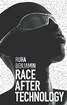

<figure class="wp-block-image alignwide size-large"></figure>

<a href="https://www.goodreads.com/book/show/42527493-race-after-technology">Race After Technology: Abolitionist Tools for the New Jim Code</a>  by <a href="https://www.goodreads.com/author/show/6583034.Ruha_Benjamin">Ruha Benjamin</a> 
 
Ruha Benjamin's book "Race After Technology" is a thought-provoking examination of the role technology plays in perpetuating racial discrimination and inequality. Benjamin describes how facial recognition technology, algorithms, and AI systems can reproduce and amplify existing patterns of discrimination. She argues that these technologies should be designed with more consideration for marginalized communities and offers solutions to mitigate their negative impact.  Throughout the book, Benjamin makes a compelling case for the importance of understanding the social and historical context in which new technologies are developed and implemented. She draws on examples from history and current events to illustrate the ways in which technology can perpetuate systemic racism.  While the book is at times a challenging read, Benjamin's clear and accessible writing style makes the content approachable for readers of all backgrounds. Overall, "Race After Technology" is a must-read for anyone interested in the intersection of technology and social justice, and offers important insights for designers, developers, and policymakers working in this space.  In the introduction, the author provides a comprehensive overview of the book and her background. This sets the stage for the rest of the book, which is divided into four chapters. Each chapter is focused on a different area of technology and its impact on racial justice.  <strong>Chapter One,</strong> titled "The New Jim Code," explores the ways in which new technologies are perpetuating racial discrimination and inequality. She argues that these technologies are not neutral and have the potential to reinforce existing patterns of oppression.  "Reality is something we create together, except that so few people have a genuine say in the world in which they are forced to live. Amid so much suffering and injustice, we cannot resign ourselves to this reality we have inherited. It is time to reimagine what is possible".  In <strong>Chapter Two,</strong> "The Coded Gaze," Benjamin analyses how facial recognition technology reinforces racial bias and stereotypes. She provides a detailed account of the history and development of facial recognition technology and how it has been used to target and discriminate against people of color.  In "The Coded Gaze," Joy Buolamwini analyzes how facial recognition technology reinforces racial bias and stereotypes. Buolamwini discusses various examples of how facial recognition technology has been used to target and discriminate against people of color, including cases where the technology misidentified individuals with darker skin tones. She also presents a detailed account of the history and development of facial recognition technology, outlining its evolution from early experiments in the 1960s to its widespread use today. Furthermore, Buolamwini highlights how the lack of diversity in the tech industry has contributed to the development of biased algorithms, and she proposes solutions for creating more inclusive and equitable technologies. "The Coded Gaze" serves as a wake-up call for the tech industry and society as a whole to address the harmful effects of biased technology and to strive towards a more just and equitable future.  Buolamwini's analysis of facial recognition technology is particularly relevant in light of recent events, such as the Black Lives Matter protests, which have brought to the forefront the issue of racial discrimination and inequality. Facial recognition technology has been used by law enforcement agencies to identify and track individuals, often resulting in the unjust targeting of people of color. Buolamwini's research highlights the urgent need for greater accountability and regulation of these technologies to ensure that they are not used to perpetuate systemic racism.  Buolamwini's work has also inspired a broader conversation about the role of technology in society and the need for greater diversity in the tech industry. By shining a light on the ways in which biased algorithms can perpetuate discrimination, Buolamwini has challenged the tech industry to re-evaluate its practices and to prioritize inclusivity and equity in the development of new technologies. Her work has also served as a call to action for marginalized communities to demand greater representation and to speak out against the harmful effects of biased technology.  "The Coded Gaze" is a powerful and thought-provoking analysis of the impact of facial recognition technology on racial bias and stereotyping. Buolamwini's research provides valuable insights into the history and development of this technology, and her proposed solutions offer a roadmap for creating more inclusive and equitable technological systems. Her work is a reminder of the importance of understanding the social and historical context in which technology is developed and implemented, and the need for greater accountability and transparency in the tech industry. "The Coded Gaze" is a must-read for anyone interested in the intersection of technology and social justice, and serves as an important contribution to the ongoing conversation about the role of technology in society.  <strong>Chapter Three,</strong> "Default Discrimination," discusses how algorithms and AI systems can reproduce and amplify existing patterns of discrimination. Benjamin presents several examples of how these systems can perpetuate bias and highlights the need for greater transparency and accountability in their development and deployment.  With a focus on the concept of "default discrimination," which refers to the ways in which algorithms and AI systems can reproduce and amplify existing patterns of discrimination. One of the key drivers of this phenomenon is biased data used to train machine learning models, particularly in the context of deep learning algorithms.  Deep learning algorithms are a subset of machine learning algorithms that use artificial neural networks to learn from large amounts of data. However, when these algorithms are trained on biased data, they can learn to reproduce and amplify the biases present in that data, leading to discriminatory outcomes.  To address this issue, Benjamin emphasizes the importance of greater transparency. She argues that designers, developers, and policymakers must work together to ensure that these systems are designed and trained with more consideration for marginalized communities, and that their impact is regularly monitored and evaluated. Additionally, Benjamin highlights the need for greater diversity in the tech industry, particularly in roles related to AI development and deployment.  By incorporating more diverse perspectives and experiences into the development process, it may be possible to identify and address bias more effectively and create more equitable and inclusive AI systems. Chapter 3 offers a powerful critique of the ways in which algorithms and AI systems can perpetuate bias and discrimination, and provides a roadmap for creating more just and equitable technological systems in the future.  <strong>Chapter Four,</strong> "Toward a Just Technology," Benjamin offers solutions to mitigate the negative impact of technology on marginalized communities.   Benjamin provides a recap of the main points of the book and a call to action for a more equitable and inclusive technological future. "Race After Technology" is a timely and important contribution to the ongoing conversation about the role of technology in society. It challenges readers to think critically about the ways in which technology can perpetuate systemic racism and provides a roadmap for creating a more just and inclusive technological future.
  
<a href="https://www.goodreads.com/review/list/54140412-gary-crossey">View all my Goodreads reviews</a>

