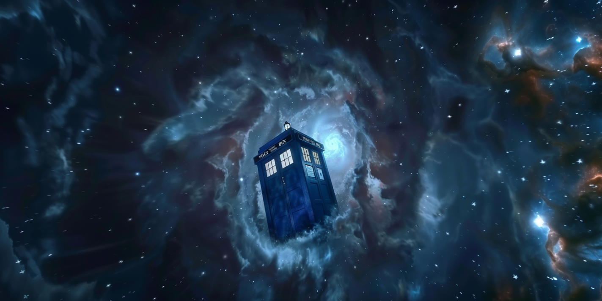

<figure class="wp-block-image size-large"></figure>

<h2 class="wp-block-heading"><strong>Introduction</strong></h2>

Hello to all the Whovians in the universe! The fascination with the adventures of the Time Lord, known to us as Doctor Who, has been a captivating journey for me. Since my early teenage years, I've found myself mesmerized by the intricate layers of the Time Lord's universe. The thrill of being whisked through time and space, all from the comfort of my own home, has never ceased to amaze me. Today, we're setting off on a compelling, in-depth exploration of "Doctor Who: Twice Upon a Time". This book has managed to expertly capture the essence of the Doctor Who series, providing a profound offering that has resonated deeply with fans. So, secure your safety belts, ensure you have your sonic screwdrivers at hand, and come along as we dive headfirst into the timeless and thrilling universe of Doctor Who!

The Doctor, in this story, is caught in the throes of a significant transformation - his regeneration. This process, while physical, is deeply intertwined with his identity and consciousness. As the Doctor grapples with the impending change, he confronts questions about his own identity and existence, providing a thoughtful exploration of the concept of selfhood. This struggle resonates through the narrative, prompting us, as readers, to engage with similar questions about our own identities and the fluid, ever-changing nature of self.

"Doctor Who: Twice Upon a Time" is a quintessential representation of its genre, which is science fiction. The narrative revolves around time travel, an iconic element in the science fiction genre. The exploration of complex themes such as identity, mortality, memory, and the fluidity of time are also common in this genre. In addition, the depiction of advanced technology, like the TARDIS (Time And Relative Dimension In Space), and the existence of alien life forms, such as the Doctor himself, further cements the book within the science fiction genre. The book also incorporates elements of drama and philosophical inquiry, thereby adding depth and complexity to its science fiction narrative.

There is a moment of profound symbolism when the Doctor observes a flame flickering in his hand. This simple act, seemingly insignificant in the grand scheme of events, is saturated with meaning and depth. This flame, unassuming yet powerful, is a representation of time itself, embodying its constant flow, change, and the ephemeral nature of existence.

The act of the Doctor observing the flame is a testament to his unique abilities and his deep, intrinsic connection with time and space. Unlike ordinary beings, the Doctor perceives time in its entirety, understanding its flow and the unfolding events within it. He is not merely a passive observer but an active participant in the temporal fabric. He has mastered the art of time, navigating its complexities with the precision of a seasoned sailor steering through tumultuous seas.

This ability to comprehend time extends beyond the ordinary, linear understanding of it. Time, in the Doctor's eyes, is not a straight line with a clear beginning and end. Instead, it is a dynamic, ever-changing entity, an intricate tapestry woven with threads of events, moments, and possibilities. His perception of time is akin to viewing a multi-dimensional landscape, full of peaks and valleys, twists and turns, rather than a flat, one-dimensional line.

The flame in the Doctor's hand symbolizes this complex understanding of time. Just like time, a flame is dynamic and ever-changing. It flickers and dances, never remaining the same for more than a fleeting moment. It consumes fuel to live, just like time consumes moments to progress. Yet, despite its constant change, the flame retains its essence, its identity. Similarly, time, despite its ceaseless flow and change, remains a constant entity.

The flame also symbolizes the delicate balance of time. Just as a flame can provide warmth and light, it can also cause destruction if not handled with care. Similarly, time, if tampered with recklessly, can lead to disastrous consequences. The Doctor, aware of this delicate balance, understands the importance of respecting time's flow and not interfering unnecessarily.

The flame in the Doctor's hand serves as a mirror to the Time Lord himself. Just like the flame, the Doctor undergoes constant change through his regenerations. Each regeneration is a new flame, a new life, a new identity. Yet, despite these changes, he retains his essence, his memories, his selfhood. This parallel between the Doctor and the flame deepens the symbolism and adds another layer of complexity to his character.

The flickering flame is also a visual representation of life's transient nature. It serves as a poignant reminder of our mortality, the fleeting nature of existence, and the inevitability of change. The Doctor, despite his ability to regenerate, is not immune to these universal laws. His struggle with his impending regeneration, his decision to die, and his acceptance of change resonate deeply with these themes.

In essence, this seemingly simple act of observing a flame in his hand encapsulates the essence of the Doctor's character and his relationship with time. It underscores the underlying themes of change, continuity, and the complexities of time, providing a profound insight into the narrative's core philosophy.

The flame, thus, is not just a flame. It is a symbol, a metaphor, and a narrative device that adds depth and complexity to the storyline. It is a testament to the Doctor's unique relationship with time, his understanding of its complexities, and his acceptance of its relentless march. In the Doctor's hand, the flame becomes a beacon, illuminating the intricacies of time and the narrative's thematic landscape.

One of the standout elements of the Doctor Who novels, and particularly "Doctor Who: Twice Upon a Time", is the subtler approach to storytelling. Unlike the TV series where dramatic shouts of "Doctor, Doctor" punctuate the action, the books foster a quieter, more intimate atmosphere. The story unfolds without the need for such overt theatrics, providing a refreshing contrast to the series and offering a new perspective.

The author advances the theme through detailed narration and introspective dialogue. The characters’ speeches and thoughts express their grappling with concepts of time, memory, and identity. The author's use of literary devices such as foreshadowing and symbolism expand on the theme. The Doctor's impending regeneration, for instance, is a potent symbol of the inevitability of change and the transience of identity, tying back to the main theme. The setting and circumstances, particularly the war and the concept of time travel, underline the themes of duty, sacrifice, and the fluidity of time and identity. Rich, descriptive language and vivid imagery enhance the reader's understanding of the theme and supplement the thematic development.

<h3 class="wp-block-heading"><strong>Essential subordinate themes or topics</strong></h3>

The essential subordinate themes or topics in the book are:

<ul class="wp-block-list">
<li>The concept of mortality and the acceptance of death</li>

<li>The exploration of time as both a physical and philosophical entity</li>

<li>The struggle of self-identity, particularly in the context of the Doctor's regeneration</li>

<li>Themes of duty, sacrifice, and ethical responsibilities</li>

<li>The complexities and paradoxes of time travel</li>

<li>The exploration of personal memories and their role in shaping a person's identity</li>

<li>The exploration of the nature of reality, particularly in the context of the glass woman and Bill Potts</li>
</ul>

<h2 class="wp-block-heading"><strong>Analysis of Storytelling Style</strong></h2>

The Doctor Who novels, particularly "Doctor Who: Twice Upon a Time", illuminate a characteristic element that sets them apart - their nuanced storytelling style. This style starkly contrasts with that of the television series, offering a more refined, introspective ambiance that is a refreshing divergence from the energetic, campy nature of the show.

The Doctor Who television series is known for its flamboyant, theatrical style. It thrives in its campy aesthetics, bringing a larger-than-life, colorful vibrancy that fills the screen with dramatic exclamations of "Doctor, Doctor" punctuating the ongoing action. The series rides high on eccentric characters, exaggerated emotions, and quirky humor. The plots often revolve around extravagant alien species, with their distinctly exaggerated appearances and theatrical performances that bring a level of whimsy and exaggerated drama to the narrative. This camp style, while entertaining, can sometimes overshadow the deeper, underlying themes of the narrative.

On the other hand, the Doctor Who novels, especially "Doctor Who: Twice Upon a Time", adopt a quieter, more introspective narrative style. The storytelling unfurls gracefully, devoid of the need for explicit theatrics, granting a more serene ambiance. This approach allows the narrative to delve deeper into the complexities of the characters and their dynamics, probing into the quieter, reflective facets of the narrative that might get lost in the flamboyant spectacle of the television series.

This difference in storytelling style between the television series and the novels presents a fresh viewpoint on the adventures of our beloved Time Lord. The television series, with its larger-than-life, campy style, brings a sense of excitement and spectacle that engages viewers in a visceral, immediate way. It creates a dynamic, fast-paced narrative that captivates viewers with its visual spectacle, eccentric characters, and dramatic confrontations.

In contrast, the novels, with their introspective, nuanced storytelling style, invite readers on a more immersive, contemplative journey. It allows readers to delve deeper into the characters' psyche, understand their motivations, and engage with the thematic elements of the narrative on a more profound level. The novels focus on exploring the complexities of the characters, their relationships, and the intricate web of time and space they navigate.

The unique storytelling style of the novels could potentially modernize the Doctor Who series if it were to be adopted. While the campy style of the television series has its charm and appeal, a shift towards a more introspective narrative could introduce a fresh perspective to the series. It could allow the series to delve deeper into the complexities of the characters, their motivations, and the intricate web of time and space they navigate.

A more serene, nuanced narrative style could help amplify the themes of the series, bringing a depth and complexity that could resonate with a wider audience. It could also present an opportunity to explore the philosophical implications of the Doctor's adventures, probing deeper into the concepts of time, identity, and morality. This could potentially make the series more accessible and engaging for viewers who prefer narratives with a strong thematic depth and character focus.

The adoption of a more introspective storytelling style could potentially modernize the series by aligning it with contemporary narrative trends. In recent years, there has been a shift towards narratives that focus on character development, thematic depth, and psychological exploration.

<h2 class="wp-block-heading"><strong>Analysis of Key Narrative Devices</strong></h2>

"Doctor Who: Twice Upon a Time" cleverly incorporates narrative devices to layer the plot. The factory TARDIS, with its stark white exterior unadorned by any designs, lends itself to an interesting comparison with the initial process of crafting a website. Much like the skeletal framework of a website, the factory TARDIS is a necessary foundation. However, it's the infusion of personal style, reminiscent of the Doctor's touch on the TARDIS, that metamorphoses it into an engaging, lively entity. This parallel serves as an insightful reminder of the humble origins of even the most remarkable creations.

Another notable narrative device is the use of the flame symbol. The Doctor's intricate relationship with time is encapsulated in the moment when he observes a flame flickering in his palm. This flame is a metaphor for time. The Doctor's role is not just confined to being a traveler but expands to being a custodian, a guide, and an integral part of the temporal tapestry. He possesses a unique understanding of the ebb and flow of time and the events within, going beyond the traditional linear perception of time. This understanding delves into the complexities of time as a fluid, ever-adapting phenomenon.

<h2 class="wp-block-heading"><strong>Key Themes Explored in "Doctor Who: Twice Upon a Time"</strong></h2>

<ol class="wp-block-list">
<li>The theme of self-identity: The Doctor struggles with accepting his younger version and reconciling with his future selves, highlighting the fluidity of identity over time.</li>

<li>The idea of change and transformation: The Doctor's impending regeneration signifies the inevitability of change. This is a key theme in the Doctor Who series and is explored here in-depth.</li>

<li>The concept of time: The novel explores the complexities and paradoxes of time-travel. The Doctor operates outside of normal time, which poses unique challenges and dilemmas.</li>

<li>The power of memory and perception: The Doctor's past, present, and future selves co-existing creates a discourse on memory, perception, and how these elements shape our identity.</li>

<li>The importance of companionship: The relationships between the Doctor and characters like Bill and the Captain highlight the Doctor's need for companionship and his reliance on others for support and guidance.</li>

<li>Courage in the face of adversity: The Doctor's determination to confront the Glass Woman and the bold escape plan demonstrates the theme of bravery and resistance against powerful adversaries.</li>
</ol>

<h2 class="wp-block-heading"><strong>Philosophical Themes</strong></h2>

The narrative of "Doctor Who: Twice Upon a Time" ventures deep into philosophical realms, engrossing readers with thought-provoking explorations of personal identity and the concept of time. These themes, which are central to the story, reverberate within the narrative universe of "Doctor Who: Twice Upon a Time" and have always been a profound source of fascination for me, as a dedicated fan of the series.

The distinct process of regeneration that the Doctor undergoes is particularly compelling. In this process, the Doctor experiences a physical transformation yet crucially, retains his memories and experiences. This innovative narrative construct effectively challenges the traditional notion of a fixed identity. The Doctor, in essence, encapsulates a continuity of consciousness despite the drastic change in physical appearance, thus pushing the boundaries of our understanding of individual identity. This intriguing narrative element echoes the intricate questions about selfhood raised in <a href="https://betterworldwithdesign.com/book-review-reasons-and-persons/" data-type="post" data-id="4260">Derek Parfit's "Reasons and Persons</a>", a seminal work in philosophical inquiry renowned for its profound insights.

Much like the Doctor Who series, "Reasons and Persons" has had a significant impact on my worldview, shaping my thoughts and understanding of the world. The philosophical themes explored in Parfit's work have deeply resonated with me, much like the themes in "Doctor Who: Twice Upon a Time". Parfit's exploration of personal identity, specifically the revolutionary idea that identity is not what fundamentally matters in survival, aligns seamlessly with the Doctor's regeneration process. Both convey the notion that although the physical form may undergo change, the continuity of psychological connections - such as memories, beliefs, desires - is what truly defines a person's identity.

Parfit also delves into the intricate nature of time, another theme that is central to the narrative of "Doctor Who: Twice Upon a Time". The Doctor's extraordinary relationship with time, where he is not anchored by its linear progression, closely mirrors Parfit’s exploration of time's relationship with identity. The Doctor possesses the unique ability to perceive and interact with time in its complexity and flow, a perspective that is akin to Parfit's philosophical discourse. This exceptional relationship with time, coupled with the Doctor's regeneration, adds layers of depth and complexity to the narrative, enriching the story with philosophical intrigue.

The parallels between "Reasons and Persons" and "Doctor Who: Twice Upon a Time" present a unique opportunity to delve into thought-provoking perspectives on time and identity. As an ardent fan of Doctor Who and an admirer of Parfit's philosophical insights, I find this connection deeply fascinating. The exploration of these complex themes within a science fiction narrative provides a unique lens to examine and understand these philosophical concepts, making them more accessible and relatable.

The blend of philosophy and science fiction in the narrative of "Doctor Who: Twice Upon a Time" initiates a dialogue between these two seemingly disparate fields. It showcases the potential of science fiction as a medium to explore philosophical ideas, sparking thought-provoking discussions and promoting deeper understanding.

Both "Doctor Who: Twice Upon a Time" and Parfit's "Reasons and Persons" delve into the complexities of personal identity and the intricacies of time, and their intersection. They challenge conventional notions of selfhood and time, presenting a dynamic and nuanced view that profoundly resonates with me. The exploration of these themes in the narrative of "Doctor Who: Twice Upon a Time", mirroring the philosophical themes in Parfit's work, not only enriches the story but also deepens my appreciation for both works.

Parfit's exploration of personal identity includes a fascinating thought experiment involving space travel. In this scenario, a person travels from Earth to Mars at the speed of light. At the moment of departure, an exact replica of the person, with the same memories, personality traits, and physical characteristics, is created on Mars. Parfit poses the question: which one is the real person - the original on Earth or the replica on Mars?

This concept parallels the Doctor's ability to regenerate in "Doctor Who: Twice Upon a Time". When the Doctor regenerates, he essentially becomes a new person with a new physical appearance, yet retains the memories and experiences of his previous self. Much like Parfit's space traveler, the Doctor exists in two instances - the old Doctor who chooses to die and the new Doctor who arises from the regeneration.

This parallel presents a compelling exploration of the concept of selfhood and the continuity of identity. It raises questions about what truly defines a person - is it their physical form, their memories, or a combination of both? These complex questions about identity and existence add depth to the narrative, enriching the story and offering readers a thought-provoking reading experience.

<h2 class="wp-block-heading"><strong>Christ-like Themes</strong></h2>

"Doctor Who: Twice Upon a Time" explores several themes, many of which draw intriguing parallels with Christian theology. One profound theme is the act of sacrifice. The Doctor's decision to lay down his life for the good of all is a key point in the narrative. His choice is a powerful manifestation of his acceptance of mortality and the inevitability of change. The narrative paints the Doctor's sacrifice as a selfless act, strikingly similar to the sacrificial act of Jesus Christ in Christian theology.

According to Christian belief, Jesus Christ willingly died on the cross, bearing the burden of humanity's sins to provide salvation for all. This act is one of the most significant events in Christian theology, symbolizing God's love for humanity. The Doctor's choice to die mirrors this sacrificial act, demonstrating his commitment to safeguarding life throughout the universe, often at the cost of his own.

The Doctor's willingness to die, much like Christ's acceptance of his crucifixion, is a testament to his courage and selflessness. In choosing to die for the sake of all, the Doctor affirms his role as a guardian and protector, willing to make the ultimate sacrifice for the greater good. This narrative reinforces the Doctor's role as a guardian and savior, much like Christ.

Death, however, is not the finality for either the Doctor or Christ. In Christian theology, Christ's death was followed by His resurrection, a triumphant victory over death symbolizing hope and eternal life. Similarly, the Doctor, though he chooses to die, is not conquered by death. Instead, he undergoes a regeneration—a transformation into a new form, a new life. This regeneration can be seen as a form of resurrection, a victory over death, and a renewal of life.

The parallel between the Doctor's regeneration and Christ's resurrection presents a fascinating perspective on themes of sacrifice, death, and rebirth. The act of dying, whether for Christ on the cross or the Doctor in the face of impending destruction, is not an end but a transition—a doorway to a new beginning. It is a testament to the power of love, sacrifice, and the indomitable spirit of resilience and hope.

The Doctor's regeneration, like Christ's resurrection, signifies a renewal, a rebirth. It is a process that, while painful and challenging, leads to a new beginning and a fresh start. It is a symbol of hope, of life springing forth from the ashes of death. It is a testament to the enduring spirit of the Doctor, his resilience, and his undying commitment to safeguarding life.

This parallel extends beyond the individual level to encompass a broader, universal perspective. Just as Christ's resurrection signifies hope and salvation for all of humanity, the Doctor's regeneration symbolizes enduring hope for life throughout the universe. Each regeneration, each new Doctor, brings renewed commitment to protecting life, fighting injustice, and championing hope and compassion.

However, it's important to note that while there are intriguing parallels, the narrative does not equate the Doctor with Christ. The Doctor's sacrifice, though noble and selfless, does not carry the theological weight of Christ's crucifixion in Christian belief. Nevertheless, these parallels present a rich ground for exploration, interpretation, and discussion of the themes of sacrifice, mortality, resurrection, and rebirth in the narrative.

<h2 class="wp-block-heading"><strong>In-depth Analysis of the Story</strong></h2>

The most important word in the story is 'Time'. The concept of time is a recurring theme in the story, influencing the characters' actions, their understanding of their existence, and the progression of the plot.

The most important line in the story is "I'm only sorry we can't help you. More said the first doctor. When time resumes, you will not remember. This." This sentence encapsulates the Doctor's struggle with his inability to alter the course of time and his deep sense of empathy toward the Captain.

The most important aspect of this story is the exploration of the complexities of time, identity, and memory. The story delves deep into philosophical questions about what it means to be an individual, the nature of memories, and the paradoxes of time travel. The characters grapple with their identities, their past and future selves, and the consequences of their actions on the fabric of time.

As we delve deeper into the narrative, the theme of time emerges as a pivotal concept, shaping the characters' actions, their understanding of their existence, and the progression of the plot.

The Doctor, in particular, is caught in the throes of a significant transformation - his regeneration. This process, while physical, is deeply intertwined with his identity and consciousness. As the Doctor grapples with the impending change, he confronts questions about his own identity and existence, providing a thoughtful exploration of the concept of selfhood. This struggle resonates through the narrative, prompting us, as readers, to engage with similar questions about our own identities and the fluid, ever-changing nature of self.

<h2 class="wp-block-heading"><strong>Analysis of Language Techniques and Literary Devices</strong></h2>

The author masterfully employs a plethora of linguistic techniques and literary tools to enrich and enhance the narrative. Dialogue is used with dexterity to not only reveal the intricate traits of the characters but also to advance the plot, all while maintaining a captivating and organic flow of conversation. The author’s use of vibrant descriptions and powerful imagery crafts a comprehensive picture of the settings and events, augmenting the reader’s immersion and engagement with the story. Dramatic tension is skillfully interwoven into scenes, such as the riveting escape from the glass woman, keeping the reader engrossed and ensuring the narrative remains compelling from start to finish. The use of humor and sarcasm, particularly embodied through the Doctor's character, infuses the narrative with moments of levity, lightening the tone amidst an intense storyline.

The author utilizes a rich, descriptive language and vivid imagery to augment the reader's understanding of the theme. Detailed descriptions of the settings, events, and the characters' experiences add layers to the story and supplement the thematic development. The narrative is imbued with complex dialogue and introspective monologues, particularly through the Doctor's character, allowing the author to delve into his intricate emotions and philosophical musings, thereby advancing the central theme of the narrative.

The author also employs literary devices such as foreshadowing and symbolism to expand on the theme. The Doctor's impending regeneration, for instance, is a potent symbol of the inevitability of change and the transience of identity, which ties back to the main theme. The author also uses the setting and circumstances, especially the war and the concept of time travel, to underline the themes of duty, sacrifice, and the fluidity of time and identity. The Doctor’s struggle with his decision to die, and his negotiation of this decision in the context of his duty to others, for example, further develops the theme of identity and the passage of time.

The author's adept use of language techniques, rich description, and vivid imagery, coupled with well-crafted dialogue and introspective monologues, serves to enhance the reader's understanding of the story and its themes. The author's exploration of themes such as identity, time, and memory, through the experiences and interactions of the characters, adds depth and complexity to the story.

The book contains several important and forceful statements. These statements often concern themes of self-identity, the nature of time, mortality, acceptance of death, duty, sacrifice, and the complexities of memory. More said the first doctor. When time resumes, you will not remember. This" encapsulates his struggle with his inability to alter the course of time and his deep sense of empathy. The Doctor's decision to die, as seen in the statement "He had decided to die. For everyone. Everywhere.", is a powerful declaration of his acceptance of mortality and the inevitability of change. Another significant statement is "Everybody's important to somebody," which underscores the Doctor's belief in the intrinsic worth of every individual.

<h2 class="wp-block-heading"><strong>Character Development</strong></h2>

The characters of "Doctor Who: Twice Upon a Time" are thoughtfully crafted, each bringing a unique perspective to the narrative and contributing to the exploration of various themes, such as self-identity, time, duty, and memory.

The Doctor stands at the precipice of change, wrestling with his impending regeneration and the profound implications it brings. As the narrative unfolds, his internal struggle sheds light on the intricacies of his character, providing a fascinating exploration of the themes of identity, mortality, and acceptance.

The Doctor, with his eccentricity and wisdom, is more than just a time-traveling alien. He is a guardian of time, a beacon of hope, and a complex individual grappling with his own sense of self. His impending regeneration is more than a simple transformation – it signifies a change in his identity, a cessation of his current self, and the birth of a new persona. This process brings to the fore the Doctor's internal conflict. He is at odds with the inevitability of change, and the narrative deftly explores his struggle as he grapples with the loss of his current identity and the uncertainty of what he will become.

Despite his Time Lord abilities that allow him to regenerate, the Doctor's acceptance of his mortality forms a poignant aspect of his character growth. The narrative does not shy away from exploring the Doctor's vulnerability. He is not invincible; he can be hurt, he can feel fear, and he can die. His decision to embrace death, despite the possibility of regeneration, is a testament to his courage and acceptance of change. This decision not only underscores the theme of mortality and the inevitability of change, but also enriches his character, providing a depth that goes beyond his Time Lord abilities.

The Doctor's character is further amplified by his profound empathy. His encounters with various beings across time and space have shaped his understanding of life, making him deeply empathetic towards all forms of life. His empathy is not confined within the boundaries of his own species or even humanity - it extends to all beings, including his enemies. This empathy, combined with his intelligence and courage, makes the Doctor a true hero.

However, the Doctor's character is not without flaws. He can be arrogant, aloof, and sometimes burdened by the weight of his own decisions. He often struggles with the moral implications of his actions, particularly when they have far-reaching consequences across time and space. This flawed aspect of his character makes the Doctor more relatable, more human, adding another layer of complexity to his character.

The Doctor's unique perspective on time adds a fascinating dimension to his character. Time is not just a measure for the Doctor, it's a playground, a maze, and sometimes a burden. He perceives time in all its complexity – its ebb and flow, its twists and turns, and its potential for both creation and destruction. This understanding of time and his unique ability to navigate it are what make the Doctor a Time Lord.

IThe Doctor's character serves as a mirror reflecting the complexities of identity, mortality, and the inevitability of change. His struggle with his impending regeneration, his acceptance of mortality, and his profound connection with time all contribute to the multi-faceted nature of his character. His courage, empathy, and resilience in the face of adversity highlight his heroism, making the Doctor an enduring character in the realm of science fiction. Through the Doctor, we are invited to explore our own sense of self, our mortality, and our capacity for change – making the journey with the Doctor not just an adventure through time and space, but a journey of self-discovery.

The First Doctor, as portrayed in "Doctor Who: Twice Upon a Time", is a compelling character that adds a rich layer of depth and intrigue to the narrative. As an earlier incarnation of the Doctor, he serves as a bridge to the Time Lord's past and offers unique insights into the evolution of the Doctor's character.

In many ways, the First Doctor is the foundation on which all subsequent incarnations are built. His sense of wonder, curiosity, and thirst for knowledge are traits that persist in the Doctor's later regenerations. His courage and determination to fight against injustice and protect the innocent set the precedent for the heroism that would come to define the Doctor's character.

The First Doctor also exudes an air of wisdom and authority that is characteristic of his age. He is a figure of respect, not only for his knowledge and experience but also for his moral compass and his unwavering commitment to doing what is right. This sense of authority is balanced by a playful and mischievous streak, a trait that adds a touch of levity and charm to his character.

However, the First Doctor is not without his flaws. He can be stern, stubborn, and occasionally dismissive of others' opinions. His demeanor often masks his deep sense of compassion and empathy, qualities that are revealed in his interactions with his companions and his willingness to help those in need.

His presence in "Doctor Who: Twice Upon a Time" serves as a poignant reminder of the Doctor's journey, highlighting how much he has changed and yet how much of his original self remains. The interplay between the First Doctor and his later incarnation provides a fascinating exploration of the Doctor's self-identity, raising questions about the nature of change and the essence of an individual's self.

The First Doctor's interactions with other characters in the story also reveal a great deal about his character. His relationship with the Captain, for example, showcases his empathy, wisdom, and his willingness to offer comfort and guidance even in the most dire of circumstances. His exchanges with the glass woman, on the other hand, provide a glimpse into his decisive and courageous nature.

The First Doctor is a complex and multi-dimensional character who enriches the narrative of "Doctor Who: Twice Upon a Time". He represents the Doctor's roots, embodying the values, traits, and ideals that have shaped the Doctor's evolution. His presence in the narrative adds depth to the exploration of themes such as self-identity, change, and the passage of time, making him an integral part of the story.

Captain Archibald Hamish Lethbridge Stewart, more commonly known as Archie, is a character who leaves a lasting impression in "Doctor Who: Twice Upon a Time". Caught in the midst of war, Archie represents the thousands of brave soldiers who face the grim realities of conflict with strength and courage. His character is a poignant depiction of duty and sacrifice, embodying the spirit of bravery and selflessness that marks a soldier's life.

Archie's stoic acceptance of his fate is a testament to his robust character. He understands the harsh realities of the battlefield and accepts the inevitable with a quiet grace that is both moving and inspiring. His relentless commitment to his duty, even in the face of certain death, speaks volumes about his strong moral compass and unwavering resolve.

The sacrifice Archie makes is not just a physical one but a deeply emotional one as well. He willingly walks into the jaws of death, fully conscious of the price he is paying. This ultimate sacrifice adds layers of depth and complexity to his character, making him a symbol of selfless bravery.

Archie's interactions with the Doctor bring to light another aspect of his character. Despite his tough exterior, he harbors a deep sense of empathy and understanding. His request to the Doctor, to look in on his family from time to time, shows his concern for his loved ones, adding an emotional depth to his otherwise stoic character.

Ultimately, Captain Archibald Hamish Lethbridge Stewart or Archie is a character who embodies duty, sacrifice, and bravery. His story is a powerful depiction of the human spirit's strength and resilience in the face of adversity.

The Glass Woman, a character in "Doctor Who: Twice Upon a Time", is not just a character but a potent symbol. As a physical manifestation of memory, she brings to life the intriguing exploration of memory and its profound impact on our identities. Her existence, shaped by the memories of Bill Potts, challenges traditional definitions of reality and personal identity, suggesting that our sense of self is shaped as much by our memories as it is by our physical existence.

Despite being a construct of glass and memory, the Glass Woman is perceived by others as a living, sentient being. This perception challenges our understanding of reality, suggesting that what we perceive as real can be as influential and powerful as physical reality. It highlights the subjective nature of reality and the power of perception in shaping our understanding of the world around us.

The Glass Woman’s interactions with the Doctor and other characters provide valuable insights into the theme of memory and identity. Her existence, while based on Bill's memories, evolves as she interacts with the world around her. She forms new memories, learns, and grows, much like a real person. This development suggests that our identities are not static but constantly evolving, shaped by our experiences and interactions.

She serves as a mirror to the Doctor's struggle with his impending regeneration, a process that will alter his physical form while retaining his memories. Her existence poses a compelling question: If our memories remain, are we fundamentally the same person, even if our physical form changes?

The Glass Woman also embodies the paradox of memory. Memories are inherently subjective, influenced by our emotions, perceptions, and the passage of time. Yet, they play a crucial role in shaping our sense of self. The Glass Woman, a being born of memory, encapsulates this paradox. She is both a product of someone else's memories and a being with her own experiences and perceptions, highlighting the complex interplay between memory, perception, and identity.

In "Doctor Who: Twice Upon a Time", the Glass Woman serves as a powerful symbol of the intricate relationship between memory and identity. Her character encourages readers to reflect on the nature of selfhood, the subjectivity of reality, and the pivotal role memory plays in shaping our identities. By exploring these complex themes through the character of the Glass Woman, the narrative adds depth and nuance to the philosophical discourse of the story.

Rusty the Dalek is a significant character in "Doctor Who: Twice Upon a Time", serving as a symbol of rebellion, individuality, and the potential for change. Unlike the archetypal Daleks, known for their relentless drive towards destruction and their uniform hatred for anything non-Dalek, Rusty proves to be a renegade. He has undergone a unique shift in his belief system that has led him to detest his own kind and actively go against them.

Rusty is not simply a character in the narrative but a potent metaphor that challenges the monolithic portrayal of the Dalek race. Like the TARDIS, Rusty is more than what meets the eye. On the surface, Rusty appears to be a typical Dalek, but within him resides a world of unique thoughts and beliefs that set him apart from the rest of his kind.

Much like the TARDIS, which is a simple police box on the outside but encapsulates an entire universe within, Rusty's exterior belies the complexity of his character. His rebellion against the Dalek norms, his shift in beliefs, and his refusal to conform to the Dalek's destructive ideology underscore the theme of individuality and the ability to redefine one's identity. Just as the TARDIS undergoes changes with each Doctor, reflecting their unique personality and style, Rusty also undergoes a transformation that sets him apart.

Rusty's character serves as a crucial narrative device in exploring themes of identity, change, and the power of individual thought. His journey echoes the Doctor's struggles with change and identity development, adding depth to the exploration of these themes within the narrative. Moreover, Rusty's individuality and defiance serve to highlight the potential for change and the capacity for individual thought, even in a species typically characterized by uniformity and conformity.

Rusty's presence in the narrative provides a fresh perspective on the Dalek race within the Doctor Who universe. His character challenges the viewer's preconceived notions about the Daleks, offering a more nuanced depiction of their race. Rusty's unique perspective, his defiance of Dalek norms, and his rebellion against his kind not only enrich the narrative but also open up new narrative possibilities.

A fascinating element in "Doctor Who: Twice Upon a Time" is the character-like role played by the TARDIS, specifically the depiction of the factory TARDIS. Unlike the colorful, vibrant TARDIS we associate with the Doctor, the factory TARDIS is stark, white, and devoid of any distinct designs. This seemingly unimpressive form is crucial, serving as the canvas onto which the Doctor's personality is imprinted.

This narrative choice is reminiscent of the process of building a website. The initial framework of a site, while essential, is visually unremarkable, much like the factory TARDIS. It's the application of CSS, which adds color, fonts, and styles, that brings the site to life, transforming it into a dynamic and engaging platform. Similarly, the Doctor personalizes the TARDIS, imprinting it with their unique touch, thereby transforming it from a plain, white structure into a vessel teeming with character and charm.

This depiction of the TARDIS serves as a potent reminder that even the most extraordinary things can have simple beginnings. It reflects the transformative power of personalization - how adding individual touches can imbue an otherwise unremarkable object with depth and charm.

Moreover, the TARDIS is more than just a time-traveling machine; it's a character, playing a pivotal role in the Doctor's adventures. It's the Doctor's home, their safe haven, and their loyal companion, sharing in their victories and losses. It's a silent witness to the Doctor's life, its walls echoing with tales of bravery, sacrifice, and resilience. It's a testament to the Doctor's journey, bearing the marks of their adventures across time and space.

The TARDIS, much like the Doctor, evolves over time. Each Doctor leaves their mark on the TARDIS, reflecting their unique personality and style. This evolving nature of the TARDIS mirrors the Doctor's regenerations, each bringing a new personality and appearance, yet retaining the same essence.

In the grand tapestry of "Doctor Who: Twice Upon a Time", the TARDIS stands as a symbol of the Doctor's journey, a silent character in its own right, bearing witness to the Doctor's life, sharing in their joys and sorrows, and ultimately, serving as an enduring testament to the Doctor's adventures across time and space.

Each character in "Doctor Who: Twice Upon a Time" undergoes their unique journey of growth. Their experiences and interactions highlight the themes of the story and contribute to the narrative's depth and complexity. The characters' struggles with their identities, their confrontation with time, the acceptance of their duties, and their exploration of memory all contribute to their character development and enrich the narrative. The depth of each character, their unique perspectives, and their growth throughout the story make "Doctor Who: Twice Upon a Time" a rich and engaging narrative that explores complex themes through the lens of compelling characters.

<h2 class="wp-block-heading"><strong>Potential Interpretations</strong></h2>

Interpreting the story or its characters can vary significantly among readers, based on their perspectives and experiences. For some, the Doctor's struggle with his impending regeneration and his decision to die may highlight themes of acceptance, mortality, and the inevitability of change. Others may focus on the dynamic between the Doctor and other characters, reflecting the Doctor's internal conflict, his connection to his past, and his impact on others. Some readers might interpret the story as a commentary on the nature of time and memory, with the use of time travel, the Doctor's unique abilities, and the concept of the factory TARDIS seen as metaphors for the fluidity and subjectivity of memory and personal identity.

<h2 class="wp-block-heading"><strong>Conclusion</strong></h2>

"Doctor Who: Twice Upon a Time" is a richly layered narrative that dives deep into the philosophical questions about identity, time, and memory. The author's skillful use of language techniques, narrative devices, and character development provides an engaging and thought-provoking reading experience. The story's themes and the characters' experiences resonate beyond the pages of the book, prompting readers to engage with these concepts in their own lives.

Reading this book has certainly deepened my understanding of the subject. It explores complex themes such as identity, time, memory, and the intricacies of personal relationships in an engaging and thought-provoking manner. The author's use of vivid descriptions, introspective dialogue, and intricate plot devices has provided a rich narrative that delves into the philosophical implications of each theme, enhancing my comprehension and appreciation of the subject.

This story stands as a testament to the depth and complexity that the Doctor Who series offers, making it a timeless treat for Whovians. So, grab your sonic screwdriver, hop into your TARDIS, and embark on this journey with the Doctor. The fabric of time and space awaits!

<h4 class="wp-block-heading">Recommended Reading</h4>

<figure class="wp-block-embed is-type-wp-embed is-provider-better-world-with-design wp-block-embed-better-world-with-design">

<blockquote class="wp-embedded-content" data-secret="10l4hkRBJa"><a href="https://betterworldwithdesign.com/book-review-reasons-and-persons/">Reasons and Persons by Derek Parfit</a></blockquote><iframe loading="lazy" class="wp-embedded-content" sandbox="allow-scripts" security="restricted" style="position: absolute; visibility: hidden;" title="&#8220;Reasons and Persons by Derek Parfit&#8221; &#8212; Better World With Design" src="https://betterworldwithdesign.com/book-review-reasons-and-persons/embed/#?secret=2vlrrHVMUq#?secret=10l4hkRBJa" data-secret="10l4hkRBJa" width="600" height="338" frameborder="0" marginwidth="0" marginheight="0" scrolling="no"></iframe>

</figure>

