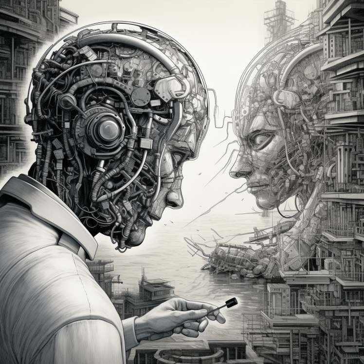
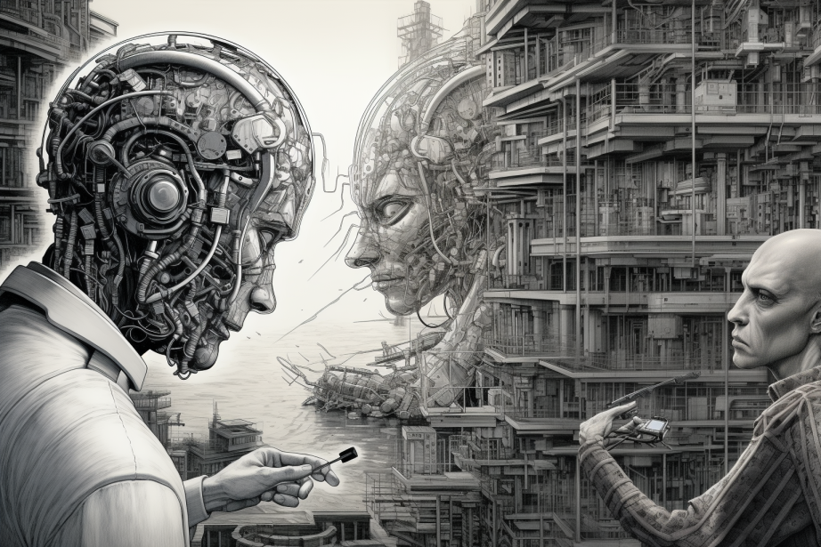
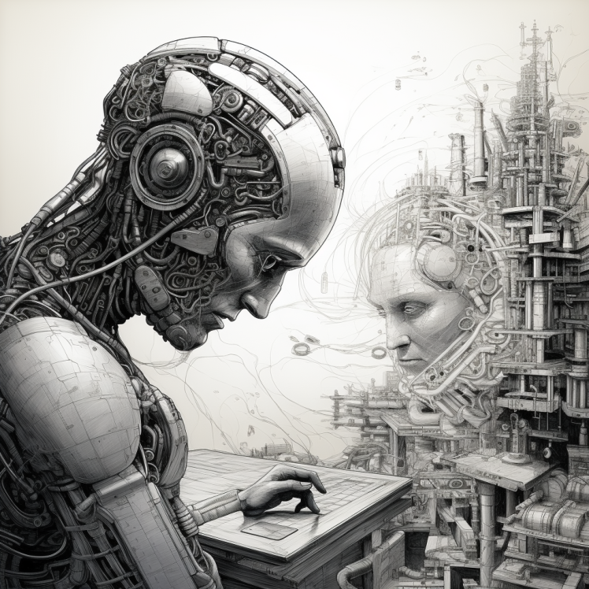
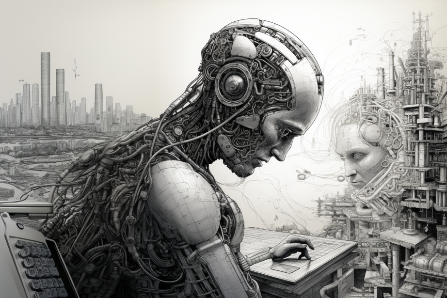

<figure class="wp-block-image size-full wp-duotone-varpresetduotoneforeground-and-background-2"><figcaption class="wp-element-caption">Digital Art by Gary Crossey</figcaption></figure>

In the grand tapestry of Parisian lore, "The Invention of Hugo Cabret" by Brian Selznick unfolds as a captivating tale that beckons the reader to traverse the labyrinthine alleys of 1930s Paris. With a masterful fusion of prose and intricate black-and-white illustrations, Selznick weaves a tale that transports us to a world where the lines between reality and imagination blur, and where the human spirit triumphs against all odds.

Our journey commences with Hugo, a twelve-year-old waif, who resides furtively within the recesses of a bustling train station. Bereft of familial ties after the untimely demise of his father, Hugo clings to a broken automaton, a mechanical enigma that his father once sought to mend. This mechanical marvel, Hugo believes, holds within its intricate gears and cogs a message from his departed progenitor, a message that may illuminate the mysteries of his own existence.

One cannot help but be enveloped by the prevailing theme of connection and friendship that permeates the narrative. It is through a serendipitous encounter with Isabelle, a kindred spirit, that Hugo embarks upon a quest to unravel the enigma of the automaton. In their shared pursuit, a profound bond is forged, one that transcends the boundaries of age and circumstance. This bond, serves as an abiding testament to the transformative power of human connection, reminding us that our journey through life is enriched immeasurably by the companionship and understanding of kindred souls.

Selznick masterfully underscores the magic of imagination and creativity throughout the pages of this enchanting opus. Hugo's ardor for mending machines and his insatiable fascination with the world of cinema serve as beacons of inspiration. Through Hugo's unwavering devotion to his craft, we are implored to embrace the boundless potential of our own creative faculties, to revel in the splendor of art, storytelling, and the ceaseless dance of the imagination. For it is in these realms that the true essence of our humanity finds its purest expression.

The preservation of history, its delicate tapestry interwoven with the threads of time, emerges as a theme of profound significance within the narrative. Hugo's father, a master clockmaker, bequeaths to his son a reverence for the past, a deep-seated desire to safeguard the relics of a bygone era. Through Hugo's quest to mend the automaton, the story illuminates the importance of cherishing historical artifacts, for they serve as vessels of memory and bear witness to the triumphs and tribulations of those who came before us. In this gentle admonition, we are reminded to honor and cherish our collective past, for it is through understanding and appreciating history that we pave the way for a more enlightened future.

<figure class="wp-block-image size-full wp-duotone-varpresetduotoneforeground-and-background-3"><figcaption class="wp-element-caption">Digital Art by Gary Crossey</figcaption></figure>

The tapestry of Hugo's journey is intricately woven with the threads of loss and the quest for purpose. In the wake of his father's demise, Hugo finds himself adrift, longing for a sense of belonging. Yet, it is through the crucible of his encounters with Isabelle and his relentless pursuit of the automaton's secrets that he discovers a profound purpose that transcends his own personal narrative. Selznick deftly explores the depths of the human spirit, illuminating the resolute resilience that lies within us all, urging us to embrace the transformative power of adversity and to forge our own destinies amidst the crucible of life's trials.

But it is in the realm of forgiveness and redemption that the narrative reaches its crescendo. As the tapestry of the story unfurls, a hidden connection between Hugo's past and the life of Georges Méliès, a forgotten filmmaker, comes to light. Initially portrayed as a bitter and isolated figure, Méliès finds himself on a path to redemption through the unwavering persistence of Hugo and the cathartic power of forgiveness. The narrative delves into the profound depths of the human condition, exploring themes of absolution, the promise of second chances, and the transformative power of compassion.

"The Invention of Hugo Cabret" stands as a testament to the indomitable human spirit, an ode to friendship, imagination, history, resilience, and forgiveness. With every turn of the page, Selznick beckons us to embrace the fullness of our creative potential, to cherish the connections that weave the tapestry of our lives, and to find solace and meaning within our own unique narratives. Immerse yourself in this heartfelt and visually stunning masterpiece, and let its timeless wisdom ignite the flame of your own imagination.

<figure class="wp-block-image size-full wp-duotone-varpresetduotoneforeground-and-background-4"><figcaption class="wp-element-caption">Digital Art by Gary Crossey</figcaption></figure>

<h3 class="wp-block-heading">The themes explored in "The Invention of Hugo Cabret" include:</h3>

<ol class="wp-block-list">
<li>Connection and Friendship: The narrative emphasizes the power of human connection and the bonds forged through friendship, transcending age and circumstance.</li>

<li>Imagination and Creativity: The book celebrates the magic of imagination and the boundless potential of creativity, urging readers to embrace artistic expression and storytelling.</li>

<li>Preservation of History: The importance of cherishing and safeguarding historical artifacts is highlighted, emphasizing the role they play in preserving collective memory and shaping a more enlightened future.</li>

<li>Loss and Quest for Purpose: The protagonist's journey explores themes of loss and the search for purpose, showcasing the transformative power of adversity and the resilience of the human spirit.</li>

<li>Forgiveness and Redemption: The narrative delves into the themes of forgiveness and redemption, portraying the cathartic power of compassion and the promise of second chances.</li>
</ol>

These themes intertwine to create a captivating narrative that invites readers to reflect on the complexities of human experience and the profound impact of connection, imagination, history, resilience, and forgiveness.

<figure class="wp-block-image size-full wp-duotone-varpresetduotoneforeground-and-background-5"><figcaption class="wp-element-caption">Digital Art by Gary Crossey</figcaption></figure>

<blockquote class="instagram-media" data-instgrm-captioned data-instgrm-permalink="https://www.instagram.com/reel/CxlsE-XrXhX/?utm_source=ig_embed&amp;utm_campaign=loading" data-instgrm-version="14" style=" background:#FFF; border:0; border-radius:3px; box-shadow:0 0 1px 0 rgba(0,0,0,0.5),0 1px 10px 0 rgba(0,0,0,0.15); margin: 1px; max-width:540px; min-width:326px; padding:0; width:99.375%; width:-webkit-calc(100% - 2px); width:calc(100% - 2px);">
 <a href="https://www.instagram.com/reel/CxlsE-XrXhX/?utm_source=ig_embed&amp;utm_campaign=loading" style=" background:#FFFFFF; line-height:0; padding:0 0; text-align:center; text-decoration:none; width:100%;" target="_blank" rel="noopener"> 
 

 
 

 

 
<svg width="50px" height="50px" viewBox="0 0 60 60" version="1.1" xmlns="https://www.w3.org/2000/svg" xmlns:xlink="https://www.w3.org/1999/xlink"><g stroke="none" stroke-width="1" fill="none" fill-rule="evenodd"><g transform="translate(-511.000000, -20.000000)" fill="#000000"><g><path d="M556.869,30.41 C554.814,30.41 553.148,32.076 553.148,34.131 C553.148,36.186 554.814,37.852 556.869,37.852 C558.924,37.852 560.59,36.186 560.59,34.131 C560.59,32.076 558.924,30.41 556.869,30.41 M541,60.657 C535.114,60.657 530.342,55.887 530.342,50 C530.342,44.114 535.114,39.342 541,39.342 C546.887,39.342 551.658,44.114 551.658,50 C551.658,55.887 546.887,60.657 541,60.657 M541,33.886 C532.1,33.886 524.886,41.1 524.886,50 C524.886,58.899 532.1,66.113 541,66.113 C549.9,66.113 557.115,58.899 557.115,50 C557.115,41.1 549.9,33.886 541,33.886 M565.378,62.101 C565.244,65.022 564.756,66.606 564.346,67.663 C563.803,69.06 563.154,70.057 562.106,71.106 C561.058,72.155 560.06,72.803 558.662,73.347 C557.607,73.757 556.021,74.244 553.102,74.378 C549.944,74.521 548.997,74.552 541,74.552 C533.003,74.552 532.056,74.521 528.898,74.378 C525.979,74.244 524.393,73.757 523.338,73.347 C521.94,72.803 520.942,72.155 519.894,71.106 C518.846,70.057 518.197,69.06 517.654,67.663 C517.244,66.606 516.755,65.022 516.623,62.101 C516.479,58.943 516.448,57.996 516.448,50 C516.448,42.003 516.479,41.056 516.623,37.899 C516.755,34.978 517.244,33.391 517.654,32.338 C518.197,30.938 518.846,29.942 519.894,28.894 C520.942,27.846 521.94,27.196 523.338,26.654 C524.393,26.244 525.979,25.756 528.898,25.623 C532.057,25.479 533.004,25.448 541,25.448 C548.997,25.448 549.943,25.479 553.102,25.623 C556.021,25.756 557.607,26.244 558.662,26.654 C560.06,27.196 561.058,27.846 562.106,28.894 C563.154,29.942 563.803,30.938 564.346,32.338 C564.756,33.391 565.244,34.978 565.378,37.899 C565.522,41.056 565.552,42.003 565.552,50 C565.552,57.996 565.522,58.943 565.378,62.101 M570.82,37.631 C570.674,34.438 570.167,32.258 569.425,30.349 C568.659,28.377 567.633,26.702 565.965,25.035 C564.297,23.368 562.623,22.342 560.652,21.575 C558.743,20.834 556.562,20.326 553.369,20.18 C550.169,20.033 549.148,20 541,20 C532.853,20 531.831,20.033 528.631,20.18 C525.438,20.326 523.257,20.834 521.349,21.575 C519.376,22.342 517.703,23.368 516.035,25.035 C514.368,26.702 513.342,28.377 512.574,30.349 C511.834,32.258 511.326,34.438 511.181,37.631 C511.035,40.831 511,41.851 511,50 C511,58.147 511.035,59.17 511.181,62.369 C511.326,65.562 511.834,67.743 512.574,69.651 C513.342,71.625 514.368,73.296 516.035,74.965 C517.703,76.634 519.376,77.658 521.349,78.425 C523.257,79.167 525.438,79.673 528.631,79.82 C531.831,79.965 532.853,80.001 541,80.001 C549.148,80.001 550.169,79.965 553.369,79.82 C556.562,79.673 558.743,79.167 560.652,78.425 C562.623,77.658 564.297,76.634 565.965,74.965 C567.633,73.296 568.659,71.625 569.425,69.651 C570.167,67.743 570.674,65.562 570.82,62.369 C570.966,59.17 571,58.147 571,50 C571,41.851 570.966,40.831 570.82,37.631"></path></g></g></g></svg>

 
View this post on Instagram

 

 

 

 

 

 

 

 

 

 
 

 

</a>
<a href="https://www.instagram.com/reel/CxlsE-XrXhX/?utm_source=ig_embed&amp;utm_campaign=loading" style=" color:#c9c8cd; font-family:Arial,sans-serif; font-size:14px; font-style:normal; font-weight:normal; line-height:17px; text-decoration:none;" target="_blank" rel="noopener">A post shared by Gary Crossey (@betterworldwithdesign)</a>

</blockquote> 
