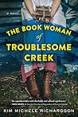

<a href="https://www.goodreads.com/book/show/40914165-the-book-woman-of-troublesome-creek">The Book Woman of Troublesome Creek</a>  by <a href="https://www.goodreads.com/author/show/2063992.Kim_Michele_Richardson">Kim Michele Richardson</a>
  
The Book Woman of Troublesome Creek is a compelling story despite the sad events that unfold. The author's ability to convey the story through the eyes of the protagonist, Cussy Mary Carter, makes it easy to read. The character is resilient, and her determination to deliver books to rural areas despite the challenges she faces is inspiring.  The Book Woman of Troublesome Creek is a work of fiction, but the author, Kim Michele Richardson, drew inspiration from the Pack Horse Library Project, a program that operated in the Appalachian region in the 1930s. The program was part of President Roosevelt's Works Progress Administration, and it aimed to increase literacy rates in rural areas. The book accurately portrays the challenges faced by the women who participated in the program.  The library service played a significant role in the main character's life. Cussy Mary Carter, a "Blue" woman, faced discrimination and isolation from her community. However, her job as a Pack Horse Librarian gave her a sense of purpose and allowed her to connect with people who shared her love for books. The program impacted the region by increasing literacy rates, promoting education, and providing access to resources that were previously unavailable.  Today, rural areas still face challenges when it comes to access to resources. However, initiatives such as mobile libraries and bookmobiles have been introduced to address this issue. These programs are similar to the Pack Horse Library Project and aim to increase literacy rates and promote education in rural areas.  One of the most important aspects of the story is the author's ability to highlight the struggles faced by "Blue" people. The book sheds light on a little-known part of history and educates readers about the discrimination faced by this community. The author also honors the region's history by incorporating local folklore and customs into the story.  The book has several smaller stories happening simultaneously, which adds depth to the plot. Cussy Mary meets various people while delivering books, including a snake-handling preacher, a moonshiner, and an Irish family living in the mountains. These encounters provide insights into the diverse community living in the region.  The rural library program is no longer active, but it impacted many people during its operation. The program employed over 1,000 women and reached approximately 200,000 people. The reading rate of people in the area during the time of the book is unknown, but it is safe to assume that the program contributed to an increase in literacy rates.  If the book were written about today, it would still be relatable. The issues of discrimination, isolation, and access to resources still exist today. While the Blue people are no longer discriminated against, other communities still face discrimination based on their race, ethnicity, or religion.  The Blue people were a real community, and there are no known cases of people with blue skin today. However, there are still cases of genetic conditions that cause skin discoloration.  The signs that said "No colors or blues" were real and were used to discriminate against people with blue skin. The signs were prevalent in the early 1900s but were eventually taken down due to pressure from civil rights activists.  One of the characters compares the main character Cussy Mary Carter's beauty to the "Blue Period" paintings of Pablo Picasso, specifically, the painting of the "Blue Lady." This comparison is significant because it highlights the beauty of a character who is often discriminated against because of her skin color.  The "Blue Period" is a significant period in Picasso's artistic career, during which he primarily used blue tones in his paintings to convey sadness and melancholy. The "Blue Lady" painting, in particular, is a portrait of a woman with a somber expression, emphasizing the sadness and loneliness of the subject.  The comparison of Cussy Mary's beauty to the "Blue Lady" painting implies that her beauty is not just skin deep but also reflects her inner strength and resilience. Despite facing discrimination and isolation, Cussy Mary's determination to deliver books to rural areas and connect with people who share her love for books is inspiring.  This comparison also suggests that beauty can be found in unexpected places, and people should look beyond appearances to appreciate the inner qualities that make a person beautiful.  Overall, the use of the Picasso painting in "The Book Woman of Troublesome Creek" highlights the importance of recognizing and celebrating beauty in all its forms and serves as a reminder of the resilience of the human spirit.  The Book Woman of Troublesome Creek is a powerful story that sheds light on a little-known part of history. The book highlights the importance of access to resources and education and celebrates the resilience of the human spirit.
 
<a href="https://www.goodreads.com/review/list/54140412-gary-crossey">View all my Goodreads reviews</a>

