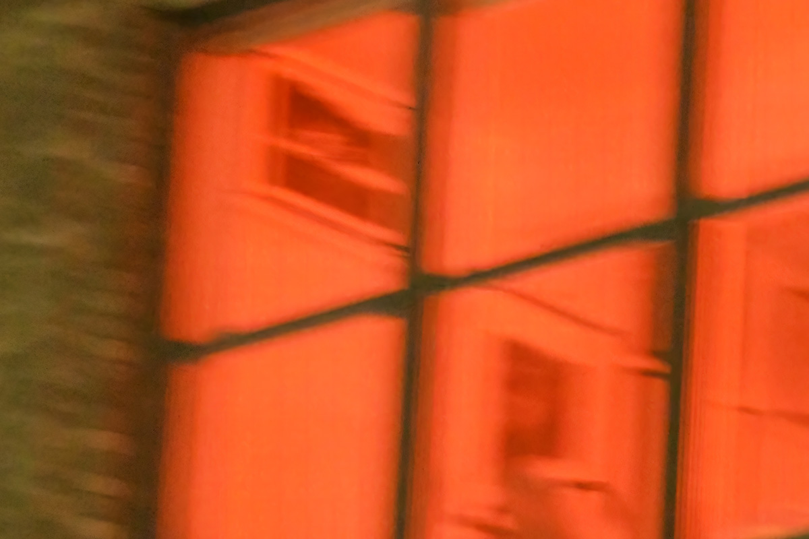
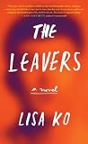

The Leavers

<a href="https://www.goodreads.com/book/show/30753987-the-leavers">The Leavers</a>  by <a href="https://www.goodreads.com/author/show/15053129.Lisa_Ko">Lisa Ko</a> 
The Leavers is one of the most interesting books I have read in quite a while. The story is powerful and has many fascinating aspects to it.  The novel tells the story of Deming Guo, a young boy whose mother, Polly, an undocumented Chinese immigrant, suddenly disappears one day. Deming is then adopted by a white, middle-class American couple and renamed Daniel. The story follows his struggles to adapt to his new life and his search for his mother, which takes him on a journey that spans continents and cultures.  One of the things that makes this book so powerful is the way it explores issues of identity, belonging, and culture. Deming/Daniel's experiences as an immigrant, both in China and the US, are vividly portrayed and provide a nuanced perspective on the immigrant experience.  Another aspect of the book that I found compelling was the way it dealt with issues of family and relationships. The complex web of relationships that Deming/Daniel has with his birth mother, adoptive parents, and various other characters in the book is portrayed with great sensitivity and insight.  Overall, The Leavers is a beautifully written and deeply affecting novel that explores important themes with intelligence and compassion. I would highly recommend it to anyone looking for a thought-provoking and emotionally resonant read.
  
<a href="https://www.goodreads.com/review/list/54140412-gary-crossey">View all my Goodreads reviews</a>

