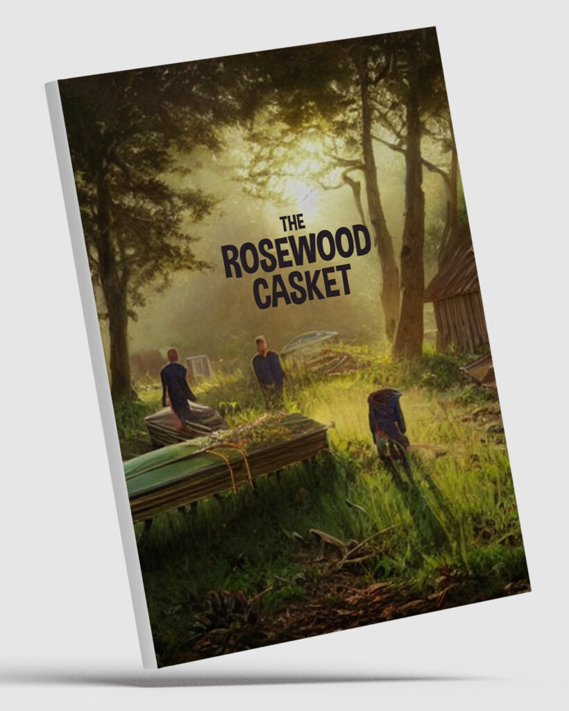

<figure class="wp-block-image size-full"><figcaption class="wp-element-caption">Book Cover created by Gary Crossey</figcaption></figure>

<a href="https://www.goodreads.com/book/show/471519.The_Rosewood_Casket">The Rosewood Casket</a> by <a href="https://www.goodreads.com/author/show/317.Sharyn_McCrumb">Sharyn McCrumb</a>  "The Rosewood Casket" by Sharyn McCrumb is a novel about the Hill family in the Appalachian Mountains of Tennessee. The story revolves around the four Hill brothers building a rosewood casket for their dying father, and the family's secrets and past. While the novel touches on important themes such as forgiveness and familial relationships, it misses the opportunity to delve deeper into the characters' emotions and motivations. The author spends too much time on exposition and long dialogue, making the story slow and long in some parts.  The novel starts by centering around the four Hill brothers: Randy, Kieran, Gervase, and David. Their father, who is dying, asks them to build a casket for him out of rosewood. Although the process of building the casket could have brought the brothers closer together and helped them reconcile with their past, the novel does not explore this theme in depth. Building the casket is a major plot point, but it is not the focus of the story, and the author does not fully develop its potential as a means of character development and family reconciliation. The Hill brothers' journey to build their father's casket could have been a poignant reminder of the importance of coming together in times of hardship.  At times, the dialogue can be hard to follow because it is clunky and goes on for too long. Even though this novel can be a moving story about family and love, it drags on and can be hard to finish. The Rosewood Casket has a lot of descriptions and spends a great deal of time exploring the history of the area.  While the novel touches on the history of the Cherokee Indians in the area, it could have delved deeper into their culture and their relationship to the Hill family's community. The little farms talked about in the first chapter is a reference to the way of life in the Appalachian Mountains, where families often lived off the land and had small farms to sustain themselves - though I do seem to remember a “small people living in the mountains” reference, that didn’t seem to have any relevance.

The little girl's ghost is a recurring presence in the story and is revealed to be the spirit of a child who died in the community years before. Her appearances serve as a reminder of the family's past and the secrets that they keep. The father holds the shame for the death of his sister because he was the last person to see her alive. However, the truth of her death is ultimately revealed to be more complicated. The novel's revelations lacked impact because there were insufficient clues planted earlier in the story.  The scene with the police officer being shot and following surgery is a distraction to the story because it is not directly related to the Hill family's plotline. Similarly, the death of the woman at the end of the book is disappointing because it feels like an unnecessary tragedy that does not add to the overall narrative.

The author includes interesting details on the native and non-native birds and plants. The story of the role of each bird is particularly intriguing. The arrival of the swallow and its impact on the local ecosystem was also noteworthy. The arrival of Bluegrass to the region as a packing material was fascinating, even if it isn’t historically accurate. The broad history of the large trees prior to the arrival of settlers and the impact on the pigeon and other animal populations is also well done. The author does a brilliant job of bringing the reader closer to the native environment but somehow misses the opportunity to bring the reader to any resolution.  Additionally, traditional gender roles are reinforced in the characters, with the men performing manual labor while the women stay home and do domestic work. While this may be true to the rural Tennessee setting, it can be frustrating to read about these outdated societal norms.  "The Rosewood Casket" is often a beautifully written novel that skims the surface of the intricate web that is family. The novel manages to touch on important themes such as forgiveness, redemption, and the complexities of familial relationships, but not to the extent that it could have.    <a href="https://www.goodreads.com/review/list/54140412-gary-crossey">View all my Goodread Reviews</a>

