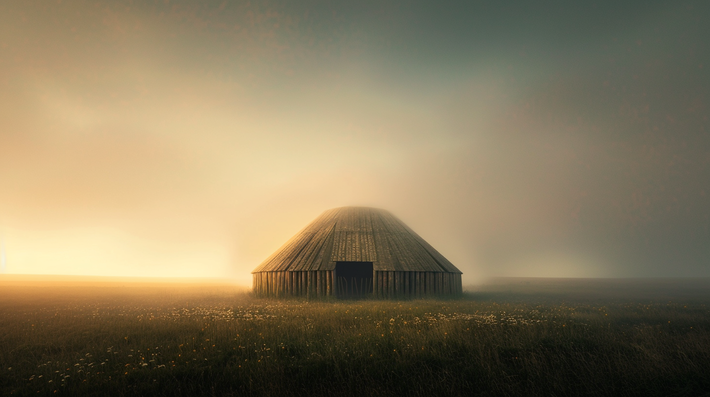

Louise Erdrich's "The Round House" is a masterful exploration of justice, family bonds, and the complex intersection of legal systems affecting Native American communities. As someone deeply interested in how stories shape our understanding of justice and community, this novel resonates particularly strongly with themes I often explore in my writing about social change and cultural understanding.

<figure class="wp-block-video"><video height="720" style="aspect-ratio: 1280 / 720;" width="1280" autoplay controls loop muted src="./images/the-round-house-a-journey-through-justice-identity-and-native-american-rights/round-house.mp4"></video></figure>

<h2 class="wp-block-heading">The Heart of the Story</h2>

At its core, "The Round House" follows 13-year-old Joe Coutts as he navigates the aftermath of a brutal attack on his mother, Geraldine. Through Joe's eyes, we witness not just a personal tragedy, but a community grappling with deep-rooted systemic challenges. As Joe and his father Bazil, a tribal judge, seek justice, they encounter a complex web of legal barriers and jurisdictional conflicts that have long plagued Native American communities.

This isn't simply a coming-of-age story - it's a powerful examination of how personal trauma ripples through families and entire communities. Joe's journey from innocence to understanding mirrors the broader awakening to the systemic injustices that Native Americans face. His quest for justice becomes intertwined with larger questions about tribal sovereignty, cultural identity, and the preservation of traditional ways of life.

The novel's setting on a North Dakota Ojibwe reservation in 1988 is crucial, serving as more than just a backdrop. It highlights the jurisdictional maze that often prevents justice in Native American communities, where overlapping federal, state, and tribal authorities create bureaucratic hurdles that can leave victims without recourse. This setting becomes a powerful metaphor for the broader challenges facing Native communities, where historical policies continue to impact present-day struggles for justice and self-determination.

<figure class="wp-block-image size-large"></figure>

<h2 class="wp-block-heading">Legal Complexities and Cultural Identity</h2>

What struck me most was how Erdrich masterfully interweaves the personal and political dimensions throughout the narrative. Through Joe's father, Bazil Coutts, a tribal judge, we witness firsthand the frustrating limitations and bureaucratic hurdles that tribal courts face. The complex interplay between federal, state, and tribal law creates a challenging legal landscape that often impedes justice rather than facilitating it. This legal labyrinth serves as a powerful metaphor for the broader challenges facing Native American communities, resonating deeply with contemporary discussions about sovereignty and justice.

The novel's exploration of these jurisdictional complexities reveals how seemingly abstract legal frameworks have profound personal impacts. When a crime occurs on reservation land, the question of jurisdiction becomes paramount - determining whether tribal, federal, or state authorities have the power to investigate and prosecute. This isn't merely a technical legal issue; it's a matter of real consequences for families and communities seeking justice. Through Bazil's professional expertise and personal anguish, we see how these jurisdictional gaps can leave victims without recourse and perpetrators unpunished.

The story particularly illuminates the Major Crimes Act and its lasting impact on tribal sovereignty. This federal law, which removes certain serious crimes from tribal jurisdiction, creates a complicated web of authority that can actually hinder the pursuit of justice. When violent crimes occur on tribal lands, the overlapping and sometimes conflicting jurisdictions can lead to delays, confusion, and ultimately, failure to prosecute. Through Joe's family's experience, we see how these legal constraints don't just affect court proceedings - they shape the very fabric of daily life on the reservation.

Beyond the immediate story, this legal complexity reflects historical patterns of diminished tribal sovereignty. The limitation of tribal courts' authority over non-Native perpetrators, even when crimes occur on tribal lands, exemplifies the ongoing challenges to Native American self-governance. These restrictions stem from a long history of federal policies that have systematically undermined tribal authority, creating a justice system that often fails to protect Native American communities effectively.

This intersection of personal trauma and systemic injustice becomes even more poignant as we follow Joe's family's quest for justice. Their struggle highlights how legal frameworks designed to "protect" Native American interests often do the opposite, creating barriers rather than pathways to justice. This theme continues to resonate strongly with contemporary discussions about tribal sovereignty, jurisdictional reform, and the ongoing fight for Native American rights and self-determination.

<h2 class="wp-block-heading">The Power of Community and Tradition</h2>

The importance of community bonds and traditional knowledge runs deep throughout the Ojibwe culture portrayed in the novel. The intricate web of relationships between Joe, his family, local elders, and tribal members demonstrates how Native communities maintain their resilience through collective support and shared wisdom. When tragedy strikes, this network activates - friends and relatives step forward to help the family cope, sharing not just practical support but also cultural teachings and spiritual guidance. The round house itself stands as more than just a building - it represents a sacred gathering place where ceremonies strengthen community ties and pass down ancestral knowledge. Through these bonds, we see how Native communities have preserved their identity and values despite tremendous historical challenges.

This resilience manifests in many ways: through oral traditions that keep historical memory alive, through ceremonial practices that maintain spiritual connections, and through everyday acts of mutual support that sustain the community. Even as Joe and his family face their personal crisis, they draw strength from these deep communal roots and cultural foundations. The round house embodies this intersection of past and present - a physical structure that houses both ancient traditions and contemporary tribal life, making it a powerful symbol of cultural continuity and collective strength.

Modern challenges have not diminished these bonds; if anything, they've highlighted their vital importance. Whether facing legal obstacles, social pressures, or personal traumas, community members rely on their shared heritage and interconnected relationships to persevere. This network of support, built on generations of shared experience and cultural knowledge, proves essential for both individual healing and communal survival.

<figure class="wp-block-image size-full"></figure>

<h2 class="wp-block-heading">Contemporary Relevance</h2>

Reading this in 2025, the themes feel more relevant than ever. The novel's exploration of violence against Native American women, jurisdictional conflicts, and the struggle for justice continues to reflect current headlines. Recent statistics show that Native American women face disproportionately high rates of violence, with some studies indicating they are ten times more likely to experience violence than other demographic groups. The jurisdictional maze that complicated justice in 1988 remains largely unchanged, creating barriers for tribal authorities seeking to prosecute crimes on reservation lands.

The novel's portrayal of these systemic challenges has gained renewed attention as tribal nations continue advocating for expanded jurisdiction and enforcement powers. The 2013 reauthorization of the Violence Against Women Act (VAWA) and its subsequent updates have made some progress in addressing these issues, but significant gaps remain. Many tribal courts still face limitations in prosecuting non-Native perpetrators, echoing the frustrations faced by Joe's father, a tribal judge, in the novel.

The book's examination of cultural identity and preservation resonates strongly with contemporary movements for Indigenous rights and sovereignty. As Native communities work to maintain their traditions while navigating modern challenges, the round house's symbolic significance as a place of both spiritual practice and cultural resistance takes on new meaning. Recent efforts to protect sacred sites and preserve traditional practices mirror the novel's emphasis on the importance of cultural spaces and ceremonies.

Environmental justice, another theme touched upon in the novel, has become increasingly urgent. Many reservations continue to face threats from resource extraction, pipeline projects, and climate change impacts. These challenges echo the novel's broader exploration of how external forces can threaten tribal lands and ways of life. The intersection of environmental and social justice issues highlights how the struggles depicted in the novel remain deeply relevant to contemporary Native American experiences.

The intergenerational trauma portrayed in the novel also connects strongly with current discussions about historical justice and reconciliation. As more institutions and governments acknowledge past wrongs against Native communities, the novel's depiction of how historical injustices continue to shape present-day experiences provides important context for these conversations. Recent initiatives to address missing and murdered Indigenous women, investigate boarding school histories, and protect Native American cultural rights demonstrate how the issues Erdrich explored in 1988 continue to demand attention and action.

While some progress has been made in addressing these challenges, the novel's central themes of justice, sovereignty, and cultural resilience remain pressing concerns. Modern readers will recognize how the bureaucratic obstacles, jurisdictional conflicts, and systemic biases that complicate Joe's quest for justice continue to affect Native communities today. It's a sobering reminder that while the story is set in 1988, many of the fundamental challenges it explores still await meaningful resolution.

<h2 class="wp-block-heading">A Personal Response</h2>

What makes "The Round House" particularly compelling is how it refuses to offer easy answers. Like other books I've reviewed such as "<a href="https://betterworldwithdesign.com/a-peoples-history-of-the-united-states/">A People's History of the United States</a>" and "<a href="https://betterworldwithdesign.com/automating-inequality-how-high-tech-tools-profile-police-and-punish-the-poor/">Automating Inequality</a>," it grapples with systemic injustice and the complex interplay between law, society, and marginalized communities. As someone who writes extensively about social justice and community building, I appreciate how Erdrich, like authors Virginia Eubanks and Howard Zinn, shows that progress often requires confronting uncomfortable truths about our systems and institutions.

The novel's exploration of tribal sovereignty and justice resonates strongly with themes I've explored in my reviews of "<a href="https://betterworldwithdesign.com/design-justice-community-led-practices-to-build-the-worlds-we-need/">Design Justice</a>" and "<a href="https://betterworldwithdesign.com/race-after-technology-abolitionist-tools-for-the-new-jim-code/">Race After Technology</a>," particularly in how it examines the ways institutional systems can perpetuate inequality. Just as Ruha Benjamin discusses how technology can embed racial bias, Erdrich masterfully illustrates how legal frameworks can systematically disadvantage Native communities.

Similar to "<a href="https://betterworldwithdesign.com/the-book-woman-of-troublesome-creek/">The Book Woman of Troublesome Creek</a>" and "<a href="https://betterworldwithdesign.com/we-always-lived-in-the-castle/">We Have Always Lived in the Castle</a>," which I've previously reviewed, "The Round House" uses a powerful personal narrative to illuminate broader societal issues. The story challenges readers to consider their own role in perpetuating or challenging systemic injustices, much like how "Automating Inequality" forced us to examine our relationship with technological systems of control.

Through my experience reviewing books that examine social justice themes, from "<a href="https://betterworldwithdesign.com/killer-high-a-history-of-war-in-six-drugs-by-peter-andreas/">Killer High</a>" to "<a href="https://betterworldwithdesign.com/the-leavers-by-lisa-ko/">The Leavers</a>," I've found that the most impactful works are those that, like "The Round House," weave together personal stories with systemic analysis. This novel stands alongside these works in its ability to make complex legal and social issues accessible through compelling narrative.

<h2 class="wp-block-heading">20 Book Club Discussion Questions</h2>

<ol class="wp-block-list">
<li>How does Joe's journey from innocence to understanding mirror broader societal awakening to injustice?</li>

<li>What role does the round house play as both a physical location and a symbolic space in the novel?</li>

<li>How does Erdrich use the relationship between Joe and his father to explore different approaches to seeking justice?</li>

<li>Discuss the significance of storytelling and oral tradition in the novel. How do stories serve as both comfort and guidance?</li>

<li>How does the novel portray the tension between traditional tribal law and the American legal system?</li>

<li>What role do Joe's friends play in his journey? How does their friendship reflect broader community values?</li>

<li>How does Geraldine's trauma affect not just her family but the entire community?</li>

<li>Discuss the significance of the novel's 1988 setting. How do the issues raised remain relevant today?</li>

<li>How does the novel address the intersection of gender and racial justice?</li>

<li>What role does spirituality play in the characters' understanding of justice and healing?</li>

<li>How does Joe's mother's profession as a tribal enrollment specialist add layers to the novel's exploration of identity?</li>

<li>Discuss the significance of place and geography in the novel. How does the reservation setting shape the story?</li>

<li>How does the novel explore different forms of justice - legal, moral, traditional?</li>

<li>What role do women play in preserving and transmitting cultural knowledge in the novel?</li>

<li>How does the novel address the impact of historical trauma on contemporary Native American communities?</li>

<li>Discuss the significance of names and naming in the novel. How do they reflect identity and belonging?</li>

<li>How does the novel challenge or confirm your understanding of tribal sovereignty?</li>

<li>What role does memory play in both personal and cultural survival?</li>

<li>How does the novel address the balance between individual and community needs?</li>

<li>What message does the novel convey about the relationship between justice and healing?</li>
</ol>
