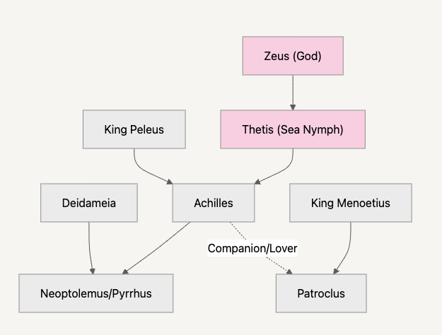
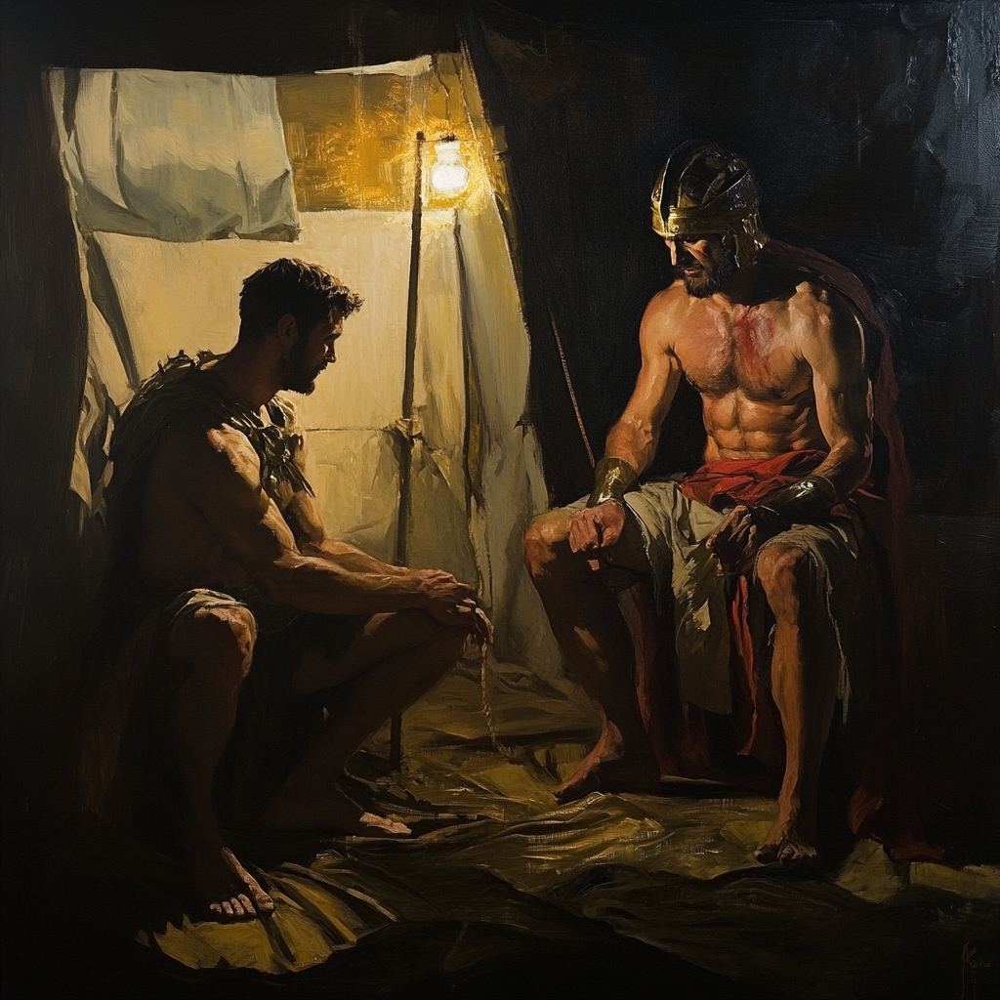
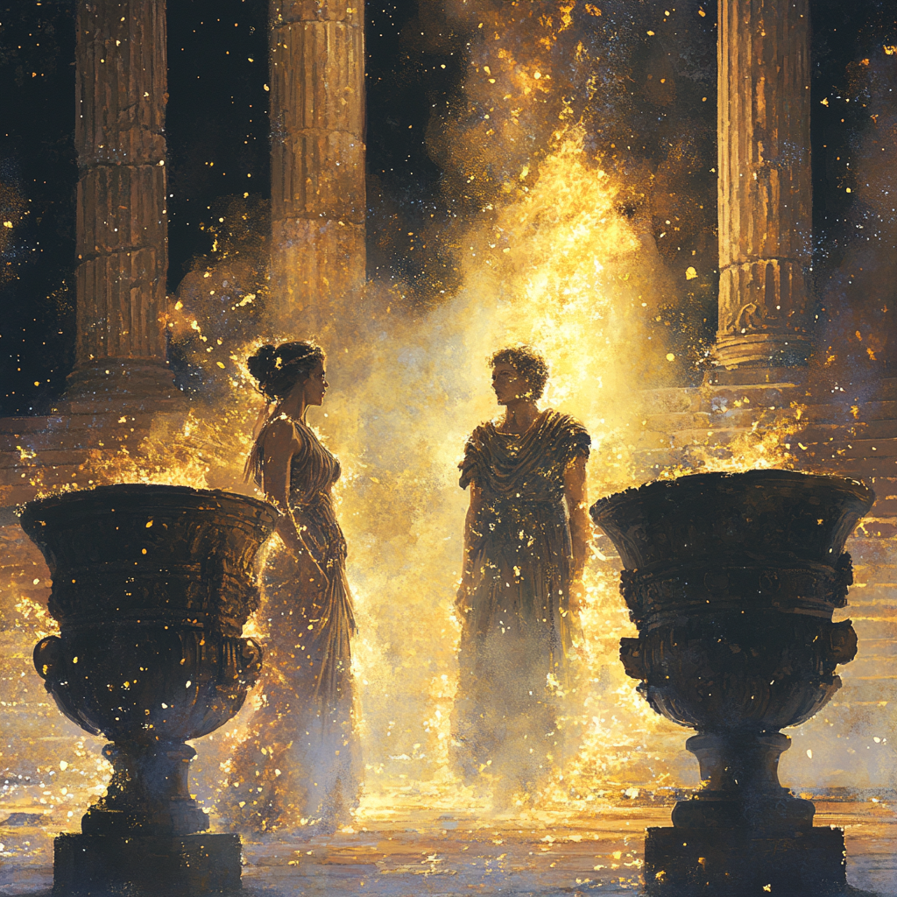

<h2>The Song of Achilles — A Love That Outlives War<!-- notionvc: 38a0410e-6f7e-475e-b7a9-3d33fd7b3c5a --></h2>

Discover Madeline Miller's lyrical retelling of the Trojan War through Patroclus's eyes—a story of fate, friendship, and a love that transcends death.<!-- notionvc: 2871e952-3530-4fba-ab6c-fe304480bec2 -->

<h2>Iliad vs. The Song of Achilles — What's Different?</h2>

<strong>C</strong>ompare Homer's epic with Miller's intimate reimagining. See how scope, perspective, and themes shift from battlefield glory to personal truth.

View the Comparison Table →

<h2><!-- notionvc: 7b80ddae-df5a-4d0f-b442-ac09243a6eec --></h2>

<!-- notionvc: 16832797-d3b9-4ae0-a645-5946e7b6213e -->

<h2>Test Your Knowledge<!-- notionvc: 0b7fb2ff-52ba-41d5-8c68-52683fb89978 --></h2>

Take the Thetis's Prophecy quiz and see how well you know the story.

Take the Quiz →

<!-- notionvc: a4e3f723-37ff-471e-a1fe-b7e06490de95 -->

<h2>Character Guide</h2>

Meet Achilles, Patroclus, Thetis, and the cast who bring this epic to life.<!-- notionvc: 8baf49a6-6368-463c-a4cf-0c70406bf89c -->

Explore Characters →

<h2 class="wp-block-heading has-large-font-size">A Reader's Journey with The Song of Achilles</h2>

Characters, Relationships, and Modern Relevance

As I delved into this modern retelling of an ancient tale, I joined countless readers online who grapple with similar questions about this interesting narrative. The first half of the book captivated me with its intimate portrayal of young friendship blossoming into love, and the last quarter left me emotionally transformed - as it has many others, judging by the online discourse.

One of my major challenges was keeping track of the sequence of conflicts:

<ul>
<li>The initial political tensions between Greek kingdoms</li>
<li>The conflict over Helen's abduction</li>
<li>gathering of forces at Aulis</li>
<li>The early years of the Trojan War</li>
<li>The final year's devastating events</li>
</ul>

Like many readers, I found myself questioning Achilles' emotional landscape. His moodiness and periods of withdrawal suggest what we might today recognize as depression, particularly after significant losses and during the weight of prophecy bearing down on him. Was this legendary warrior actually struggling with the burden of expectations, destiny, and the conflict between divine heritage and human emotion?

<!-- wp:paragraph -->

The question of whether this is truly a tragic tale or a love story that transcends death continues to spark debate. While the ending is undeniably heartbreaking, the final scene suggests an eternal reunion. Are readers simply trying to soften the blow by imagining a happily-ever-after in the underworld, or is this interpretation crucial to understanding the story's deeper meaning about love's endurance beyond death?

<h2>Character Guide</h2>

Meet Achilles, Patroclus, Thetis, and the cast who bring this epic to life.<!-- notionvc: 8baf49a6-6368-463c-a4cf-0c70406bf89c -->

Explore Characters →

 

<h2 class="wp-block-heading has-text-align-left has-white-color has-text-color" style="font-size: 100px; font-style: normal; font-weight: bold; letter-spacing: 0px; line-height: 1; text-transform: uppercase;"></h2>

<h2>KEY Characters</h2>
<h2><!-- notionvc: 0b7fb2ff-52ba-41d5-8c68-52683fb89978 --></h2>

UPDATING

Take the Quiz →

<!-- notionvc: a4e3f723-37ff-471e-a1fe-b7e06490de95 -->

<h2>KEY Relationships</h2>
<h2><!-- notionvc: 0b7fb2ff-52ba-41d5-8c68-52683fb89978 --></h2>

UPDATING

Take the Quiz →

<!-- notionvc: a4e3f723-37ff-471e-a1fe-b7e06490de95 -->

<h2 class="wp-block-heading">Main Characters</h2>

<strong>Achilles</strong>: The legendary warrior, son of Thetis and King Peleus, known for his extraordinary fighting abilities and his deep bond with Patroclus.<!-- /wp:paragraph --><!-- /wp:column -->

<!-- wp:column -->

<!-- wp:paragraph --><strong>Patroclus</strong>: Exiled prince who becomes Achilles' closest companion and lover.

<!-- /wp:columns -->

<!-- wp:columns -->

<!-- wp:column -->

<!-- wp:paragraph --><strong>Thetis</strong>: sea nymph goddess and Achilles' mother, who tries to protect her son from his fate.<!-- /wp:paragraph --><!-- wp:column -->

<!-- /wp:column -->

<!-- wp:paragraph --><strong>Chiron</strong>: the wise centaur who mentors both Achilles and Patroclus.

<h2 class="wp-block-heading has-large-font-size">Divine Characters</h2>

<h2>Royal Family Members</h2>

<strong>King Peleus</strong>: Mortal king of Phthia and Achilles' father.<!-- /wp:paragraph -->

<!-- /wp:column -->

<!-- wp:column -->

<strong>Neoptolemus (Pyrrhus)</strong>: Achilles' son, who later becomes known for his brutality.

<h2>Trojan War Leaders</h2>

King Priam with Achilles in his tent.

<strong>Agamemnon</strong>: Leader of the Greek forces during the Trojan War.

<strong>King Priam</strong>: King of Troy, father of Hector and Paris.

<strong>Paris</strong>: Trojan prince whose actions sparked the Trojan War by taking Helen.

<strong>Odysseus</strong>: a clever Greek warrior and king who attempts to honor Patroclus' memory.

<h2>KEY Relationships</h2>
<h2><!-- notionvc: 0b7fb2ff-52ba-41d5-8c68-52683fb89978 --></h2>

UPDATING

Take the Quiz →

<!-- notionvc: a4e3f723-37ff-471e-a1fe-b7e06490de95 -->

<strong>Achilles &amp; Patroclus:</strong> Central relationship of the story - from childhood friends to lifelong companions

<strong>Achilles &amp; Patroclus:</strong> Central relationship of the story - from childhood friends to lifelong companions

<strong>Achilles &amp; Patroclus:</strong> Central relationship of the story - from childhood friends to lifelong companions

<h2>Women in the Story</h2>

UPDATING

Penelope: Odysseus's wife, mentioned in his plea to Paris

Panthesilea: Amazon warrior queen killed by Achilles

Deidameia: Princess of Scyros who bore Achilles' son Neoptolemus

Thetis: sea nymph goddess, Achilles' mother

Briseis: war captive claimed by Achilles, later taken by Agamemnon

The Three Fates: Divine women who prophesied about Achilles' destiny

Helen: Of Sparta, whose beauty launched the Trojan War

<h2> Additional Characters Mentioned</h2>

Additional Characters Mentioned

<strong>Hector</strong>: Trojan warrior and prince, killed by Achilles

<strong>Memnon</strong>: Warrior killed by Achilles in battle

<!-- /wp:list-item -->

<!-- wp:list-item -->

<!-- /wp:list-item -->

<!-- wp:list-item -->

<strong>Panthesilea</strong>: Amazon warrior encountered by Achilles

<!-- /wp:list-item -->

<!-- wp:list-item -->

<!-- /wp:list-item -->

<!-- wp:list-item -->

<!-- /wp:list-item -->

<!-- wp:list-item -->

<!-- /wp:list-item -->

<!-- wp:list-item -->

<strong>Helen</strong>: Of Sparta, whose abduction by Paris sparked the Trojan War

<strong>King Menoetius</strong>: Father of Patroclus

<strong>Briseis</strong>: Captive taken by Achilles during the war

<strong>Zeus</strong>: King of the gods, mentioned in relation to Thetis

<!-- /wp:list-item -->

<!-- wp:list-item -->

&nbsp;

<strong>Poseidon</strong>: God of the sea, also involved in Thetis's story

<!-- /wp:list-item -->

<!-- wp:list-item -->

<strong>Agamemnon's son</strong>: Who killed Pyrrhus

<!-- /wp:list-item -->

<!-- wp:list-item -->

<strong>The Three Old Women</strong>: Who spoke the prophecy about Achilles

<h2>Patroclus's Family Background</h2>

While Patroclus came from royal lineage, his exile and subsequent fostering by King Peleus became a crucial turning point in his life and in the story.

Adoption: After his exile, Patroclus was taken in by King Peleus and raised alongside Achilles in Phthia

Exile: Patroclus was exiled from his homeland after accidentally killing another noble's son during a game

King Menoetius: Patroclus's father, ruler of Opus

<h2 class="wp-block-heading has-large-font-size"><strong>Is The Song of Achilles LGBTQ?</strong></h2>

Yes, The Song of Achilles is considered LGBTQ literature as it centers on the romantic relationship between two male characters, Achilles and Patroclus. Author Madeline Miller deliberately chose to portray their relationship as explicitly romantic and intimate, building upon interpretations of their bond that date back to ancient times.

<!-- /wp:paragraph -->

<!-- wp:paragraph -->

The nature of Achilles and Patroclus's relationship has been debated throughout history. While Homer's Iliad depicts them as extremely close companions, ancient Greek texts and commentaries often interpreted their relationship as romantic love. Notable classical writers like Plato, in his Symposium, referenced their relationship as romantic, and Aeschylus explicitly portrayed them as lovers in his lost play The Myrmidons.

<!-- /wp:paragraph -->

<!-- wp:paragraph -->

Miller's interpretation in The Song of Achilles follows this romantic tradition, presenting their relationship as a deep love story that develops from childhood friendship to adult romance. The novel explores their relationship with sensitivity and depth, focusing on emotional intimacy, mutual understanding, and unwavering devotion.

<!-- /wp:paragraph -->

<!-- wp:paragraph -->

The book's LGBTQ themes are handled naturally within the context of ancient Greek culture, where same-sex relationships were viewed differently than in modern times. Miller portrays their relationship without anachronistic elements, while still making it accessible and meaningful to contemporary readers. The story doesn't treat their same-sex relationship as taboo or problematic; instead, any conflict stems from Achilles's divine destiny and the prophecies surrounding his fate.

The novel has become particularly significant in LGBTQ literature for several reasons:

<ul>
<li>It presents a same-sex relationship as the central love story rather than a subplot</li>
<li>It treats the relationship with dignity and depth, avoiding stereotypes or sensationalism</li>
<li>It connects modern LGBTQ readers with classical literature and mythology</li>
<li>It demonstrates how queer narratives have always been part of human storytelling</li>
</ul>

The book has found particular resonance among LGBTQ readers who appreciate seeing a complex, tender love story between two men that doesn't shy away from emotional depth while still remaining true to its historical context. Miller's approach has helped make classical literature more accessible and relevant to contemporary LGBTQ audiences while also highlighting how same-sex love has been part of human storytelling for thousands of years.

<!-- /wp:paragraph -->

<!-- wp:paragraph -->

The success of The Song of Achilles as LGBTQ literature lies in how it balances historical context with emotional authenticity, creating a narrative that speaks to modern readers while honoring its classical roots. The novel demonstrates how LGBTQ themes can be explored in historical and classical settings without feeling forced or anachronistic.

<h3>Is The Song of Achilles spicy?</h3>

The Song of Achilles contains some intimate scenes and romantic content between the main characters, though they are written with literary sensitivity rather than explicit detail. While there are some passionate moments, they are generally handled tastefully and serve the story's emotional development rather than being gratuitous. The book focuses more on the deep emotional bond between the characters than on the physical aspects of their relationship.

<h3>Is The Song of Achilles appropriate for a 14 year old?</h3>

The Song of Achilles is generally considered appropriate for mature teenagers (14+). While it contains some mature themes including violence and romantic relationships, these are handled tastefully and within historical context. Parents should be aware that the book includes battle scenes, some intimate moments (though not explicitly detailed), and discussions of death and war.

<h3>Is The Song of Achilles based on The Iliad?</h3>

Yes, The Song of Achilles is based on Homer's Iliad, but it expands significantly beyond the original epic poem. While The Iliad primarily focuses on a few weeks during the Trojan War, The Song of Achilles tells a broader story, beginning with Patroclus and Achilles' childhood and continuing through the events of The Iliad.

Is The Song of Achilles appropriate for a 14 year old?

The Song of Achilles is generally considered appropriate for mature teenagers (14+). While it contains some mature themes including violence and romantic relationships, these are handled tastefully and within historical context. Parents should be aware that the book includes battle scenes, some intimate moments (though not explicitly detailed), and discussions of death and war.

&nbsp;

<!-- /wp:paragraph -->

<!-- wp:paragraph -->

<!-- /wp:paragraph -->

<!-- wp:list -->

<ul class="wp-block-list">
<ul class="wp-block-list"><!-- wp:list-item --></ul>
</ul>

<!-- /wp:list-item -->

<!-- /wp:list -->

<!-- wp:paragraph -->

&nbsp;

&nbsp;

<!-- /wp:paragraph -->

<!-- wp:paragraph -->

<!-- /wp:paragraph -->

<!-- wp:paragraph -->

<!-- /wp:paragraph -->

<!-- wp:image {"id":4961,"sizeSlug":"full","linkDestination":"none"} -->

<!-- /wp:image -->

<!-- wp:paragraph -->

<!-- /wp:paragraph -->

<!-- wp:heading {"level":3,"fontSize":"large"} -->

<!-- /wp:heading -->

<!-- wp:paragraph -->

<!-- /wp:paragraph -->

<!-- wp:heading {"level":3,"fontSize":"large"} -->

<!-- /wp:paragraph -->

<!-- wp:paragraph {"fontSize":"large"} -->

&nbsp;

<!-- /wp:paragraph -->

<!-- wp:paragraph {"fontSize":"large"} -->

<!-- /wp:paragraph -->

<!-- wp:paragraph -->

&nbsp;

<!-- /wp:paragraph -->

<!-- wp:paragraph -->

Key differences from The Iliad include:

<!-- /wp:paragraph -->

<!-- wp:list -->

<ul class="wp-block-list">
<ul class="wp-block-list">
<ul class="wp-block-list"><!-- wp:list-item --></ul>
<li>The novel is narrated from Patroclus's perspective rather than using The Iliad's third-person narrative</li>
<li>It provides extensive background on the characters' early lives and relationship development</li>
<li>The story incorporates elements from other ancient Greek sources beyond The Iliad</li>
<li>It expands on characters and relationships that receive less attention in Homer's work</li>
<ul class="wp-block-list"></ul>
</ul>
</ul>

While Miller stays faithful to the major events and outcomes of The Iliad, she reimagines the story through a more intimate lens, focusing on the personal relationships and emotional journeys of the characters rather than the epic's emphasis on warfare and divine intervention.

<!-- /wp:paragraph -->

<!-- wp:paragraph {"fontSize":"large"} -->

<strong>Why is The Song of Achilles so popular?</strong>

<!-- /wp:paragraph -->

<!-- wp:paragraph -->

The Song of Achilles has achieved remarkable popularity for several key reasons:

<!-- /wp:paragraph -->

<!-- wp:list -->

<ul class="wp-block-list">
<ul class="wp-block-list"><!-- wp:list-item -->

<li><strong>Accessible retelling of classics:</strong> Miller makes ancient Greek mythology accessible to modern readers while maintaining the story's epic scope and emotional depth.</li>
</ul>
</ul>

<!-- /wp:list-item -->

<!-- wp:list-item -->

<ul class="wp-block-list">
<ul class="wp-block-list">
<li><strong>Beautiful prose:</strong> The novel is celebrated for its lyrical writing style and poetic language that captures both tender moments and tragic events with equal grace.</li>
</ul>
</ul>

<!-- /wp:list-item -->

<!-- wp:list-item -->

<ul class="wp-block-list">
<ul class="wp-block-list">
<li><strong>Universal themes:</strong> The story explores timeless themes like love, destiny, loyalty, and sacrifice that resonate deeply with readers across different backgrounds and ages.</li>
</ul>
</ul>

<!-- /wp:list-item -->

<!-- wp:list-item -->

<ul class="wp-block-list">
<ul class="wp-block-list">
<li><strong>Character development:</strong> The novel provides rich psychological depth to mythological figures, making them feel deeply human and relatable to modern readers.</li>
</ul>
</ul>

<!-- /wp:list-item -->

<!-- wp:list-item -->

<ul class="wp-block-list">
<ul class="wp-block-list">
<li><strong>Social media influence:</strong> The book gained significant popularity through platforms like TikTok and Instagram, where readers enthusiastically shared their emotional responses to the story.</li>
</ul>
</ul>

<!-- /wp:list-item -->

<!-- /wp:list -->

<!-- wp:paragraph -->

The novel's success also stems from its unique narrative approach:

<!-- /wp:paragraph -->

<!-- wp:list -->

<ul class="wp-block-list">
<ul class="wp-block-list"><!-- wp:list-item -->

<li><strong>Fresh perspective:</strong> By telling the story through Patroclus's eyes, Miller offers a fresh take on a well-known myth, providing intimate insights into the characters' motivations and emotions.</li>
</ul>
</ul>

<!-- /wp:list-item -->

<!-- wp:list-item -->

<ul class="wp-block-list">
<ul class="wp-block-list">
<li><strong>Love story focus:</strong> While maintaining historical accuracy, the book prioritizes the love story between Achilles and Patroclus, appealing to readers who appreciate character-driven narratives.</li>
</ul>
</ul>

<!-- /wp:list-item -->

<!-- wp:list-item -->

<ul class="wp-block-list">
<ul class="wp-block-list">
<li><strong>Emotional impact:</strong> The novel's ability to create deep emotional investment in its characters, leading to a powerful and moving conclusion, has generated strong word-of-mouth recommendations.</li>
</ul>
</ul>

<!-- /wp:list-item -->

<!-- /wp:list -->

<!-- wp:paragraph -->

Additionally, the book's timing and cultural relevance have contributed to its popularity:

<!-- /wp:paragraph -->

<!-- wp:list -->

<ul class="wp-block-list">
<ul class="wp-block-list"><!-- wp:list-item -->

<li><strong>LGBTQ+ representation:</strong> The novel's sensitive and dignified portrayal of a same-sex relationship in classical literature has resonated with many readers seeking diverse perspectives in historical fiction.</li>
</ul>
</ul>

<!-- /wp:list-item -->

<!-- wp:list-item -->

<ul class="wp-block-list">
<ul class="wp-block-list">
<li><strong>Cultural moment:</strong> The book's themes of identity, love, and acceptance align with contemporary social discussions, making it particularly relevant to modern audiences.</li>
</ul>
</ul>

<!-- /wp:list-item -->

<!-- /wp:list -->

<!-- wp:paragraph {"fontSize":"large"} -->

<strong>Was Achilles actually shot in the heel?</strong>

<!-- /wp:paragraph -->

<!-- wp:paragraph -->

According to mythology, Achilles was not actually shot in the heel - he was struck by an arrow in his heel. According to the most common version of the myth, Paris shot Achilles in his vulnerable heel with an arrow guided by the god Apollo.

<!-- /wp:paragraph -->

<!-- wp:paragraph -->

The story of Achilles' heel vulnerability comes from the legend that when he was born, his mother Thetis dipped him in the River Styx to make him invulnerable. However, she held him by his heel, which didn't touch the water, leaving that spot as his only weak point. This is where we get the phrase "Achilles' heel" to describe a person's weak spot despite overall strength.

<!-- /wp:paragraph -->

<!-- wp:paragraph -->

Interestingly, this particular detail about his heel vulnerability doesn't appear in Homer's Iliad. The story of Achilles' heel and his death by Paris's arrow emerged in later Greek and Roman myths, particularly in Ovid's Metamorphoses. In the Iliad, while Achilles' death is prophesied, the specific method isn't described in detail.

<!-- /wp:paragraph -->

<!-- wp:paragraph -->

The myth of Achilles' death highlights important themes about fate and hubris - even the greatest warrior had a weakness, and despite his near-invulnerability, he was still mortal and subject to the will of the gods. Paris, considered a lesser warrior, was able to defeat him through divine intervention, demonstrating that even the mightiest heroes could fall.

<!-- /wp:paragraph -->

<!-- wp:paragraph {"fontSize":"large"} -->

<strong>Who is Achilles girlfriend?</strong>

<!-- /wp:paragraph -->

<!-- wp:paragraph -->

In The Song of Achilles, Achilles does not have a girlfriend in the traditional sense. His primary romantic relationship is with Patroclus. While he does have a brief relationship with Princess Deidameia during his time on Skyros (which results in the birth of his son Neoptolemus), this is not portrayed as a love match but rather a relationship of circumstance while he was hiding from the war.

<!-- /wp:paragraph -->

<!-- wp:paragraph -->

In the original Greek mythology, Achilles has several romantic associations, including:

<!-- /wp:paragraph -->

<!-- wp:list -->

<ul class="wp-block-list">
<ul class="wp-block-list"><!-- wp:list-item -->

<li><strong>Deidameia:</strong> The princess of Skyros who becomes the mother of his son</li>
</ul>
</ul>

<!-- /wp:list-item -->

<!-- wp:list-item -->

<ul class="wp-block-list">
<ul class="wp-block-list">
<li><strong>Briseis:</strong> A war prize captured during the Trojan War, though their relationship is more complex and varies depending on the source material</li>
</ul>
</ul>

<!-- /wp:list-item -->

<!-- wp:list-item -->

<ul class="wp-block-list">
<ul class="wp-block-list">
<li><strong>Patroclus:</strong> While ancient sources vary in their explicit description of their relationship, many classical writers interpreted their bond as romantic, a view that The Song of Achilles fully embraces</li>
</ul>
</ul>

<!-- /wp:list-item -->

<!-- /wp:list -->

<!-- wp:paragraph {"fontSize":"large"} -->

<strong>How old are Achilles and Patroclus in The Song of Achilles?</strong>

<!-- /wp:paragraph -->

<!-- wp:paragraph -->

In The Song of Achilles, Patroclus and Achilles first meet when they are young boys around 8-9 years old. The story follows them through their childhood, adolescence, and into early adulthood. When they join the Trojan War, they are young men in their late teens or early twenties. The exact ages aren't always explicitly stated, but their relationship develops over approximately a decade before the events of the Trojan War.<!-- /wp:paragraph -->

<!-- wp:paragraph {"fontSize":"large"} -->

<strong>Are Achilles and Patroclus lovers in Song of Achilles?</strong><!-- /wp:paragraph -->

<!-- wp:paragraph -->

Yes, in The Song of Achilles, Achilles and Patroclus are explicitly portrayed as lovers. Their relationship develops from childhood friendship into a deep romantic and physical partnership. The novel presents their love story as the central narrative, depicting their relationship with tenderness and emotional depth. While they begin as close friends during their youth, their bond gradually evolves into romantic love during their teenage years, particularly during their time training with Chiron. Their relationship continues to deepen throughout the story, becoming one of profound devotion that ultimately shapes both characters' destinies.<!-- /wp:paragraph -->

<!-- wp:paragraph -->

The novel stays true to interpretations from ancient Greek literature that viewed their relationship as romantic, while developing their love story in a way that resonates with modern readers. Their bond is portrayed as both emotional and physical, though intimate scenes are handled with restraint and literary sensitivity.<!-- /wp:paragraph -->

<!-- wp:paragraph -->

One of the most poignant moments regarding their relationship comes at the end of the novel, after both Achilles and Patroclus have died. Achilles' son, Pyrrhus (also known as Neoptolemus), arrives at Troy and initially refuses to bury Patroclus's ashes with Achilles', not understanding their significance to each other. It is Thetis, Achilles' divine mother, who ultimately reveals the depth of their relationship to Pyrrhus.<!-- /wp:paragraph -->

<!-- wp:paragraph -->

Despite her initial disapproval of Patroclus during their lives, Thetis comes to recognize and honor the profound love between her son and Patroclus. In a moving scene, she tells Pyrrhus about their relationship and convinces him to allow their ashes to be mixed together. This moment is particularly significant because Thetis, who had once seen Patroclus as unworthy of her son, is the one who ensures their eternal union.

<!-- /wp:paragraph -->

<!-- wp:paragraph -->

The novel ends with Patroclus's spirit finally being able to join Achilles in the underworld after their ashes are combined, symbolizing their eternal reunion. This conclusion reinforces the central theme that their love transcends death itself. The fact that Thetis, a goddess who had opposed their relationship in life, becomes the advocate for their love in death adds a powerful layer of recognition and acceptance to their story.<!-- /wp:paragraph -->

<!-- wp:paragraph {"fontSize":"large"} -->

<strong>What is the target audience of The Song of Achilles?</strong>

<!-- /wp:paragraph -->

<!-- wp:paragraph -->

The Song of Achilles is primarily targeted at:

<!-- /wp:paragraph -->

<!-- wp:list -->

<ul class="wp-block-list">
<ul class="wp-block-list"><!-- wp:list-item -->

<li><strong>Young Adult and Adult readers:</strong> While marketed as adult fiction, it appeals strongly to mature young adult readers (16+)</li>
</ul>
</ul>

<!-- /wp:list-item -->

<!-- wp:list-item -->

<ul class="wp-block-list">
<ul class="wp-block-list">
<li><strong>Lovers of mythology:</strong> Readers interested in Greek mythology and classical retellings</li>
</ul>
</ul>

<!-- /wp:list-item -->

<!-- wp:list-item -->

<ul class="wp-block-list">
<ul class="wp-block-list">
<li><strong>Literary fiction readers:</strong> Those who appreciate character-driven narratives and lyrical prose</li>
</ul>
</ul>

<!-- /wp:list-item -->

<!-- wp:list-item -->

<ul class="wp-block-list">
<ul class="wp-block-list">
<li><strong>LGBTQ+ readers:</strong> People seeking well-crafted queer representation in historical/mythological contexts</li>
</ul>
</ul>

<!-- wp:paragraph -->

While the book contains mature themes and some violence, it's written in an accessible style that makes it suitable for most readers who can handle emotional complexity and moderate adult content. The novel bridges the gap between young adult and adult literature, making it appealing to a broad age range of mature readers.<!-- /wp:paragraph -->

<!-- wp:paragraph {"fontSize":"large"} -->

<strong>Why is it called The Song of Achilles?</strong><!-- /wp:paragraph -->

<!-- wp:paragraph -->

The title "The Song of Achilles" references several aspects of the novel:<!-- /wp:paragraph -->

<!-- wp:list -->

<ul class="wp-block-list">
<ul class="wp-block-list"><!-- wp:list-item -->

<li><strong>Classical tradition:</strong> It evokes the tradition of epic poetry, like The Iliad, where heroes' stories were sung by bards</li>
</ul>
</ul>

<!-- wp:list-item -->

<ul class="wp-block-list">
<ul class="wp-block-list">
<li><strong>Narrative perspective:</strong> The novel serves as Patroclus's "song" about Achilles, telling the hero's story through the eyes of the one who loved him most</li>
</ul>
</ul>

<!-- wp:list-item -->

<ul class="wp-block-list">
<ul class="wp-block-list">
<li><strong>Poetic style:</strong> The lyrical, flowing prose style of the novel resembles a song in its beauty and rhythm</li>
<li></li>
<li>The title also carries a touch of irony, as this "song" is not the traditional glorification of Achilles's martial prowess, but rather an intimate portrait that reveals his humanity through his relationship with Patroclus.</li>
</ul>
</ul>

<!-- /wp:paragraph -->

<!-- wp:separator {"className":"is-style-wide"} -->

&nbsp;

<h2 class="wp-block-heading">A Modern Reimagining: Achilles and Patroclus in Today's World</h2>

Imagining Achilles and Patroclus in contemporary society offers fascinating parallels and contrasts. In today's world, they might meet at an elite private school where Achilles is the star athlete with Olympic potential, while Patroclus is a scholarship student with dreams of becoming a doctor. Their relationship would face different challenges - not prophecies and gods, but perhaps social media pressure, family expectations, and career aspirations.

<!-- /wp:paragraph -->

<!-- wp:paragraph -->

Achilles might be struggling with the intense pressure of being a child prodigy, his Instagram filled with sponsorship deals and millions of followers, while dealing with a helicopter parent (Thetis as a high-powered CEO or influential politician). Patroclus could be the grounding force, perhaps running a medical nonprofit for underprivileged communities, his empathy and care for others remaining his defining characteristic.

<!-- /wp:paragraph -->

<!-- wp:paragraph -->

Their love story might unfold through text messages and late-night FaceTime calls when they're at different universities. Instead of a war over Helen, perhaps they're separated by professional obligations - Achilles competing in international championships while Patroclus works with Doctors Without Borders. The fatal conflict might arise not from a literal war, but from a moral choice: Achilles having to choose between breaking a world record and standing up for an ethical cause Patroclus believes in.

<!-- /wp:paragraph -->

<!-- wp:paragraph -->

The modern equivalent of Achilles' choice to pursue glory might be the decision between maintaining a carefully curated public image and living authentically with Patroclus. Their story would likely become a trending topic, with supporters and critics debating their relationship on social media platforms. Thetis might try to manage Achilles' public image through PR firms rather than divine intervention.

The tragedy might unfold not on a battlefield but in the aftermath of a public protest or humanitarian crisis where Patroclus puts himself in danger to help others, leading to Achilles' subsequent actions being captured by viral videos and news headlines. Their story would raise questions about celebrity culture, authentic identity, and the price of fame - themes that resonate with both ancient and modern audiences.

<!-- /wp:paragraph -->

<!-- wp:paragraph -->

The core of their relationship - the tender friendship that grows into profound love - would remain unchanged, though expressed through modern means. They might share spotify playlists instead of lyre lessons, send each other memes alongside heartfelt declarations, and face the challenges of maintaining privacy in a world where everything is documented and shared.

<!-- /wp:paragraph -->

<!-- wp:paragraph -->

In the end, their modern story would still be about choosing between personal happiness and societal expectations, about the courage to be true to oneself, and about love that defies conventional norms. The fundamental questions about fate, choice, and the power of love would remain just as relevant in today's context as they were in ancient Greece.

