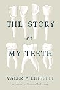

<figure class="wp-block-image size-full"><figcaption class="wp-element-caption">Digital Art Animation by Gary Crossey</figcaption></figure>

<a href="https://www.goodreads.com/book/show/24796231-the-story-of-my-teeth">The Story of My Teeth</a> by <a href="https://www.goodreads.com/author/show/4405738.Valeria_Luiselli">Valeria Luiselli</a> 
The Story of My Teeth novel by Valeria Luiselli that tells the story of Gustavo 'Highway' Sánchez Sánchez, an auctioneer who believes that he can sell anything by giving it a new story. Throughout the book, Highway sets out to sell his own teeth, claiming that they once belonged to famous people such as Plato and Virginia Woolf.  The point of this book is to challenge the traditional notion of storytelling and to explore the power of narrative. Highway's ability to sell anything by attaching a story to it demonstrates the importance of storytelling in our lives. The book also touches on themes such as identity, culture, and the value of objects.  There is a hidden message in the text that encourages the reader to question the authenticity of stories and to consider the role of the storyteller in shaping our understanding of the world. The book also challenges the idea of truth and suggests that it is subjective and malleable.  The translation of the book is considered to be good. The translator, Christina MacSweeney, has been praised for capturing the playful and experimental nature of Luiselli's writing.  After reading this book, the reader should expect to have a deeper understanding of the power of storytelling and the ways in which it can shape our perceptions of the world. The book also encourages readers to question the authenticity of stories and to consider the role of the storyteller in shaping our understanding of reality.  If the reader were to read the book a second time, they should pay attention to the key story elements such as the use of language, the role of objects, and the development of Highway's character. They should also pay attention to the various literary techniques such as repetition, humor, and irony that Luiselli uses to convey her message.  The Story of My Teeth is a fascinating and thought-provoking book that challenges our traditional notions of storytelling and encourages us to think critically about the stories that we tell ourselves.
  
<a href="https://www.goodreads.com/review/list/54140412-gary-crossey">View all my Goodreads reviews</a>

<h2 class="has-text-align-center wp-block-heading">The Story of My Teeth</h2>

