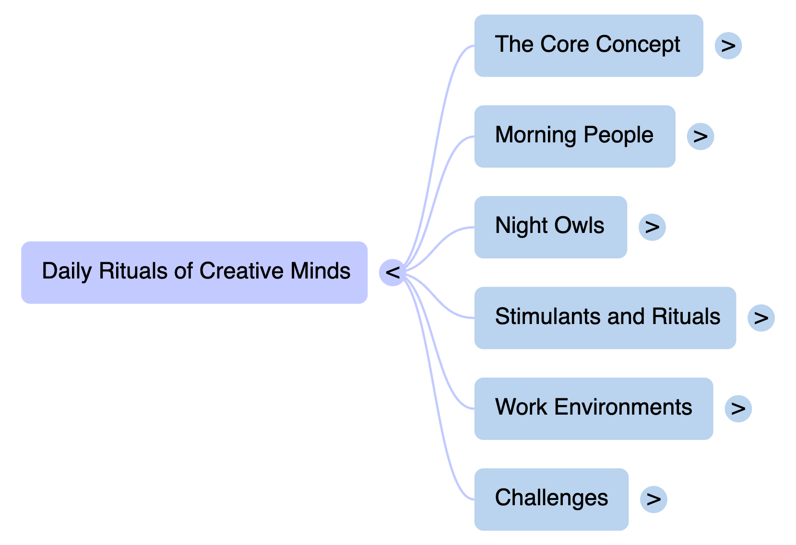
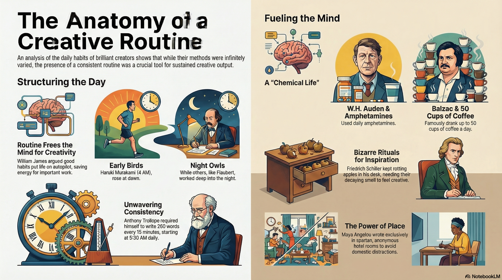
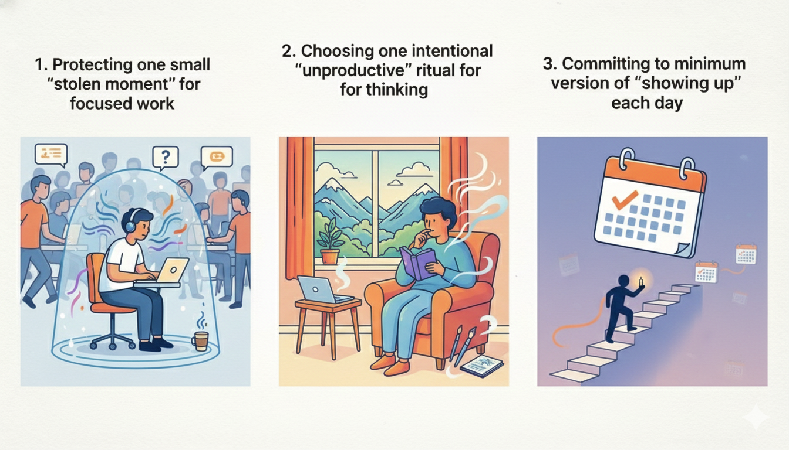
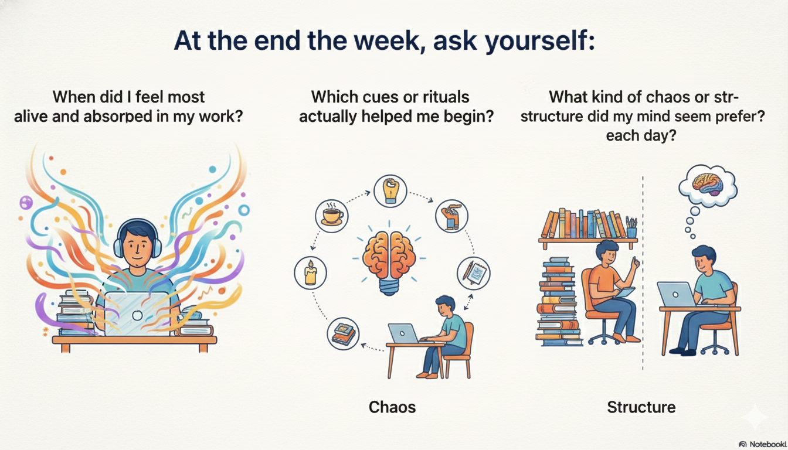

<figure class="wp-block-image size-large"></figure>

<h3 class="wp-block-heading"><strong>Book Review: Mason Currey's Daily Rituals</strong></h3>

This article draws heavily from Mason Currey's fascinating 2013 book <em>Daily Rituals: How Artists Work</em>, a meticulously researched collection of the daily routines of over 160 writers, composers, painters, choreographers, playwrights, poets, philosophers, scientists, and mathematicians.

Currey's project began modestly—as a form of procrastination. One Sunday afternoon in July 2007, facing a looming deadline but unable to focus, he found himself researching other writers' working schedules online instead of writing his own article. What started as a way to feel better about his own inconvenient predilection for morning work (and afternoon uselessness) became the Daily Routines blog, and eventually this book.

The book's genius lies in its format: brief, digestible portraits that let the subjects speak for themselves through quotes from letters, diaries, and interviews. Currey doesn't mythologize or moralize. He simply presents the facts: when they woke, what they ate, how they worked, what strange rituals they performed, what substances they consumed, and how they protected their creative time.

What emerges is both inspiring and liberating. As Currey notes in his introduction, the book inevitably deals with questions he struggles with in his own life: <em>How do you do meaningful creative work while also earning a living? Is it better to devote yourself wholly to a project, or to set aside a small portion of each day? Are comfort and creativity incompatible, or is finding a basic level of daily comfort a prerequisite for sustained creative work?</em>

The answer, it turns out, is that there is no single answer. For every cheerfully industrious figure who worked nonstop (as V.S. Pritchett observed of the "great men" he wrote about), there is a Franz Kafka or William James—great minds who wasted time, procrastinated, and were racked by doubt. Most fall somewhere in the middle: committed to daily work but never entirely confident, always wary of the one off day that undoes the streak.

Currey's book serves as proof that the obsession with finding the "perfect routine" is misguided. Instead, what matters is discovering the specific conditions under which <em>your</em> best work quietly, consistently happens—even if those conditions look absolutely bizarre from the outside.

This article adapts Currey's research into a practical framework, distilling the most counter-intuitive insights into actionable principles. If you're intrigued by these stories, <em>Daily Rituals</em> is essential reading—a reminder that brilliant work emerges not from perfection, but from deeply personal, often strange, fiercely protected daily practices.

<h3 class="wp-block-heading"><strong>The Myth of the Perfect Routine</strong></h3>

In the modern quest for productivity, we’re bombarded with the idea of a perfect routine. We chase the 5 a.m. Miracle Morning, the time‑blocked calendar, and the zero‑inbox lifestyle, often feeling inadequate when our messy reality doesn’t match the ideal. But what if the secret to brilliant work is not found in a flawless schedule? What if instead, it lies in embracing our own strange and personal rhythms?

An exploration into the daily lives of history’s greatest minds reveals a surprising truth: their paths to creativity were often chaotic, bizarre, and deeply unconventional. This article distills the most counter‑intuitive takeaways from their habits into a playbook of actionable insights.

The psychologist William James once argued for forming good habits so that we can “free our minds to advance to really interesting fields of action.” Ironically, James himself was a chronic procrastinator who could never stick to a regular schedule. His struggle highlights a central theme: the most effective routine is the one that works for you, no matter how odd it may seem.

<figure class="wp-block-embed is-type-video is-provider-youtube wp-block-embed-youtube wp-embed-aspect-16-9 wp-has-aspect-ratio">

<iframe loading="lazy" title="📚 The Unconventional Playbook: Creative Habits of the World&#039;s Most Brilliant Minds" width="1080" height="608" src="https://www.youtube.com/embed/3AJKS-QMX9k?feature=oembed"  allow="accelerometer; autoplay; clipboard-write; encrypted-media; gyroscope; picture-in-picture; web-share" referrerpolicy="strict-origin-when-cross-origin" allowfullscreen></iframe>

</figure>

<h3 class="wp-block-heading"><strong>1. Some of the most disciplined minds thrived on chaos</strong></h3>

It’s a common belief that creative discipline requires a life of meticulous order. Yet for some of the greatest artists, immense inner focus coexisted with staggering external chaos.

The painter Francis Bacon is a prime example. His studio was legendary for its disorder, with paint smeared on the walls and a “knee‑deep morass” of brushes, papers, and detritus piled on the floor. His life outside the studio was a whirlwind of hedonistic excess, filled with multiple rich meals, tremendous quantities of alcohol, and late‑night partying that would exhaust his contemporaries.

And yet, despite this disarray, Bacon was “essentially a creature of habit.” His work always came first. No matter how late he had been out the night before, he woke at first light and worked for several hours. He did not just tolerate the side effects of his lifestyle; he harnessed them.

“I often like working with a hangover,” he said, “because my mind is bubbling with energy and I can think very clearly.”

Bacon’s routine suggests that profound creative discipline is not always contingent on a tidy, conventional life. True focus is an internal state, not necessarily an external one.

<h3 class="wp-block-heading"><strong>2. Creativity Requires Strange (and Sometimes Unhealthy) Fuel</strong></h3>

Many creative geniuses relied on bizarre rituals and stimulants to access the right mindset for work. Their triggers were deeply personal and often defied logical explanation.

The novelist Patricia Highsmith, author of <em>The Talented Mr. Ripley</em>, had an unusually intense connection with animals, particularly snails, which she bred at home. She eventually housed 300 of them in her garden and once arrived at a London cocktail party with a handbag containing a head of lettuce and 100 snails, her companions for the evening. When she later moved to France, she smuggled her beloved mollusks across the border by hiding them six to ten at a time “under each breast.” She also had a habit of taking a stiff drink before writing, not to get revved up, but specifically “to reduce her energy levels,” which she felt veered toward the manic.

Other creative triggers were even stranger. The German playwright Friedrich Schiller famously kept a drawer full of rotting apples in his workroom because he needed their decaying smell to feel the urge to write. And the novelist Honoré de Balzac fueled his brutal 1 a.m. to 4 p.m. work cycle with an extreme coffee habit—by one estimate, he drank as many as 50 cups a day.

These habits reveal creative triggers are not just personal but often primal and subconscious. They resist any simple formula or attempt at logical replication.

<figure class="wp-block-image alignfull size-full"></figure>

<h3 class="wp-block-heading"><strong>3. The Best Work Is Often Done in stolen moments</strong></h3>

For many great minds who lacked the luxury of a private study and uninterrupted time, creativity had to happen in the margins of a busy life. They learned to work amidst the noise and demands of their daily obligations.

Franz Kafka, who balanced writing with a deadening day job, captured this tension:

“Time is short; my strength is limited. The office is a horror. The apartment is noisy, and if a pleasant, straightforward life is not possible, then one must try to wriggle by subtle maneuvers.”

Jane Austen is a classic example of this principle. She wrote her masterpieces in the family sitting room, “subject to all kinds of casual interruptions.” She developed a subtle method for protecting her work, writing on small sheets of paper that could be quickly hidden away. Crucially, Austen was “careful that her occupation should not be suspected by servants or visitors,” as writing novels was not considered a respectable or serious pursuit for a woman of her social standing.

Her famous use of a creaking swing door was more than an early‑warning system for approaching visitors. It was a tool of quiet defiance, allowing her to preserve her vital creative life in the face of societal constraints.

Similarly, T.S. Eliot did some of his most important work, including drawing on scenes for <em>The Waste Land</em>, while employed as a clerk at Lloyd’s Bank in London, joining the crowd crossing London Bridge each morning.

These examples demonstrate that constraints do not always hinder creativity; sometimes, the need to steal moments for our work can make that time more focused and precious.

<h3 class="wp-block-heading"><strong>4. Inspiration Is for Amateurs; The Greats Just Show Up</strong></h3>

The romantic notion of the artist waiting patiently for the muse to strike is one of the most persistent myths of creativity. The reality for many of history’s greats was far more blue‑collar. They treated their work as a job, showing up to a schedule regardless of how they felt.

The artist Chuck Close put it most bluntly:

“Inspiration is for amateurs… The rest of us just show up and get to work.”

This professional mindset was shared by many. The composer George Gershwin dismissed the idea of waiting for inspiration, saying that if he did, he “would compose at most three songs a year.” He believed that, like a pugilist, a songwriter “must always keep in training.”

The poet W.H. Auden was obsessively punctual and lived by an “exacting timetable,” believing this military precision was essential to his creativity. For him, a solid routine was the very structure upon which genius could be built. “The surest way to discipline passion is to discipline time,” he observed.

This approach demystifies the creative process. It transforms it from a magical, unreliable event into a consistent practice. The greats did not have a special hotline to inspiration; they had the discipline to show up, day after day, and do the work.

<h3 class="wp-block-heading"><strong>5. Your “Unproductive” Time Might Be Your Most Creative</strong></h3>

Some of the most essential creative work happens when we are not “working” at all. Activities that seem like distractions or procrastination were, for many historical figures, vital parts of their process.

The Danish philosopher Søren Kierkegaard had his best ideas during his long walks through Copenhagen. He would sometimes get so excited by a thought that he would rush home and, without even removing his hat or setting down his umbrella, begin writing while still standing at his desk. For him, the physical act of walking was inseparable from the mental act of philosophizing.

Others found their breakthroughs in different routines. Filmmaker Woody Allen takes “extra showers” to stimulate “a fresh burst of mental energy” and solve story problems. When he hits an impasse, he goes upstairs and stands under the steaming hot water for 30 or 40 minutes, just thinking. The legendary choreographer George Balanchine claimed, “When I’m ironing, that’s when I do most of my work.”

These habits show the power of allowing the mind to wander. By engaging in simple, physical, or routine tasks, we can allow our subconscious to make connections that focused, deliberate effort cannot. Our “unproductive” time is often where the real breakthroughs occur.

<h3 class="wp-block-heading"><strong>6. The Unconventional Playbook: Design Your Own "Weird" Routine</strong></h3>

You do not need to adopt anyone else’s rituals wholesale (and you probably should not copy the 50 coffees a day). Instead, you can reverse‑engineer the deeper principles behind these stories and apply them to your own life in small, grounded ways.

Here is a practical playbook to start designing your own unconventional routine:

<ol class="wp-block-list">
<li><strong>Track your real rhythm, not your ideal one.</strong> For one week, notice when you naturally feel most alert, restless, calm, or reflective. Instead of forcing a 5 a.m. Miracle Morning, ask: <em>When does my brain actually want to do deep work, and when does it want to wander?</em></li>

<li><strong>Protect one “stolen moment” block.</strong> Choose a 20–40 minute slice of time you can reclaim most days—on a commute, during a lunch break, in the quiet before others wake up. Treat it like Jane Austen’s small pages: portable, interruptible, but sacred.</li>

<li><strong>Identify a harmless “strange fuel” that gets you started.</strong> It might be a specific song, a particular beverage, a candle, a walk around the block, or even a particular chair. The content of the ritual matters less than its reliability as a cue: <em>when this happens, I begin.</em></li>

<li><strong>Design intentional “unproductive” rituals.</strong> Instead of doom‑scrolling when stuck, choose a low‑stakes, physical activity that invites wandering thoughts: a walk, a shower, ironing, washing dishes. Go into it with a quiet assignment: <em>hold this question lightly in the back of your mind.</em></li>

<li><strong>Set a minimum viable showing‑up rule.</strong> Borrow from Chuck Close and Gershwin: define a version of “showing up” that you can do even on bad days. Ten minutes at the desk. One paragraph. One sketch. One small move that keeps the creative muscle “in training.”</li>

<li><strong>Make peace with your aesthetic of chaos (or order).</strong> If you work best in a tidy, minimalist space, honor that. If your desk looks like Francis Bacon’s studio and you still produce great work, maybe your chaos is not a problem to be solved but an environment your brain knows how to navigate.</li>
</ol>

You are not trying to win in productivity aesthetics. You are trying to discover the specific conditions under which your best work quietly, consistently happens.

<h3 class="wp-block-heading"><strong>Embrace Your Own Process</strong></h3>

If there is one lesson to be learned from the bizarre habits of great minds, it is this: there is no single “correct” way to be creative and productive. A successful routine can be rigid or chaotic, fueled by coffee or quiet walks, performed at the crack of dawn or in the dead of night. The only rule is that it must work for you.

Their stories free us from the pressure to conform to a single, idealized model of productivity. Instead of searching for the perfect routine to copy, the more interesting move is to treat your life as a series of experiments.

<figure class="wp-block-image size-large"></figure>

<h4 class="wp-block-heading">For the next seven days, you might try:</h4>

<ul class="wp-block-list">
<li>Protecting one small “stolen moment” for focused work.</li>

<li>Choosing one intentional “unproductive” ritual for thinking.</li>

<li>Committing to a minimum viable version of “showing up” each day.</li>
</ul>

<figure class="wp-block-image size-full"></figure>

<h4 class="wp-block-heading">At the end of the week, ask yourself:</h4>

<ul class="wp-block-list">
<li><em>When did I feel most alive and absorbed in my work?</em></li>

<li><em>Which cues or rituals actually helped me begin?</em></li>

<li><em>What kind of chaos or structure did my mind seem to prefer?</em></li>
</ul>

The goal is not to assemble a perfect routine, but to notice the contours of your own. The most productive thing you may do is give yourself permission to discover, and trust, a process that looks a little strange from the outside—yet quietly works for you.

