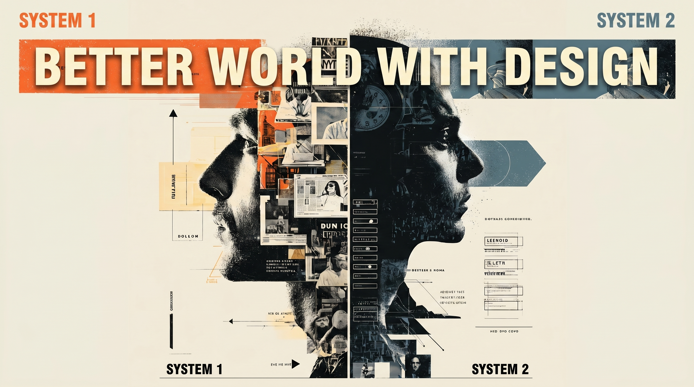

<!-- wp:image {"id":7511,"sizeSlug":"large","linkDestination":"none"} -->

<figure class="wp-block-image size-large"></figure>

<!-- /wp:image -->

<!-- wp:html --> 
<iframe loading="lazy" width="100%" height="180" frameborder="no" scrolling="no" seamless="" src="https://share.transistor.fm/e/f706bdff"></iframe> 
<!-- /wp:html -->

<!-- wp:paragraph -->

I used to believe my judgments were mostly mine. Not perfect, but mine. I assumed that if I slowed down, looked at the facts, and tried to be fair, I would land somewhere near reasonable.

<!-- /wp:paragraph -->

<!-- wp:paragraph -->

Thinking, Fast and Slow doesn’t exactly argue with that. It just shows you, calmly and repeatedly, that your mind is doing something else a lot of the time. It isn’t telling you that you’re irrational in random ways. It’s telling you that you’re predictably irrational, in repeatable ways. The mistakes have patterns. And once you see the patterns, you start noticing them everywhere: in meetings, in relationships, in the way you read the news, in the way you interpret your own memories.

<!-- /wp:paragraph -->

<!-- wp:paragraph -->

And the weird part is that none of this feels like it’s happening. It feels like you’re just thinking. It feels like you’re just being you.

<!-- /wp:paragraph -->

<!-- wp:paragraph -->

So today I want to walk through why this book lands so hard, and why it matters if you care about making decisions, building systems, designing experiences, or just trying to be a slightly less self-deceived person.

<!-- /wp:paragraph -->

<!-- wp:paragraph -->

Here’s where we’re going. First, I want to explain the book’s central frame: the two modes of thinking, the one that moves fast and the one that moves slow. Second, we’ll walk through a handful of demonstrations and examples that make the point stick in your body, not just your head. And third, we’ll talk about what all of this means in real life, because the book isn’t just theory. It’s a warning label. A design manual. A vocabulary upgrade. And maybe, if you take it seriously, a kind of quiet intervention.

<!-- /wp:paragraph -->

<!-- wp:paragraph -->

Let’s start with the core idea: two systems.

<!-- /wp:paragraph -->

<!-- wp:paragraph -->

The book uses the metaphor of two agents in your mind. One is fast and automatic. The other is slow and effortful. The fast one is constantly running. The slow one shows up when it has to, and it often doesn’t want to.

<!-- /wp:paragraph -->

<!-- wp:heading -->

<h2 class="wp-block-heading">Quick take (for busy readers)</h2>

<!-- /wp:heading -->

<!-- wp:paragraph -->

If you remember one thing: Thinking, Fast and Slow argues that we run on fast intuition most of the time, and that “slow thinking” is limited and easily depleted. That’s why predictable biases show up in judgment, media attention, and even high-stakes institutional decisions.

<!-- /wp:paragraph -->

<!-- wp:heading -->

<h2 class="wp-block-heading">Key terms you’ll hear in this review</h2>

<!-- /wp:heading -->

<!-- wp:list -->

<ul class="wp-block-list"><!-- wp:list-item -->

<li><strong>System 1:</strong> fast, automatic, intuitive</li>

<!-- /wp:list-item -->

<!-- wp:list-item -->

<li><strong>System 2:</strong> slow, effortful, deliberate</li>

<!-- /wp:list-item -->

<!-- wp:list-item -->

<li><strong>Availability heuristic:</strong> what’s easiest to recall feels most common/important</li>

<!-- /wp:list-item -->

<!-- wp:list-item -->

<li><strong>Base-rate neglect:</strong> stereotypes beat statistics unless you slow down</li>

<!-- /wp:list-item -->

<!-- wp:list-item -->

<li><strong>Inattentional blindness:</strong> attention is a spotlight, not a floodlight</li>

<!-- /wp:list-item --></ul>

<!-- /wp:list -->

<!-- wp:heading -->

<h2 class="wp-block-heading">System 1: The Fast, Automatic Storyteller</h2>

<!-- /wp:heading -->

<!-- wp:paragraph -->

System 1 is automatic. It operates quickly, with little or no effort, and no sense of voluntary control. It recognizes faces, completes patterns, jumps to conclusions, forms impressions, fills in gaps, generates feelings that feel like truth. It is your storyteller and your pattern matcher.

<!-- /wp:paragraph -->

<!-- wp:heading -->

<h2 class="wp-block-heading">System 2: The Slow, Effortful Editor</h2>

<!-- /wp:heading -->

<!-- wp:paragraph -->

System 2 allocates attention to effortful mental activities. It can do complex computations. It can follow rules. It can check logic. It can question the story System 1 is telling. But System 2 is limited. It gets tired. It gets distracted. And it’s often lazy in the way a busy person is lazy, not in a moral way, but in a resource-limited way.

<!-- /wp:paragraph -->

<!-- wp:paragraph -->

One line from the book that really matters here is this: “System one operates automatically and quickly with little or no effort, and no sense of voluntary control. System 2 allocates attention to the effortful mental activities that demand it.”

<!-- /wp:paragraph -->

<!-- wp:paragraph -->

That’s the whole premise. And it’s easy to nod along with that premise, because you’ve experienced it. You’ve experienced times where you instantly knew something, and you’ve experienced times where you had to grind through thinking, step by step.

<!-- /wp:paragraph -->

<!-- wp:paragraph -->

But the point of the book is not just that you have two speeds. The point is that the fast speed is doing far more than you think. And the slow speed is doing far less than you believe.

<!-- /wp:paragraph -->

<!-- wp:paragraph -->

In other words, we identify ourselves with the slow thinker. We believe the part of us that reasons, chooses, decides what to think about, and decides what to do, is the real hero. But the book keeps insisting that the automatic System 1 is the secret author of many of the choices and judgments you make. System 2 often comes in afterward to rationalize the result, not to generate it.

<!-- /wp:paragraph -->

<!-- wp:paragraph -->

This is why the book can feel offensive. It challenges your sense of authorship. It challenges the idea that your beliefs are formed by deliberate reasoning. It suggests that a lot of what you call judgment is pattern matching that arrives as certainty.

<!-- /wp:paragraph -->

<!-- wp:paragraph -->

And the author’s stated goal, early on, is worth noticing too. The book frames this in a very human way. It says the author wants to enrich the vocabulary people use when they talk about judgments and choices. It compares this to medical diagnosis: you need labels, patterns, names. The book says, “We’ll make systematic errors are known as biases, and they recur predictably.”

<!-- /wp:paragraph -->

<!-- wp:paragraph -->

That phrase “recur predictably” is the entire project. The book is trying to give you labels for recurring errors, so you can recognize them. Not only in others, but eventually in yourself.

<!-- /wp:paragraph -->

<!-- wp:paragraph -->

Now, if this stayed in the realm of concepts, it would be interesting. But the reason it works is that it keeps dragging you into examples.

<!-- /wp:paragraph -->

<!-- wp:paragraph -->

So let’s get into the demonstrations. The moments where you realize you’re not just hearing an argument; you’re watching your own mind do the thing.

<!-- /wp:paragraph -->

<!-- wp:heading -->

<h2 class="wp-block-heading">Example 1: Base rates vs stereotypes (the “Steve” problem)</h2>

<!-- /wp:heading -->

<!-- wp:paragraph -->

First example: the Steve question.

<!-- /wp:paragraph -->

<!-- wp:paragraph -->

I’ll be honest: I fall for this kind of thing all the time. If someone “looks like” an expert, or “sounds like” they know what they’re doing, my brain wants to trust the vibe before it checks the math.

<!-- /wp:paragraph -->

<!-- wp:paragraph -->

In the book, there’s a description of a person named Steve. Steve is shy and withdrawn, helpful, orderly, detail oriented. And you’re asked: is Steve more likely to be a librarian or a farmer?

<!-- /wp:paragraph -->

<!-- wp:paragraph -->

Almost everyone feels the pull toward librarian. It fits the stereotype. It feels right. It’s coherent.

<!-- /wp:paragraph -->

<!-- wp:paragraph -->

But then a statistical fact is introduced. The book asks, “Did it occur to you that there are more than 20 male farmers for each male library in the United States?”

<!-- /wp:paragraph -->

<!-- wp:paragraph -->

That base rate matters. And in a world where we were purely rational statisticians, it would matter a lot. You’d think: even if Steve seems like a librarian, farmers are far more common, so probability should lean farmer.

<!-- /wp:paragraph -->

<!-- wp:paragraph -->

But the book says participants ignore the relevant statistical facts and rely exclusively on resemblance. They use resemblance as a simplifying heuristic, a rule of thumb, and that reliance produces predictable biases.

<!-- /wp:paragraph -->

<!-- wp:paragraph -->

That example is doing multiple jobs at once.

<!-- /wp:paragraph -->

<!-- wp:paragraph -->

It shows you System 1 at work. System 1 matches Steve to a stereotype and generates an answer with a feeling of rightness.

<!-- /wp:paragraph -->

<!-- wp:paragraph -->

It shows you what System 2 is supposed to do. It’s supposed to integrate statistics and probability.

<!-- /wp:paragraph -->

<!-- wp:paragraph -->

And it shows you what System 2 often fails to do. It doesn’t intervene strongly enough to override the intuitive answer.

<!-- /wp:paragraph -->

<!-- wp:paragraph -->

This isn’t about being foolish. It’s about being human. Even when we know base rates exist, even when we can understand the math, the stereotype is fast, vivid, and emotionally coherent. The statistical correction is slow, abstract, and effortful.

<!-- /wp:paragraph -->

<!-- wp:paragraph -->

This is the first big lesson the book teaches: your mind prefers a good story over a true one.

<!-- /wp:paragraph -->

<!-- wp:paragraph -->

Now, the next example reinforces that preference in a different way: the availability heuristic.

<!-- /wp:paragraph -->

<!-- wp:heading -->

<h2 class="wp-block-heading">Example 2: The availability heuristic (why your brain mistakes recall for truth)</h2>

<!-- /wp:heading -->

<!-- wp:paragraph -->

The book describes how people judge frequency and importance by how easily examples come to mind. It gives a simple demonstration. Consider the letter K. Is K more likely to appear as the first letter in a word, or as the third letter?

<!-- /wp:paragraph -->

<!-- wp:paragraph -->

This is one of those ideas that made me notice my own “mental feed.” If I’ve been reading the same topic all week, it starts to feel like the whole world is about that topic—like my brain has confused what’s on my screen with what’s actually common.

<!-- /wp:paragraph -->

<!-- wp:paragraph -->

What matters here is not the correct answer. What matters is the substitution your mind makes without telling you.

<!-- /wp:paragraph -->

<!-- wp:paragraph -->

It’s much easier to come up with words that begin with K than to come up with words where K is the third letter. So K feels like it must be more common at the beginning.

<!-- /wp:paragraph -->

<!-- wp:paragraph -->

The book says, “As any Scrabble player knows, it is much easier to come up with words that begin with a particular letter than to find words that have the same letter in the third position.”

<!-- /wp:paragraph -->

<!-- wp:paragraph -->

That ease becomes evidence. You answer “Which is more frequent?” by answering “Which is easier to think of examples for?” And you rarely notice you’ve done the substitution.

<!-- /wp:paragraph -->

<!-- wp:paragraph -->

This becomes much bigger than a word puzzle when the book moves into media and public attention.

<!-- /wp:paragraph -->

<!-- wp:paragraph -->

It says people assess the relative importance of issues by the ease with which they are retrieved from memory, and that this is largely determined by media coverage. It gives a vivid cultural example: after a celebrity death, it becomes difficult to find coverage of anything else. Meanwhile, “critical but unexciting issues” get less coverage, so they become less available.

<!-- /wp:paragraph -->

<!-- wp:paragraph -->

This matters because it reveals something about society, not just individuals. Availability is not only a brain quirk. It becomes a social force when media and platforms shape what is easy to recall, and therefore what feels important.

<!-- /wp:paragraph -->

<!-- wp:paragraph -->

There’s also a subtle moment of honesty in the book: the author notices their own examples are guided by availability. The issues they chose were the ones that came to mind. Other equally important issues did not come to mind.

<!-- /wp:paragraph -->

<!-- wp:paragraph -->

That’s one of the reasons this work is persuasive. It doesn’t pretend the author is outside the phenomenon. It keeps pointing out that System 1 is running in everyone, including the person describing it.

<!-- /wp:paragraph -->

<!-- wp:paragraph -->

Now, if you want the most dramatic demonstration of attention limits, it’s the Invisible Gorilla.

<!-- /wp:paragraph -->

<!-- wp:heading -->

<h2 class="wp-block-heading">Example 3: Inattentional blindness (the “Invisible Gorilla”)</h2>

<!-- /wp:heading -->

<!-- wp:embed {"url":"https://www.youtube.com/watch?v=vJG698U2Mvo","type":"video","providerNameSlug":"youtube","responsive":true,"className":"wp-embed-aspect-4-3 wp-has-aspect-ratio"} -->

<figure class="wp-block-embed is-type-video is-provider-youtube wp-block-embed-youtube wp-embed-aspect-4-3 wp-has-aspect-ratio">

<iframe loading="lazy" title="selective attention test" width="1080" height="810" src="https://www.youtube.com/embed/vJG698U2Mvo?feature=oembed"  allow="accelerometer; autoplay; clipboard-write; encrypted-media; gyroscope; picture-in-picture; web-share" referrerpolicy="strict-origin-when-cross-origin" allowfullscreen></iframe>

</figure>

<!-- /wp:embed -->

<!-- wp:paragraph -->

This one is funny until it isn’t.

<!-- /wp:paragraph -->

<!-- wp:paragraph -->

I tested the “Invisible Gorilla” clip on my partner. I told him the task was simple: watch the video and count what the gorilla catches.

<!-- /wp:paragraph -->

<!-- wp:paragraph -->

And he did the thing our brains always do when they get a mission. He locked in. He concentrated. He was sure he was watching closely.

<!-- /wp:paragraph -->

<!-- wp:paragraph -->

Then the video ended.

<!-- /wp:paragraph -->

<!-- wp:paragraph -->

And he never saw the gorilla.

<!-- /wp:paragraph -->

<!-- wp:paragraph -->

Not “missed a detail.” Missed the gorilla entirely.

<!-- /wp:paragraph -->

<!-- wp:paragraph -->

That’s why this experiment is so sticky. It isn’t teaching you a fact about “other people.” It’s showing you how your own attention works when it’s pointed like a flashlight.

<!-- /wp:paragraph -->

<!-- wp:paragraph -->

In the classic setup, you’re watching a short film with two teams passing basketballs. Viewers are instructed to count the number of passes made by one team, ignoring the other team. Halfway through the video, a person in a gorilla suit appears, crosses the court, beats their chest, and moves on.

<!-- /wp:paragraph -->

<!-- wp:paragraph -->

The gorilla is in view for nine seconds. Nine seconds is a long time to miss something that obvious. And yet, the book says, “The gorilla is in view for nine seconds… half of them do not notice anything unusual.”

<!-- /wp:paragraph -->

<!-- wp:paragraph -->

What does that mean in real life?

<!-- /wp:paragraph -->

<!-- wp:paragraph -->

It means intense focus can make you effectively blind.

<!-- /wp:paragraph -->

<!-- wp:paragraph -->

It also means you’re blind to your blindness. The people who miss the gorilla often feel certain it wasn’t there, because the story in their mind is: “I was paying attention.”

<!-- /wp:paragraph -->

<!-- wp:paragraph -->

We tend to assume seeing is passive and complete. We assume we register what’s in front of us. But the book suggests attention is not a floodlight. It’s a spotlight. When it’s aimed at one thing, other things can vanish—even if they’re obvious.

<!-- /wp:paragraph -->

<!-- wp:paragraph -->

And if you’ve ever missed something right in front of you because you were focused on something else, you’ve lived this.

<!-- /wp:paragraph -->

<!-- wp:paragraph -->

The book then extends the attention story into another kind of evidence: measurement.

<!-- /wp:paragraph -->

<!-- wp:heading -->

<h2 class="wp-block-heading">Example 4: Mental effort is measurable (pupil dilation and cognitive load)</h2>

<!-- /wp:heading -->

<!-- wp:paragraph -->

It moves from demonstrations to physiology: pupil dilation and heart rate.

<!-- /wp:paragraph -->

<!-- wp:paragraph -->

I noticed this in myself before I ever had a label for it: if I’m trying to write, solve something technical, or make a high-stakes decision late in the day, I can feel the “budget” running out. My first draft gets sloppy. My patience gets shorter. My certainty gets louder.

<!-- /wp:paragraph -->

<!-- wp:paragraph -->

There’s a section where the author describes lab work recording pupil size during mental tasks like add-one and add-three exercises. The point is that mental effort shows up in the body. The pupil dilates as effort increases. Heart rate changes. Effort rises, peaks, then falls as working memory unloads. There’s even a pattern described as an inverted V.

<!-- /wp:paragraph -->

<!-- wp:paragraph -->

And then you get a concrete line: “The pupil dilates by about 50 of its original area and heart rate increases by about seven beats per minute.”

<!-- /wp:paragraph -->

<!-- wp:paragraph -->

That’s not a metaphor. It’s measurement. It ties cognitive effort to something you can observe and quantify.

<!-- /wp:paragraph -->

<!-- wp:paragraph -->

And the book uses that measurement to reinforce another key idea: effort is limited. Attention is a budget. If you overspend it, you fail. If you allocate it to one thing, you have less for another thing.

<!-- /wp:paragraph -->

<!-- wp:paragraph -->

This is why you can’t do complicated mental math while making a left turn into dense traffic. It’s why people stop talking when the driver is doing something risky. We all intuitively understand attention is limited, but we often forget it in decision-making environments where we pretend people can always reason fully.

<!-- /wp:paragraph -->

<!-- wp:paragraph -->

Now, if all of this stayed in labs and word puzzles, you could treat it as interesting but irrelevant.

<!-- /wp:paragraph -->

<!-- wp:paragraph -->

But then the book drops a real-world example that should bother you if you care about fairness: the Israeli parole judges study.

<!-- /wp:paragraph -->

<!-- wp:heading -->

<h2 class="wp-block-heading">Example 5: Decision fatigue in the real world (parole decisions)</h2>

<!-- /wp:heading -->

<!-- wp:paragraph -->

In this study, eight parole judges spend full days reviewing applications for parole. The cases are presented in random order. The average time per case is six minutes. The default decision is denial. Only 35 percent are approved. The time of each decision is recorded, and the times of food breaks are recorded.

<!-- /wp:paragraph -->

<!-- wp:paragraph -->

The researchers plot the proportion of approved requests against time since the last food break. The proportion spikes after each meal. About 65 percent of requests are granted shortly after eating. Then approval drops steadily to about zero just before the next meal.

<!-- /wp:paragraph -->

<!-- wp:paragraph -->

One more angle on that parole study, because it’s easy to hear it as an isolated “wow” moment and then move on. But it’s actually a blueprint for how a lot of institutions work, even when they’re not trying to be cruel.

<!-- /wp:paragraph -->

<!-- wp:paragraph -->

The book says the default decision is denial. That’s already telling you something. In many systems, the default is not “what is best,” it’s “what requires the least justification.” Denial is cleaner. It’s safer. It’s harder to blame. It’s also what you get when the person making the call doesn’t have the time, energy, or attention to fully engage.

<!-- /wp:paragraph -->

<!-- wp:paragraph -->

And this is where the book quietly changes how you interpret the phrase “use your best judgment.” Because “best judgment” is not only about intelligence or expertise. It’s about conditions. It’s about whether the environment is designed so the slower, effortful part of thinking can actually show up when the stakes are high.

<!-- /wp:paragraph -->

<!-- wp:paragraph -->

That’s why the earlier sections on effort and attention aren’t just interesting science trivia. The book talks about attention as a limited budget. It describes how tasks interfere with each other, how effort peaks and then collapses. It ties this to the body: pupil dilation, heart rate, and the observable moment when someone gives up.

<!-- /wp:paragraph -->

<!-- wp:paragraph -->

So here’s a question that starts to matter more than “Are people biased?” The question becomes: what do we build that assumes people can reason perfectly on demand, all day long, under pressure, with zero recovery?

<!-- /wp:paragraph -->

<!-- wp:paragraph -->

Because if we build systems like that, the outcome is predictable. People will rely on System 1. They’ll take shortcuts. They’ll default. They’ll accept the first coherent story. They’ll be more confident than they should be, and they’ll be less aware of what they’re missing than they think.

<!-- /wp:paragraph -->

<!-- wp:paragraph -->

And here’s the uncomfortable part. That doesn’t just create random errors. It creates patterned errors. It means certain people pay the price more than others, especially in systems where the default is already tilted against them, or where the evaluation is subjective, or where the person deciding is under heavy load and relies on stereotypes and quick impressions.

<!-- /wp:paragraph -->

<!-- wp:paragraph -->

So if you care about “better world” work, a lot of it is not about telling individuals to try harder. A lot of it is about designing better conditions. Things like making high-stakes decisions earlier in the day; rotating reviewers; building in forced pauses; using checklists at the moment when people are most likely to rely on a gut impression; separating the stage where you generate an impression from the stage where you evaluate it; and creating a culture where someone can say, “I think we’re defaulting,” without being punished for slowing things down.

<!-- /wp:paragraph -->

<!-- wp:paragraph -->

It’s not glamorous. But it’s the difference between a system that hopes people will be rational, and a system that respects how thinking actually works.

<!-- /wp:paragraph -->

<!-- wp:paragraph -->

That pattern in the parole study is brutal. It suggests tired and hungry judges tend to fall back on the easier default position: denial. It’s not that the judges become malicious. It’s that the system is set up so depletion shapes outcomes.

<!-- /wp:paragraph -->

<!-- wp:paragraph -->

This is the moment where the book stops being a mirror for your personal quirks and becomes a mirror for institutions.

<!-- /wp:paragraph -->

<!-- wp:paragraph -->

Because if cognitive depletion shifts parole decisions, what else does it shift?

<!-- /wp:paragraph -->

<!-- wp:paragraph -->

Hiring decisions at the end of a long day. Medical diagnosis decisions late in a shift. Moderation decisions after a pile of ugly reports. Policy decisions under time pressure. Approval processes in organizations where the default is no.

<!-- /wp:paragraph -->

<!-- wp:paragraph -->

The book’s implied message is that fairness is not only about good intentions. Fairness is about conditions. It’s about whether System 2 has enough energy and enough structure to show up.

<!-- /wp:paragraph -->

<!-- wp:paragraph -->

Now, I want to name what the book is doing as a craft move, because it’s part of why it sticks.

<!-- /wp:paragraph -->

<!-- wp:paragraph -->

It is building a vocabulary and then populating it with memorable demonstrations.

<!-- /wp:paragraph -->

<!-- wp:paragraph -->

It gives you labels: availability heuristic, halo effect, base-rate neglect, inattentional blindness, ego depletion, law of least effort.

<!-- /wp:paragraph -->

<!-- wp:paragraph -->

Then it gives you stories and experiments that glue the labels into memory. The Steve example. The letter K example. The gorilla. The pupil dilation. The parole judges.

<!-- /wp:paragraph -->

<!-- wp:paragraph -->

The label gives you a handle. The example gives you a hook.

<!-- /wp:paragraph -->

<!-- wp:paragraph -->

And this is important for the goal the book names at the beginning: a richer vocabulary for conversations about judgment and choice. Not just to sound smart. To diagnose patterns. To anticipate mistakes. To know when a situation is likely to produce a predictable error.

<!-- /wp:paragraph -->

<!-- wp:paragraph -->

Now we get to the part that matters most for me, and probably for you too: what does this mean for building a better world?

<!-- /wp:paragraph -->

<!-- wp:heading -->

<h2 class="wp-block-heading">Why this matters: practical takeaways for work, design, and decision-making</h2>

<!-- /wp:heading -->

<!-- wp:paragraph -->

The first implication is that a lot of our systems assume a rational human that doesn’t exist.

<!-- /wp:paragraph -->

<!-- wp:paragraph -->

This is the part that made me rethink how I run my own work. It’s easy to believe “I’ll be careful later,” but later is often exactly when System 2 is tired—and that’s when the defaults win.

<!-- /wp:paragraph -->

<!-- wp:paragraph -->

We design forms assuming people will read. We design policies assuming people will reason. We design news consumption assuming people will weigh evidence carefully. We design workplace processes assuming people will catch mistakes. We design choices assuming people will compare options calmly and logically.

<!-- /wp:paragraph -->

<!-- wp:paragraph -->

But if System 1 is doing most of the work, people are not reading like lawyers. They’re scanning. They’re feeling. They’re relying on what is easy, vivid, and available.

<!-- /wp:paragraph -->

<!-- wp:paragraph -->

So if you design for a rational user and then blame the user for not being rational, you’ve made a category mistake. You’re designing against human nature and calling it a moral failure.

<!-- /wp:paragraph -->

<!-- wp:paragraph -->

Let’s talk about three ways this shows up.

<!-- /wp:paragraph -->

<!-- wp:paragraph -->

First, interfaces and media amplify the shortcuts people already use.

<!-- /wp:paragraph -->

<!-- wp:paragraph -->

If people judge importance by what is easy to recall, then everything that shapes recall is power. Headlines, trending sections, notifications, virality mechanics, recommendation algorithms, and even the social structure of what your friends share.

<!-- /wp:paragraph -->

<!-- wp:paragraph -->

These don’t just reflect what matters. They shape what becomes mentally available. And then what is mentally available becomes what feels important.

<!-- /wp:paragraph -->

<!-- wp:paragraph -->

That’s availability turned into culture.

<!-- /wp:paragraph -->

<!-- wp:paragraph -->

And if you care about justice, you should notice the downstream effect. Topics that are dramatic or celebrity-driven dominate attention. Topics that are slow, complex, and structural get less attention. That doesn’t mean they’re less important. It means they’re less available.

<!-- /wp:paragraph -->

<!-- wp:paragraph -->

Second, defaults are not neutral.

<!-- /wp:paragraph -->

<!-- wp:paragraph -->

When attention is low, people drift toward the default. The book makes it clear that under depletion, people choose the easier default. Judges deny parole. People stop checking. People accept the first answer that comes to mind.

<!-- /wp:paragraph -->

<!-- wp:paragraph -->

So defaults function as policy.

<!-- /wp:paragraph -->

<!-- wp:paragraph -->

The default privacy setting. The default donation amount. The default opt-in checkbox. The default “deny” or “approve.” The default path in an onboarding flow.

<!-- /wp:paragraph -->

<!-- wp:paragraph -->

If you’re building systems for people, you can’t treat defaults as convenience. You have to treat them as moral architecture.

<!-- /wp:paragraph -->

<!-- wp:paragraph -->

Third, “debiasing” is not a poster. It is a process.

<!-- /wp:paragraph -->

<!-- wp:paragraph -->

A lot of people read this kind of book and want a checklist: how do I stop being biased?

<!-- /wp:paragraph -->

<!-- wp:paragraph -->

The book’s vibe is: awareness matters, but not as much as you hope. You cannot turn System 1 off. You cannot decide to stop having the intuitive answer appear. You cannot decide to stop seeing the illusion even after you measure the lines.

<!-- /wp:paragraph -->

<!-- wp:paragraph -->

So what do you do?

<!-- /wp:paragraph -->

<!-- wp:paragraph -->

You design conditions where System 2 is more likely to show up when it matters.

<!-- /wp:paragraph -->

<!-- wp:paragraph -->

That means slowing down decisions that matter. It means separating intuition from evaluation. It means using base rates and reference classes. It means building review steps when stakes are high. It means creating environments where dissent is safe, because one of the ways System 2 gets activated is when the story is challenged.

<!-- /wp:paragraph -->

<!-- wp:paragraph -->

And it means doing the very unsexy work of process design.

<!-- /wp:paragraph -->

<!-- wp:paragraph -->

Now, I want to bring this back to your life in a small practical way.

<!-- /wp:paragraph -->

<!-- wp:paragraph -->

If you take one idea from this book and use it this week, here’s a simple one.

<!-- /wp:paragraph -->

<!-- wp:paragraph -->

Pick one decision you’re making right now. Not a huge life decision. Something real but manageable. A work decision. A purchase. A judgment about someone. A belief you’re forming.

<!-- /wp:paragraph -->

<!-- wp:paragraph -->

Step one: write down your first answer. Your first impression. Your immediate judgment.

<!-- /wp:paragraph -->

<!-- wp:paragraph -->

Step two: ask yourself, what would I believe if this story is wrong?

<!-- /wp:paragraph -->

<!-- wp:paragraph -->

Step three: ask, what is the base rate here? What is the boring statistical reality that should constrain this?

<!-- /wp:paragraph -->

<!-- wp:paragraph -->

Step four: ask, what information is missing that I’m treating as if it doesn’t exist?

<!-- /wp:paragraph -->

<!-- wp:paragraph -->

That last one is the “what you see is all there is” problem. We treat what’s in front of us as the whole picture. We rarely stop and ask what we are not seeing.

<!-- /wp:paragraph -->

<!-- wp:paragraph -->

This is not about becoming perfect. It’s about becoming the kind of person who can notice when certainty is just speed wearing a mask.

<!-- /wp:paragraph -->

<!-- wp:paragraph -->

Before I close, I want to offer a quick reader mirror, because this also matters.

<!-- /wp:paragraph -->

<!-- wp:paragraph -->

If you love frameworks and mental models, you’ll probably love this book. It will feel like getting the owner’s manual for your own mind. If you work in design, research, product, policy, leadership, or any field where you make decisions for other people, it will change how you interpret “good judgment.”

<!-- /wp:paragraph -->

<!-- wp:paragraph -->

If you’re tired of hot takes, it will feel grounding. It’s not trying to perform certainty. It’s trying to describe patterns.

<!-- /wp:paragraph -->

<!-- wp:paragraph -->

But if you want plot, momentum, and narrative drive, parts of this will feel dense. It is a long walk, not a sprint. And if you want a neat moral conclusion, you may find the ending unsatisfying. It’s more diagnosis than cure.

<!-- /wp:paragraph -->

<!-- wp:paragraph -->

And that might be the honest point. We don’t get cured of being human. We get slightly better at noticing when our minds are drifting into the same predictable errors.

<!-- /wp:paragraph -->

<!-- wp:paragraph -->

So here’s the invitation I’ll leave you with.

<!-- /wp:paragraph -->

<!-- wp:paragraph -->

Where do you notice System 1 running your life lately?

<!-- /wp:paragraph -->

<!-- wp:paragraph -->

Not in a vague way. In a specific way. In your work. In your relationships. In what you assume is true about people you disagree with. In the way you react to headlines. In the way you interpret your own past.

<!-- /wp:paragraph -->

<!-- wp:paragraph -->

If you can name one place where System 1 is driving and System 2 is asleep in the passenger seat, you can design one small interrupt. One moment where you slow down and check the story.

<!-- /wp:paragraph -->

<!-- wp:paragraph -->

That’s the real “better world” application here. Not perfection. Not purity. Just a little more humility about how we know what we think we know.

<!-- /wp:paragraph -->

<!-- wp:heading -->

<h2 class="wp-block-heading">FAQ for Slow and Fast Thinking</h2>

<!-- /wp:heading -->

<!-- wp:heading {"level":3} -->

<h3 class="wp-block-heading"><strong>What is the main point of Thinking, Fast and Slow?</strong></h3>

<!-- /wp:heading -->

<!-- wp:paragraph -->

Kahneman’s main point is that human thinking happens in two modes: fast, intuitive judgment and slower, effortful reasoning. Many of our everyday decisions are driven by the fast mode, which produces predictable biases unless the slow mode intervenes.

<!-- /wp:paragraph -->

<!-- wp:heading {"level":3} -->

<h3 class="wp-block-heading"><strong>What are System 1 and System 2?</strong></h3>

<!-- /wp:heading -->

<!-- wp:paragraph -->

System 1 is fast, automatic, and intuitive. System 2 is slow, deliberate, and effortful. System 2 can check and correct System 1, but it has limited attention and gets depleted.

<!-- /wp:paragraph -->

<!-- wp:heading {"level":3} -->

<h3 class="wp-block-heading"><strong>What is the availability heuristic (in plain English)?</strong></h3>

<!-- /wp:heading -->

<!-- wp:paragraph -->

It’s the tendency to judge frequency or importance by how easily examples come to mind. What’s memorable feels common; what’s repeated feels true; what’s covered heavily feels important.

<!-- /wp:paragraph -->

<!-- wp:heading {"level":3} -->

<h3 class="wp-block-heading"><strong>What is base-rate neglect?</strong></h3>

<!-- /wp:heading -->

<!-- wp:paragraph -->

It’s when people ignore statistical reality (how common something is) and instead rely on a vivid story or stereotype. The “Steve” example shows how strongly resemblance can override base rates.

<!-- /wp:paragraph -->

<!-- wp:heading {"level":3} -->

<h3 class="wp-block-heading"><strong>How can I apply these ideas without overthinking everything?</strong></h3>

<!-- /wp:heading -->

<!-- wp:paragraph -->

Use them selectively. Add “slow thinking” checkpoints for high-stakes decisions: write the first intuitive answer, check base rates, ask what information is missing, and separate first impressions from evaluation.

<!-- /wp:paragraph -->

<!-- wp:separator -->

<!-- /wp:separator -->

