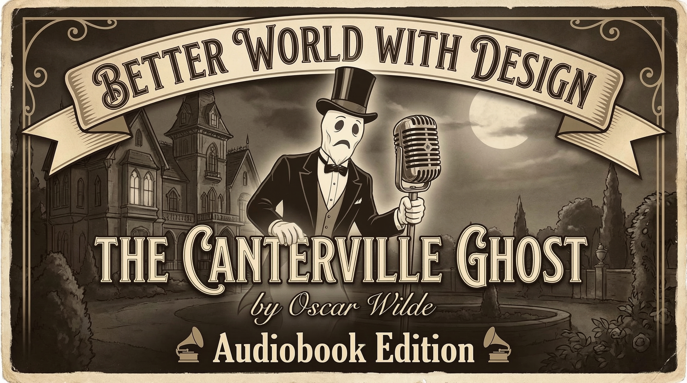

<!-- wp:image {"id":7232,"sizeSlug":"large","linkDestination":"none"} -->

<figure class="wp-block-image size-large"></figure>

<!-- /wp:image -->

<!-- wp:embed {"url":"https://youtu.be/iqN8nVTGEgI?si=4rP-WXEtQ89tkN2T","type":"video","providerNameSlug":"youtube","responsive":true,"className":"wp-embed-aspect-16-9 wp-has-aspect-ratio"} -->

<figure class="wp-block-embed is-type-video is-provider-youtube wp-block-embed-youtube wp-embed-aspect-16-9 wp-has-aspect-ratio">

<iframe loading="lazy" title="The Canterville Ghost: Complete Reading by Gary Crossey | Oscar Wilde&#039;s Supernatural Comedy" width="1080" height="608" src="https://www.youtube.com/embed/iqN8nVTGEgI?feature=oembed"  allow="accelerometer; autoplay; clipboard-write; encrypted-media; gyroscope; picture-in-picture; web-share" referrerpolicy="strict-origin-when-cross-origin" allowfullscreen></iframe>

</figure>

<!-- /wp:embed -->

<!-- wp:heading {"level":1} -->

<h1 class="wp-block-heading">Oscar Wilde's "The Canterville Ghost": A Journey Between Worlds, Cultures, and Understanding</h1>

<!-- /wp:heading -->

<!-- wp:paragraph -->

There's something magical about discovering a writer who speaks to your soul at just the right moment in your life. For me, that moment came during a transformative summer in Orange Park, near Jacksonville, Florida, when I was seventeen years old. I had picked up the complete works of Oscar Wilde, and every afternoon I would walk to the railway tracks with my book in hand. There, sitting beside those steel rails that stretched toward distant horizons, I would lose myself in Wilde's brilliant prose and wit.

<!-- /wp:paragraph -->

<!-- wp:paragraph -->

Those afternoons became sacred to me—perhaps the first time in my life I had experienced such freedom, such peace, without constantly having to look over my shoulder. Growing up in Northern Ireland had taught me a different way of navigating the world, one that required constant vigilance. But there, beside those train tracks in Florida, with Oscar Wilde as my companion, I found something I had never known before: the luxury of simply being.

<!-- /wp:paragraph -->

<!-- wp:paragraph -->

"The Canterville Ghost," first published in 1887, represents one of Wilde's most beloved supernatural comedies. What begins as a witty satire on American and British culture evolves into a moving tale of redemption through love and courage. The story follows the Otis family, practical Americans who move into Canterville Chase, a haunted English country house. When they refuse to be frightened by the centuries-old ghost Sir Simon de Canterville, the spectre finds himself increasingly frustrated by their modern attitudes and pragmatic solutions to his supernatural antics.

<!-- /wp:paragraph -->

<!-- wp:heading -->

<h2 class="wp-block-heading">Why Oscar Wilde Mattered Then (And Still Matters Now)</h2>

<!-- /wp:heading -->

<!-- wp:paragraph -->

Reading through Wilde's complete works that summer, cover to cover, I discovered something extraordinary: a kindred spirit across time. Back then, there were precious few openly gay figures who could serve as beacons of hope and representation. Wilde, despite—or perhaps because of—his tragic fate, showed me that it was possible to live authentically, to create beauty, and to face the world with both courage and humor.

<!-- /wp:paragraph -->

<!-- wp:paragraph -->

Wilde and I align in our shared understanding that wit can be a form of resistance, that beauty is a necessity not a luxury, and that authenticity—no matter the cost—is the only way to truly live. His ability to find joy and create art even in the face of society's harshest judgments became my building block for the future.

<!-- /wp:paragraph -->

<!-- wp:paragraph -->

That summer, sitting by those railroad tracks, reading page after page of Wilde's genius, I knew with absolute certainty that everything in the world was going to be alright. Not because the world was perfect, but because there were people like Oscar Wilde in it—people who could transform pain into beauty, isolation into art, and suffering into something transcendent.

<!-- /wp:paragraph -->

<!-- wp:heading -->

<h2 class="wp-block-heading">The Cultural Clash at the Heart of the Story</h2>

<!-- /wp:heading -->

<!-- wp:paragraph -->

At its core, "The Canterville Ghost" is a brilliant examination of cultural collision. Mr. Hiram B. Otis, the American Minister, represents the new world's pragmatic approach to life. When Lord Canterville warns him about the ghost, Mr. Otis responds with characteristic American confidence: "I have come from a modern country, where we have everything that money can buy." This encapsulates the entire American attitude throughout the story—problems can be solved with the right product, whether it's Pinkerton's Champion Stain Remover for bloodstains or Tammany Rising Sun Lubricator for noisy chains.

<!-- /wp:paragraph -->

<!-- wp:paragraph -->

The Otis family's response to supernatural phenomena perfectly satirizes both American materialism and British traditionalism. When the ghost makes his dramatic entrance, chains rattling, the twins shoot at him with pea-shooters, Washington Otis offers him lubricating oil, and Mrs. Otis provides Doctor Dobell's tincture for what she assumes is indigestion. These moments are hilarious precisely because they invert our expectations—the Americans should be terrified, but instead they treat the supernatural with the same practical efficiency they'd apply to any household problem.

<!-- /wp:paragraph -->

<!-- wp:heading -->

<h2 class="wp-block-heading">Sir Simon: More Than Just a Ghost</h2>

<!-- /wp:heading -->

<!-- wp:paragraph -->

What makes "The Canterville Ghost" particularly unusual is its treatment of the ghost himself. Sir Simon de Canterville is no one-dimensional spectre. He's a fully realized character with pride, vanity, despair, and ultimately, a capacity for growth and redemption. He's been haunting Canterville Chase for three centuries, perfecting his craft, taking pride in his various incarnations—"Reckless Rupert, or the Headless Earl," "Martin the Maniac, or the Masked Mystery," "Dumb Daniel, or the Suicide's Skeleton."

<!-- /wp:paragraph -->

<!-- wp:paragraph -->

His frustration with the Otis family is comedic but also poignant. He's spent three hundred years being taken seriously, frightening people into fits and turning hair grey overnight. The Americans' refusal to play by the rules of traditional ghost stories doesn't just inconvenience him—it undermines his entire existence, his sense of purpose. When he complains, "I must rattle my chains, and groan through keyholes, and walk about at night, if that is what you mean. It is my only reason for existing," we laugh, but we also recognize a deeper truth about how we all need to feel that our lives have meaning.

<!-- /wp:paragraph -->

<!-- wp:heading -->

<h2 class="wp-block-heading">Virginia: The Bridge Between Worlds</h2>

<!-- /wp:heading -->

<!-- wp:paragraph -->

If the story were only about the clash between American pragmatism and British tradition, it would be entertaining but ultimately superficial. What elevates "The Canterville Ghost" to something more profound is Virginia E. Otis, the fifteen-year-old daughter who becomes the emotional and spiritual center of the narrative.

<!-- /wp:paragraph -->

<!-- wp:paragraph -->

Virginia is described as "lithe and lovely as a fawn, and with a fine freedom in her large blue eyes." Unlike the rest of her family, she's disturbed by the bloodstain that keeps reappearing in the library. She possesses something her practical family members lack—the capacity for empathy and spiritual understanding. When she encounters Sir Simon in the Tapestry Chamber, looking forlorn and defeated, her first instinct isn't to run or to apply American practicality to the problem. Instead, she's "filled with pity, and determined to try and comfort him."

<!-- /wp:paragraph -->

<!-- wp:paragraph -->

The conversation between Virginia and the ghost reveals the story's deeper themes. Sir Simon tells her, "Death must be so beautiful. To lie in the soft brown earth, with the grasses waving above one's head, and listen to silence. To have no yesterday, and no to-morrow. To forget time, to forget life, to be at peace." This is Wilde at his most poetic and profound, using a supernatural comedy to explore genuine existential questions about mortality, redemption, and peace.

<!-- /wp:paragraph -->

<!-- wp:heading -->

<h2 class="wp-block-heading">The Prophecy and the Garden of Death</h2>

<!-- /wp:heading -->

<!-- wp:paragraph -->

The ancient prophecy painted on the library window provides the story's mythic framework: "When a golden girl can win / Prayer from out the lips of sin, / When the barren almond bears, / And a little child gives away its tears, / Then shall all the house be still / And peace come to Canterville." Virginia must weep for Sir Simon's sins and pray for his soul, crossing the boundary between life and death to help him find peace.

<!-- /wp:paragraph -->

<!-- wp:paragraph -->

Wilde deliberately leaves Virginia's experience in the Garden of Death unexplained. When her new husband asks what happened, she responds, "I have never told any one, Cecil... Please don't ask me, Cecil, I cannot tell you. Poor Sir Simon! I owe him a great deal. Yes, don't laugh, Cecil, I really do. He made me see what Life is, and what Death signifies, and why Love is stronger than both." This refusal to explain everything, to reduce the supernatural to something comprehensible and managed, gives the story a timeless, mythic quality that continues to resonate.

<!-- /wp:paragraph -->

<!-- wp:heading -->

<h2 class="wp-block-heading">Wilde's Wit and Social Commentary</h2>

<!-- /wp:heading -->

<!-- wp:paragraph -->

Throughout the story, Wilde's legendary wit is on full display. His observations about both American and British culture are sharp but never mean-spirited. Of Mrs. Otis, he writes, "Many American ladies on leaving their native land adopt an appearance of chronic ill-health, under the impression that it is a form of European refinement, but Mrs. Otis had never fallen into this error." The twins are "usually called 'The Star and Stripes,' as they were always getting swished."

<!-- /wp:paragraph -->

<!-- wp:paragraph -->

These moments of humor serve a larger purpose—they keep the story light and entertaining while Wilde explores deeper themes. The bloodstain that changes colors (from red to purple to emerald green) becomes a running joke, with the family making bets on what color it will be each morning. But this seemingly silly detail also reinforces how the Americans treat everything, even supernatural phenomena, as entertainment rather than taking it seriously.

<!-- /wp:paragraph -->

<!-- wp:heading -->

<h2 class="wp-block-heading">Why This Story Still Matters Today</h2>

<!-- /wp:heading -->

<!-- wp:paragraph -->

Reading "The Canterville Ghost" today, I'm struck by how modern it feels. The clash between American pragmatism and British tradition resonates in our globalized world where cultures continuously collide and negotiate. As someone from Northern Ireland who has lived across different cultures, this tension feels deeply familiar to me.

<!-- /wp:paragraph -->

<!-- wp:paragraph -->

The story's examination of commercialism versus tradition feels particularly relevant in our consumer-driven society. Mr. Otis's belief that everything—even ghosts—can be solved with the right product mirrors our own tendency to seek commercial solutions to complex problems. We live in an age where there's an app for everything, a product to fix every issue, a hack for every challenge. Wilde's gentle mockery of this mindset reminds us that some things—spiritual growth, emotional understanding, genuine human connection—can't be purchased or optimized.

<!-- /wp:paragraph -->

<!-- wp:paragraph -->

Perhaps most relevant is the story's ultimate message about empathy and understanding. In our polarized world, Virginia's willingness to listen to and help someone completely different from herself—crossing boundaries of nationality, time, and even mortality—offers a powerful example of compassion. She doesn't try to fix Sir Simon with American efficiency; she offers him something more valuable: her tears, her prayers, her willingness to see him as more than just a problem to be solved.

<!-- /wp:paragraph -->

<!-- wp:heading -->

<h2 class="wp-block-heading">The Enduring Appeal of Wilde's Ghost</h2>

<!-- /wp:heading -->

<!-- wp:paragraph -->

The story's enduring appeal is evident in its numerous adaptations across media—from films and TV shows to plays, musicals, and operas. Its influence extends beyond direct adaptations, inspiring countless works that blend humor with the supernatural or explore cultural clashes through a satirical lens.

<!-- /wp:paragraph -->

<!-- wp:paragraph -->

For me, speaking with my Northern Irish sensibility, there's something particularly powerful about how this story uses humor to address serious themes. That's a very Irish approach—finding laughter even when dealing with death and the otherworldly—and perhaps explains part of my connection to Wilde's work.

<!-- /wp:paragraph -->

<!-- wp:paragraph -->

"The Canterville Ghost" remains relevant because it speaks to universal human experiences: our fear of death, our capacity for change, our cultural differences, and ultimately, our ability to connect across seemingly impossible divides. The ghost who terrified people for three hundred years finds peace through the compassion of a fifteen-year-old girl. The practical Americans who scoff at tradition learn that some mysteries shouldn't be explained away. And readers across generations discover that a story published in 1887 can still speak to our contemporary concerns.

<!-- /wp:paragraph -->

<!-- wp:heading -->

<h2 class="wp-block-heading">A Personal Reflection</h2>

<!-- /wp:heading -->

<!-- wp:paragraph -->

As I sit here today, far from those railway tracks in Florida where I first encountered Wilde, I'm reminded that truly great stories don't age—they evolve with us, continuing to reveal new insights with each reading. That seventeen-year-old sitting beside the train tracks in Orange Park was seeking escape, finding in Wilde a friend who understood everything without judgment. Now, decades later, I return to these stories with different eyes, but I find they still offer something essential.

<!-- /wp:paragraph -->

<!-- wp:paragraph -->

Virginia says to her husband, "He made me see what Life is, and what Death signifies, and why Love is stronger than both." Perhaps that's the essence of great literature—it helps us see beyond our immediate concerns to something more profound. It bridges gaps we thought were unbridgeable, whether those gaps are between the living and the dead, between different cultures and worldviews, or between who we are and who we hope to become.

<!-- /wp:paragraph -->

<!-- wp:paragraph -->

Much like Sir Simon needed Virginia to find his peace, we all need someone to help us see beyond our own hauntings. As we say back home, "What's for you won't pass you by"—and I suspect Oscar Wilde's tales found me at exactly the right moment, just as I hope they've found you today.

<!-- /wp:paragraph -->

<!-- wp:paragraph -->

At Better World with Design, we believe in the power of stories to transform perspectives and bridge divides—much like Virginia bridged the divide between the living and Sir Simon's restless spirit. "The Canterville Ghost" reminds us that humor and heart aren't opposites but can work together to create something deeper than either alone could achieve.

<!-- /wp:paragraph -->

<!-- wp:paragraph -->

Wilde's genius was in making us laugh while making us think, in entertaining us while challenging our assumptions, in creating characters we remember long after we've finished reading. Sir Simon de Canterville, the ghost who couldn't frighten the Otis family, ends up teaching us all something about empathy, redemption, and the transformative power of genuine human connection.

<!-- /wp:paragraph -->

<!-- wp:paragraph -->

Thank you for joining me on this literary journey through one of Wilde's most beloved works. Whether you're discovering this story for the first time or returning to it as an old friend, I hope you've found something valuable in these reflections. And remember—you probably won't need Pinkerton's Champion Stain Remover for those troublesome bloodstains, but you might need a tissue or two for the moments that touch your heart.

<!-- /wp:paragraph -->

<!-- wp:paragraph -->

Until next time, may your own stories be filled with both laughter and depth, and may you find your own kindred spirits in the pages you read. Slán go fóill—goodbye for now.

<!-- /wp:paragraph -->

