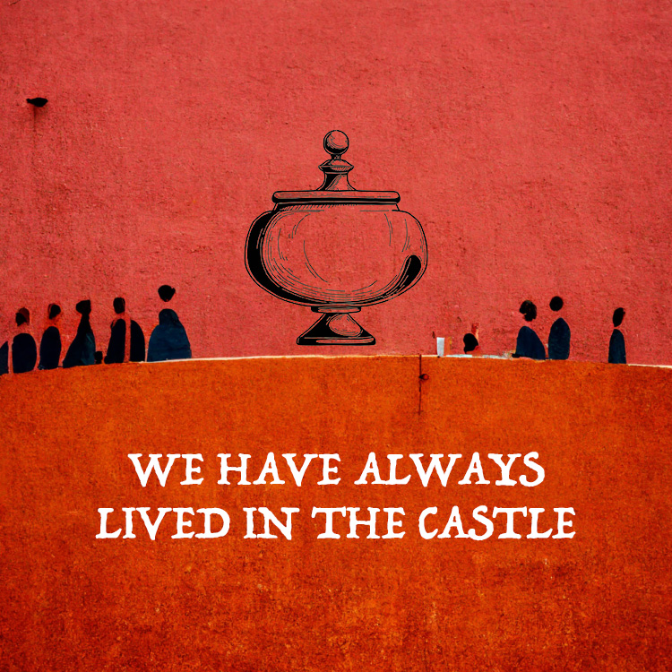

<figure class="wp-block-image size-full"><figcaption class="wp-element-caption">Digital Art created by Gary Crossey</figcaption></figure>

We Have Always Lived in the Castle by Shirley Jackson is a novel that tells the story of the Blackwood family, who live in a large mansion on the outskirts of a small village. The story is narrated by Mary Katherine, or "Merricat," Blackwood, an eighteen-year-old girl who lives with her sister Constance and their uncle Julian.

The novel begins by describing the events that led up to the mysterious deaths of several members of the Blackwood family, including Merricat's parents, brother, and aunt. Constance was accused and acquitted of the murders, but the villagers still view the Blackwoods with suspicion and hostility.

Uncle Julian, who survived the poisoning that killed the rest of the family, is writing a book about the murders and becomes increasingly paranoid and delusional. Charles, a cousin who comes to visit the Blackwoods, is manipulative and cruel, causing tension and upheaval in the already fragile household.

<h2 class="wp-block-heading">Chapter 1 Analysis</h2>

The <strong>first chapter</strong> of "We Have Always Lived in the Castle" sets the tone for the novel with an unreliable narrator and a sense of mystery. From the beginning, Mary Katherine Blackwood, or Merricat, reveals her unstable nature by confessing her aversion to bathing and her affinity for the death-cup mushroom. Her likes and dislikes offer a glimpse into her peculiar personality, which immediately raises suspicion and adds to the suspense.

Despite the simplicity of the action in the first chapter, which involves Merricat walking to town to buy groceries, check out library books, and stop at the coffee shop, the interactions between the characters are fraught with tension and intrigue. Merricat is suspicious of everyone around her and avoids personal contact, while the other characters behave strangely in her presence. The reader is left to wonder what has happened to Merricat and why the other characters are acting so oddly. This sense of mystery adds depth and complexity to the story and sets the stage for the events that will follow.

As the story progresses, it becomes clear that Merricat is deeply disturbed and has a tenuous grip on reality. She engages in magical thinking and has elaborate rituals that she believes will protect her and her family from harm. Constance is protective of Merricat but also struggles with her own guilt and trauma from the deaths of her family members.

<h2 class="wp-block-heading">Chapter 2 Analysis</h2>

<strong>In Chapter 2</strong> of "We Have Always Lived in the Castle," the reader learns that the majority of the Blackwood family was killed by arsenic poisoning and that Constance was accused of the murders and then acquitted. Uncle Julian tells Lucille Wright about the murders that occurred in the Blackwood home six years prior, revealing some details about the past.

The author establishes the Blackwood household as a predictably orderly place, with the sisters and their routines taking pride in the organization and neatness of their household. Merricat goes to town, checks out library books, and buys groceries on certain days, while Helen Clarke comes for tea only on certain days. The contrast between this orderliness and the chaos of their past adds to the intrigue of the novel.

<h2 class="wp-block-heading">Chapter 3 Analysis</h2>

In <strong>Chapter 3</strong>, the author establishes Merricat's character as an unreliable narrator with a vivid imagination and a belief in magic and omens. She reveals her faith in omens, buried treasure, and magical words, which adds to her mystique as an unreliable narrator. Although Julian and Constance go about their regular day, Merricat senses that a change is coming, which further adds to the suspense and leads up to the climax.

The chapter also includes other details that add to the gothic atmosphere of the novel, such as Merricat burying items in the garden, such as baby teeth that would grow into dragons. Additionally, the mention of canned food and how all the ladies added to the supply creates a sense of claustrophobia and confinement, as if the Blackwoods are cut off from the outside world and must rely on their own resources to survive.

At the end of the chapter, there is foreshadowing when Constance takes Uncle Julian inside the house. She is afraid that he is getting cold outside and wants to protect him from the chilly spring air. Julian, on the other hand, wants to keep working on his book because he says he has a thousand details to remember and not a minute to waste. This is predictive to the climax of the story when Julian's heart cannot take the stress of the house fire.

<h2 class="wp-block-heading">Chapter 4 Analysis</h2>

<strong>Chapter 4</strong>,Merricat says that Charles is the first person to enter their house, but this is not true as Helen Clarke and Lucille Wright have been in their house recently, as revealed in Chapter 2. This suggests that Merricat says whatever is convenient to support her emotions or that she has a different category for Charles than she has for Helen Clarke and Lucille Wright.

Merricat's reaction to Charles's arrival seems extreme as she goes outside and sleeps in the woods. Constance's reaction to Merricat's behavior is somewhat surprising since she cares for Uncle Julian so attentively, taking him in the house if she is afraid that he might get cold and cooking him whatever he wants to eat. It seems likely that she would care for her younger sister attentively as well. However, when Merricat flees to her secret hiding place in the woods, Constance allows her to stay outside all night, even though it is only April.

<h2 class="wp-block-heading">Chapter 5 Analysis</h2>

In <strong>Chapter 5</strong>, Charles reminds the reader of John Blackwood, the father of Constance and Merricat, who was an unpleasant man. The longer Charles stays in the house, the more his weaknesses become apparent. Within twenty-four hours, he reveals his greedy side, asking about where the money is kept and finding ways to access it.

In the same chapter, Constance shows a weakness for Charles, despite his unkindness. She displays this by wondering if it's acceptable for her to wear her mother's pearls, indicating her attraction and desire to please him. Merricat is convinced that Charles is a ghost and must be driven from the house, and she refuses to be civil to him. This supports her belief that a change is coming.

<blockquote class="wp-block-quote is-layout-flow wp-block-quote-is-layout-flow">

"You had dinner here last night and woke up alive this morning.”

</blockquote>

<h2 class="wp-block-heading">Chapter 6 Analysis</h2>

Charles's character is illuminated in <strong>Chapter 6</strong>, revealing his true nature as an unscrupulous and greedy man. Despite being initially welcomed by Uncle Julian, Charles's behavior becomes increasingly suspicious and Julian becomes wary of him, even refusing to allow him to touch his belongings. The only member of the Blackwood household who remains friendly with Charles is Constance. Charles's greed is on full display as he continually inquires about the value of John Blackwood's possessions and attempts to take them for himself.

Chapter 6 also incorporates elements of Romantic literature, particularly in the form of the supernatural. Merricat's obsession with magical objects and omens has an otherworldly quality that is reminiscent of Romantic literature. Additionally, Romantic literature often imbues the very young and very old with intuitive powers that others lack. Julian serves as a sort of barometer of safety in this chapter. Despite his occasional senility, he is able to sense the malevolence emanating from Charles. The reader is encouraged to trust Julian's instincts.

<h2 class="wp-block-heading">Chapter 7 Analysis</h2>

In the first chapter of the novel, Shirley Jackson uses overt foreshadowing to set up the climax that will occur in Chapter 8. In <strong>Chapter 7</strong>, Merricat says that Constance makes spice cookies for dinner but that she shouldn't have bothered because this would be the last day. Although she doesn't explain what she means by this, the reader can sense that she is telling the truth in some fashion because she has been leading up to this since the very first chapter where she says that the library books are five months overdue.

<h2 class="wp-block-heading">Chapter 8 Analysis</h2>

<strong>Chapter 8</strong>, is the climax of the story. The chapter begins with a conflict between Charles and the rest of the family at dinner. Constance attempts to keep the peace between Charles, Merricat, and Uncle Julian.

The fire that destroys the Blackwood house results from the conflict between Charles and Merricat. Constance asked Charles to be more careful with his pipes several times, and in an effort to protect the house from his pipes, she gave him saucers to place them on. However, he neglects to put his pipe out before leaving rooms, and when Merricat happens upon a smoldering pipe, she swipes it into the wastebasket, rationalizing her action by telling herself that Constance wouldn't want it sitting around on the furniture. Although Merricat doesn't fully believe that the fire is completely Charles's fault, she keeps calling it Charles's fire, as if she's trying to convince herself that it isn't her own fault.

After the fire is put out, the villagers' hatred towards the Blackwoods is unleashed and they are portrayed as completely heartless. Even when it is announced that Julian has died, they still make horrible remarks. The only people at the fire who seem to care at all are Helen and Jim Clarke and Dr. Levy. The rest of the villagers are virtually strangers to the Blackwoods, so their hatred is unjustified.

Additionally, Shirley Jackson incorporates elements of Romantic literature in this chapter. Jonas, the cat, refuses to go into the summer house with Mary Katherine. The use of animals with intuitive powers is a common trope in Romantic literature, and therefore, the reader pays close attention to Jonas's actions. However, Merricat doesn't pay attention to Jonas and ventures into the summer house alone. The summer house is described as a damp and dank place, and once Merricat is inside, her fantasies seem to go wild. She imagines her family having a conversation that never could have taken place and even imagines her mother saying, "Bow all your heads to our adored Mary Katherine."

<h2 class="wp-block-heading">Chapter 9 Analysis</h2>

After the intense climax in Chapter 8, Chapter 9 offers a welcome respite. The Blackwoods have always been creatures of habit, and the morning after the fire, Constance and Merricat find a way to return to routine and order. They salvage what they can from the wreckage and by the end of the day, have transformed the kitchen into a clean, orderly haven. They seem emotionally balanced once again.

The outreach from the Clarkes and Dr. Levy is a breath of fresh air after the brutality of the previous night. Although Constance and Merricat don't respond to the kindness, they feel better knowing that someone cares about them. The relationships are not as important to them as the thought behind the kindness. In fact, they seem to take some prideful pleasure in not responding to the men's pleas.

<h2 class="wp-block-heading">Chapter 10 Analysis</h2>

Merricat and Constance create a new life with what remains from the old one. This life suits Merricat much better than the old one because the relics of those she killed are gone. Their bedrooms burned up in the fire, and the only room left for them to inhabit is the kitchen, which always belonged to Constance anyway, since she was the family member who enjoyed cooking and cleaning. Therefore, the productive, happy, and useful part of the house remains, while the ghosts of the past are gone.

Constance, always the peacemaker, eventually takes to the new life as well, although she has to mourn for the loss of the old life. She never becomes the outgoing person that she longed to be for a while. In fact, she becomes a full-fledged hermit, but her life is simple and pleasing, and she enjoys seeing the people who come to picnic on the lawn and look at the odd house. Ivy grows up over the burned rafters. She grows her garden when others are not around, and she brings in flowers to put on the table. The resolution is strange but pleasing. Merricat, the true murderer, has never been publicly identified, but she seems to have made peace at last.

<figure class="wp-block-image size-large"><figcaption class="wp-element-caption">Word Cloud (of this review) created by Gary Crossey</figcaption></figure>

<h3 class="wp-block-heading">Theme</h3>

The themes of isolation, persecution, and family dysfunction are central to the novel. The Blackwoods are ostracized by the villagers and must rely on each other for support, but their relationships are strained and complicated by past traumas.

<h3 class="wp-block-heading">Style</h3>

The style of the book is gothic and atmospheric, with vivid descriptions of the Blackwood mansion and its surroundings. Jackson's use of symbolism and metaphor adds depth and complexity to the story, as objects and events take on multiple meanings and interpretations.

<h3 class="wp-block-heading">Characters</h3>

In terms of character importance, Merricat is the protagonist and narrator, followed by Constance, Julian, and Charles. Merricat's unreliable narration and peculiar behavior drive the plot, while Constance's guilt and trauma provide emotional depth. Julian's book and deteriorating mental state add suspense and tension, and Charles's arrival disrupts the delicate balance of the Blackwood family. Some characters only appear briefly or are mentioned in passing, while others are more central to the plot.

<ul class="wp-block-list">
<li>Arthur Blackwood - Charles's father.</li>

<li>Charles Blackwood - Mary Katherine's cousin.</li>

<li>Constance Blackwood - Mary Katherine's Sister</li>

<li>Dorothy Blackwood - Julian's wife.</li>

<li>John Blackwood - Mary Katherine's father.</li>

<li>Julian Blackwood - Mary Katherine's Uncle.</li>

<li>Mary Katherine Blackwood - Protagonist and Narrator. aka: Merricat.</li>

<li>Thomas Blackwood - Constance and Mary Katherine's brother.</li>

<li>Mr. Carrington - Friend of Mary Katherine's father.</li>

<li>Helen Clarke - Family Friend of Mary Katherine.</li>

<li>Jim Clarke - Helen's husband.</li>

<li>Kim Clarke - Jim's brother.</li>

<li>Mrs. Crowley - A Church regular.</li>

<li>Jim Donell - Mrs. Donell's Husband / A gossiping neighbor.</li>

<li>Joe Dunham - The carpenter.</li>

<li>Mrs. Dunham - Mary Katherine's Neighbor.</li>

<li>Mr. Elbert - Owner of a Grocery Store.</li>

<li>Mrs. Elbert - Mr. Elbert's Greedy Wife.</li>

<li>Dr. Levy - Jack Mason's colleague.</li>

<li>Dr. Jack - Doctor of the Blackwood family.</li>

<li>Amanita Phalloides - The Death-Cup Mushroom.</li>

<li>Mrs. Rice - A Church regular.</li>

<li>Mrs. Shepherd - A Church regular.</li>

<li>Lucille Wright - Helen's friend.</li>

<li>Jonas - Mary Katherine's cat.</li>

<li>Stella - Owner of a Shop.</li>
</ul>

As for the chicken pie left on the doorstep, it was not clear which character first placed food other than he is the guy who broke the chair. and was at the door on his wife's, and was sorry. 

Thank you to <a href="https://www.bookcompanion.com/we_have_always_lived_in_the_castle_name_list2.html" data-type="URL" data-id="https://www.bookcompanion.com/we_have_always_lived_in_the_castle_name_list2.html" target="_blank" rel="noreferrer noopener">Book Companion</a> for the Character List

<h3 class="wp-block-heading">Book Response</h3>

The novel has been well-received by readers and critics, with praise for its haunting atmosphere, complex characters, and masterful storytelling. It has been adapted into a film and a play, cementing its status as a classic of modern gothic literature.

<h3 class="wp-block-heading">Overall</h3>

We Have Always Lived in the Castle is a chilling and thought-provoking novel that explores the dark corners of the human psyche and the power of family bonds to both protect and destroy.

 <a href="https://www.goodreads.com/review/list/54140412-gary-crossey">View all my Goodread Reviews</a>

<blockquote class="instagram-media" data-instgrm-captioned data-instgrm-permalink="https://www.instagram.com/reel/Cw3Onkouelp/?utm_source=ig_embed&amp;utm_campaign=loading" data-instgrm-version="14" style=" background:#FFF; border:0; border-radius:3px; box-shadow:0 0 1px 0 rgba(0,0,0,0.5),0 1px 10px 0 rgba(0,0,0,0.15); margin: 1px; max-width:540px; min-width:326px; padding:0; width:99.375%; width:-webkit-calc(100% - 2px); width:calc(100% - 2px);">
 <a href="https://www.instagram.com/reel/Cw3Onkouelp/?utm_source=ig_embed&amp;utm_campaign=loading" style=" background:#FFFFFF; line-height:0; padding:0 0; text-align:center; text-decoration:none; width:100%;" target="_blank" rel="noopener"> 
 

 
 

 

 
<svg width="50px" height="50px" viewBox="0 0 60 60" version="1.1" xmlns="https://www.w3.org/2000/svg" xmlns:xlink="https://www.w3.org/1999/xlink"><g stroke="none" stroke-width="1" fill="none" fill-rule="evenodd"><g transform="translate(-511.000000, -20.000000)" fill="#000000"><g><path d="M556.869,30.41 C554.814,30.41 553.148,32.076 553.148,34.131 C553.148,36.186 554.814,37.852 556.869,37.852 C558.924,37.852 560.59,36.186 560.59,34.131 C560.59,32.076 558.924,30.41 556.869,30.41 M541,60.657 C535.114,60.657 530.342,55.887 530.342,50 C530.342,44.114 535.114,39.342 541,39.342 C546.887,39.342 551.658,44.114 551.658,50 C551.658,55.887 546.887,60.657 541,60.657 M541,33.886 C532.1,33.886 524.886,41.1 524.886,50 C524.886,58.899 532.1,66.113 541,66.113 C549.9,66.113 557.115,58.899 557.115,50 C557.115,41.1 549.9,33.886 541,33.886 M565.378,62.101 C565.244,65.022 564.756,66.606 564.346,67.663 C563.803,69.06 563.154,70.057 562.106,71.106 C561.058,72.155 560.06,72.803 558.662,73.347 C557.607,73.757 556.021,74.244 553.102,74.378 C549.944,74.521 548.997,74.552 541,74.552 C533.003,74.552 532.056,74.521 528.898,74.378 C525.979,74.244 524.393,73.757 523.338,73.347 C521.94,72.803 520.942,72.155 519.894,71.106 C518.846,70.057 518.197,69.06 517.654,67.663 C517.244,66.606 516.755,65.022 516.623,62.101 C516.479,58.943 516.448,57.996 516.448,50 C516.448,42.003 516.479,41.056 516.623,37.899 C516.755,34.978 517.244,33.391 517.654,32.338 C518.197,30.938 518.846,29.942 519.894,28.894 C520.942,27.846 521.94,27.196 523.338,26.654 C524.393,26.244 525.979,25.756 528.898,25.623 C532.057,25.479 533.004,25.448 541,25.448 C548.997,25.448 549.943,25.479 553.102,25.623 C556.021,25.756 557.607,26.244 558.662,26.654 C560.06,27.196 561.058,27.846 562.106,28.894 C563.154,29.942 563.803,30.938 564.346,32.338 C564.756,33.391 565.244,34.978 565.378,37.899 C565.522,41.056 565.552,42.003 565.552,50 C565.552,57.996 565.522,58.943 565.378,62.101 M570.82,37.631 C570.674,34.438 570.167,32.258 569.425,30.349 C568.659,28.377 567.633,26.702 565.965,25.035 C564.297,23.368 562.623,22.342 560.652,21.575 C558.743,20.834 556.562,20.326 553.369,20.18 C550.169,20.033 549.148,20 541,20 C532.853,20 531.831,20.033 528.631,20.18 C525.438,20.326 523.257,20.834 521.349,21.575 C519.376,22.342 517.703,23.368 516.035,25.035 C514.368,26.702 513.342,28.377 512.574,30.349 C511.834,32.258 511.326,34.438 511.181,37.631 C511.035,40.831 511,41.851 511,50 C511,58.147 511.035,59.17 511.181,62.369 C511.326,65.562 511.834,67.743 512.574,69.651 C513.342,71.625 514.368,73.296 516.035,74.965 C517.703,76.634 519.376,77.658 521.349,78.425 C523.257,79.167 525.438,79.673 528.631,79.82 C531.831,79.965 532.853,80.001 541,80.001 C549.148,80.001 550.169,79.965 553.369,79.82 C556.562,79.673 558.743,79.167 560.652,78.425 C562.623,77.658 564.297,76.634 565.965,74.965 C567.633,73.296 568.659,71.625 569.425,69.651 C570.167,67.743 570.674,65.562 570.82,62.369 C570.966,59.17 571,58.147 571,50 C571,41.851 570.966,40.831 570.82,37.631"></path></g></g></g></svg>

 
View this post on Instagram

 

 

 

 

 

 

 

 

 

 
 

 

</a>
<a href="https://www.instagram.com/reel/Cw3Onkouelp/?utm_source=ig_embed&amp;utm_campaign=loading" style=" color:#c9c8cd; font-family:Arial,sans-serif; font-size:14px; font-style:normal; font-weight:normal; line-height:17px; text-decoration:none;" target="_blank" rel="noopener">A post shared by Gary Crossey (@betterworldwithdesign)</a>

</blockquote> 
