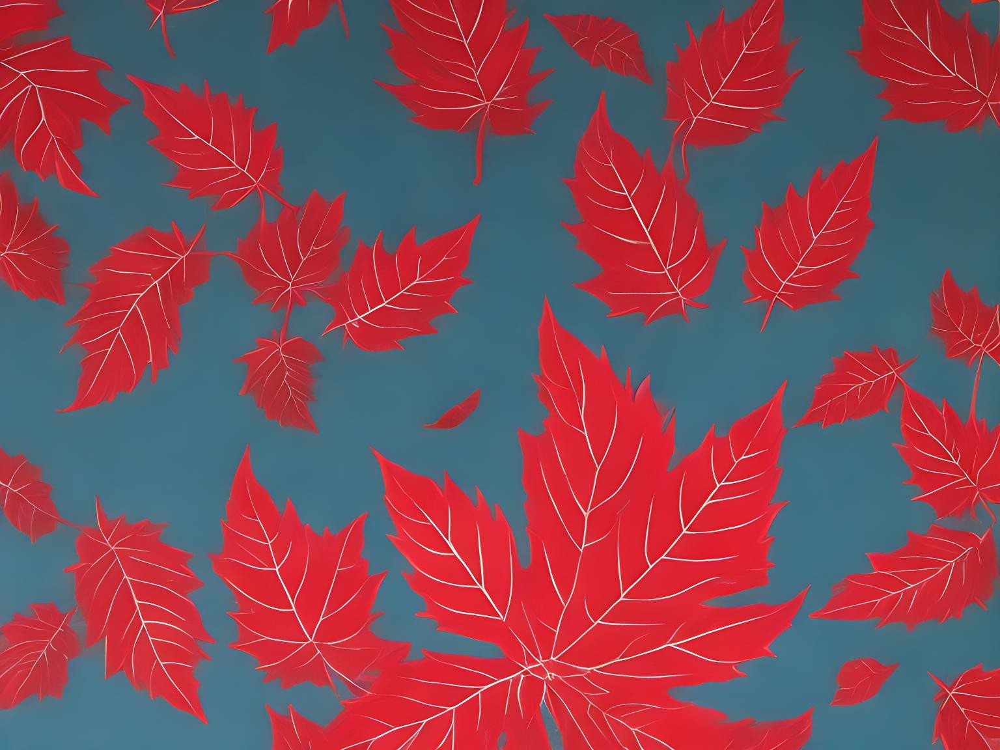

<h2 class="alignwide has-text-align-center wp-block-heading has-background-color has-text-color" style="font-size:64px">2022</h2>

<h2 class="alignwide has-text-align-center wp-block-heading has-background-color has-text-color" style="font-size:64px">Fall</h2>

<h2 class="alignwide has-text-align-center wp-block-heading has-background-color has-text-color" style="font-size:64px">Playlist</h2>

<h2 class="has-text-align-center has-text-color wp-block-heading" style="color:#d92639">Fall 2022 Playlist</h2>

<figure class="wp-block-image size-full"></figure>

Fall is a season of change and transformation. It's a time for cozy sweaters, pumpkin spice lattes, and evenings by the fire. 

To set the right tone for this transformative season, you need to choose your fall music carefully. Whether you're looking for the perfect autumn playlist or just some great songs to get you in the mood, there are plenty of options out there. From indie songs to modern pop hits, I hope my <strong>Fall 2022 Playlist</strong> helps you find the best music for fall that will make this season one of your favorites.

Fall 2022 Playlist

<iframe style="border-radius:12px" src="https://open.spotify.com/embed/playlist/7hUh9fv0fD8vpvjLoGp66a?utm_source=generator&amp;theme=0" width="100%" height="680" frameborder="0" allowfullscreen="" allow="autoplay; clipboard-write; encrypted-media; fullscreen; picture-in-picture" loading="lazy"></iframe>

<h3 class="has-text-align-center has-text-color has-x-large-font-size wp-block-heading" style="color:#d92639;font-style:normal;font-weight:600">Welcome to the journey of self-discovery! </h3>

As the days get shorter and the weather gets colder, it can be easy to feel a little down. But, don't worry! There are plenty of uplifting and refreshing tunes that are perfect for getting you through those crisp autumn days. Whether you're looking for upbeat fall songs, happy autumn tunes, or inspiring fall tracks, this selection of music is sure to put a smile on your face and get you in the mood for the season.

The lyrics by <strong>Luren Nikohl</strong> (<strong>Raining Gold</strong>) are so powerful too - "Rise to unchained realms of truth". That's the type of truth I can get behind. 

For those in the know - both members of The XX are featured respectfully with their solo projects (that they are both been active supporting each other). Building your support is most important as we travel though fall season in the winter. 

I am here to help guide you as you take into account your body, mind, and soul. <strong>UPSAHL’s</strong> track <strong>Into My Body</strong> campaign is all about empowering you to ask yourself the tough questions and be ready for the answers. It’s a way to encourage your growth, confidence, and courage in being true to yourself.

I recently stumbled upon a song and it has been on repeat in my playlist since I discovered it - Ghostkeeper by Klangkarussell. This song came into my life at a time when I needed it the most. Recently, I lost one of my closest friends who was my musical brother. Listening to this song made me realize that when someone passes away, you lose your history that person holds.

Yes, the Fall 2022 playlist is Maria Uzor heavy, including her freshest and newest music. I think it's the perfect way to usher in the season. You may get hooked on Maria Uzor's sound, and won't be able to stop listening.

<h2 class="has-text-align-center has-x-large-font-size wp-block-heading">Enjoy my Fall 2022 Playlist</h2>

<figure class="wp-block-table is-style-stripes has-medium-font-size"><table class="has-vivid-red-background-color has-text-color has-background" style="color:#386574"><thead><tr><th class="has-text-align-left" data-align="left">Track Name</th><th class="has-text-align-left" data-align="left">Artist</th></tr></thead><tbody><tr><td class="has-text-align-left" data-align="left">Raining Gold</td><td class="has-text-align-left" data-align="left">Lauren Nikohl</td></tr><tr><td class="has-text-align-left" data-align="left">What I Want</td><td class="has-text-align-left" data-align="left">MUNA</td></tr><tr><td class="has-text-align-left" data-align="left">Sensitive Child - Soulwax Remix</td><td class="has-text-align-left" data-align="left">Oliver Sim</td></tr><tr><td class="has-text-align-left" data-align="left">Contagious</td><td class="has-text-align-left" data-align="left">Black Caviar</td></tr><tr><td class="has-text-align-left" data-align="left">Let's Take Off - Osunlade Yoruba Soul Vocal</td><td class="has-text-align-left" data-align="left">Marbert Rocel</td></tr><tr><td class="has-text-align-left" data-align="left">Like That</td><td class="has-text-align-left" data-align="left">Seamus D</td></tr><tr><td class="has-text-align-left" data-align="left">Boundaries - DRAMA Remix</td><td class="has-text-align-left" data-align="left">Jamila Woods</td></tr><tr><td class="has-text-align-left" data-align="left">Into My Body</td><td class="has-text-align-left" data-align="left">UPSAHL</td></tr><tr><td class="has-text-align-left" data-align="left">My Baby Just Cares for Me</td><td class="has-text-align-left" data-align="left">Lou Hayter</td></tr><tr><td class="has-text-align-left" data-align="left">Ghostkeeper - Edit</td><td class="has-text-align-left" data-align="left">Klangkarussell</td></tr><tr><td class="has-text-align-left" data-align="left">Luvin U Is Easy</td><td class="has-text-align-left" data-align="left">Confidence Man</td></tr><tr><td class="has-text-align-left" data-align="left">Stand Up - 1997 Radio Mix</td><td class="has-text-align-left" data-align="left">Mattei &amp; Omich</td></tr><tr><td class="has-text-align-left" data-align="left">Midnight (The Hanging Tree) MK Remix</td><td class="has-text-align-left" data-align="left">HOSH</td></tr><tr><td class="has-text-align-left" data-align="left">Induratize</td><td class="has-text-align-left" data-align="left">Kristina Sheli</td></tr><tr><td class="has-text-align-left" data-align="left">Talk Over Town</td><td class="has-text-align-left" data-align="left">Katy J Pearson</td></tr><tr><td class="has-text-align-left" data-align="left">Strong</td><td class="has-text-align-left" data-align="left">Romy</td></tr><tr><td class="has-text-align-left" data-align="left">What Happened in the World</td><td class="has-text-align-left" data-align="left">Tonbe</td></tr><tr><td class="has-text-align-left" data-align="left">Kerosene</td><td class="has-text-align-left" data-align="left">Biig Piig</td></tr><tr><td class="has-text-align-left" data-align="left">No Roots (TikTok Classics Version)</td><td class="has-text-align-left" data-align="left">Alice Merton</td></tr><tr><td class="has-text-align-left" data-align="left">Solitaire</td><td class="has-text-align-left" data-align="left">Maria Uzor</td></tr><tr><td class="has-text-align-left" data-align="left">Cockstrutter</td><td class="has-text-align-left" data-align="left">Maria Uzor</td></tr><tr><td class="has-text-align-left" data-align="left">Over This</td><td class="has-text-align-left" data-align="left">Maria Uzor</td></tr><tr><td class="has-text-align-left" data-align="left">Carousel</td><td class="has-text-align-left" data-align="left">Maria Uzor</td></tr></tbody></table></figure>

