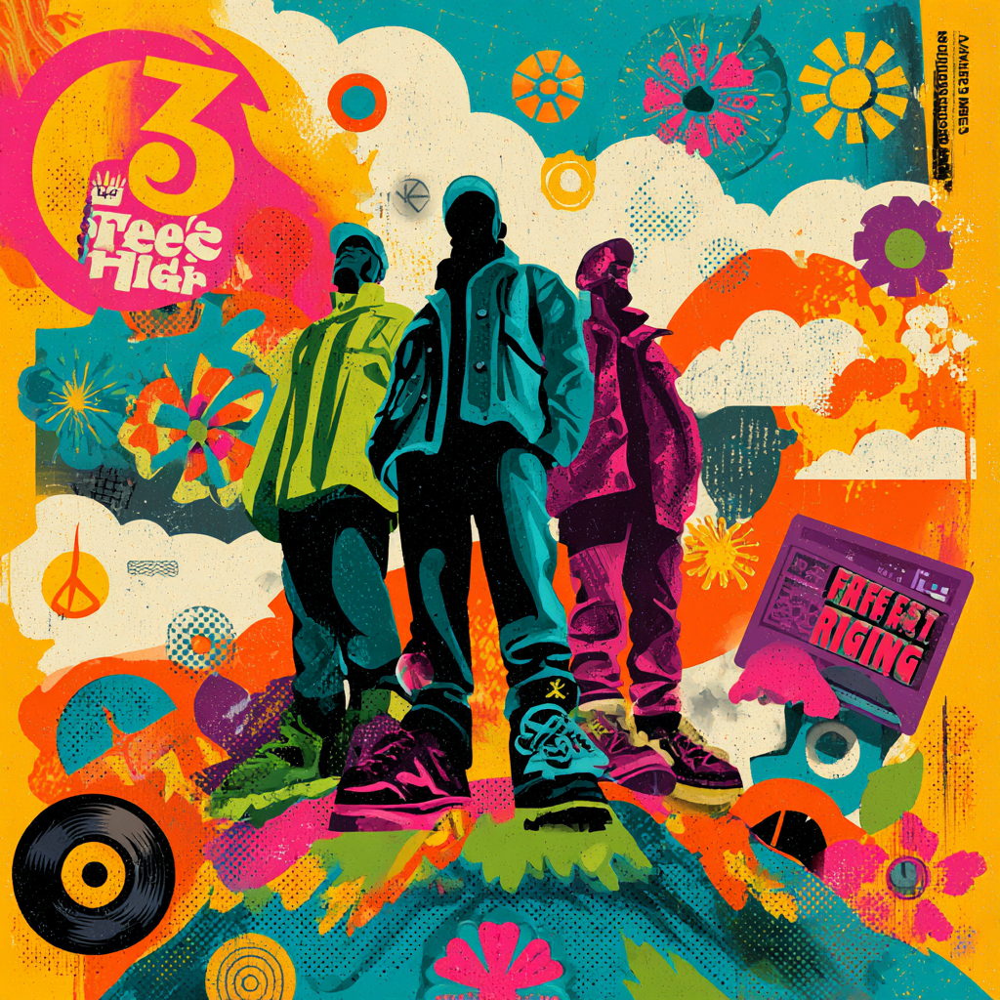

<h2>The $13,000 Pastiche That Broke Hip-Hop</h2>

An in-depth exploration of De La Soul's groundbreaking debut album <em>3 Feet High and Rising</em> — and the 30-year silence that followed.

🌼 ✌️ 🌸 🌻 ☮️  🌀<!-- notionvc: ebd4cac1-2fd2-4b1e-bb45-9e899d9611c4 -->

<h2 data-path-to-node="6"><!-- notionvc: c8f860d6-a929-4b44-9d65-9104186a7db4 --></h2>

<h2>"Eye Know" — When Hip-Hop Learned to Love</h2>

In 1989, when hip-hop's dominant modes were either hard-edged social commentary or party-starting braggadocio, De La Soul delivered something almost revolutionary with "Eye Know": sincere, joyful romantic affection without apology or irony.

The song opens with one of the most recognizable samples in hip-hop history—Steely Dan's "Peg." That choice alone tells you everything about De La Soul's approach. Steely Dan: yacht rock, jazz fusion, the epitome of 1970s sophistication. Not exactly an obvious source for hip-hop in 1989. But De La Soul heard something in that guitar line, that smooth groove, and made it their own.

<h3>The Revolutionary Sincerity</h3>

What made "Eye Know" radical was its vulnerability. Hip-hop masculinity in 1989 didn't typically allow for open emotional expression toward women. You could brag about sexual conquest, describe physical attraction, but sincere romantic feeling? That was rare.

Posdnuos opens with devastating directness: "Girl, I must admit I'm in love with you." No posturing, no protective layers of irony. Just honest feeling, plainly stated. Then he moves into specifics—her walk, her talk, her smile. These aren't generic compliments; they're observations from someone who actually pays attention.

The chorus—"I know, I know, I know, I know, I know"—is beautifully simple, almost childlike in its repetition. But that repetition serves a purpose: it's the insistence of genuine feeling against skepticism. When you really know something, when you're certain, you state it plainly, repeatedly, without elaborate justification.

<h3 data-path-to-node="5"><!-- notionvc: c0ccfffc-ea69-4926-988d-3130b4bf7a5a --></h3>
<h3 data-path-to-node="13">What This Investigation Covers:</h3>

Over the coming weeks, I am publishing a multi-part reconstruction of this lost classic:

<ul data-path-to-node="15">
<li>

<b data-path-to-node="15,0,0" data-index-in-node="0">The Cultural Shock:</b> How the "Daisy Age" translated to a kid in a conflict zone.

</li>
<li>

<b data-path-to-node="15,1,0" data-index-in-node="0">The Legal Trap:</b> The $1.7 million "The Turtles" lawsuit that effectively silenced a generation of samplers.

</li>
<li>

<b data-path-to-node="15,2,0" data-index-in-node="0">The Track-by-Track Forensic:</b> A 22-song journey through the genius of Prince Paul and De La Soul.

</li>
<li>

<b data-path-to-node="15,3,0" data-index-in-node="0">The Digital Paradox:</b> Why the most "connected" generation in history is being denied its most influential roots.

</li>
</ul>
<h2 data-path-to-node="6"><!-- notionvc: c8f860d6-a929-4b44-9d65-9104186a7db4 --></h2>

<h2>Want the Full Story?</h2>

This is just a preview. The complete investigation into <em>3 Feet High and Rising</em> — including the cultural impact, the legal nightmare, track-by-track analysis, and why this masterpiece disappeared from streaming — will be published soon.

<strong>Sign up to be notified when the full De La Soul article (and Podcast) drops.</strong>

<!-- notionvc: 93c0a0c2-a955-4ed6-a88e-5138f0c3bbf7 -->

<!-- form.123formbuilder.com script begins here -->

<!-- form.123formbuilder.com script ends here -->

