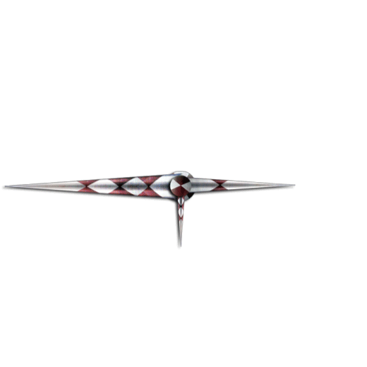

Clock Opera

With three albums loaded into the playlist I start listening to Clock Opera. For many bands the third album can be quite a defining moment. By the third album the band has had time enough to figure out if they are an evolving sound or they are a one-trick pony (no offense to ponies). 

<iframe loading="lazy" style="border-radius:12px" src="https://open.spotify.com/embed/playlist/1HEfKCoZlL1NgKX6MwRedV?utm_source=generator" width="100%" height="380" frameborder="0" allowfullscreen="" allow="autoplay; clipboard-write; encrypted-media; fullscreen; picture-in-picture"></iframe>

I know Clock Opera mostly from the remix projects for Marianna and the Diamonds, The Golden Filter, Tracey Thorn, Niki &amp; the Dove, Feist, Christine and the Queens, and Blood Orange - that list could easily be part of my favorite Top Ten recording artists. So, not quite sure why I haven't jumped on the Clock Opera train before now. 

Guy Connelly has such an interesting voice - on New Arrivals Connelly's vocals reminds me of The Waterboys - that similarity I don't hear on other tracks. Connelly's voice is strangely quite varied - and no one trick pony.   

<h3 class="wp-block-heading">Stand Out Tracks </h3>

⭐⭐⭐⭐⭐  <strong>Run</strong> - <em>so far</em> is the standout track for me. The vocals on Run are brilliant. The storytelling is relatable. Crisp track. 

⭐⭐⭐⭐⭐  <strong>Let Go the Lifeboats </strong>- I could leave this song on repeat for the rest of the day, I still wouldn't be able to unpack it all. Refined and powerful.

⭐⭐⭐⭐⭐  <strong>Carousel </strong>- Carousel shows Clock Opera as masters of their sound. Singing "I can never be wrong" - as everything on this tracks aligns and spins like you on a Carousel. 

⭐⭐⭐⭐⭐  <strong>I Surrender </strong>- First listen - and I couldn't do it. I need a drink before unpacking <strong>I Surrender</strong>. 

