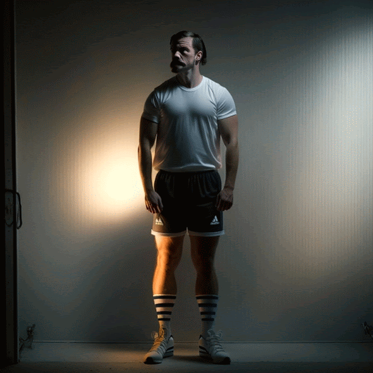

"I keep telling myself I'm fine Got you on repeat in my mind I wish that I could lose track of time But I know that you know that I'll never forget it 'Cause I know the day, and the month, and the second"

Song by Girli

<h2 class="wp-block-heading has-text-align-center">Dad Bob Playlist</h2>

2018 witnessed a plethora amount of amazing music from various artists. Out of the numerous artists that shone in 2018, more than 80 artists were selected for this playlist. Each of these artists had a significant impact on 2018 dance music scene.

<iframe loading="lazy" style="border-radius:12px" src="https://open.spotify.com/embed/playlist/6UtQakI6nno9wesEesG8RW?utm_source=generator" width="100%" height="1380" frameborder="0" allowfullscreen="" allow="autoplay; clipboard-write; encrypted-media; fullscreen; picture-in-picture"></iframe>

<h2 class="wp-block-heading has-text-align-center">2018 Dad Bod Playlist</h2>

<figure class="wp-block-image size-full"></figure>

2018 witnessed a plethora of amazing music from various artists. Out of the numerous artists that shone in 2018, ten artists were selected for this playlist. Each of these artists had a significant impact on 2018 music scene.

<h2 class="wp-block-heading">Klangkarussell, Will Heard</h2>

The duo, Klangkarussell, collaborated with Will Heard to produce the song "Sonnentanz (Sun Don't Shine)" that made it to this playlist. The song was an important tune of 2018 because it had a unique blend of jazz and electronica, creating an extraordinary sound.

<h2 class="wp-block-heading">girli, Fabich</h2>

"Gangster Trippin - Sultan + Shepard Remix" by Fatboy Slim featuring Sultan + Shepard was an exceptional tune of 2018. The remix was a perfect blend of old school and new school sounds. An interesting fact about Sultan + Shepard is that they have been nominated for a Grammy award.

<h2 class="wp-block-heading">Ferreck Dawn, Robosonic</h2>

"In Arms - Extended Mix" by Ferreck Dawn and Robosonic was an outstanding house music tune of 2018. The song had fantastic beats that kept the listener grooving all through. An interesting fact about Ferreck Dawn is that he has worked with famous artists such as Mark Knight and Shiba San.

<h2 class="wp-block-heading">EBorn Dirty, jstlbby</h2>

"Get Up Get Out" by EBorn Dirty and jstlbby had incredible energy that made it an excellent song of 2018. An interesting fact about EBorn Dirty is that he is a former member of the duo, Dirtyphonics.

<h2 class="wp-block-heading">EDon Diablo, Emeli Sandé, Gucci Mane</h2>

"Don Diablo" featuring Emeli Sandé and Gucci Mane produced the tune "Survive" that made it to the playlist. The song had amazing beats and a unique blend of pop and trap sounds. An interesting fact about Don Diablo is that he was ranked 6th on the Top 100 DJs list by DJ Magazine.

<h2 class="wp-block-heading">APRE</h2>

"Everybody Loves You" by APRE had incredible energy that made it an excellent song of 2018. An interesting fact about APRE is that they are a London-based duo.

<h2 class="wp-block-heading">ENoname</h2>

"Blaxploitation" by Noname was a unique tune of 2018 with extraordinary beats that made it stand out. Noname was featured on Chance the Rapper's album "Acid Rap."

<h2 class="wp-block-heading">Harrison, Ralph</h2>

"Your Girl" by Harrison featuring Ralph was an exceptional tune of 2018 with a unique blend of jazz and electronica, creating a remarkable sound. Harrison has been producing music since he was 12 years old.

<h2 class="wp-block-heading">The Ting Tings</h2>

"Blacklight" by English indie pop duo The Ting Tings had incredible energy that made it an excellent song of 2018.

<h2 class="wp-block-heading">Riton, Kah-Lo</h2>

"Fake ID" by Riton featuring Kah-Lo was an phenomenal tune of 2018 with unique beats that were irresistible to dance to. An interesting fact about Kah-Lo is that she was nominated for a Grammy award for Best Dance Recording in 2016.

These ten artists had a massive impact on 2018 music scene and made it a year to remember.

"<strong>I've walked through the valleys of the wilderness in time Only to find out That you have love in places I can't describe, yeah I need you It's the sunrise</strong>" Sonnentanz - Klangkarussell

"it's just a thing we do"

