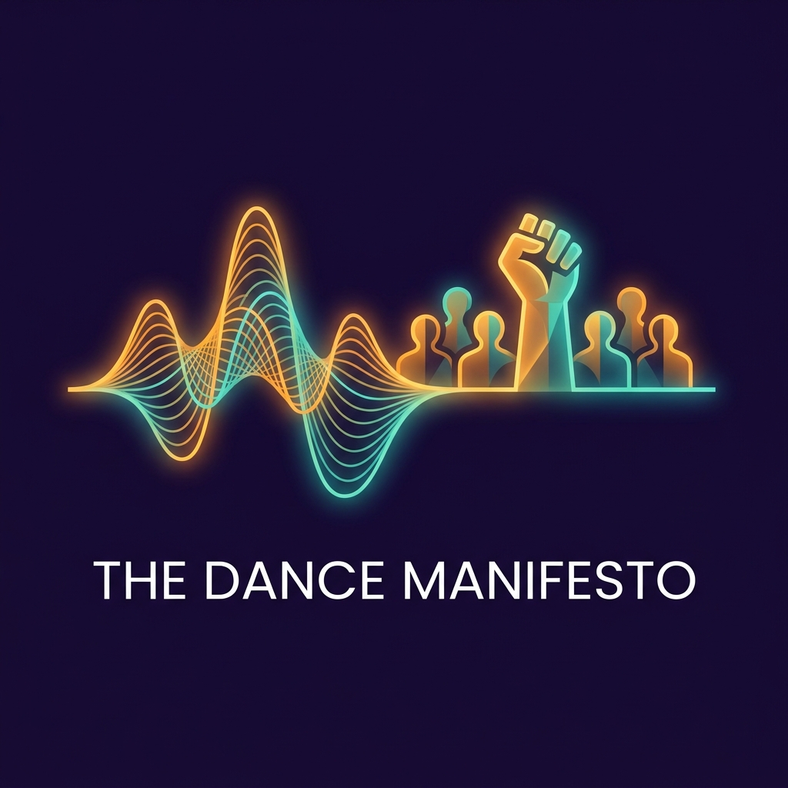

<iframe loading="lazy" style="border-radius: 12px;" src="https://open.spotify.com/embed/playlist/4pY9K4UP088Qj85D57qPUW?utm_source=generator" width="100%" height="780" frameborder="0" allowfullscreen="" allow="autoplay; clipboard-write; encrypted-media; fullscreen; picture-in-picture"></iframe><!-- /wp:image --><!-- wp:paragraph --><!-- wp:html -->

<!-- /wp:paragraph -->

<h2>Dance Manifesto Playlist </h2>
<h3>The Dance Manifesto doesn't ease you in. It opens by naming itself — Hyenah and Rimarkable's "The Manifesto," an Afro-leaning house cut on Rise Music, and the reason the whole playlist exists.</h3>

I sequenced it first because it states the argument out loud before a single other track has time to. Rimarkable's vocal sets the terms plainly: it doesn't matter how much money you make, what you look like, or who you love — what matters is what you offer, and the only moment that counts is this one, right here and now. It's a manifesto in the truest sense, a set of values delivered over a groove, asking us to come together and rise. It's not about a face, it insists — it's about us. And then it lands on the phrase I couldn't stop turning over while I built this set: that this feeling is as American as the blues, that America has always provided the atmosphere for exactly this kind of communal lift.

That's the seed everything else grew. Once that idea was the opener, the rest of the playlist became an answer to it — twenty-two tracks curated around empowerment and the quiet work of finding your inner strength, drawn from deep house, tech house and disco house, almost nothing harder, because those are the rooms where this feeling lives. I wanted a set that could carry you from the floor of a hard week back up onto your feet, arguing gently and then insistently for getting back up.

That "as American as the blues" idea kept circling while I sequenced it, and it's worth sitting with, because house music is one of the most American things there is — even when the records come from Berlin or São Paulo or Glasgow. The empowerment isn't something I imposed on these songs. It's already in them, in the

<h2>DNA of the genre itself.</h2>

Music born to set you free House didn't arrive as background music. It was built in Black and queer American clubrooms — Chicago first, then Detroit and New York — as music of release and self-possession, a place to be fully yourself when the world outside wasn't offering that. That origin is still audible in every four-on-the-floor kick on this playlist, and several of the people here direct lines back to it.

Mike Dunn, whose voice anchors Honey Dijon's "Work," is a genuine Chicago original — an Englewood-raised pioneer who's been making house since the 1980s and helped invent hip house along the way. Carl Craig, whose "Throw" sits near the heart of this set in its Slam RTM Remix, is one architect of Detroit's second techno wave and the founder of Planet E. And Honey Dijon herself — Chicago-born, now moving between New York and Berlin — has spent her career pushing house back toward the people who made it, refusing to flatten it into the polite, decaffeinated version that crossed over. When I say this music carries empowerment, I mean it was designed to. These are its keepers.

<h2>Track by track: the opening movement</h2>

If "The Manifesto" states the argument at the door, the records that follow pick it up and carry it, one by one. They're worth walking through.

Hardage's "Hysterical Years," in the Enea DJ &amp; Lukas Wolf remix, threads the voice of Gil Scott-Heron through the groove — and it pulls from the exact place my whole framing came from: his 1976 spoken-word piece "Bicentennial Blues," recorded with Brian Jackson around America's two-hundredth birthday. That performance is where the "as American as the blues" idea actually lives. Scott-Heron called himself and his peers not musicians but bluesicians, people whose job was to define the country back to itself, and his argument is unsparing: the blues is totally American because America built the atmosphere that birthed it — on the auction block, on the docks where the slave ships landed, in the courage of Harriet Tubman and the visions of Nat Turner. He traces the music's growth right alongside the country's, from Plymouth Rock to acid-rock, from 13 states to Watergate, and arrives at the line that does the real damage: the blues has grown up, but the country has not. The blues remember everything America chose to forget.

That's the conscience riding underneath this whole playlist. Scott-Heron turned national disquiet into something you could carry forward, and when his voice surfaces inside a contemporary house track, it isn't nostalgia — it's a handing-down. Rimarkable's "as American as the blues" on the opener and Scott-Heron's case from 1976 are the same argument, fifty years apart, set to the same insistence that this music belongs to the people who needed it most. He's why the playlist has a backbone and not just a pulse. Over fifty years on, his voice and his message keep resurfacing in new music precisely because the thing he was naming never resolved — every generation of producers who samples him is reaching for the same moral clarity.

Then the set lifts. Low Steppa &amp; Saison's "Dig Down Deep," with Sharlene Hector's voice, is the big house tune that opens the floor up — but listen past the lift and it's still carrying the argument. Its refrain is a plea to dig down deep and not lie about a man, and that's the whole point: it's a song about how a person's worth gets distorted, how easily someone is misrepresented when there's nobody standing up to hold the truth of who they are. That's the same thread "The Manifesto" pulls — judge people by what they offer, not the story told about them — and the same one running under Scott-Heron, who spent "Bicentennial Blues" insisting the country tell the truth about the people it had written out of its own history. Three records, three registers — a manifesto, a piece of spoken-word conscience, and a euphoric floor-filler — all making the same demand: don't lie about a person's value. Hold them up honestly, and do it right here, right now.

If "Dig Down Deep" opens the floor, "Promises" lowers the lights. Miguel Migs's deep-house production gets its rework here from Girls of the Internet — and that's no incidental credit. Their reworks are pure A-list, some of the sharpest deep-house production going, and their presence is part of why a set this wide-ranging still hangs together. Riding their slow, unhurried groove is Lisa Shaw, one of the most quietly essential voices in the music. Shaw came up through the San Francisco deep-house world, a Naked Music–era vocalist whose warmth became a kind of signature for an entire strain of the genre, and that's the strange, unfair thing about her: a generation has carried her voice in their bodies, danced to it, leaned on it on the comedown, and most of those people couldn't tell you her name. So much of dance music's emotional weight rests on session vocalists like her — the ones who give the records their soul and almost none of the credit. It's worth saying plainly: Lisa Shaw has given the music more than the music has given back to her.

And here she isn't commanding the floor the way Honey Dijon does on "Work." She's doing something gentler and harder — offering a hand. The complete song is built around a single, patient invitation to think about it. Not a demand, not a manifesto, just a soft, repeated nudge to sit with something, to reconsider, to let a feeling settle and maybe shift. After the conscience of Scott-Heron and the insistence of "Dig Down Deep," "Promises" is the moment the playlist stops arguing and simply asks. It trusts you to change your own mind. That's its own kind of empowerment — the quiet kind.

And then Bonobo's "Rosewood" — the breath in the middle of the set, the one record here that isn't built for the peak. Simon Green's track, on Ninja Tune, is down-tempo where almost everything else is four-on-the-floor, and that's exactly why it belongs: strength isn't only propulsion, sometimes it's stillness. Like the best tracks on this playlist, it works by repetition, circling one quiet promise — I won't leave you — until the phrase stops being a lyric and starts feeling like a fact. There's a second line that turns it, that another person's mind has set the singer free, and between the two you get the whole emotional logic of the song: devotion and liberation as the same gesture, staying because you've been freed rather than despite it. After Scott-Heron's reckoning and the floor-filling insistence of "Dig Down Deep," "Rosewood" lowers the temperature and makes the playlist's argument intimate. The manifesto was about us, plural, out loud. This is the same care turned toward one person, in a whisper. It's proof that the empowerment running through this set isn't always loud — sometimes it's just someone telling you, over and over until you believe it, that they aren't going anywhere.

If "Rosewood" is the whispered promise to stay, Kormak's "Baybee" is what comes after the staying — the warm, hands-in-the-air resolution. It's the most straightforwardly happy record on the playlist, built on a buoyant, soul-soaked vocal that does something the rest of the set has been circling toward without quite naming: it asks to go back to when two people were in love, and to take back the pain they caused each other. That's the missing piece of the argument. The whole playlist has been about not lying about a person's worth — and forgiveness is the act that restores it. You can't hold someone up honestly while still holding the damage against them; at some point the manifesto has to make room for grace. "Baybee" is that room. After the conscience of Scott-Heron, the insistence of "Dig Down Deep," and the hush of "Rosewood," this is the track that lets the breath out and lets the joy back in — restoration as its own kind of strength. It's the sound of two people deciding the love is bigger than the hurt, and choosing it again.

By the time Mr. ID's "Track ID1" arrives — in the Kerri Chandler remix — the playlist stops using words. The opening run laid out the terms in language: the Manifesto's values, Scott-Heron's reckoning, the plea of "Dig Down Deep." This is where the set turns those terms over to the body. It's an instrumental, all groove and space and hypnotic percussion, and that's the point — you've heard the argument, now you sit inside it. The mindset reset happens here, in the wordless stretch where you stop being told and start metabolizing.

It matters who's at the controls. Kerri Chandler is one of the most revered figures in deep house, a New Jersey native raised on the Black American church and the Jersey-and-New York garage tradition, the man whose warm, soulful, often gospel-rooted house has shaped the genre for three decades. The track came out on his own Kaoz Theory label, where he didn't just release Mr. ID's EP but remixed it himself — an elder lending his hand to a younger artist, which is its own quiet act of holding someone up. And the "623" in the title is his signature, a recurring personal motif threaded through his catalogue. That he reached for the No Piano version here is fitting: he set aside the church chords he's most loved for and left you with rhythm and air, the sound stripped to the part that moves you without explaining itself. After all those words, that's exactly the reset the playlist needs.

Coming out of that wordless reset, the playlist returns to language with a single instruction: work. Honey Dijon's "Work" turns the whole set's argument into a verb. Everything before it has been about believing — in your own worth, in someone else's, in forgiveness — and this is where belief is told to get up and do something. The vocal is part command, part dancefloor scripture: give your body to the moment, find your own center inside the sound, and understand that none of it arrives by standing still. It keeps pressing the point that there's no substitute for the real thing — you have to actually let the music reach you, not just hear it. After a track that let you metabolize in silence, "Work" says: now move. There's work to do, and you can't do it from the sidelines.

It lands so hard because of who and what's behind it. Honey Dijon — Chicago-born, now between New York and Berlin — built it with Classic Music Company, the label Derrick Carter and Luke Solomon founded in 1994, and stacked it with live jazz: real horns, a brass-and-bass warmth woven into the groove. That jazziness is exactly what makes it the perfect follow to the stripped - down Chandler cut — where "Track ID1" was air and percussion, "Work" floods the room back up with horns. The vocals come from Dave Giles II, Cor. Ece, and the Chicago house legend Mike Dunn, the Englewood pioneer who's been making this music since the 1980s, and the whole thing is an open homage to the Harlem ballroom scene — house handed back to the Black and queer American communities who built it. It's empowerment as effort and as joy in the same breath. You don't so much listen to "Work" as get instructed by it: believe you deserve it, then earn it on the floor.

<h2>What do twenty-two tracks have in common</h2>

Read the titles back in sequence, and the argument writes itself. "Dig Down Deep." "The Manifesto." "Courage International." "Keep 'Em Movin'." "Keep Moving." "Live My Life." "Work." The empowerment isn't subtext — it's stated, over and over, by people who mostly didn't know they were being gathered into the same conversation.

Musically, what binds them is the four-on-the-floor as a vehicle rather than a destination. Underneath every one of these tracks is the same steady heartbeat, and on top of it, almost without exception, a vocal or a melodic phrase reaching for uplift. Low Steppa &amp; Saison's "Dig Down Deep," with Sharlene Hector's voice, does it through gospel-tinged house on Defected's DFTD. Miguel Migs and Lisa Shaw's "Promises," in the Girls Of The Internet mix, does it through the silk of West Coast deep house. Kerri Chandler — the New Jersey deep-house elder — does it through his 623 remix of Mr. ID, all space and feel. The textures differ wildly, but the gesture is identical: hold steady, lift up.

That's the real common thread. Whether it's the deep end (Chandler, Migs, the Detroit patience of Brian Kage &amp; Delano Smith on "Keep 'Em Movin'"), the tech end (Daniel Steinberg's "2001," Catz N Dogz and Monty Luke's "They Frontin'"), or the disco end (Jungle, Paperclip People), every track treats the groove as something to draw strength from. Resilience you can move to.

<h2>The set is built to be mixed</h2>

I pulled this playlist together thinking like a DJ, not just a curator (DJ iGUY). I still mix with BPM and keys using this method, and this set is built on harmonic sequencing with keys moving in deliberate, mixable steps—the run from track 3 onwards (8A → 2A → 2A → 10A → 6A → 7B) follows Camelot-wheel-friendly transitions. The 2A to 2A match between "Promises" and "Rosewood" is a perfect key transition, turning a potential break into one continuous exhale. The BPM tells a similar story: opening at a moderate 120, easing to 121 for "Rosewood", then climbing and holding at 125 for the Honey Dijon / Detroit stretch. It finishes with a defiant ramp—hitting 127 for "Throw" and "Gabriel"—before settling at 126 for the finale, proving the set lands on defiance, not exhaustion.

<h2>And where they pull apart</h2>

What keeps the playlist from being one long blur is how different these artists actually are once you look past the shared pulse.

Geographically, it's a small atlas. Chicago and Detroit and New Jersey anchor the American spine, but Jungle and Dave Lee bring London — Lee, the Z Records founder and disco-boogie obsessive, turns "Keep Moving" into a gleaming early-'80s revision. Vintage Culture beams in from Brazil with Sonny Fodera on "Nightjar," all festival-sized euphoria. Daniel Steinberg is German, Catz N Dogz are Polish, Ewan McVicar is Scottish, Hyenah brings an Afro-leaning sway to "The Manifesto" on Rise Music. Empowerment is a global dialect, but every speaker has an accent.

The textures pull apart too, and deliberately. Bonobo's "Rosewood" is the outlier — a downtempo, Ninja Tune breath that lowers the heart rate without breaking the mood, proof that strength can be patient and propulsive. Dido's "Don't Believe in Love," in Dennis Ferrer's Objektivity mix, smuggles a mainstream pop voice into a New York house frame. Little Boots, the British synth-pop singer, turns up on the closer "Burn This House" with J. Worra. These aren't dilutions — they're the playlist insisting that this feeling doesn't belong to one room or one crowd. It survives translation into pop, into Afro house, into Brazilian big-room, into Detroit minimalism, and comes out the other side intact.

That's the part I find quietly moving. Twenty-two artists who'd never share a bill agree, without conferring, on the same emotional argument.

<h2>How it ends</h2>

I sequenced the back half to land on defiance rather than exhaustion. Cumhur Jay's "Courage International" practically announces it. Danae's "Flowers In The Garden" and Jamie 3:26 and Jurgen Bouman's "Live My Life" — a record built on the Chicago edit tradition and released through the storied Nu Groove — keep the resolve warm and human rather than triumphalist. And the two newest additions close it on a forward lean: Joe Goddard and Valentina's "Gabriel," handed to Ewan McVicar for a house rework, and then "Burn This House," all release and burn-it-down catharsis.

No filler, no comedown for its own sake. Each track is a minor argument for standing up again, and the sequence is designed so that by the end you believe it a little more than you did at the start.

That's why the Dance Manifesto earns its name. It runs from Gil Scott-Heron's American conscience to a Glasgow remix to a Detroit organ line, and somehow it all says the same thing. Music really is one of the most powerful tools we have for moving through difficulty — not by ignoring it, but by giving it a rhythm you can ride. Twenty-two tracks, three countries' worth of house music, one stubborn idea about resilience.

<strong>Play it loud. Play it when you need it most</strong>.

<h2>Playlist</h2>
<figure class="wp-block-table is-style-stripes has-small-font-size">
<table class="has-fixed-layout">
<thead>
<tr>
<th>Artist</th>
<th>Track</th>
</tr>
</thead>
<tbody>
<tr>
<td>Hardage Feat. Gil Scott-Heron</td>
<td>Hysterical Years (Enea DJ &amp; DJ Lukas Wolf Remix) ❤️</td>
</tr>
<tr>
<td>Low Steppa &amp; Saison Feat. Sharlene Hector</td>
<td>Dig Down Deep 
[DFTD]?</td>
</tr>
<tr>
<td>Hyenah &amp; Rimarkable</td>
<td>The Manifesto 
[Rise Music]</td>
</tr>
<tr>
<td>Miguel Migs Feat. Lisa Shaw</td>
<td>Promises (Girls Of The Internet Mix) 
[Soulfuric Deep]❤️</td>
</tr>
<tr>
<td>Bonobo</td>
<td>Rosewood 
[Ninja Tune]</td>
</tr>
<tr>
<td>Kormak</td>
<td>Baybee ❤️</td>
</tr>
<tr>
<td>Mr. ID</td>
<td>Track ID1 (Kerri Chandler 623 No Piano Mix) 
[Kaoz Theory]</td>
</tr>
<tr>
<td>Honey Dijon Feat. Dave Giles II, Cor.Ece &amp; Mike Dunn</td>
<td>Work (When Honey Met Harry Mix) 
[Classic Music Company]</td>
</tr>
<tr>
<td>Brian Kage &amp; Delano Smith</td>
<td>Keep ‘Em Movin’ [Michigander]</td>
</tr>
<tr>
<td>Cumhur Jay</td>
<td>Courage International [Riverette] ❤️</td>
</tr>
<tr>
<td>Vintage Culture &amp; Sonny Fodera Feat. SHELLS</td>
<td>Nightjar ?</td>
</tr>
<tr>
<td>Danae</td>
<td>Flowers In The Garden 
[Bubble Tease Communications] ❤️❤️</td>
</tr>
<tr>
<td>Jungle</td>
<td>Keep Moving (Dave Lee Jungle Boogie Mix) 
[ZR Records]</td>
</tr>
<tr>
<td>Daniel Steinberg</td>
<td>2001 
[Arms &amp; Legs] ❤️❤️</td>
</tr>
<tr>
<td>Catz N Dogz Feat. Monty Luke</td>
<td>They Frontin’</td>
</tr>
<tr>
<td>Nic Joseph &amp; Mizbee</td>
<td>On Me 
[Simma Black]</td>
</tr>
<tr>
<td>Jamie 3:26 &amp; Jurgen Bouman</td>
<td>Live My Life 
[Nu Groove Records] ❤️❤️</td>
</tr>
<tr>
<td>Paperclip People</td>
<td>Throw (Slam’S RTM Remix) 
[Planet E Communications]</td>
</tr>
<tr>
<td>Miguel Campbell</td>
<td>Not that kind of Girl - MAM Remix</td>
</tr>
<tr>
<td>Dido</td>
<td>Don’t Believe In Love (Dennis Ferrer Objektivity Mix) 
[Cheeky Records] ❤️</td>
</tr>
</tbody>
</table>
</figure>

