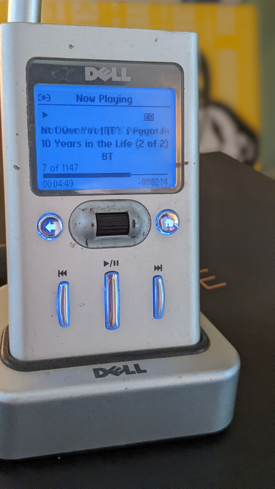

I can't make any promises on how this playlist will end up. For the moment, my (recently discovered) MP3 player from the earlier 2000's with 1147 tracks is lined up and ready to (rave) play. Here is the resulting playlist. <strong>Which jams do you remember? </strong>

<figure class="wp-block-image aligncenter size-large"></figure>

<iframe loading="lazy" src="https://open.spotify.com/embed/playlist/0gijKHKXuEjgBuhHlNGsaH?utm_source=generator&amp;theme=0" width="100%" height="600px" frameborder="0" allowfullscreen="" allow="autoplay; clipboard-write; encrypted-media; fullscreen; picture-in-picture"></iframe>

