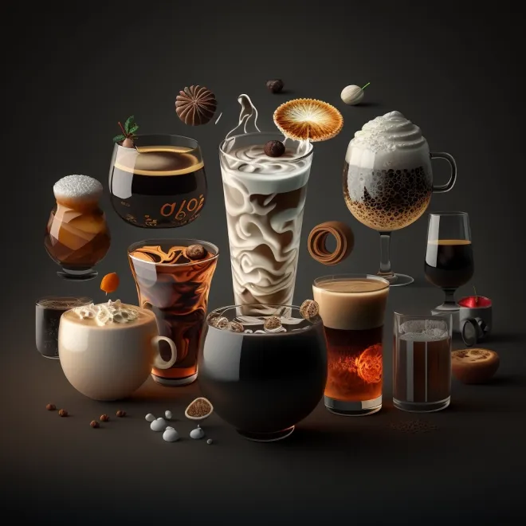
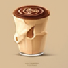
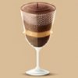

<h2 class="wp-block-heading alignwide has-background-color has-text-color" style="font-size:64px">Coffee-Inspired Playlist</h2>

Cup of Ambition 2.0 is not just a playlist, it's a celebration of coffee culture.

<iframe style="border-radius:12px" src="https://open.spotify.com/embed/playlist/6ZtU7h0PptSsspakbip076?utm_source=generator&amp;theme=0" width="100%" height="800px" frameborder="10" allowfullscreen="" allow="autoplay; clipboard-write; encrypted-media; fullscreen; picture-in-picture" loading="lazy"></iframe>

Are you a coffee lover? Do you enjoy listening to music while sipping on your cup of joe? If so, you're in the right place! Cup of Ambition is a coffee-inspired playlist that will surely kick start your day. The playlist started as a holiday CD that came with a small pack of coffee and custom art. However, as the CDs broke, the online version of Cup of Ambition 2.0 was born and now extends to more than 30+ songs.

Cup of Ambition is not just a playlist, it's a celebration of coffee culture. It's a fun and unique way to enjoy your favorite beverage while discovering new music. So, grab a cup of coffee, press play, and let the music take you on a journey.

<h3 class="wp-block-heading">A Playlist with a Twist</h3>

What makes Cup of Ambition unique is that all the songs have a coffee reference. From indie pop to jazz standards, euro pop, country rock, and even some metal, you'll find a wide variety of genres that celebrate this beloved beverage. Each song on the playlist has a different vibe, so you can choose what kind of coffee-inspired mood you're in.

Not only is Cup of Ambition a great way to discover new music, but it's also a fun way to learn more about coffee culture. You'll hear references to espresso shots, latte art, coffee beans, and much more. Whether you're a barista, coffee enthusiast, or just someone who enjoys a good cup of coffee, this playlist is for you.

<figure class="wp-block-image size-full has-custom-border"><figcaption class="wp-element-caption">Digital Ai Art by Gary Crossey</figcaption></figure>

<h2 class="wp-block-heading">Sip, Listen, and Enjoy</h2>

So, what are you waiting for? Pour yourself a cup of ambition and start listening to the ultimate coffee-inspired playlist. From the upbeat and energetic "Coffee" by Supersister (a personal favourite) to the smooth and sultry "Black Coffee" by Sarah Vaughan, there's something for every coffee lover on this playlist.

And the best part? You can access Cup of Ambition 2.0 online (playlist above), so you can listen to it anytime, anywhere. Whether you're commuting to work, working from home, or simply relaxing at home, this playlist will surely brighten up your day.

<figure class="wp-block-image alignleft size-full has-custom-border"></figure>

<strong>Coffee Time - Natalie Cole</strong>: "Coffee Time" is a song that was written by Arthur Freed and Harry Warren. It was originally featured in the 1945 film "Musical Movieland" and has been covered by various artists over the years. Natalie Cole's version was released in 1991 as a single and was later included on her album "Unforgettable... with Love." The song features Cole's smooth vocals accompanied by a jazz-inspired arrangement.

<figure class="wp-block-image alignleft size-full has-custom-border"></figure>

<strong>Cup Of Coffee - Garbage</strong>: "Cup of Coffee" is a song by the American-Scottish alternative rock band Garbage. It was released in 2002 as a single from their album "Beautiful Garbage." The song was written by the band's lead vocalist Shirley Manson and features her emotive vocals accompanied by a sparse piano arrangement. The lyrics describe the aftermath of a breakup and the feelings of loneliness and regret that follow.

<figure class="wp-block-image alignleft size-full has-custom-border"></figure>

<strong>Starfish and Coffee (featuring Maya Rudolph) - Renee &amp; Friends</strong>: "Starfish and Coffee" is a song by Prince, originally released on his 1987 album "Sign o' the Times." The song was written by Prince and features his signature blend of funk, pop, and rock. Renee &amp; Friends is a children's music project that reimagines classic songs with new arrangements and featuring guest vocalists. For this version of "Starfish and Coffee," Renee &amp; Friends collaborated with comedian and actress Maya Rudolph, who provides the lead vocals.

<figure class="wp-block-image alignleft size-full has-custom-border"></figure>

<strong>Coffee Homeground - Kate Bush:</strong> "Coffee Homeground" is a song by the British singer-songwriter Kate Bush. It was released in 1978 as a B-side to her single "The Man with the Child in His Eyes." The song features Bush's ethereal vocals accompanied by a dreamy arrangement of piano, bass, and drums. The lyrics describe a person who believes they are been poisoned.

<figure class="wp-block-image alignleft size-full has-custom-border"></figure>

<strong>Wake Up And Smell The Coffee - The Cranberries:</strong> "Wake Up and Smell the Coffee" is a song by the Irish rock band The Cranberries. It was released in 2001 as the title track of their fifth studio album. The song was written by the band's lead vocalist Dolores O'Riordan and features her distinctive vocals accompanied by a driving guitar riff. The lyrics describe the sense of urgency and determination needed to achieve one's goals.

<figure class="wp-block-image alignleft size-full has-custom-border"></figure>

<strong>Coffee (Radio Edit) - Supersister:</strong> "Coffee" is a song by the Dutch pop band Supersister. It was released in 1972 as a single and later included on their album "Pudding en Gisteren." The song features a jazzy arrangement of piano, saxophone, and drums, with lyrics that playfully describe the pleasures of drinking coffee.

<figure class="wp-block-image alignleft size-full has-custom-border"></figure>

<strong>Coffee - Ledisi:</strong> "Coffee" is a song by the American singer Ledisi. It was released in 2017 as a single and later included on her album "Let Love Rule." The song features Ledisi's smooth vocals accompanied by a jazzy arrangement of piano, saxophone, and drums. 

<figure class="wp-block-image alignleft size-full has-custom-border"></figure>

<strong>I Don't Sleep, I Drink Coffee Instead - Brenda Kahn:</strong> "I Don't Sleep, I Drink Coffee Instead" is a song by the American singer-songwriter Brenda Kahn. It was released in 1994 as a single and later included on her album "Epiphany in Brooklyn." The song features Kahn's raw, emotive vocals accompanied by a sparse arrangement of guitar and drums. The lyrics describe the restless, obsessive nature of creativity and the need for caffeine to fuel it.

<figure class="wp-block-image alignleft size-full has-custom-border"></figure>

<strong>Black Coffee - All Saints, Mark Stent: </strong>"Black Coffee" is a song by the British girl group All Saints. It was released in 2000 as a single and later included on their album "Saints &amp; Sinners." The song features the group's smooth harmonies accompanied by a dance-inspired arrangement of beats and synths. The lyrics describe the pain of heartbreak and the need for a strong cup of coffee to get through it.

<figure class="wp-block-image alignleft size-full has-custom-border"></figure>

<strong>You're The Cream In My Coffee - Seth MacFarlane:</strong> "You're the Cream in My Coffee" is a song from the 1928 musical "Hold Everything!" It has been covered by various artists over the years, including Seth MacFarlane, who included his version on his album "Music Is Better Than Words." MacFarlane's rendition features his smooth vocals accompanied by a lush arrangement of strings and horns.

<figure class="wp-block-image alignleft size-full has-custom-border"></figure>

<strong>The Coffee Song - Frank Sinatra:</strong> "The Coffee Song" is a song written by Bob Hilliard and Dick Miles. It has been covered by various artists over the years, including Frank Sinatra, who included his version on his album "Ring-a-Ding-Ding!" The song features Sinatra's signature crooning vocals accompanied by a swinging arrangement of horns and percussion.

<figure class="wp-block-image alignleft size-full has-custom-border"></figure>

<strong>9 to 5 - Dolly Parton: </strong>"9 to 5" is a song written and performed by the American country singer Dolly Parton. It was released in 1980 as the title track of the film "9 to 5." The song features Parton's sassy vocals accompanied by a catchy arrangement of guitar, bass, and drums. The lyrics describe the monotony and frustration of working a 9-to-5 job.

<figure class="wp-block-image alignleft size-full has-custom-border"></figure>

<strong>40 Cups Of Coffee - Ella Mae Morse:</strong> "40 Cups of Coffee" is a song by the American singer Ella Mae Morse. It was released in 1953 as a single and later included on her album "Barrelhouse, Boogie, and the Blues." The song features Morse's soulful vocals accompanied by a swinging arrangement of piano, horns, and drums. The lyrics describe the jittery, wired feeling of drinking too much coffee.

<figure class="wp-block-image alignleft size-full has-custom-border"></figure>

<strong>Coffee Cups - Dave Morrison:</strong> "Coffee Cups" is a song by the Canadian singer-songwriter Dave Morrison. It was released in 2004 as a single and later included on his album "The Other Side." The song features Morrison's introspective lyrics and gentle vocals accompanied by a sparse arrangement of guitar and percussion.

<figure class="wp-block-image alignleft size-full has-custom-border"></figure>

<strong>Black Coffee - Dave Carter:</strong> "Black Coffee" is a song by the American folk singer Dave Carter. It was released in 1995 as a single and later included on his album "When I Go." The song features Carter's raw, emotive vocals accompanied by a rustic arrangement of guitar, mandolin, and fiddle. The lyrics describe the heartache of a failed relationship and the comfort of a strong cup of coffee.

<figure class="wp-block-image alignleft size-full has-custom-border"></figure>

<strong>Can't Drink Enough Coffee - Dave Bader: </strong>"Can't Drink Enough Coffee" is a song by the American singer-songwriter Dave Bader. It was released in 2005 as a single and later included on his album "Coffeehouse." The song features Bader's witty lyrics and breezy vocals accompanied by a jazzy arrangement of guitar, bass, and drums.

<figure class="wp-block-image alignleft size-full has-custom-border"></figure>

<strong>Coffee Coffee Coffee - Dave Dudley:</strong> "Coffee Coffee Coffee" is a song by the American country singer Dave Dudley. It was released in 1966 as a single and later included on his album "Thanks for All the Miles." The song features Dudley's deep, resonant vocals accompanied by a rollicking arrangement of guitar, drums, and horns. The lyrics describe the singer's dependence on coffee to keep him going on the road.

<figure class="wp-block-image alignleft size-full has-custom-border"></figure>

<strong>Coffee Jim - Dave Dudley: </strong>"Coffee Jim" is a song by the American country singer Dave Dudley. It was released in 1965 as a single and later included on his album "Travelin' with Dave Dudley." The song features Dudley's twangy vocals accompanied by a honky-tonk arrangement of guitar, bass, and drums. The lyrics describe the story of a truck driver named Coffee Jim who drinks coffee to stay awake on the road.

<figure class="wp-block-image alignleft size-full has-custom-border"></figure>

<strong>I'll Have Another Cup of Coffee (Then I'll Go) - Dave Dudley: </strong>"I'll Have Another Cup of Coffee (Then I'll Go)" is a song by the American country singer Dave Dudley. It was released in 1966 as a single and later included on his album "Thanks for All the Miles." The song features Dudley's smooth vocals accompanied by a lush arrangement of strings and horns. The lyrics describe the singer's reluctance to leave his lover and his need for one more cup of coffee before he goes.

<figure class="wp-block-image alignleft size-full has-custom-border"></figure>

<strong>Old Mill Coffee - Gary Daverne:</strong> "Old Mill Coffee" iThe song "Old Mill Coffee" by Gary Daverne is a delightful composition that pays homage to the joy and warmth that a cup of coffee can bring.

<figure class="wp-block-image alignleft size-full has-custom-border"></figure>

<strong>Coffee &amp; TV - Blur: </strong>"Coffee &amp; TV" is a song by the British rock band Blur. It was released in 1999 as a single and later included on their album "13." The song features lead vocalist Graham Coxon's plaintive vocals accompanied by a bouncy arrangement of guitar, bass, and drums. The lyrics describe the singer's search for connection and meaning in a world that seems increasingly disconnected.

<figure class="wp-block-image alignleft size-full has-custom-border"></figure>

<strong>Black Coffee in Bed - Ernie Halter:</strong> "Black Coffee in Bed" is a song by the British new wave band Squeeze. It was released in 1982 as a single and later included on their album "Sweets from a Stranger." Ernie Halter's version features his smooth vocals accompanied by a stripped-down acoustic arrangement of guitar and percussion.

<figure class="wp-block-image alignleft size-full has-custom-border"></figure>

<strong>Black Coffee - Sarah Vaughan:</strong> "Black Coffee" is a song written by Sonny Burke and Paul Francis Webster. It has been covered by various artists over the years, including Sarah Vaughan, who included her version on her album "Sarah Vaughan with Clifford Brown." The song features Vaughan's powerful vocals accompanied by a lush arrangement of strings and horns.

<figure class="wp-block-image alignleft size-full has-custom-border"></figure>

<strong>One More Cup of Coffee - Bob Dylan:</strong> "One More Cup of Coffee" is a song by the American singer-songwriter Bob Dylan. It was released in 1976 on his album "Desire." The song features Dylan's distinctive vocals accompanied by a haunting arrangement of guitar and violin. The lyrics describe a doomed love affair and the singer's need for one more cup of coffee before he goes.

<figure class="wp-block-image alignleft size-full has-custom-border"></figure>

<strong>Coffee Blues - Mississippi John Hurt:</strong> "Coffee Blues" is a song by the American blues singer Mississippi John Hurt. It was originally recorded in 1928 and later included on his album "The Best of Mississippi John Hurt." The song features Hurt's gentle vocals accompanied by a fingerpicked guitar. The lyrics describe the singer's love for coffee and the way it helps him get through the day.

<figure class="wp-block-image alignleft size-full has-custom-border"></figure>

<strong>Cigarettes and Coffee - Otis Redding:</strong> "Cigarettes and Coffee" is a song by the American soul singer Otis Redding. It was released in 1966 on his album "The Soul Album." The song features Redding's soulful vocals accompanied by a laid-back arrangement of guitar, bass, and drums. The lyrics describe the simple pleasures of sharing a cup of coffee and a cigarette with a lover.

<figure class="wp-block-image alignleft size-full has-custom-border"></figure>

<strong>One More Cup Of Coffee - The White Stripes: </strong>"One More Cup of Coffee" is a song by the American singer-songwriter Bob Dylan. It was covered by the American rock duo The White Stripes and released in 2004 on their album "Live Under Blackpool Lights." The song features the duo's stripped-down, bluesy style and lead vocalist Jack White's gritty vocals.

<figure class="wp-block-image alignleft size-full has-custom-border"></figure>

<strong>Coffee, God, And Cigarettes - Mischief Brew:</strong> "Coffee, God, and Cigarettes" is a song by the American folk punk band Mischief Brew. It was released in 2005 on their album "Smash the Windows." The song features the band's raw, energetic style and lead vocalist Erik Petersen's gritty vocals. The lyrics describe the singer's vices and the way they help him cope with the struggles of life.

<figure class="wp-block-image alignleft size-full has-custom-border"></figure>

<strong>Coffee And Wine - Chadwick Stokes, State Radio, Sierra Leone's Refugee All Stars: </strong>"Coffee and Wine" is a song by the American singer-songwriter Chadwick Stokes of the band State Radio. It features Sierra Leone's Refugee All Stars and was released in 2012 on Stokes' album "Simmerkane II." The song features a relaxed, folksy arrangement of guitar, percussion, and horns, with lyrics that describe the simple pleasures of life like drinking coffee and sharing wine with friends.

<figure class="wp-block-image alignleft size-full has-custom-border"></figure>

<strong>Don't Forget The Coffee Billy Joe - Tom T. Hall: </strong>"Don't Forget the Coffee Billy Joe" is a song by the American country singer Tom T. Hall. It was released in 1976 on his album "The Magnificent Music Machine." The song features Hall's smooth vocals accompanied by a twangy arrangement of guitar, bass, and drums. The lyrics describe the importance of coffee in the singer's daily routine.

<figure class="wp-block-image alignleft size-full has-custom-border"></figure>

<strong>A Cup of Coffee - Julian Moon: </strong>"A Cup of Coffee" is a song by the American singer-songwriter Julian Moon. It was released in 2014 as a single and later included on her album "Good Girl." The song features Moon's sweet, delicate vocals accompanied by a simple arrangement of guitar and percussion. The lyrics describe the singer's longing for a simple life and the comfort of a cup of coffee.

<figure class="wp-block-image alignleft size-full has-custom-border"></figure>

<strong>Coffee Shop (feat. Gorilla Zoe) - Young Joc, Gorilla Zoe:</strong> "Coffee Shop" is a song by the American rapper Young Joc featuring Gorilla Zoe. It was released in 2007 as a single and later included on Young Joc's album "Hustlenomics." The song features a catchy, upbeat arrangement of beats and synths, with lyrics that describe the singers' love for coffee and the way it helps them stay awake and focused.

<figure class="wp-block-image alignleft size-full has-custom-border"></figure>

P<strong>atricia - Acoustic - Florence + The Machine: </strong>"Patricia - Acoustic" is a song by the British band Florence + The Machine. It was released in 2018 and is an acoustic version of the original song "Patricia," which was released in 2018 as well. The song's theme is about the power of female friendship and the support that women can offer each other. The musical style is a mix of indie rock and folk, with Florence Welch's powerful vocals at the forefront. Welch co-wrote the song with Emile Haynie and Thomas Bartlett. The acoustic version features Welch's vocals accompanied by a guitar, giving the song a more stripped-down and intimate feel.

<figure class="wp-block-image alignleft size-full has-custom-border"></figure>

<strong>Sleeping Alone - Live from The Majestic Theatre - k.d. lang: </strong>"Sleeping Alone" is a song by the Canadian singer-songwriter k.d. lang. This version was recorded live at The Majestic Theatre in San Antonio, Texas and released in 2009 on her album "Recollection." The song features lang's emotive vocals accompanied by a lush arrangement of strings and piano. The lyrics describe the pain of loneliness and the desire for human connection.

<figure class="wp-block-image alignleft size-full has-custom-border"></figure>

<strong>COFFEE - Kelly Rowland:</strong> "COFFEE" is a song by the American singer Kelly Rowland. It was released in 2020 as a single and features a sultry, R&amp;B-inspired arrangement of beats and synths. 

<figure class="wp-block-image alignleft size-full has-custom-border"></figure>

<strong>Death bed (coffee for your head) - Powfu, beabadoobee:</strong> "death bed (coffee for your head)" is a song by the Canadian rapper Powfu featuring beabadoobee. It was released in 2020 as a single and features a laid-back, lo-fi arrangement of beats and guitar. The lyrics describe the singer's desire to spend his final moments with a loved one, sharing a cup of coffee.

<figure class="wp-block-image alignleft size-full has-custom-border"></figure>

<strong>My Country Sugar Mama - Howlin' Wolf:</strong> "My Country Sugar Mama" is a song by the American blues singer Howlin' Wolf. It was released in 1965 on his album "The Real Folk Blues." The song features Wolf's deep, growling vocals accompanied by a gritty arrangement of guitar, bass, and drums. The lyrics describe the singer's love for a wealthy woman who provides him with the material comforts of life, including sugar for his coffee.

<a class="wp-block-button__link wp-element-button" href="https://open.spotify.com/playlist/6ZtU7h0PptSsspakbip076?si=b515a2487ff34771" style="border-radius:30px" target="_blank" rel="noreferrer noopener">Click for Direct Spotify Link</a>

Sip, Listen, and Enjoy

