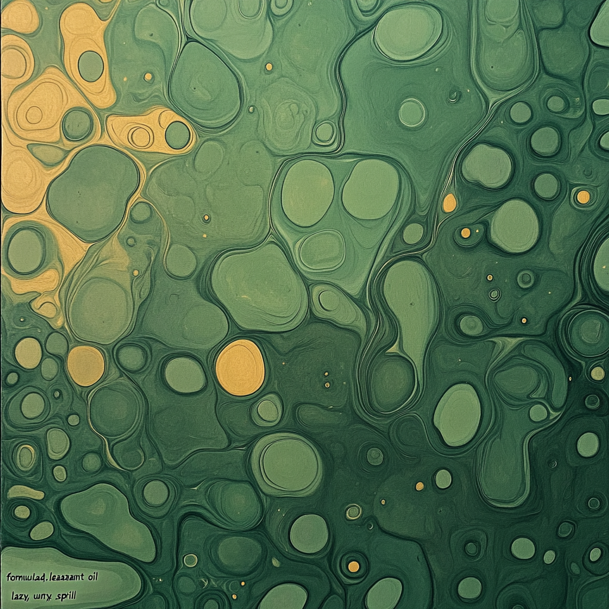

The Cure’s 2025 LP:  A Review of Mixes Of A Lost World

<strong>Twenty-four remixes. One iconic band.</strong> The Cure’s <em>Mixes Of A Lost World</em> lands today with an ambitious promise: to reinvent their acclaimed 2024 LP through the lens of electronic music’s finest. From dance pioneers Paul Oakenfold and Orbital to contemporary innovators Four Tet, Mogwai, and Chino Moreno, this isn’t just another remix album – it’s a collision of musical worlds. While the project’s charitable partnership with War Child UK adds heart to its purpose, a crucial question emerges: can these 24 interpretations capture The Cure’s atmospheric mastery, or will this sprawling collection dissolve into a maze of missed opportunities? The pre-release singles were disappointingly formulaic and flat.

<figure class="wp-block-embed is-type-rich is-provider-spotify wp-block-embed-spotify wp-embed-aspect-21-9 wp-has-aspect-ratio">

<iframe title="Spotify Embed: Mixes Of A Lost World&amp;apos;: The Cure&amp;apos;s Remix LP — Hits, Misses, &amp; Unexpected Transformations" style="border-radius: 12px" width="100%" height="152" frameborder="0" allowfullscreen allow="autoplay; clipboard-write; encrypted-media; fullscreen; picture-in-picture" loading="lazy" src="https://open.spotify.com/embed/episode/5yU66tD1PXABJgiUdicokH?si=qhegsWnjQtCalpJwyLMyvw&utm_source=oembed"></iframe>

</figure>

<h2 class="wp-block-heading">The Early Disappointments: Setting Low Expectations</h2>

Let’s dive into the first three singles that kicked off this remix collection – and hold onto your headphones, because this is where things get interesting (and a bit painful). Paul Oakenfold, Orbital, and Four Tet – three legendary names in electronic music – were tasked with reimagining The Cure’s haunting soundscapes. The result? Let’s just say these remixes left me checking my speakers to make sure they were working properly.

First up, Paul Oakenfold’s “Cinematic” remix of “I Can Never Say Goodbye” promised exactly what it says on the tin – a cinematic experience. Picture this: the opening moments actually nail it, crafting a moody atmosphere worthy of those brilliant Northern Irish dramas like “The Fall.” But then… oh dear. What follows is like watching someone slowly dismantle a perfectly good sports car and replace its engine with a golf cart motor. Oakenfold strips away The Cure’s thunderous instrumentation, those raw, emotional guitar riffs, and even the subtle percussion that made the original so powerful. In their place? Generic keyboard sounds that would feel at home in a 2010 movie trailer. The iconic guitar riff makes just two brief cameos, like a rockstar reduced to doing walk-on parts in their own show. What we’re left with is essentially Robert Smith’s magnificent voice floating in a sea of vanilla electronic sounds – it’s “The Cure: Karaoke Edition.”

Then there’s Orbital’s take on “Endsong,” which feels like stumbling into a time machine set to “Generic Trance Club, Circa 2002.” Now, I love a good throwback as much as anyone, but this isn’t so much a throwback as it is a step backward. The original “Endsong” might not be The Cure’s most-played track, but Orbital’s treatment – shortening the intro and slapping on a basic drum beat – feels about as innovative as putting ketchup on a fine steak. As Robert Smith hauntingly asks “where did the time go?” in the lyrics, I found myself wondering “where did the creativity go?” The cruel irony? This remix leaves us with exactly what Robert laments in the song – nothing.

Looking at these first singles together, it’s clear what went wrong: big-name producers playing it frustratingly safe. Instead of bold reinvention, we got musical paint-by-numbers. These aren’t remixes that make you hear The Cure in a new light – they’re more like hearing The Cure through a broken light bulb.

<h2 class="wp-block-heading">The Good Stuff: When Things Start to Click</h2>

The album’s trajectory takes an intriguing turn with Daniel Avery’s remix of “Drone:nodrone.” Avery introduces a sophisticated interplay of textures, layering a muscular beat beneath atmospheric elements that breathe new life into what was previously one of the original album’s more understated tracks. While the remix maintains the song’s structural bones, it adds compelling sonic details that reward repeated listens.

But it’s Meera’s transformative take on “All I Ever Am” that truly showcases the potential of this remix project. Here, finally, is a reimagining that dares to deconstruct and rebuild. The introduction of South Asian musical elements creates an unexpected but entirely natural fusion, while the bold treatment of Smith’s vocals – processed into beautiful abstraction – demonstrates how a remix can honor its source material while charting entirely new territory. Though the eight-minute runtime occasionally tests the limits of its ideas, and the abrupt ending feels somewhat unresolved, these are minor quibbles in what stands as one of the collection’s most adventurous and successful experiments.

The Âme remix of “A Fragile Thing” stands as the album’s crowning achievement. The German electronic music duo, consisting of Kristian Beyer and Frank Wiedemann, brings their signature deep house expertise to transform The Cure’s track into something truly extraordinary. Known for their work on the prestigious Innervisions label and their ability to craft emotional electronic landscapes, Âme delivers a masterclass in remix artistry here. Their interpretation completely reconstructs the song from the ground up, weaving Smith’s vocals through a hypnotic tapestry of crisp percussion and pulsating synthesizers. The production is immaculate – every element sits perfectly in the mix, from the subtly processed vocals to the warm, analog-inspired bass tones. Around the three-minute mark, they introduce a cleverly distorted keyboard motif that subtly references The Cure’s earlier work while maintaining a thoroughly modern sound palette. The remix’s true genius emerges at 3:48, where a dramatic breakdown and tempo shift demonstrates Âme’s profound understanding of both club dynamics and The Cure’s atmospheric heritage. This moment of transformation elevates the track from merely excellent to truly exceptional, showcasing why Beyer and Wiedemann are considered among electronic music’s most sophisticated producers. It’s a rare achievement when a remix surpasses its source material, but Âme manages this feat while maintaining deep respect for the original’s emotional core.

Mental Overdrive’s reimagining of “I Can Never Say Goodbye” emerges as one of the collection’s most audacious transformations. The producer boldly transplants The Cure’s gothic DNA into sun-drenched territory, crafting an unexpectedly euphoric beach-ready anthem. Through clever manipulation of tempo and Robert Smith’s vocals, the remix achieves what few others dare attempt: a complete tonal shift that somehow preserves the band’s essential character. The track’s sophisticated production reveals itself in the details, particularly at the 3:15 mark, where a masterful tempo drop briefly returns Smith’s vocals to their original pitch – a moment of technical prowess that serves the song rather than overshadowing it. The evolving backbeat and meticulous integration of The Cure’s instrumental elements demonstrate Mental Overdrive’s deep understanding of the source material. At 7:10, this extended journey through light and shade stands as one of the few remixes that demands repeat listens, though subsequent spins do reveal a slight karaoke quality that wasn’t immediately apparent. Nevertheless, the boldness of Mental Overdrive’s vision and its initial impact remain impressive.

Danny Briottet’s interpretation of “And Nothing Is Forever” emerges as a compelling addition to the collection, infusing the track with understated vitality that, despite its somewhat conventional structure, proves irresistibly engaging. The remix cultivates a sophisticated lounge atmosphere while skillfully avoiding the dated production values that plague some of its contemporaries. It exemplifies a recurring theme throughout the album: lesser-known producers often deliver more innovative and unpredictable interpretations than their more celebrated counterparts. However, this track also highlights a conspicuous void in the collection – the absence of a truly transformative club anthem that could elevate The Cure’s introspective soundscapes into peak-hour dancefloor territory.

Craven Faults’ interpretation of “I Can Never Say Goodbye” transcends mere remixing, ascending into the realm of spiritual metamorphosis. Where most remixers might have chased the obvious path of beats and drops, this rework boldly ventures into sacred territory, conjuring cathedral-like reverberations and pipe organ atmospherics that transport the listener far beyond the original’s earthly bounds. The patience shown in the composition is remarkable – allowing a full five minutes of instrumental meditation before even considering the introduction of vocals. This masterful exercise in tension-building doesn’t just honor The Cure’s fondness for expansive arrangements; it elevates it to new heights. What’s truly revelatory here is how Craven Faults excavates The Cure’s instrumental DNA, proving that the band’s sonic signature runs far deeper than Robert Smith’s distinctive voice. As ethereal layers build and interweave, the track achieves something rare in remix territory – it doesn’t just reinterpret the original, it discovers an entirely new dimension within it. The closing sequence, with its transcendent layering, doesn’t just transport the song – it achieves a kind of musical apotheosis, carrying listeners into an entirely new sonic realm. In bravely minimizing vocals, Craven Faults has maximized the spiritual potential lurking within The Cure’s composition, creating something that feels less like a remix and more like a religious experience.

Two standout tracks further exemplify the collection’s most successful transformations. 65daysofstatic’s interpretation of “All I Ever Am” masterfully navigates the temporal landscape, employing strategic tempo modulation that speaks directly to The Cure’s core audience. Rather than pursuing dancefloor accessibility, the remix delves deeper into the band’s atmospheric DNA, unearthing and amplifying elements that lay dormant in the original. The Twilight Sad’s rendition of “A Fragile Thing” demonstrates similar artistic insight, employing innovative vocal processing techniques that simultaneously honor and reinvent the source material. The result is a muscular, expansive interpretation that manages to feel both fresh and familiar, achieving that rare balance between commercial appeal and artistic integrity.

These selections crystallize the album’s central thesis: successful remixes transcend mere rhythmic augmentation to achieve genuine sonic evolution. The most compelling interpretations strike a delicate equilibrium between electronic innovation and The Cure’s essential character, creating hybrid compositions that feel both authentic and revelatory.

<h2 class="wp-block-heading">Beyond the Beat: Navigating the Remix Spectrum</h2>

Despite the album’s luminous highs, finding consistently engaging remixes proved challenging. Take Daybreaker’s “Warsong” for instance – while it starts promisingly with an energetic intro that channels the spirit of early 2000s trance, it ultimately feels like a missed opportunity. The track’s initial promise gives way to a meandering middle section that loses focus, leaving this longtime Cure fan wanting more. Whether listening at home with headphones or in my car, I found myself wishing Daybreaker had maintained that early momentum throughout. It’s not that dance-oriented remixes are necessary for success – some of the album’s finest moments come from more experimental approaches – but when a remix hints at such potential, it’s disappointing to hear it fade into indecision.

The ultimate disappointment arrived with the final track, Mogwai’s remix of “Endsong.” While epic-length tracks can be transformative when done right – think of Orbital’s 15-minute masterpiece “The Box” or Jon Hopkins’ transcendent 13-minute journey “Luminous Beings” – this 10:46 endeavor falls dramatically short. The intro’s promising combination of drums and guitar initially sparked interest, despite my mounting fatigue from the album’s lengthy runtime. However, within three minutes, any hope for a gradual, meaningful build-up (like Underworld achieved in their legendary “Born Slippy NUXX”) dissipated entirely. The track devolves into an exercise in endurance, with muddy production choices amplifying The Cure’s tendency toward extended intros beyond their breaking point. The distortion becomes actively unpleasant through headphones, lacking the purposeful abrasiveness of, say, Aphex Twin’s “Selected Ambient Works Volume II.” By the halfway mark, I found myself longing for the song’s conclusion, the vocals becoming increasingly grating against a backdrop of directionless noise. This stands in stark contrast to Gregor Tresher’s version of the same song, which demonstrates how extended play times can enhance rather than diminish a track’s emotional impact. Where Tresher’s remix creates a spiritual experience through careful progression, Mogwai’s interpretation leaves only a void – the essence of the original completely lost in translation. It serves as a cautionary tale of how even a powerful song can be diminished, and unsurprisingly, did not make the playlist.

<figure class="wp-block-image alignfull size-full"></figure>

After immersing myself in these 24 reinterpretations, <em>Mixes Of A Lost World</em> emerges as a study in contrasts. With <strong>12 standout tracks</strong> from the collection making their way into regular rotation, the album achieves a batting average of .500 – respectable, if not spectacular. The highlights are genuinely transformative, with visionary producers like Meera, Âme, and Mental Overdrive crafting soundscapes that both honor and transcend The Cure’s gothic foundations. Yet for every innovative reimagining, there’s a counterpoint of pedestrian interpretations that fail to capture the source material’s magic, resulting in a collection that vacillates between brilliance and mediocrity.

At 24 tracks, this collection’s scope proves to be both its ambition and its Achilles’ heel. The sheer volume of material creates an exhausting listening experience that even the most devoted fan might struggle to digest in a single sitting. This expansiveness feels particularly problematic given the collection’s wildly varying quality – moments of genuine brilliance are diluted by stretches of mediocrity, making the complete journey feel more like an endurance test than a curated experience. What’s particularly telling about the album’s bloated track count is how it appears engineered for the streaming age. These 24 remixes span virtually every conceivable BPM range and electronic sub-genre, suggesting a strategy aimed less at artistic cohesion and more at maximizing playlist placement opportunities across streaming platforms. While this approach might benefit the album’s algorithmic discoverability, it comes at the cost of the focused, album-length statement that The Cure has historically excelled at crafting.

<em>Mixes Of A Lost World</em> is a sprawling journey through 24 remixes, with <strong>12 tracks</strong> making it onto my personal playlist. While this collection will resonate most deeply with devoted Cure fans and remix enthusiasts willing to take the journey, there are some genuine treasures to discover. At its zenith, we hear remixes that don’t just reframe The Cure’s compositions but expand their emotional and sonic possibilities in remarkable ways. Yet these transcendent moments find themselves in stark contrast with more pedestrian efforts that fail to capture what makes The Cure’s music so compelling in the first place.

In the end, what elevates <em>Mixes Of A Lost World</em> beyond mere commercial enterprise is The Cure’s unwavering commitment to giving back. Every stream, every download contributes to War Child UK’s vital mission – a reminder that music’s transformative power extends far beyond the dancefloor. As I sit here in my studio, headphones on, revisiting Mental Overdrive’s sun-drenched reimagining and Craven Faults’ cathedral-like expanses, I’m struck by how these 24 remixes, despite their varying success, form a kaleidoscopic tribute to The Cure’s enduring artistry. While not every track achieves transcendence, the collection’s brightest moments – those <strong>12 standout remixes</strong> – will find their way onto countless personal playlists, including my own, where they’ll continue to evolve, transform, and inspire.

<h2 class="wp-block-heading">The Tracks that made the Crossey Cure Remix playlist </h2>

<figure class="wp-block-embed is-type-rich is-provider-spotify wp-block-embed-spotify wp-embed-aspect-21-9 wp-has-aspect-ratio">

<iframe title="Spotify Embed: Lost World Reimagined: The Cure&amp;apos;s Essential Remixes" style="border-radius: 12px" width="100%" height="352" frameborder="0" allowfullscreen allow="autoplay; clipboard-write; encrypted-media; fullscreen; picture-in-picture" loading="lazy" src="https://open.spotify.com/embed/playlist/6xrpkzirS1m6H7daEyyRd6?si=bbf1cf9b03bf4d69&utm_source=oembed"></iframe>

</figure>

<strong>The playlist is arranged according to valence - a musical measurement that indicates a song's emotional positivity. In music psychology and streaming platforms, valence ranges from 0 to 100, where lower values represent darker, more melancholic moods, and higher values indicate more uplifting, positive emotions. This playlist creates an emotional journey starting with deeply introspective remixes (valence around 3-10), gradually building through more energetic interpretations (20-40), and peaking with more euphoric renditions (60-73). This thoughtful progression mirrors The Cure's ability to explore both shadows and light in their music, taking listeners from gothic melancholy to cautious optimism.</strong>

<figure class="wp-block-embed is-type-video is-provider-youtube wp-block-embed-youtube wp-embed-aspect-16-9 wp-has-aspect-ratio">

<iframe loading="lazy" title="Orbital - The Box (Full Version)" width="1080" height="608" src="https://www.youtube.com/embed/cONv26K0vL8?feature=oembed" frameborder="0" allow="accelerometer; autoplay; clipboard-write; encrypted-media; gyroscope; picture-in-picture; web-share" referrerpolicy="strict-origin-when-cross-origin" allowfullscreen></iframe>

</figure>

Check out this epic journey through electronic music history - Orbital's "The Box" (Full Version). (Sorry about the ads).

