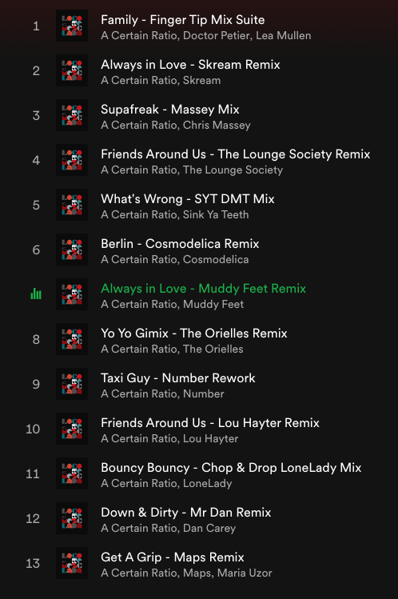

<iframe loading="lazy" style="border-radius:12px" src="https://open.spotify.com/embed/playlist/4fysPEW9z1PzJAEG7ez5ta?utm_source=generator" width="100%" height="380" frameborder="0" allowfullscreen="" allow="autoplay; clipboard-write; encrypted-media; fullscreen; picture-in-picture"></iframe>

<h1 class="wp-block-heading">A Certain Ratio - Loco Remezclada</h1>

<figure class="wp-block-table"><table><tbody><tr><td class="has-text-align-center" data-align="center">?</td><td class="has-text-align-center" data-align="center">?</td></tr><tr><td class="has-text-align-center" data-align="center">8</td><td class="has-text-align-center" data-align="center">5</td></tr></tbody></table><figcaption>A Certain Ratio - Loco Remezclada Score</figcaption></figure>

<strong>What is the point of a remix album?</strong>

For me, the Maria Uzor &amp; Sync Your Teeth tracks got me listening (and buying vinyl) of<a href="https://www.instagram.com/acr.mcr/" target="_blank" rel="noreferrer noopener"> <strong>A Certain Ratio</strong></a>. Without Sync Your Teeth I may never have discovered <strong>A Certain Ratio. </strong>For me - the remix album is more interesting than many of the original tracks. 

<strong>Get A Grip - Maps Remix </strong>is such a great stand out song. While also answering the question - what is the point of a remix album 

<h3 class="wp-block-heading">I did rearrange the playlist order, and am enjoying the album better. </h3>

<figure class="wp-block-image aligncenter size-full is-style-default"></figure>

<h3 class="wp-block-heading">Track by Track - original arrangement</h3>

? #1 <strong>Down &amp; Dirty - Mr Dan Remix</strong> Who is the female on Vocals (pumping track) Opening Tracking is a thumbing bangers ? #2 <strong>Friends Around Us - Lou Hayter Remix </strong> Not sure why this track is the second track. It's a complete mood killer. Seriously, following a banger. At the best of times this track could have stopped much sooner. ? <strong>#3 Bouncy Bouncy - Chop &amp; Drop LoneLady Mix</strong> Uneventful - with time it may be a grower. But, why have to wait when there is already so much good music to listen to. If there were more to the track (like a Kate Bush or EBTG track that reveals something deeper. The investment justified. ? <strong>#4</strong> <strong>Yo Yo Gimix - The Orielles Remix </strong> Maybe I signed up for the wrong party. The first track set up a certain tone that has quickly disappeared into the vast past of forgetfulness. ? <strong>#5 Supafreak - Massy Mix  </strong> One of the least player tracks from the album - but certainly one of the stronger tunes. Good balance of vocals and driving beat. Could file into a Happy Monday's track - ? <strong>#6</strong> <strong>Always in Love - Skream Remix</strong>  New Order could have released the beat for this song. The female vocals are not quite aligning with the song which only is confirmed once the guy begins to sing - the effect on his voice would have sounded great on her vocals as well. ? <strong>#7 Family - Finger Tips Mix Suite </strong> YES YES YES - now that's how you do an intro. No one was expecting any of these vocals. Booming along with a funk bass line. This should have been the second track (if not the leading track). Reminds me of Prince 12" - with seperate parts to the track (does sound like the bass line from Alp. Street. I do wish there was more of this vibe during track 2-4 - getting down without feeling completely down. Best tune. ? <strong>#8</strong> <strong>Get a Grip - Maps Remix </strong> I can not lie. Maria Uzor got me here. And I love that vinyl (it's brilliant). This mix may not be my favorite - there is something really interesting about the track. The vocals are used wonderfully - unexpected. ? <strong>#9</strong> <strong>Berlin - Cosmodelica Remix </strong> Another pumping tune. This song does make me want to listen to the original album ? <strong>#10</strong> <strong>What's Wrong - SYT DMT Mix</strong> Right from the first few beats and bassline. What's Wrong (SYT DMT mix) could easily be an early Sasha track. You really can't go wrong with Maria Uzor and Gemma Cullingford on vocals. ? <strong>#11 Taxi Driver - Number Reworks </strong> Without the horn I may have completely missed "Taxi Guy" ? <strong>#12 Always in Love - Muddy Feet Remix</strong> The first minute in that voice pops in (these tracks should have been arrayed differently). By the second minute I am hoping the track will go somewhere. By the third minute I realize that there is another 4 minutes on this one. I couldn't do it - I had to skip to the next track. ? <strong>#13 Friends Around Us - The Lounge Society Remix </strong> The horn is maybe the best element on this album. The intro is solid followed with that funky bassline. There is something exciting about "Friends Around Us"

