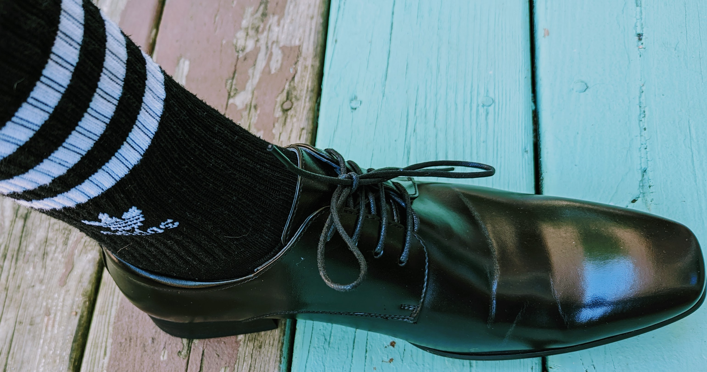

Cocteau Twins news keeps coming across my recent feed - mostly about solo projects. It was with great surprise that when I started to listen to Robin Gurthrie today, he was one of the hundred artists on my playlist. And like most of what I do, I let Google select a random number between 3 and 99. Google selected the #36 - Robin Guthrie. 

<h2 class="wp-block-heading">Vast Music Catalog</h2>

With 13 full albums ranging from 2003 to 2021, it is hard to know where to jump in. This playlist may take awhile to build. After listening to Pearldiving and 3:19 Soundtrack, I kinda want to jump into the Robin Guthrie catalog from the beginning. Yes, <strong>Imperial </strong>released in 2003. 

<iframe loading="lazy" style="border-radius:12px" src="https://open.spotify.com/embed/playlist/1YAzXL7wXadjD2xbgsslit?utm_source=generator" width="100%" height="380" frameborder="0" allowfullscreen="" allow="autoplay; clipboard-write; encrypted-media; fullscreen; picture-in-picture"></iframe>

<strong>Link to Playlist</strong> - <a href="https://open.spotify.com/playlist/1YAzXL7wXadjD2xbgsslit?si=e5cc82c70718442c" target="_blank" rel="noreferrer noopener">https://open.spotify.com/playlist/1YAzXL7wXadjD2xbgsslit?si=e5cc82c70718442c</a>

<figure class="wp-block-image size-large is-style-rounded"><figcaption>Robin Guthrie Playlist</figcaption></figure>

Interested in what else I am listening to? Check out my other music overviews.  <a href="https://betterworldwithdesign.com/category/music-i-am-listening-to/">https://betterworldwithdesign.com/category/music-i-am-listening-to/</a>

