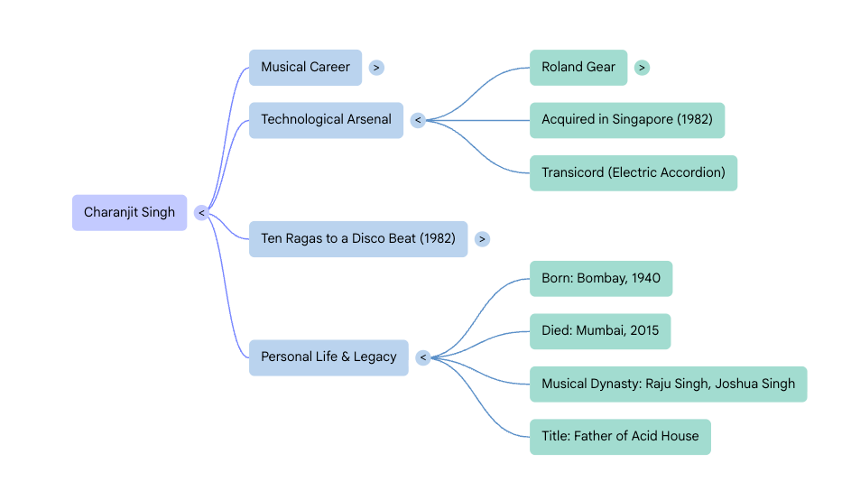
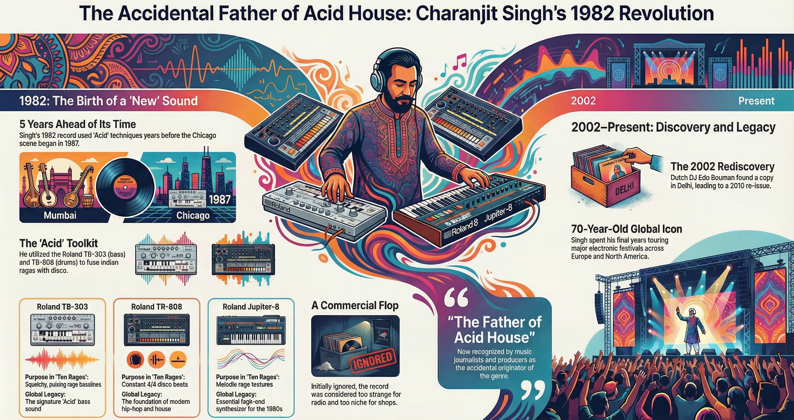

<!-- wp:image {"id":7164,"sizeSlug":"full","linkDestination":"none"} -->

<figure class="wp-block-image size-full"></figure>

<!-- /wp:image -->

<!-- wp:html --> 
<iframe loading="lazy" width="100%" height="180" frameborder="no" scrolling="no" seamless="" src="https://share.transistor.fm/e/f8c188b6"></iframe> 
<!-- /wp:html -->

<!-- wp:heading {"level":3} -->

<h3 class="wp-block-heading">The Hook: A Mystery in a Mumbai Studio</h3>

<!-- /wp:heading -->

<!-- wp:paragraph -->

In the spring of 1982, inside a modest recording studio in Mumbai’s coastal Cuffe Parade, a session musician named Charanjit Singh sat surrounded by a new suite of Roland electronics: the TB-303, the TR-808, and the Jupiter-8.

<!-- /wp:paragraph -->

<!-- wp:paragraph -->

I’m not coming to this story as a detached historian.

<!-- /wp:paragraph -->

<!-- wp:paragraph -->

I’m building <strong>Answer Engine Music</strong> right now. I’m writing songs with an acid house and trip hop foundation, and I’m paying attention to the moments when technology stops feeling like gear and starts feeling like a <em>language</em>.

<!-- /wp:paragraph -->

<!-- wp:paragraph -->

That is what pulled me into Singh’s story.

<!-- /wp:paragraph -->

<!-- wp:paragraph -->

He wasn’t trying to spark a global revolution or dismantle Western dance music. He was a working musician inside the Bollywood machine, experimenting with how new gadgets might breathe modern life into ancient structures.

<!-- /wp:paragraph -->

<!-- wp:paragraph -->

This was no random "happy accident" born of amateur fumbling. Singh had purchased these machines in Singapore and, with the meticulous discipline of a master craftsman, spent an entire year studying the manuals before ever laying down a track. He was a man obsessed with technical mastery, and he approached these proto-techno tools with the same rigor he applied to the violin or the steel guitar.

<!-- /wp:paragraph -->

<!-- wp:paragraph -->

What emerged from those sessions was an album titled <em>Synthesizing: Ten Ragas to a Disco Beat</em>. Recorded over a mere two days, the project was a daring fusion that replaced traditional percussion with steady electronic pulses. Singh’s central irony lies in his intent: he believed he was merely modernizing Indian classical traditions for a contemporary audience, unknowingly distilling the acid-drenched frequencies of a global subculture that wouldn't even have a name for another five years.

<!-- /wp:paragraph -->

<!-- wp:heading {"level":3} -->

<h3 class="wp-block-heading">The Timeline Glitch: Mumbai Beats Chicago by Five Years</h3>

<!-- /wp:heading -->

<!-- wp:paragraph -->

The history of electronic music typically places the birth of Acid House in Chicago around 1987, credited to pioneers like Phuture and their seminal "Acid Trax." However, Charanjit Singh’s 1982 release creates a startling chronological glitch. <em>Ten Ragas to a Disco Beat</em> utilized the exact same sonic palette—the liquid, "squelchy" basslines of the TB-303 and the rigid, hypnotic drum patterns of the TR-808—half a decade before the sound took over the Western underground.

<!-- /wp:paragraph -->

<!-- wp:paragraph -->

WIn the spring of 1982, a session musician named Charanjit Singh sat in a modest studio in Mumbai’s coastal Cuffe Parade. Around him: a new suite of Roland electronics, including the TB-303, the TR-808, and the Jupiter-8.

<!-- /wp:paragraph -->

<!-- wp:paragraph -->

I’m not coming to this story as a detached historian.

<!-- /wp:paragraph -->

<!-- wp:paragraph -->

Right now, I’m building <strong>Answer Engine Music</strong>. I’m writing songs with an acid house and trip hop foundation. Along the way, I’m watching for the moment when technology stops feeling like gear and starts feeling like a <em>language</em>.

<!-- /wp:paragraph -->

<!-- wp:paragraph -->

That is what pulled me into Singh’s story.

<!-- /wp:paragraph -->

<!-- wp:paragraph -->

Singh wasn’t trying to spark a global revolution or dismantle Western dance music. Instead, he worked inside the Bollywood machine and experimented with how new gadgets could breathe modern life into ancient structures.

<!-- /wp:paragraph -->

<!-- wp:paragraph -->

This was no random “happy accident” born of amateur fumbling. After buying the machines in Singapore, Singh studied the manuals for a full year before recording a single track. That discipline mattered. He approached these proto-techno tools with the same rigor he applied to the violin and steel guitar.

<!-- /wp:paragraph -->

<!-- wp:paragraph -->

What emerged was an album titled <em>Synthesizing: Ten Ragas to a Disco Beat</em>. Singh recorded it in two days. Even so, it was a daring fusion that swapped traditional percussion for steady electronic pulses. Here is the irony: Singh thought he was modernizing Indian classical traditions for a contemporary audience. In reality, he had distilled the acid-drenched frequencies of a global subculture that would not have a name for another five years.

<!-- /wp:paragraph -->

<!-- wp:heading {"level":3} -->

<h3 class="wp-block-heading">The Timeline Glitch: Mumbai Beats Chicago by Five Years</h3>

<!-- /wp:heading -->

<!-- wp:paragraph -->

Most electronic music histories place the birth of acid house in Chicago around 1987. They often credit pioneers like Phuture and the seminal “Acid Trax.” However, Charanjit Singh’s 1982 release creates a startling chronological glitch. <em>Ten Ragas to a Disco Beat</em> utilized the exact same sonic palette—the liquid, "squelchy" basslines of the TB-303 and the rigid, hypnotic drum patterns of the TR-808—half a decade before the sound took over the Western underground.

<!-- /wp:paragraph -->

<!-- wp:paragraph -->

When the album was first rediscovered and shared in the digital age, the "unintended alchemy" of the sound was so advanced that many listeners initially dismissed it as a hoax or a modern forgery. The recording quality was too high, the 303 manipulation too "correct," and the vibe too contemporary to be a relic of early-80s Mumbai. This discovery forces a radical shift in the narrative of electronic music, challenging the assumption that these sounds were a purely Western innovation. As music historians have recently noted:

<!-- /wp:paragraph -->

<!-- wp:paragraph -->

"Earlier historians considered Chicago to be the birthplace of acid house. Decades later, however, they found that it was Mumbai all along."

<!-- /wp:paragraph -->

<!-- wp:heading {"level":3} -->

<h3 class="wp-block-heading">The "Accidental" Innovation: Ragas, Not Rave</h3>

<!-- /wp:heading -->

<!-- wp:paragraph -->

Even though people later crowned him the “Father of Acid House,” Singh’s motivations stayed rooted in classical utility. To a musicologist, the brilliance of the album lies in its technical synthesis. Singh chose ragas because their melodic notes are fixed; this allowed him to program complex melodic variations on the Jupiter-8 while the TB-303 provided a steady, mathematical bassline. He replaced the traditional <em>tabla</em> with a 4/4 disco beat, not for the dancefloor, but because he found the four-on-the-floor rhythm "universal" and "steady," allowing for a continuous, unbroken variation of the raga.

<!-- /wp:paragraph -->

<!-- wp:paragraph -->

&nbsp;

<!-- /wp:paragraph -->

<!-- wp:image {"id":7167,"sizeSlug":"full","linkDestination":"none"} -->

<figure class="wp-block-image size-full"></figure>

<!-- /wp:image -->

<!-- wp:paragraph -->

Singh was famously unimpressed when finally introduced to the actual Acid House movement decades later. When played the tracks that defined the Chicago scene, he noted they were "quite simple" compared to the intricate melodic variations of Hindustani ragas. Where the West saw a revolution in minimalism, Singh saw a simplified version of his own classical training. For him, the machines were just a way to keep the tradition alive without a full orchestra:

<!-- /wp:paragraph -->

<!-- wp:paragraph -->

"I thought why not do something different... give the beat a disco beat – and turn off the tabla."

<!-- /wp:paragraph -->

<!-- wp:heading {"level":3} -->

<h3 class="wp-block-heading">The Secret Architect of Bollywood's Golden Era</h3>

<!-- /wp:heading -->

<!-- wp:paragraph -->

Long before he became an international cult icon, Charanjit Singh was an essential, if invisible, pillar of the Bollywood music industry. He was the "first call" musician for any composer seeking a modern, electronic edge. His technical "fingerprints" are across the most iconic soundtracks of the 1970s and 80s, serving legends like R.D. Burman and Laxmikant–Pyarelal.

<!-- /wp:paragraph -->

<!-- wp:heading {"level":3} -->

<h3 class="wp-block-heading">The fingerprints hiding in plain sight</h3>

<!-- /wp:heading -->

<!-- wp:paragraph -->

Singh was a multi-instrumental master whose presence often dictated the entire production schedule. He provided the piercing drone and electric accordion (transicord) intro to the legendary "Dum Maro Dum," the organ riffs on "Piya Tu Ab To Aaja," the swirling keyboard work on "Meri Umar Ke Naujawano," and the delicate guitar and keys on "Chura Liya Hai Tumne Jo Dil Ko." He even contributed the evocative synthesizer textures to the <em>Sholay</em> classic "Mehbooba Mehbooba." His 1982 experiment wasn't a fluke; it was the output of an industry giant who had helped define the sound of Indian cinema for three decades.

<!-- /wp:paragraph -->

<!-- wp:heading {"level":3} -->

<h3 class="wp-block-heading">The 20-Year Vanishing Act and the Dutch Discovery</h3>

<!-- /wp:heading -->

<!-- wp:paragraph -->

For twenty years, <em>Ten Ragas to a Disco Beat</em> was a ghost. It was a commercial flop, too strange for 1982 Indian radio and too niche for the local market. Its resurrection occurred in 2002, when Dutch DJ and crate-digger Edo Bouman discovered a copy in a dusty corner of a Delhi record store. Bouman was stunned to find a record from the early 80s that captured the exact "acid" squelch that wouldn't reach the West for years.

<!-- /wp:paragraph -->

<!-- wp:paragraph -->

After tracking Singh down in Mumbai—who was genuinely surprised anyone remembered the project—Bouman re-issued the album in 2010. It quickly attained "holy grail" status on internet forums and among elite producers. Figures like Four Tet, Caribou, and even Aphex Twin have been linked to the orbit of his influence, recognizing the album as a missing link in the evolution of global synthesis.

<!-- /wp:paragraph -->

<!-- wp:image {"id":7169,"sizeSlug":"large","linkDestination":"none","align":"wide"} -->

<figure class="wp-block-image alignwide size-large"></figure>

<!-- /wp:image -->

<!-- wp:heading {"level":3} -->

<h3 class="wp-block-heading">The Ultimate Second Act: From Retirement to Berghain</h3>

<!-- /wp:heading -->

<!-- wp:paragraph -->

The final chapter of Singh’s life was his most surreal. In his 70s, the soft-spoken, bespectacled senior citizen—a man who looked more like he belonged on a neighborhood park bench than a nightclub—was suddenly booked to play the world’s most prestigious techno venues. In 2013, he performed at Berlin’s Berghain, the "mecca of techno," where a young audience watched him recreate his 1982 ragas on his original Roland gear.

<!-- /wp:paragraph -->

<!-- wp:paragraph -->

Touring Europe and North America, Singh proved to be a natural showman. He fed off the energy of crowds less than half his age, standing behind his synthesizers with a focus that bridged the gap between a classical recital and a warehouse rave. He viewed his late-career resurgence not as a bewildering accident, but as a continuation of his life’s work.

<!-- /wp:paragraph -->

<!-- wp:paragraph -->

"When I am in music I get a lot of energy... I don't care about my age."

<!-- /wp:paragraph -->

<!-- wp:heading {"level":3} -->

<h3 class="wp-block-heading">A Legacy of Intentional Curiosity</h3>

<!-- /wp:heading -->

<!-- wp:paragraph -->

Charanjit Singh passed away in 2015, leaving behind a legacy that redefined the geography of electronic music. He stands as a bridge between the ancient mathematical rigor of Eastern classical structures and the cold, clicking precision of Western technology. Singh’s story is a masterclass in technological convergence—how a tool like the TB-303, originally intended as a mere bass accompaniment for guitarists, found its true soul in the hands of an Indian session master who ignored the "rules."

<!-- /wp:paragraph -->

<!-- wp:paragraph -->

It leaves one to wonder: how many other accidental masterpieces are sitting unnoticed in the corners of the world, waiting for a listener with the right ear to recognize the future?

<!-- /wp:paragraph -->

<!-- wp:paragraph -->

For me, that question lands close.

<!-- /wp:paragraph -->

<!-- wp:paragraph -->

If Singh could take a “utility” box like the TB-303 and translate it into something timeless, then my job is not to copy a genre.

<!-- /wp:paragraph -->

<!-- wp:paragraph -->

My job is to listen harder.

<!-- /wp:paragraph -->

<!-- wp:paragraph -->

To keep chasing <strong>hypnotic repetition</strong>, <strong>expressive texture</strong>, and <strong>a sense of place</strong> until the track stops sounding like a reference and starts sounding like <em>me</em>.

<!-- /wp:paragraph -->

