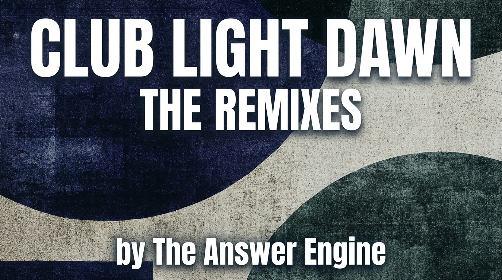

<h2 style="text-align: center;">CLUB LIGHT DAWN</h2>

<iframe loading="lazy" title="YouTube video" width="1080" height="608" src="https://www.youtube.com/embed/cNlBZOepJKw?feature=oembed" allow="accelerometer; autoplay; clipboard-write; encrypted-media; gyroscope; picture-in-picture; web-share" referrerpolicy="strict-origin-when-cross-origin" allowfullscreen></iframe>

<h2>Extended Versions and Remixes</h2>

An extended Club Floor Edit was created for the song, running 7-8 minutes with a tempo increased to 122-126 BPM for peak-time club play. This version features euphoric progressive house meets melodic techno with trip-hop soul influences, maintaining the emotional journey while building to massive drops and extended dance breaks.

The club mix arrangement includes an atmospheric intro, maintains the emotional intimacy of verses while building energy, and features a bridge breakdown that strips back to minimal production before the dance break peak—the absolute moment of euphoria unleashed on the dancefloor.

<!-- notionvc: 0a0d29ed-cd16-47d4-b125-19f1a67a14c8 -->

Club Light Dawn ("Enlightening Dawn") is a personal exploration of resilience, heartbreak, and the transformative power of dancing through pain. This trip-hop inspired track weaves together vivid imagery of purple petals, golden moonlight, and club lights at dawn to create a sonic landscape where vulnerability becomes strength.<!-- notionvc: b89b7424-d681-4091-b97b-b8662546d295 -->

<h2>The Story Behind "Enlightening Dawn"</h2>

At its core, "Enlightening Dawn" captures the bittersweet experience of dancing through heartbreak in neon-lit spaces, painting scars with club lights while waiting for the dawn of renewal. The song explores themes of failed romance, self-discovery, and the courage to keep moving forward despite repeated disappointments.

The narrative centers on a complicated relationship with someone named Matt White—sitting on his floor watching him paint, feeling weak from his simple phrases, experiencing tears and celestial smiles with ruling lips. The lyrics juxtapose tender moments of connection with the pain of emotional manipulation, creating a story that feels both deeply personal and universally relatable.

The production mirrors this emotional journey, starting with intimate verses that bloom into anthemic choruses, underscored by club-ready beats that invite both reflection and release. Purple petals, golden moonlight, and scarlet rosebuds serve as recurring visual metaphors throughout, building a rich symbolic landscape of longing, tenderness, and transformation.

<!-- notionvc: 42fbb2f4-bccb-4919-b2aa-fd3af91a7eb6 -->

<h2>Musical Style and Production</h2>

The song draws inspiration from trip-hop and downtempo electronic music, with influences from artists like Portishead and Everything But The Girl. The production features deep, pulsing basslines with sub-bass undertones, atmospheric synth pads creating ethereal textures, and vintage Rhodes or Wurlitzer electric piano for warmth. Sparse, deliberate drums with heavy reverb on snares combine with vinyl crackle and tape hiss for nostalgic texture, while string arrangements add cinematic, sweeping moments.

The vocal style is breathy and intimate, with layers of harmonies that blend vulnerability with strength. The production emphasizes heavy use of space and silence, letting the track breathe with analog warmth and digital precision. Sidechain compression on pads creates rhythmic pulsing, while dub-influenced delay and reverb on vocals enhance the film noir atmosphere—smoky, late-night, and urban.

<h2><!-- notionvc: 8f113632-4415-47d7-9ad5-7c15f0897b30 --></h2>

<!-- notionvc: 42fbb2f4-bccb-4919-b2aa-fd3af91a7eb6 -->

<iframe data-testid="embed-iframe" style="border-radius:12px" src="https://open.spotify.com/embed/album/3INgT6QwObmTAGLoj9WrEJ?utm_source=generator" width="100%" height="452" frameBorder="0" allowfullscreen="" allow="autoplay; clipboard-write; encrypted-media; fullscreen; picture-in-picture" loading="lazy"></iframe>

<iframe data-testid="embed-iframe" style="border-radius:12px" src="https://open.spotify.com/embed/track/0y4FiaZBLCV1IK0JgUqM7g?utm_source=generator" width="100%" height="252" frameBorder="0" allowfullscreen="" allow="autoplay; clipboard-write; encrypted-media; fullscreen; picture-in-picture" loading="lazy"></iframe>

<a class="et_pb_button_3 et_pb_button et_pb_bg_layout_light et_pb_module et_flex_module" href="https://open.spotify.com/artist/0ABWAxqIZiHC6ScjYmM6Ch?si=FbsxxjxxSDmceu5AXZM7Zg">Listen to The Answer Engine</a>

