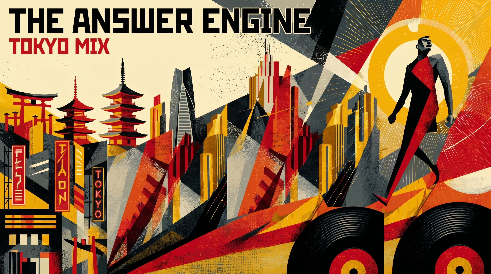
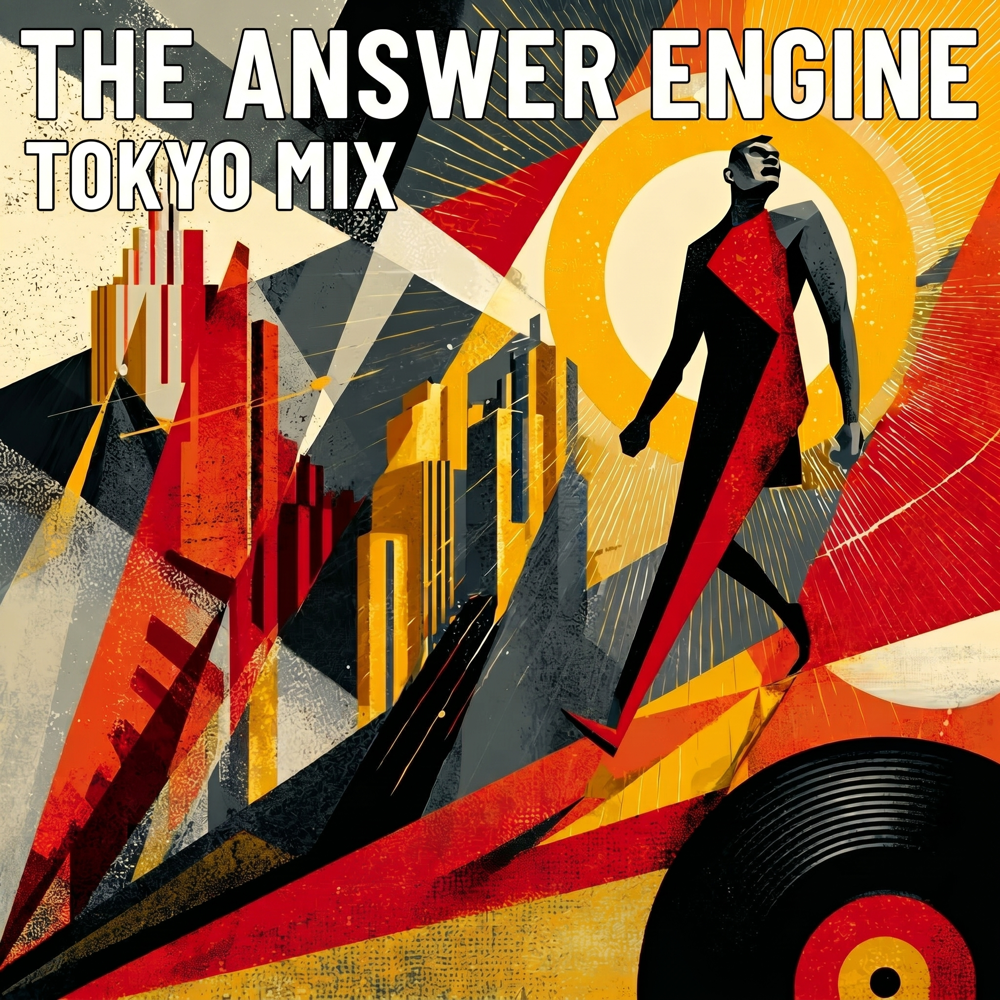

<figure class="wp-block-image aligncenter size-large"></figure>

<iframe data-testid="embed-iframe" style="border-radius:12px" src="https://open.spotify.com/embed/track/0pPRMMWLMnvX2Wee1xVyD7?utm_source=generator" width="100%" height="152" frameBorder="0" allowfullscreen="" allow="autoplay; clipboard-write; encrypted-media; fullscreen; picture-in-picture" loading="lazy"></iframe>

<h2 class="wp-block-heading">The Answer Engine — Tokyo Mix (DJ mix)</h2>

<em>The mix series continues: four tracks for late-night reflection, forward motion, and the quiet work of becoming honest with yourself.</em>

If <em>The Answer Engine</em> is my long-form project about turning the archive into music—journals into lyrics, memory into sound—then the mixes are where that world gets rearranged. Same themes, different lighting. Different pacing. Different weather.

Tokyo Mix is a small, focused sequence built around a particular mood: the feeling of motion without certainty. The feeling of being in transit—through a city, through a season, through a version of yourself that’s starting to wear thin.

I wanted this to live in the zone where trip-hop, downtempo, and late-night electronic mood music overlap—music with patience, texture, and space to think. A mix that doesn’t try to “win” your attention so much as <em>hold it</em>, quietly, long enough for something to loosen.

<h2 class="wp-block-heading" id=":rj1b:">Tracklist (Tokyo Mix)</h2>

<ul class="wp-block-list">
<li>Stop Pushing Forward (Extended Mix)</li>

<li>The Record Kept Spinning (303 Mix)</li>

<li>Trust Yourself</li>

<li>Club Light Dawn (Tokyo Mix)</li>
</ul>

<h3 class="wp-block-heading" id=":rj1g:">Stop Pushing Forward (Extended Mix)</h3>

This track feels like a thesis statement: stop forcing momentum and start choosing direction.

It’s built on a slow, hypnotic boom-bap groove—head-nod tempo, deep sub-bass, that trip-hop sense of dim light and internal monologue. The voice is intimate and worn-in, delivered in spoken word: not performing at you, more like speaking <em>from inside the room</em>.

The sound design matters here. Scratches, backspins, stutter edits, chopped syllables—the DJ language isn’t decoration, it’s the method. The edits become percussion. The track’s insistence is subtle but clear: you can keep moving and still be lost.

<h3 class="wp-block-heading" id=":rj1k:">The Record Kept Spinning (303 Mix)</h3>

This is the “keep going” track—steady motion, but not the kind that pretends everything is fine.

Four-on-the-floor pulse, minimalist structure, and a bassline that feels like determination rather than celebration. The vocal sits in that space I keep returning to across <em>The Answer Engine</em>: breathy, close, slightly distant at the same time—like a memory talking.

Lyrically it plays with road and car metaphors—escape, pressure, the moment you realize you’re trying to outdrive something you actually have to name. It’s danceable, but emotionally it’s still looking over its shoulder.

<h3 class="wp-block-heading" id=":rj1o:">Trust Yourself</h3>

“Trust Yourself” is the emotional center of the Tokyo Mix—an introspective trip-hop cut that blends R&amp;B warmth with downtempo spaciousness.

The groove is slow and grounded: punchy kick, crisp snare, vinyl crackle giving it that lived-in grain. A smooth bassline holds the harmony while jazzy electric piano chords and shimmering pads open the track into something dreamlike—like a room you can’t quite find the door to.

But the defining element is the vocal. Soft, smoky, intimate—delivered with a vulnerability that feels unguarded, not theatrical. The recurring phrase “trust yourself” becomes less a hook than a survival line: something you repeat because you need it to become true.

There’s also a shift that I love: the song moves from melancholic self-doubt toward something closer to defiance, including a rawer spoken section filtered into that lo-fi “telephone” distance. It’s still quiet—but it’s not passive.

<h3 class="wp-block-heading" id=":rj1t:">Club Light Dawn (Tokyo Mix)</h3>

This track is a bridge into what’s coming later this year.

I’ve been working on a Club Light Dawn reworking with Japanese vocals, and the Tokyo Mix version is where that thread starts to show. I’ve been learning Japanese, and translating the song has been a surprisingly intense process—not just swapping words, but re-understanding what the song actually <em>means</em> when you have to rebuild it from the ground up.

Translation forces clarity. It exposes which lines were doing real emotional work, and which lines were just atmosphere. It also changes the feeling in your mouth when you sing it—different rhythm, different weight, different kind of honesty.

<figure class="wp-block-image alignright size-large is-resized"></figure>

The official single version is on the way later this year, but Tokyo Mix is the first glimpse of that direction.

<h3 class="wp-block-heading" id=":rj22:">What this mix is really asking</h3>

Underneath the versions and BPMs, Tokyo Mix keeps circling the same question:

What happens when you stop worshipping “forward” as a virtue—

and start asking <em>toward what?</em>

That’s the larger engine behind <em>The Answer Engine</em> project for me: not nostalgia, not aesthetic moodboarding, but the hard, sometimes unglamorous work of meaning-making. Using sound and voice as a way to tell the truth sideways—so it can get past your defenses.

If you listen straight through, I hope it feels like one continuous piece: four scenes, same night, different angles.

