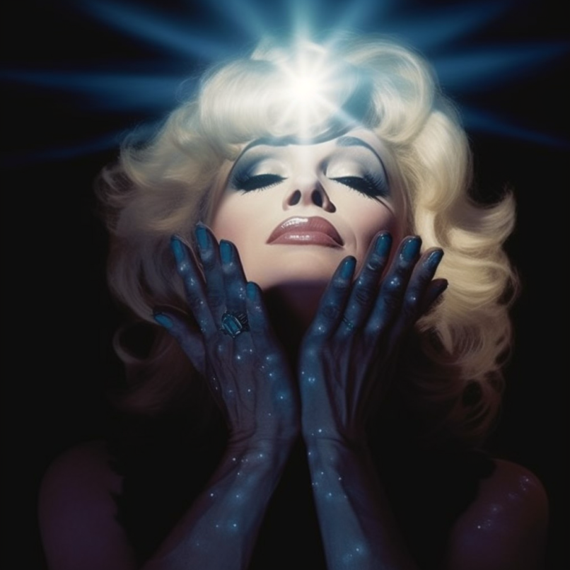

<figure class="wp-block-image aligncenter size-full"></figure>

<h3 class="wp-block-heading">Dolly Parton - 9 to 5 (Dance Mix) </h3>

<figure class="wp-block-embed is-type-video is-provider-youtube wp-block-embed-youtube wp-embed-aspect-16-9 wp-has-aspect-ratio">

<iframe loading="lazy" title="Dolly Parton (preforming at Oscars) 9 to 5 Club Dance Remix - (DMC DJ Only)" width="1080" height="608" src="https://www.youtube.com/embed/_VDhvQCUe8M?feature=oembed" frameborder="0" allow="accelerometer; autoplay; clipboard-write; encrypted-media; gyroscope; picture-in-picture; web-share" referrerpolicy="strict-origin-when-cross-origin" allowfullscreen></iframe>

</figure>

As a visual artist and former DJ, I'm always looking for ways to explore my creativity. One of my favorite projects from my DJ days was making video mashup that combined music and visuals that I would include during my set. This Dolly Parton Video was always a crowd favorite and floor filler every time. 

I drew inspiration for the video from different sources.  

<ul class="wp-block-list">
<li>Dolly's Oscar performance of 9 to 5</li>

<li>Clips of Madonna</li>

<li>John Travolta's fancy cowboy footwork</li>
</ul>

Over 60,000 plays on YouTube  (only the occasional bad review)   

<a class="wp-block-button__link has-text-align-center wp-element-button" href="https://www.youtube.com/watch?v=_VDhvQCUe8M" target="_blank" rel="noreferrer noopener">Click to Subscribe to My YouTube Channel</a>

